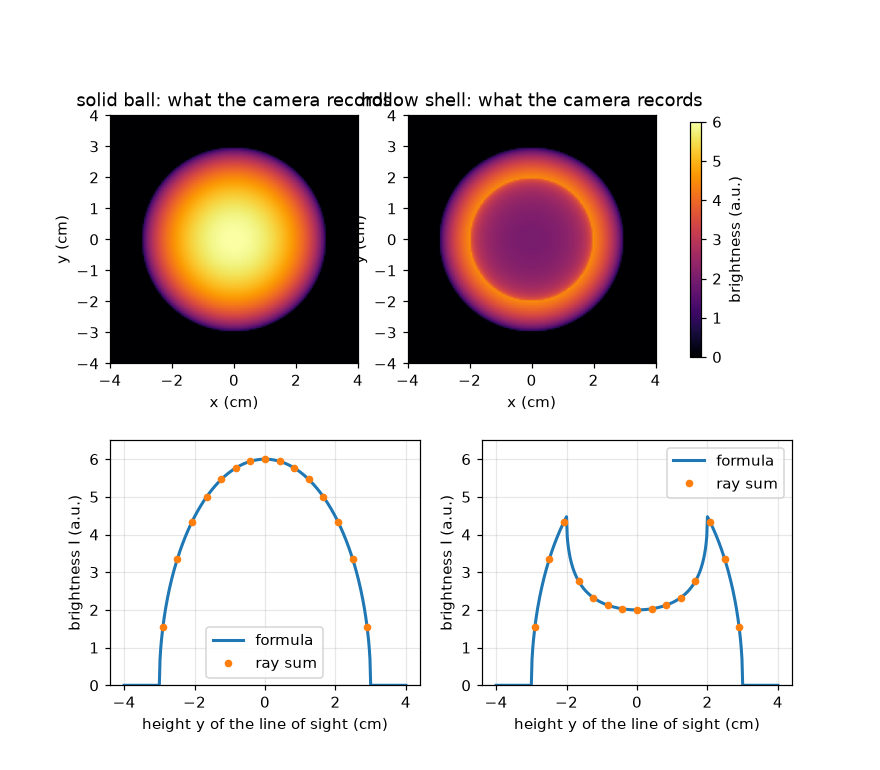
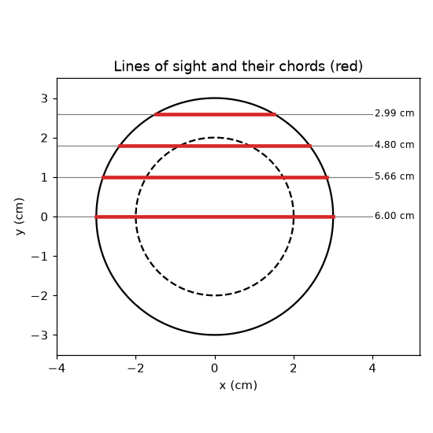

# सत्र 1: एक फ़ोटो हर दृष्टि-रेखा के साथ आने वाले प्रकाश को जोड़ती है

*स्तर 1 (संकल्पनात्मक इंटरैक्टिव मॉडल) · लगभग 60 मिनट · openabel*

> यह एक सरलीकृत शैक्षिक मॉडल है। यह कोई प्रमाणित डिज़ाइन टूल नहीं है और इसका उपयोग वास्तविक संरचनाओं, विद्युत स्थापनाओं, वाहनों, औद्योगिक प्रक्रियाओं या चिकित्सा निर्णयों के लिए नहीं किया जाना चाहिए।

**पूर्व-आवश्यकताएँ (Prerequisites)**

- पाइथागोरस प्रमेय (Pythagoras' theorem)।
- आपने PRIMER.md पढ़ लिया है और `python start.py 1` एक बार चला लिया है।

**सीखने के उद्देश्य (Learning objectives)।** इस सत्र के बाद आप:

- समझा सकेंगे कि कैमरे का एक पिक्सेल (pixel) एक बिंदु नहीं, बल्कि पूरी दृष्टि-रेखा (line of sight) के साथ योग क्यों दर्ज करता है।
- किसी गोले से होकर जाने वाली जीवा (chord) की लंबाई और समान रूप से चमकते गोले का चमक प्रोफ़ाइल (brightness profile) निकाल सकेंगे।
- किसी सूत्र को किरण के साथ सीधे-सीधे (brute-force) किए गए योग से जाँच सकेंगे।
- समझा सकेंगे कि एक खोखला चमकता कोश (hollow glowing shell) अपने किनारे के पास सबसे चमकीला क्यों दिखता है।

## A. वास्तविक दुनिया की समस्या
मोमबत्ती की लौ एक 3D चमकता हुआ पिंड है, पर उसकी फ़ोटो सपाट होती है। हर पिक्सेल लौ का एक बिंदु नहीं देखता: वह कैमरे से लौ के आर-पार जाने वाली रेखा के साथ बना सारा प्रकाश देखता है। जब हम किसी चमकते गोले को बगल से देखते हैं तो एक पिक्सेल कितना चमकीला होता है, और एक खोखला गोला ठोस गोले से अलग क्यों दिखता है? (यह इमेजिंग के बारे में सामान्य शिक्षा है, किसी भी सुरक्षा निर्णय के लिए मापन विधि नहीं।)

## B. संकल्पना और सिद्धांत
त्रिज्या R वाले एक गोले को बगल से देखिए। मध्य से ऊँचाई y पर एक दृष्टि-रेखा गोले से होकर एक सीधे खंड के साथ गुज़रती है जिसे जीवा (chord) कहते हैं। यदि गोला हर जगह समान रूप से उत्सर्जन (emission) eps0 के साथ चमकता है (पथ के प्रति सेंटीमीटर बना प्रकाश, मनमानी इकाइयों a.u. प्रति cm में), तो पिक्सेल eps0 गुणा जीवा की लंबाई दर्ज करता है। समकोण त्रिभुज (आधी जीवा, y, R) पर पाइथागोरस लगाने से जीवा मिलती है। खाली भीतरी त्रिज्या r_in वाले खोखले कोश के लिए, छेद से होकर जाने वाली जीवा घटा दीजिए। किसी रेखा के साथ एक राशि को जोड़ना रेखा समाकल (line integral) कहलाता है; यहाँ उत्सर्जन स्थिर है, इसलिए यह बस उत्सर्जन गुणा लंबाई है।

| प्रतीक | अर्थ | इकाई |
|---|---|---|
| R | गोले की बाहरी त्रिज्या | cm |
| r_in | खाली छेद की भीतरी त्रिज्या (ठोस गोले के लिए 0) | cm |
| y | मध्य से दृष्टि-रेखा की ऊँचाई | cm |
| eps0 | उत्सर्जन: पथ के प्रति cm बना प्रकाश | a.u. per cm |
| I(y) | ऊँचाई y पर पिक्सेल द्वारा दर्ज चमक | a.u. |

**मान्यताएँ (Assumptions)**

- वस्तु एक आदर्श गोला है जिसके चमकते क्षेत्र के भीतर हर जगह समान चमक है।
- वस्तु पारदर्शी है: रास्ते में बना प्रकाश अवशोषित (absorbed) या प्रकीर्णित (scattered) नहीं होता।
- कैमरा समानांतर दृष्टि-रेखाओं के साथ देखता है (एक दूर स्थित, आदर्श कैमरा)।

$$ \mathrm{chord}(y,R)=2\sqrt{R^2-y^2}\quad(|y|<R),\qquad 0\ \text{otherwise} $$

$$ I(y)=\varepsilon_0\,\mathrm{chord}(y,R)\quad\text{(solid ball)} $$

$$ I(y)=\varepsilon_0\big(\mathrm{chord}(y,R)-\mathrm{chord}(y,r_\mathrm{in})\big)\quad\text{(hollow shell)} $$

## C. दृश्य व्याख्या
पहला चित्र एक ठोस गोले की कैमरा फ़ोटो दिखाता है (बीच में सबसे चमकीला, eps0 = 1 a.u. per cm और R = 3 cm के लिए 6 a.u.), उसके बगल में भीतरी त्रिज्या 2 cm वाला एक खोखला कोश है: कोश का बीच का भाग गहरा (2 a.u.) है और y = 2 cm पर एक चमकीला वलय (4.47 a.u.) है। हर फ़ोटो के नीचे चमक प्रोफ़ाइल है; बिंदु किरणों के साथ brute-force योग हैं और ठीक सूत्र पर बैठते हैं। दूसरा चित्र गोले से होकर चार दृष्टि-रेखाएँ उनकी जीवा-लंबाइयों के साथ लाल रंग में दिखाता है: बीच से जाने वाली रेखा सबसे लंबी है, किनारे के पास वाली रेखा छोटी है।

*एक ठोस चमकते गोले और एक खोखले कोश की कैमरा फ़ोटो और चमक प्रोफ़ाइल (बिंदु: brute-force किरण योग)।*

*एक गोले से होकर चार दृष्टि-रेखाएँ और उनकी जीवा-लंबाइयाँ (लाल)।*

## D. इंटरैक्टिव सिमुलेशन
पाठ चलाइए (`python start.py 1`), फिर लाइव ऐप खोलिए: [सत्र 1: बगल से देखा गया एक चमकता गोला](https://krunalpanchal1995.github.io/pan-iit-oss/openabel/session-01/) (या इसी फ़ोल्डर में `app.html`)। दृष्टि-रेखा स्लाइडर को खिसकाइए और प्रोफ़ाइल पर लाल जीवा और चमक बिंदु को देखिए; फिर खोखलेपन का प्रतिशत बढ़ाइए और गहरे केंद्र को उभरते देखिए।

**चुनौती।** प्रोफ़ाइल के केंद्र की चमक को सबसे चमकीले बिंदु के अधिकतम आधे तक लाइए (खोखलेपन वाले स्लाइडर का उपयोग करें)।

## E. हल किया गया उदाहरण और प्रयोग
**समस्या।** त्रिज्या R = 3 cm वाले एक ठोस गोले का उत्सर्जन eps0 = 2 a.u. per cm है। y = 1.8 cm पर एक दृष्टि-रेखा पर कैमरा क्या दर्ज करता है?

1. संख्याओं का वर्ग कीजिए: R^2 = 9 और y^2 = 3.24।
2. R^2 - y^2 = 5.76 और इसका वर्गमूल 2.4 cm है।
3. जीवा 2 * 2.4 = 4.8 cm है।
4. चमक = eps0 * chord = 2 a.u. per cm * 4.8 cm = 9.6 a.u.।
5. समझदारी जाँच (sanity check): केंद्र रेखा 2 * 3 * 2 = 12 a.u. देगी, जो 9.6 से बड़ा है जैसा कि होना चाहिए, और इकाइयाँ (a.u. per cm गुणा cm) a.u. देती हैं।

**उत्तर।** जीवा 4.8 cm है और पिक्सेल 9.6 a.u. दर्ज करता है।

**प्रयोग।** एक अंधेरे कमरे में एक फ़्रॉस्टेड (ओपल) बल्ब या भीतर से रोशन एक पिंग-पोंग गेंद को देखिए, जिसकी फ़ोटो फ़ोन से बगल से ली गई हो। ठोस चमक के लिए बीच का भाग सबसे चमकीला दिखता है। एक असली बल्ब मॉडल से अलग होता है क्योंकि काँच प्रकाश को प्रकीर्णित और अवशोषित करता है और कैमरे की चमक रैखिक (linear) नहीं होती; मॉडल केवल एक आदर्श पारदर्शी चमक के लिए ही सटीक है।

## F. मूल्यांकन और डिज़ाइन चुनौती
**प्रश्न प्रकार A: संकल्पनात्मक।** एक ठोस चमकते गोले का बीच का भाग सबसे चमकीला पिक्सेल क्यों होता है, और एक खोखला कोश बीच की तुलना में अपने किनारे पर अधिक चमकीला क्यों हो सकता है?

संकेत

बीच से जाने वाली रेखा और छेद के किनारे के पास जाने वाली रेखा के लिए चमकते पदार्थ से होकर पथ-लंबाइयों की तुलना कीजिए।

चरण-दर-चरण हल

पिक्सेल पथ के साथ प्रकाश को जोड़ता है, इसलिए चमकते पदार्थ से होकर लंबा पथ अधिक चमकीला पिक्सेल देता है। ठोस गोले में बीच से जाने वाली रेखा सबसे लंबी होती है। कोश में बीच वाली रेखा अपनी अधिकांश लंबाई खाली छेद में बिताती है, इसलिए केवल छोटी दीवारें ही गिनी जाती हैं; जो रेखा छेद को बस छूकर निकलती है वह दीवार के भीतर लंबी दूरी तय करती है, इसलिए सबसे चमकीली रेखा वह है जो भीतरी त्रिज्या को छूती है।

**प्रश्न प्रकार B: संख्यात्मक।** एक ठोस गोले के लिए R = 2.5 cm और eps0 = 1.2 a.u. per cm है। y = 1.5 cm पर और y = 0 पर जीवा और चमक ज्ञात कीजिए। इकाइयाँ जाँचिए।

संकेत

chord = 2 sqrt(R^2 - y^2) का उपयोग करें: y = 1.5 पर, R^2 - y^2 = 6.25 - 2.25 = 4।

चरण-दर-चरण हल

y = 1.5 cm पर: chord = 2 * sqrt(4) = 4 cm और I = 1.2 * 4 = 4.8 a.u.। y = 0 पर: chord = 2R = 5 cm और I = 1.2 * 5 = 6.0 a.u.। इकाइयाँ: (a.u. per cm) गुणा cm = a.u.। समझदारी जाँच: केंद्र से हटी रेखा छोटी है इसलिए वह कम चमकीली है।

**प्रश्न प्रकार C: ग्राफ़ और सिमुलेशन की व्याख्या।** खोखले कोश (R = 3 cm, r_in = 2 cm) के प्रोफ़ाइल में सबसे चमकीला बिंदु कहाँ है और उसका मान क्या है? केंद्र केवल 2 a.u. क्यों है?

संकेत

सबसे चमकीली रेखा भीतरी वृत्त को छूती है: y = r_in। 2 sqrt(R^2 - r_in^2) का मान निकालिए।

चरण-दर-चरण हल

सबसे चमकीला बिंदु y = 2 cm पर है जहाँ I = 2 sqrt(9 - 4) = 2 sqrt(5) = 4.47 a.u.। केंद्र रेखा की जीवा बाहरी गोले से होकर 6 cm है, उसमें से छेद से होकर 4 cm घटाने पर 2 cm बचती है, और I = 2 a.u.। इसलिए प्रोफ़ाइल में बीच में एक गिरावट और दो चमकीले कंधे होते हैं, जिसे किनारा-दीप्ति (limb brightening) कहते हैं।

**प्रश्न प्रकार D: डिज़ाइन और इष्टतमीकरण (optimisation) चुनौती।** डिज़ाइन: एक चमकते कोश की बाहरी त्रिज्या 3 cm है। भीतरी त्रिज्या ऐसी चुनिए कि केंद्र की चमक सबसे अधिक चमक की अधिकतम आधी हो। क्या 1 cm त्रिज्या का छेद पर्याप्त है? गणना से उचित ठहराइए।

संकेत

अनुपात I(0) / I_max = sqrt((R - r_in) / (R + r_in))। इसे 1/2 के बराबर रखिए।

चरण-दर-चरण हल

I(0) / I_max = sqrt((R - r_in) / (R + r_in)) <= 1/2 का अर्थ है (R - r_in) / (R + r_in) <= 1/4, इसलिए r_in >= 0.6 R = 1.8 cm। 1 cm का छेद पर्याप्त नहीं है: अनुपात sqrt(2/4) = 0.71 है। r_in = 2 cm के साथ अनुपात sqrt(1/5) = 0.45 है, जो काम करता है। समझौता (trade-off): बड़ा छेद अधिक गहरा केंद्र देता है पर चमकती दीवार पतली हो जाती है, इसलिए पूरी छवि कम चमकीली होती है।

[RUBRIC.md](../../RUBRIC.md) से स्वयं को अंक दीजिए। कागज़ पर काम करने के लिए [गतिविधि पत्रक](activity_sheet.md) प्रिंट कीजिए।

## सामान्य भ्रांतियाँ (Common misconceptions)
| सामान्य भ्रांति | वास्तव में क्या सच है |
|---|---|
| एक पिक्सेल वस्तु के एक बिंदु की चमक दर्ज करता है। | एक पिक्सेल वस्तु से होकर पूरी दृष्टि-रेखा के साथ चमक का योग दर्ज करता है। |
| फ़ोटो में गहरे केंद्र का अर्थ है कि वस्तु के बीच में कोई चमक नहीं है। | गहरे केंद्र का अर्थ खोखला केंद्र हो सकता है, पर केवल तभी जब आकार ज्ञात हो; केवल एक शुद्ध रेखा समाकल यह नहीं बताता कि चमक रेखा के साथ कैसे फैली है। |
| सबसे चमकीला पिक्सेल वहाँ होता है जहाँ चमक सबसे प्रबल है। | यह वहाँ होता है जहाँ चमकते पदार्थ से होकर पथ कुल मिलाकर सबसे लंबा या सबसे प्रबल हो; कोश के लिए यह भीतरी किनारे पर है, न कि वहाँ जहाँ उत्सर्जन सबसे अधिक है। |

## शब्दावली (Glossary)
- **दृष्टि-रेखा (line of sight)**: कैमरा पिक्सेल से वस्तु के आर-पार जाने वाली सीधी रेखा
- **जीवा (chord)**: वह सीधा खंड जहाँ दृष्टि-रेखा किसी वृत्त या गोले के भीतर होती है
- **उत्सर्जन (emission)**: वस्तु के भीतर पथ की प्रति इकाई लंबाई पर बना प्रकाश
- **रेखा समाकल (line integral)**: किसी रेखा के साथ एक राशि को जोड़ना; यहाँ उत्सर्जन गुणा लंबाई
- **किनारा-दीप्ति (limb brightening)**: ऐसा प्रोफ़ाइल जो किसी खोखली वस्तु के बीच की तुलना में उसके किनारे के पास अधिक चमकीला हो

## समापन
1. [exercises.md](exercises.md) में दिए गए तीन कोडिंग कार्य कीजिए।
2. अपने बदलावों के बाद `python start.py 1` फिर से चलाइए। यह checkpoint के साथ समाप्त होता है; जब यह `PASS` छापे, तो आपका काम पूरा है। (केवल checkpoint: `python start.py check 1`।)

अगला: [सत्र 2](../session-02/README.md)
