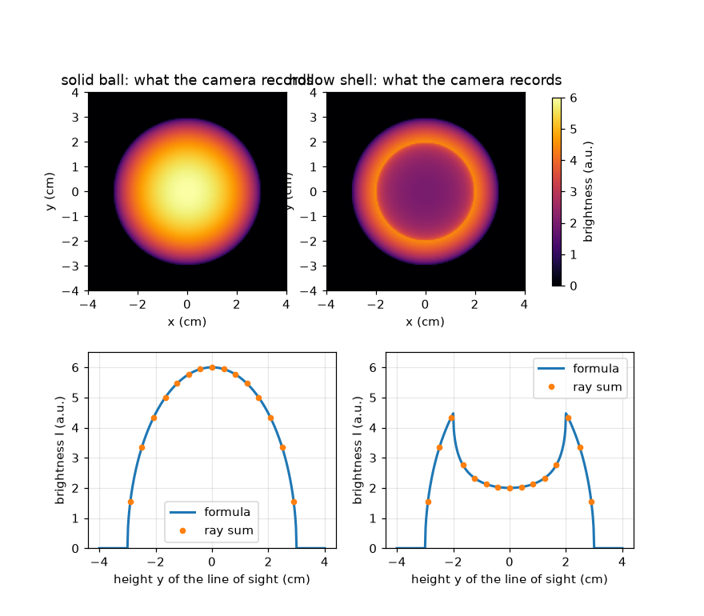
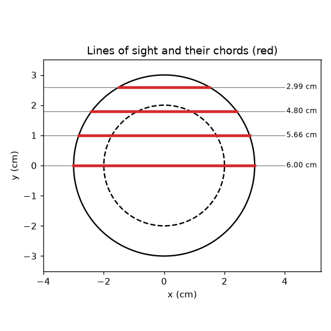

# സെഷൻ 1: ഒരു ഫോട്ടോ ഓരോ കാഴ്ചരേഖയിലൂടെയുമുള്ള പ്രകാശം കൂട്ടിച്ചേർക്കുന്നു

[Session 1 — हिन्दी](README.hi.md)

*ലെവൽ 1 (ആശയപരമായ ഇന്ററാക്ടീവ് മോഡൽ) · ഏകദേശം 60 മിനിറ്റ് · openabel*

> ഇത് ലളിതമാക്കിയ ഒരു വിദ്യാഭ്യാസ മോഡലാണ്. ഇത് സാധൂകരിക്കപ്പെട്ട ഒരു ഡിസൈൻ ഉപകരണമല്ല; യഥാർത്ഥ നിർമ്മിതികൾ, വൈദ്യുത ഇൻസ്റ്റലേഷനുകൾ, വാഹനങ്ങൾ, വ്യാവസായിക പ്രക്രിയകൾ അല്ലെങ്കിൽ വൈദ്യശാസ്ത്രപരമായ തീരുമാനങ്ങൾ എന്നിവയ്ക്ക് ഇത് ഉപയോഗിക്കരുത്.

**മുൻ‌അറിവ് (Prerequisites)**

- പൈതഗോറസ് സിദ്ധാന്തം (Pythagoras' theorem).
- നിങ്ങൾ PRIMER.md വായിക്കുകയും `python start.py 1` ഒരു തവണ റൺ ചെയ്യുകയും ചെയ്തിട്ടുണ്ട്.

**പഠന ലക്ഷ്യങ്ങൾ (Learning objectives).** ഈ സെഷനു ശേഷം നിങ്ങൾക്ക് കഴിയും:

- ഒരു ക്യാമറ പിക്സൽ ഒരു ബിന്ദുവല്ല, മുഴുവൻ കാഴ്ചരേഖയിലൂടെയുമുള്ള ആകെത്തുക രേഖപ്പെടുത്തുന്നത് എന്തുകൊണ്ടെന്ന് വിശദീകരിക്കാൻ.
- ഒരു ഗോളത്തിലൂടെയുള്ള ഞാണിന്റെ (chord) നീളവും ഒരേപോലെ തിളങ്ങുന്ന ഗോളത്തിന്റെ തെളിച്ച പ്രൊഫൈലും (brightness profile) കണക്കാക്കാൻ.
- ഒരു രശ്മിയിലൂടെയുള്ള ബ്രൂട്ട്-ഫോഴ്സ് തുകയുമായി (brute-force sum) ഒരു സൂത്രവാക്യം ഒത്തുനോക്കാൻ.
- പൊള്ളയായ തിളങ്ങുന്ന ഒരു ഷെൽ (shell) അതിന്റെ അരികിനടുത്ത് ഏറ്റവും തെളിഞ്ഞതായി കാണുന്നത് എന്തുകൊണ്ടെന്ന് വിശദീകരിക്കാൻ.

## A. യഥാർത്ഥ ലോക പ്രശ്നം
മെഴുകുതിരി ജ്വാല ഒരു ത്രിമാന (3D) തിളങ്ങുന്ന പിണ്ഡമാണ്, പക്ഷേ അതിന്റെ ഫോട്ടോ പരന്നതാണ്. ഓരോ പിക്സലും ജ്വാലയിലെ ഒരു ബിന്ദു മാത്രമല്ല കാണുന്നത്: ക്യാമറയിൽ നിന്ന് ജ്വാലയിലൂടെ പോകുന്ന രേഖയിൽ ഉണ്ടാകുന്ന മുഴുവൻ പ്രകാശവും അത് കാണുന്നു. ഒരു തിളങ്ങുന്ന ഗോളത്തെ വശത്തുനിന്ന് നോക്കുമ്പോൾ ഒരു പിക്സൽ എത്ര തെളിഞ്ഞതായിരിക്കും, പൊള്ളയായ ഗോളം ഖരഗോളത്തിൽ നിന്ന് വ്യത്യസ്തമായി കാണുന്നത് എന്തുകൊണ്ട്? (ഇത് ഇമേജിംഗിനെക്കുറിച്ചുള്ള പൊതു വിദ്യാഭ്യാസമാണ്, ഏതെങ്കിലും സുരക്ഷാ തീരുമാനത്തിനുള്ള അളവെടുപ്പ് രീതിയല്ല.)

## B. ആശയവും സിദ്ധാന്തവും
R ആരമുള്ള ഒരു ഗോളത്തെ വശത്തുനിന്ന് നോക്കുക. മധ്യത്തിൽ നിന്ന് y ഉയരത്തിലുള്ള ഒരു കാഴ്ചരേഖ (line of sight) ഞാൺ (chord) എന്നു വിളിക്കുന്ന ഒരു നേർഖണ്ഡത്തിലൂടെ ഗോളത്തിനുള്ളിലൂടെ കടന്നുപോകുന്നു. ഗോളം എല്ലായിടത്തും eps0 ഉത്സർജനത്തോടെ (emission) (പാതയുടെ ഓരോ സെന്റിമീറ്ററിലും ഉണ്ടാകുന്ന പ്രകാശം, ആർബിട്രറി യൂണിറ്റിൽ a.u. per cm) തുല്യമായി തിളങ്ങുന്നുവെങ്കിൽ, പിക്സൽ eps0 ഗുണം ഞാണിന്റെ നീളം രേഖപ്പെടുത്തുന്നു. മട്ടത്രികോണത്തിൽ (പകുതി ഞാൺ, y, R) പൈതഗോറസ് പ്രയോഗിച്ചാൽ ഞാൺ കിട്ടും. ഉള്ളിൽ r_in ആരമുള്ള ശൂന്യഭാഗമുള്ള പൊള്ളയായ ഷെല്ലിന്, ദ്വാരത്തിലൂടെയുള്ള ഞാൺ കുറയ്ക്കുക. ഒരു രേഖയിലൂടെ ഒരു അളവ് കൂട്ടിച്ചേർക്കുന്നതിനെ രേഖാ സമാകലനം (line integral) എന്ന് പറയുന്നു; ഇവിടെ ഉത്സർജനം സ്ഥിരമായതിനാൽ, അത് ഉത്സർജനം ഗുണം നീളം മാത്രമാണ്.

| ചിഹ്നം | അർത്ഥം | യൂണിറ്റ് |
|---|---|---|
| R | ഗോളത്തിന്റെ പുറം ആരം | cm |
| r_in | ശൂന്യമായ ദ്വാരത്തിന്റെ അകത്തെ ആരം (ഖരഗോളത്തിന് 0) | cm |
| y | മധ്യത്തിൽ നിന്ന് കാഴ്ചരേഖയുടെ ഉയരം | cm |
| eps0 | ഉത്സർജനം: പാതയുടെ ഓരോ cm-ലും ഉണ്ടാകുന്ന പ്രകാശം | a.u. per cm |
| I(y) | y ഉയരത്തിൽ പിക്സൽ രേഖപ്പെടുത്തുന്ന തെളിച്ചം | a.u. |

**അനുമാനങ്ങൾ (Assumptions)**

- വസ്തു ഒരു പൂർണ്ണ ഗോളമാണ്, തിളങ്ങുന്ന ഭാഗത്തിനുള്ളിൽ എല്ലായിടത്തും ഒരേ തിളക്കം.
- വസ്തു സുതാര്യമാണ് (transparent): വഴിയിൽ ഉണ്ടാകുന്ന പ്രകാശം ആഗിരണം ചെയ്യപ്പെടുകയോ ചിതറുകയോ ഇല്ല.
- ക്യാമറ സമാന്തര കാഴ്ചരേഖകളിലൂടെ നോക്കുന്നു (ദൂരെയുള്ള, ആദർശ ക്യാമറ).

$$ \mathrm{chord}(y,R)=2\sqrt{R^2-y^2}\quad(|y|<R),\qquad 0\ \text{otherwise} $$

$$ I(y)=\varepsilon_0\,\mathrm{chord}(y,R)\quad\text{(solid ball)} $$

$$ I(y)=\varepsilon_0\big(\mathrm{chord}(y,R)-\mathrm{chord}(y,r_\mathrm{in})\big)\quad\text{(hollow shell)} $$

## C. ദൃശ്യ വിശദീകരണം
ആദ്യ ചിത്രം ഒരു ഖരഗോളത്തിന്റെ ക്യാമറ ഫോട്ടോ (മധ്യത്തിൽ ഏറ്റവും തെളിഞ്ഞത്, eps0 = 1 a.u. per cm, R = 3 cm ആകുമ്പോൾ 6 a.u.) 2 cm അകത്തെ ആരമുള്ള ഒരു പൊള്ളയായ ഷെല്ലിന് അരികിൽ കാണിക്കുന്നു: ഷെല്ലിന് ഇരുണ്ട മധ്യഭാഗവും (2 a.u.) y = 2 cm-ൽ ഒരു തെളിഞ്ഞ വലയവും (4.47 a.u.) ഉണ്ട്. ഓരോ ഫോട്ടോയ്ക്കും താഴെ തെളിച്ച പ്രൊഫൈൽ ഉണ്ട്; കുത്തുകൾ രശ്മികളിലൂടെയുള്ള ബ്രൂട്ട്-ഫോഴ്സ് തുകയാണ്, അവ സൂത്രവാക്യത്തിൽ കൃത്യമായി ഇരിക്കുന്നു. രണ്ടാമത്തെ ചിത്രം ഗോളത്തിലൂടെയുള്ള നാല് കാഴ്ചരേഖകളും അവയുടെ ഞാണിന്റെ നീളങ്ങളും ചുവപ്പിൽ വരയ്ക്കുന്നു: മധ്യത്തിലൂടെയുള്ള രേഖ ഏറ്റവും നീളമുള്ളതാണ്, അരികിനടുത്തുള്ള രേഖ ചെറുതാണ്.

*ഖരമായ തിളങ്ങുന്ന ഗോളത്തിന്റെയും പൊള്ളയായ ഷെല്ലിന്റെയും ക്യാമറ ഫോട്ടോകളും തെളിച്ച പ്രൊഫൈലുകളും (കുത്തുകൾ: ബ്രൂട്ട്-ഫോഴ്സ് രശ്മി തുകകൾ).*

*ഒരു ഗോളത്തിലൂടെയുള്ള നാല് കാഴ്ചരേഖകളും അവയുടെ ഞാണിന്റെ നീളങ്ങളും (ചുവപ്പ്).*

## D. ഇന്ററാക്ടീവ് സിമുലേഷൻ
പാഠം റൺ ചെയ്യുക (`python start.py 1`), തുടർന്ന് ലൈവ് ആപ്പ് തുറക്കുക: [സെഷൻ 1: വശത്തുനിന്ന് കാണുന്ന ഒരു തിളങ്ങുന്ന ഗോളം](https://krunalpanchal1995.github.io/pan-iit-oss/openabel/session-01/) (അല്ലെങ്കിൽ ഈ ഫോൾഡറിലെ `app.html`). കാഴ്ചരേഖ സ്ലൈഡർ നീക്കി ചുവന്ന ഞാണും പ്രൊഫൈലിലെ തെളിച്ച കുത്തും ശ്രദ്ധിക്കുക; തുടർന്ന് പൊള്ള ശതമാനം (hollow percentage) കൂട്ടി ഇരുണ്ട മധ്യഭാഗം പ്രത്യക്ഷപ്പെടുന്നത് കാണുക.

**വെല്ലുവിളി.** പ്രൊഫൈലിന്റെ മധ്യത്തിലെ തെളിച്ചം ഏറ്റവും തെളിഞ്ഞ ബിന്ദുവിന്റെ പരമാവധി പകുതിയാക്കുക (പൊള്ള സ്ലൈഡർ ഉപയോഗിക്കുക).

## E. പ്രവർത്തിച്ച ഉദാഹരണവും പരീക്ഷണവും
**പ്രശ്നം.** R = 3 cm ആരമുള്ള ഒരു ഖരഗോളത്തിന് eps0 = 2 a.u. per cm ഉത്സർജനം ഉണ്ട്. y = 1.8 cm-ലെ കാഴ്ചരേഖയിൽ ക്യാമറ എന്ത് രേഖപ്പെടുത്തും?

1. സംഖ്യകളുടെ വർഗ്ഗം എടുക്കുക: R^2 = 9, y^2 = 3.24.
2. R^2 - y^2 = 5.76, അതിന്റെ വർഗ്ഗമൂലം 2.4 cm.
3. ഞാൺ 2 * 2.4 = 4.8 cm.
4. തെളിച്ചം = eps0 * ഞാൺ = 2 a.u. per cm * 4.8 cm = 9.6 a.u.
5. യുക്തിപരിശോധന (sanity check): മധ്യരേഖ 2 * 3 * 2 = 12 a.u. നൽകും, ഇത് 9.6-നേക്കാൾ വലുതാണ്, അങ്ങനെയാവണം; യൂണിറ്റുകൾ (a.u. per cm ഗുണം cm) a.u. നൽകുന്നു.

**ഉത്തരം.** ഞാൺ 4.8 cm ആണ്, പിക്സൽ 9.6 a.u. രേഖപ്പെടുത്തുന്നു.

**പരീക്ഷണം.** ഇരുണ്ട മുറിയിൽ ഒരു ഫ്രോസ്റ്റഡ് (ഓപൽ) ലൈറ്റ് ബൾബോ ഉള്ളിൽ നിന്ന് പ്രകാശിപ്പിച്ച ഒരു പിംഗ്-പോംഗ് പന്തോ ഫോൺ ഉപയോഗിച്ച് വശത്തുനിന്ന് ഫോട്ടോ എടുത്ത് നോക്കുക. ഖരമായ തിളക്കത്തിന് മധ്യഭാഗം ഏറ്റവും തെളിഞ്ഞതായി കാണും. ഗ്ലാസ് പ്രകാശം ചിതറിക്കുകയും ആഗിരണം ചെയ്യുകയും ചെയ്യുന്നതിനാലും ക്യാമറ തെളിച്ചം രേഖീയമല്ലാത്തതിനാലും യഥാർത്ഥ ബൾബ് മോഡലിൽ നിന്ന് വ്യത്യസ്തമാണ്; ആദർശ സുതാര്യ തിളക്കത്തിന് മാത്രമേ മോഡൽ കൃത്യമാകൂ.

## F. മൂല്യനിർണ്ണയവും ഡിസൈൻ വെല്ലുവിളിയും
**ചോദ്യ തരം A: ആശയപരം.** ഖരമായ തിളങ്ങുന്ന ഗോളത്തിന്റെ മധ്യം ഏറ്റവും തെളിഞ്ഞ പിക്സൽ ആകുന്നത് എന്തുകൊണ്ട്, പൊള്ളയായ ഷെല്ലിന് മധ്യത്തേക്കാൾ അരികിൽ കൂടുതൽ തെളിച്ചം ഉണ്ടാകുന്നത് എന്തുകൊണ്ട്?

സൂചന

മധ്യത്തിലൂടെയുള്ള ഒരു രേഖയുടെയും ദ്വാരത്തിന്റെ അരികിനടുത്തുള്ള ഒരു രേഖയുടെയും തിളങ്ങുന്ന പദാർത്ഥത്തിലൂടെയുള്ള പാതാ നീളങ്ങൾ താരതമ്യം ചെയ്യുക.

ഘട്ടം ഘട്ടമായുള്ള പരിഹാരം

പിക്സൽ പാതയിലൂടെയുള്ള പ്രകാശം കൂട്ടിച്ചേർക്കുന്നു, അതിനാൽ തിളങ്ങുന്ന പദാർത്ഥത്തിലൂടെയുള്ള നീളം കൂടിയ പാത കൂടുതൽ തെളിഞ്ഞ പിക്സൽ നൽകുന്നു. ഖരഗോളത്തിൽ മധ്യത്തിലൂടെയുള്ള രേഖയാണ് ഏറ്റവും നീളമുള്ളത്. ഷെല്ലിൽ മധ്യരേഖ അതിന്റെ നീളത്തിന്റെ ഭൂരിഭാഗവും ശൂന്യമായ ദ്വാരത്തിലാണ് ചെലവഴിക്കുന്നത്, അതിനാൽ ചെറിയ ഭിത്തികൾ മാത്രമേ കണക്കാകൂ; ദ്വാരത്തെ തൊട്ടുപോകുന്ന ഒരു രേഖ ഭിത്തിക്കുള്ളിൽ ദീർഘദൂരം സഞ്ചരിക്കുന്നു, അതിനാൽ ഏറ്റവും തെളിഞ്ഞ രേഖ അകത്തെ ആരത്തെ തൊടുന്നതാണ്.

**ചോദ്യ തരം B: സംഖ്യാപരം.** ഒരു ഖരഗോളത്തിന് R = 2.5 cm, eps0 = 1.2 a.u. per cm. y = 1.5 cm-ലും y = 0-ലും ഞാണും തെളിച്ചവും കണ്ടെത്തുക. യൂണിറ്റുകൾ പരിശോധിക്കുക.

സൂചന

ഞാൺ = 2 sqrt(R^2 - y^2) ഉപയോഗിക്കുക: y = 1.5-ൽ, R^2 - y^2 = 6.25 - 2.25 = 4.

ഘട്ടം ഘട്ടമായുള്ള പരിഹാരം

y = 1.5 cm-ൽ: ഞാൺ = 2 * sqrt(4) = 4 cm, I = 1.2 * 4 = 4.8 a.u. y = 0-ൽ: ഞാൺ = 2R = 5 cm, I = 1.2 * 5 = 6.0 a.u. യൂണിറ്റുകൾ: (a.u. per cm) ഗുണം cm = a.u. യുക്തിപരിശോധന: മധ്യത്തിൽ നിന്ന് മാറിയ രേഖ ചെറുതായതിനാൽ അത് മങ്ങിയതാണ്.

**ചോദ്യ തരം C: ഗ്രാഫും സിമുലേഷനും വ്യാഖ്യാനിക്കൽ.** പൊള്ളയായ ഷെല്ലിന്റെ പ്രൊഫൈലിൽ (R = 3 cm, r_in = 2 cm), ഏറ്റവും തെളിഞ്ഞ ബിന്ദു എവിടെയാണ്, അതിന്റെ മൂല്യം എന്താണ്? മധ്യം 2 a.u. മാത്രം ആകുന്നത് എന്തുകൊണ്ട്?

സൂചന

ഏറ്റവും തെളിഞ്ഞ രേഖ അകത്തെ വൃത്തത്തെ തൊടുന്നു: y = r_in. 2 sqrt(R^2 - r_in^2) കണക്കാക്കുക.

ഘട്ടം ഘട്ടമായുള്ള പരിഹാരം

ഏറ്റവും തെളിഞ്ഞ ബിന്ദു y = 2 cm-ലാണ്, I = 2 sqrt(9 - 4) = 2 sqrt(5) = 4.47 a.u. മധ്യരേഖയ്ക്ക് പുറംഗോളത്തിലൂടെ 6 cm ഞാണിൽ നിന്ന് ദ്വാരത്തിലൂടെയുള്ള 4 cm കുറച്ച് 2 cm, അതിനാൽ I = 2 a.u. അതിനാൽ പ്രൊഫൈലിന് മധ്യത്തിൽ ഒരു താഴ്ചയും രണ്ട് തെളിഞ്ഞ തോളുകളും ഉണ്ട്, ഇതിനെ ലിംബ് ബ്രൈറ്റനിംഗ് (limb brightening) എന്ന് വിളിക്കുന്നു.

**ചോദ്യ തരം D: ഡിസൈനും ഒപ്റ്റിമൈസേഷൻ വെല്ലുവിളിയും.** ഡിസൈൻ: ഒരു തിളങ്ങുന്ന ഷെല്ലിന് 3 cm പുറം ആരമുണ്ട്. മധ്യത്തിലെ തെളിച്ചം ഏറ്റവും കൂടിയ തെളിച്ചത്തിന്റെ പരമാവധി പകുതി ആകുന്ന വിധം അകത്തെ ആരം തിരഞ്ഞെടുക്കുക. 1 cm ആരമുള്ള ദ്വാരം മതിയോ? കണക്കുകൂട്ടലിലൂടെ ന്യായീകരിക്കുക.

സൂചന

അനുപാതം I(0) / I_max = sqrt((R - r_in) / (R + r_in)). അത് 1/2 ആക്കുക.

ഘട്ടം ഘട്ടമായുള്ള പരിഹാരം

I(0) / I_max = sqrt((R - r_in) / (R + r_in)) <= 1/2 എന്നാൽ (R - r_in) / (R + r_in) <= 1/4, അതിനാൽ r_in >= 0.6 R = 1.8 cm. 1 cm ദ്വാരം മതിയാവില്ല: അനുപാതം sqrt(2/4) = 0.71. r_in = 2 cm ആകുമ്പോൾ അനുപാതം sqrt(1/5) = 0.45, ഇത് പ്രവർത്തിക്കുന്നു. വിട്ടുവീഴ്ച (trade-off): വലിയ ദ്വാരം ശക്തമായ ഇരുണ്ട മധ്യം നൽകുന്നു, പക്ഷേ തിളങ്ങുന്ന ഭിത്തി നേർത്തതാകുന്നു, അതിനാൽ മുഴുവൻ ചിത്രവും മങ്ങുന്നു.

[RUBRIC.md](../../RUBRIC.md) ഉപയോഗിച്ച് സ്വയം സ്കോർ ചെയ്യുക. പേപ്പറിൽ ചെയ്യാൻ [പ്രവർത്തന ഷീറ്റ്](activity_sheet.md) പ്രിന്റ് ചെയ്യുക.

## സാധാരണ തെറ്റിദ്ധാരണകൾ
| സാധാരണ തെറ്റിദ്ധാരണ | യഥാർത്ഥത്തിൽ ശരിയായത് |
|---|---|
| ഒരു പിക്സൽ വസ്തുവിലെ ഒരു ബിന്ദുവിലെ തിളക്കം രേഖപ്പെടുത്തുന്നു. | ഒരു പിക്സൽ വസ്തുവിലൂടെയുള്ള മുഴുവൻ കാഴ്ചരേഖയിലെയും തിളക്കത്തിന്റെ ആകെത്തുക രേഖപ്പെടുത്തുന്നു. |
| ഫോട്ടോയിലെ ഇരുണ്ട മധ്യം വസ്തുവിന്റെ മധ്യത്തിൽ തിളക്കമില്ല എന്നാണ് അർത്ഥമാക്കുന്നത്. | ഇരുണ്ട മധ്യം പൊള്ളയായ മധ്യത്തെ സൂചിപ്പിക്കാം, പക്ഷേ ആകൃതി അറിയാമെങ്കിൽ മാത്രം; ഒരു ശുദ്ധ രേഖാ സമാകലനം മാത്രം രേഖയിലൂടെ തിളക്കം എങ്ങനെ വിതരണം ചെയ്യപ്പെട്ടിരിക്കുന്നു എന്ന് പറയുന്നില്ല. |
| ഏറ്റവും തെളിഞ്ഞ പിക്സൽ തിളക്കം ഏറ്റവും ശക്തമായ സ്ഥലത്താണ്. | തിളങ്ങുന്ന പദാർത്ഥത്തിലൂടെയുള്ള പാത ആകെ ഏറ്റവും നീളമുള്ളതോ ശക്തമായതോ ആയ സ്ഥലത്താണ് അത്; ഷെല്ലിന് അത് അകത്തെ അരികിലാണ്, ഉത്സർജനം ഏറ്റവും കൂടുതലുള്ളിടത്തല്ല. |

## പദാവലി (Glossary)
- **കാഴ്ചരേഖ (line of sight)**: ഒരു ക്യാമറ പിക്സലിൽ നിന്ന് വസ്തുവിലൂടെ പോകുന്ന നേർരേഖ
- **ഞാൺ (chord)**: ഒരു കാഴ്ചരേഖ ഒരു വൃത്തത്തിനോ ഗോളത്തിനോ ഉള്ളിലുള്ള നേർഖണ്ഡം
- **ഉത്സർജനം (emission)**: വസ്തുവിനുള്ളിൽ പാതയുടെ ഓരോ യൂണിറ്റ് നീളത്തിലും ഉണ്ടാകുന്ന പ്രകാശം
- **രേഖാ സമാകലനം (line integral)**: ഒരു രേഖയിലൂടെ ഒരു അളവ് കൂട്ടിച്ചേർക്കൽ; ഇവിടെ ഉത്സർജനം ഗുണം നീളം
- **ലിംബ് ബ്രൈറ്റനിംഗ് (limb brightening)**: പൊള്ളയായ വസ്തുവിന്റെ മധ്യത്തേക്കാൾ അരികിനടുത്ത് കൂടുതൽ തെളിഞ്ഞ പ്രൊഫൈൽ

## പൂർത്തിയാക്കുക
1. [exercises.md](exercises.md)-ലെ മൂന്ന് കോഡിംഗ് ടാസ്കുകൾ ചെയ്യുക.
2. നിങ്ങളുടെ മാറ്റങ്ങൾക്ക് ശേഷം `python start.py 1` വീണ്ടും റൺ ചെയ്യുക. അത് ചെക്ക്‌പോയിന്റോടെ അവസാനിക്കുന്നു; അത് `PASS` പ്രിന്റ് ചെയ്യുമ്പോൾ, നിങ്ങൾ പൂർത്തിയാക്കി. (ചെക്ക്‌പോയിന്റ് മാത്രം: `python start.py check 1`.)

അടുത്തത്: [സെഷൻ 2](../session-02/README.md)
