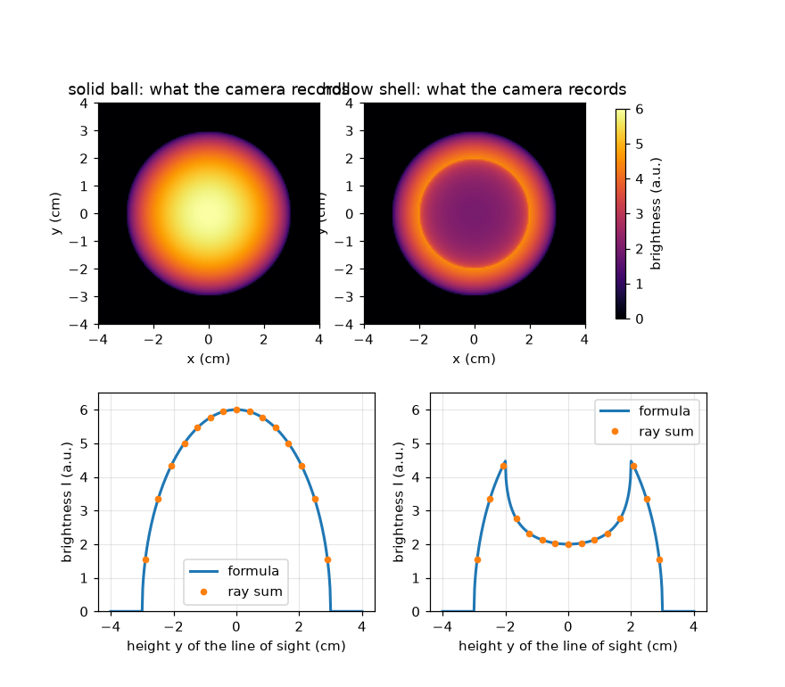
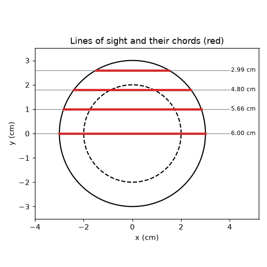

# அமர்வு 1: ஒரு புகைப்படம் ஒவ்வொரு பார்வைக் கோட்டின் வழியாகவும் உள்ள ஒளியைக் கூட்டுகிறது

[Session 1 — हिन्दी](README.hi.md)

*நிலை 1 (கருத்தியல் ஊடாடும் மாதிரி) · சுமார் 60 நிமிடங்கள் · openabel*

> இது எளிமைப்படுத்தப்பட்ட ஒரு கல்வி மாதிரி. இது சரிபார்க்கப்பட்ட வடிவமைப்புக் கருவி அல்ல; உண்மையான கட்டமைப்புகள், மின் நிறுவல்கள், வாகனங்கள், தொழில்துறை செயல்முறைகள் அல்லது மருத்துவ முடிவுகளுக்கு இதைப் பயன்படுத்தக் கூடாது.

**முன்தேவைகள் (Prerequisites)**

- பித்தகோரஸ் தேற்றம் (Pythagoras' theorem).
- நீங்கள் PRIMER.md படித்து, `python start.py 1` ஐ ஒரு முறை இயக்கியிருக்க வேண்டும்.

**கற்றல் நோக்கங்கள் (Learning objectives).** இந்த அமர்வுக்குப் பிறகு நீங்கள்:

- ஒரு கேமரா பிக்சல் ஒரு புள்ளியை அல்ல, முழுப் பார்வைக் கோட்டின் வழியான கூட்டுத்தொகையைப் பதிவு செய்வது ஏன் என்று விளக்க முடியும்.
- ஒரு கோளத்தின் வழியான நாணின் (chord) நீளத்தையும், சீராக ஒளிரும் கோளத்தின் ஒளிர்வுச் சுயவிவரத்தையும் (brightness profile) கணக்கிட முடியும்.
- ஒரு கதிரின் வழியான முரட்டு-விசைக் கூட்டுத்தொகையுடன் (brute-force sum) ஒரு சூத்திரத்தைச் சரிபார்க்க முடியும்.
- உள்ளீடற்ற ஒளிரும் ஓடு (shell) அதன் விளிம்பருகே மிகப் பிரகாசமாகத் தெரிவது ஏன் என்று விளக்க முடியும்.

## A. நிஜ உலகப் பிரச்சனை
மெழுகுவர்த்திச் சுடர் ஒரு முப்பரிமாண (3D) ஒளிரும் திரள், ஆனால் அதன் புகைப்படம் தட்டையானது. ஒவ்வொரு பிக்சலும் சுடரின் ஒரு புள்ளியை மட்டும் பார்ப்பதில்லை: கேமராவிலிருந்து சுடர் வழியாகச் செல்லும் கோட்டில் உருவாகும் எல்லா ஒளியையும் அது பார்க்கிறது. ஒளிரும் கோளத்தைப் பக்கவாட்டில் பார்க்கும்போது ஒரு பிக்சல் எவ்வளவு பிரகாசமாக இருக்கும், உள்ளீடற்ற கோளம் திடக் கோளத்திலிருந்து வேறாகத் தெரிவது ஏன்? (இது படமாக்கல் பற்றிய பொதுக் கல்வி; எந்தப் பாதுகாப்பு முடிவுக்குமான அளவீட்டு முறை அல்ல.)

## B. கருத்தும் கோட்பாடும்
R ஆரமுள்ள ஒரு கோளத்தைப் பக்கவாட்டில் பாருங்கள். நடுவிலிருந்து y உயரத்தில் உள்ள ஒரு பார்வைக் கோடு (line of sight), நாண் (chord) எனப்படும் ஒரு நேர்க்கோட்டுத் துண்டு வழியாகக் கோளத்தைக் கடக்கிறது. கோளம் எல்லா இடத்திலும் eps0 உமிழ்வுடன் (emission) (பாதையின் ஒவ்வொரு சென்டிமீட்டருக்கும் உருவாகும் ஒளி, தன்னிச்சை அலகுகளில் a.u. per cm) சமமாக ஒளிர்ந்தால், பிக்சல் eps0 பெருக்கல் நாணின் நீளத்தைப் பதிவு செய்கிறது. செங்கோண முக்கோணத்தில் (அரை நாண், y, R) பித்தகோரஸ் நாணைத் தருகிறது. உள்ளே r_in ஆரமுள்ள வெற்றுப் பகுதி கொண்ட உள்ளீடற்ற ஓட்டிற்கு, துளை வழியான நாணைக் கழிக்கவும். ஒரு கோட்டின் வழியாக ஒரு அளவைக் கூட்டுவது கோட்டுத் தொகையீடு (line integral) எனப்படும்; இங்கே உமிழ்வு மாறிலி, எனவே அது உமிழ்வு பெருக்கல் நீளம் மட்டுமே.

| குறியீடு | பொருள் | அலகு |
|---|---|---|
| R | கோளத்தின் வெளி ஆரம் | cm |
| r_in | வெற்றுத் துளையின் உள் ஆரம் (திடக் கோளத்திற்கு 0) | cm |
| y | நடுவிலிருந்து பார்வைக் கோட்டின் உயரம் | cm |
| eps0 | உமிழ்வு: பாதையின் ஒவ்வொரு cm-க்கும் உருவாகும் ஒளி | a.u. per cm |
| I(y) | y உயரத்தில் பிக்சல் பதிவு செய்யும் ஒளிர்வு | a.u. |

**அனுமானங்கள் (Assumptions)**

- பொருள் ஒரு முழுமையான கோளம்; ஒளிரும் பகுதிக்குள் எல்லா இடத்திலும் ஒரே ஒளிர்வு.
- பொருள் ஒளி ஊடுருவக்கூடியது (transparent): வழியில் உருவாகும் ஒளி உறிஞ்சப்படுவதோ சிதறுவதோ இல்லை.
- கேமரா இணையான பார்வைக் கோடுகள் வழியாகப் பார்க்கிறது (தொலைவில் உள்ள, இலட்சியக் கேமரா).

$$ \mathrm{chord}(y,R)=2\sqrt{R^2-y^2}\quad(|y|<R),\qquad 0\ \text{otherwise} $$

$$ I(y)=\varepsilon_0\,\mathrm{chord}(y,R)\quad\text{(solid ball)} $$

$$ I(y)=\varepsilon_0\big(\mathrm{chord}(y,R)-\mathrm{chord}(y,r_\mathrm{in})\big)\quad\text{(hollow shell)} $$

## C. காட்சி விளக்கம்
முதல் படம் ஒரு திடக் கோளத்தின் கேமரா புகைப்படத்தை (நடுவில் மிகப் பிரகாசம், eps0 = 1 a.u. per cm மற்றும் R = 3 cm-க்கு 6 a.u.) 2 cm உள் ஆரமுள்ள ஒரு உள்ளீடற்ற ஓட்டின் அருகில் காட்டுகிறது: ஓட்டிற்கு இருண்ட நடுப்பகுதியும் (2 a.u.) y = 2 cm-ல் ஒரு பிரகாசமான வளையமும் (4.47 a.u.) உள்ளன. ஒவ்வொரு புகைப்படத்தின் கீழும் ஒளிர்வுச் சுயவிவரம் உள்ளது; புள்ளிகள் கதிர்கள் வழியான முரட்டு-விசைக் கூட்டுத்தொகை, அவை சூத்திரத்தின் மீது சரியாக அமர்கின்றன. இரண்டாவது படம் கோளத்தின் வழியாக நான்கு பார்வைக் கோடுகளையும் அவற்றின் நாண் நீளங்களையும் சிவப்பில் வரைகிறது: நடுவின் வழியான கோடு மிக நீளமானது, விளிம்பருகே உள்ள கோடு குட்டையானது.

*திட ஒளிரும் கோளம் மற்றும் உள்ளீடற்ற ஓட்டின் கேமரா புகைப்படங்களும் ஒளிர்வுச் சுயவிவரங்களும் (புள்ளிகள்: முரட்டு-விசைக் கதிர்க் கூட்டுத்தொகைகள்).*

*ஒரு கோளத்தின் வழியான நான்கு பார்வைக் கோடுகளும் அவற்றின் நாண் நீளங்களும் (சிவப்பு).*

## D. ஊடாடும் உருவகப்படுத்தல்
பாடத்தை இயக்கவும் (`python start.py 1`), பிறகு நேரடிச் செயலியைத் திறக்கவும்: [அமர்வு 1: பக்கவாட்டில் பார்க்கப்படும் ஒளிரும் கோளம்](https://krunalpanchal1995.github.io/pan-iit-oss/openabel/session-01/) (அல்லது இந்தக் கோப்புறையில் உள்ள `app.html`). பார்வைக் கோட்டு ஸ்லைடரை நகர்த்தி, சிவப்பு நாணையும் சுயவிவரத்தில் உள்ள ஒளிர்வுப் புள்ளியையும் கவனியுங்கள்; பிறகு உள்ளீடற்ற சதவீதத்தை (hollow percentage) உயர்த்தி இருண்ட நடுப்பகுதி தோன்றுவதைப் பாருங்கள்.

**சவால்.** சுயவிவரத்தின் நடுவில் உள்ள ஒளிர்வை மிகப் பிரகாசமான புள்ளியின் அதிகபட்சம் பாதியாக்குங்கள் (உள்ளீடற்ற ஸ்லைடரைப் பயன்படுத்தவும்).

## E. தீர்க்கப்பட்ட உதாரணமும் சோதனையும்
**பிரச்சனை.** R = 3 cm ஆரமுள்ள ஒரு திடக் கோளத்திற்கு eps0 = 2 a.u. per cm உமிழ்வு உள்ளது. y = 1.8 cm-ல் உள்ள பார்வைக் கோட்டில் கேமரா என்ன பதிவு செய்யும்?

1. எண்களை வர்க்கப்படுத்துங்கள்: R^2 = 9 மற்றும் y^2 = 3.24.
2. R^2 - y^2 = 5.76, அதன் வர்க்கமூலம் 2.4 cm.
3. நாண் 2 * 2.4 = 4.8 cm.
4. ஒளிர்வு = eps0 * நாண் = 2 a.u. per cm * 4.8 cm = 9.6 a.u.
5. சரிபார்ப்பு (sanity check): நடுக்கோடு 2 * 3 * 2 = 12 a.u. தரும், இது 9.6-ஐ விடப் பெரியது, அப்படித்தான் இருக்க வேண்டும்; அலகுகள் (a.u. per cm பெருக்கல் cm) a.u. தருகின்றன.

**விடை.** நாண் 4.8 cm, பிக்சல் 9.6 a.u. பதிவு செய்கிறது.

**சோதனை.** இருட்டறையில் ஒரு உறைந்த (ஓபல்) மின்விளக்கையோ உள்ளிருந்து ஒளியூட்டப்பட்ட பிங்-பாங் பந்தையோ தொலைபேசியால் பக்கவாட்டில் புகைப்படம் எடுத்துப் பாருங்கள். திட ஒளிர்வுக்கு நடுப்பகுதி மிகப் பிரகாசமாகத் தெரியும். கண்ணாடி ஒளியைச் சிதறடித்து உறிஞ்சுவதாலும், கேமரா ஒளிர்வு நேரியல் அல்லாததாலும் உண்மையான விளக்கு மாதிரியிலிருந்து வேறுபடுகிறது; இலட்சிய ஒளி ஊடுருவும் ஒளிர்வுக்கு மட்டுமே மாதிரி துல்லியமானது.

## F. மதிப்பீடும் வடிவமைப்புச் சவாலும்
**கேள்வி வகை A: கருத்தியல்.** திட ஒளிரும் கோளத்தின் நடுப்பகுதி மிகப் பிரகாசமான பிக்சல் ஆவது ஏன், உள்ளீடற்ற ஓடு நடுவை விட விளிம்பில் பிரகாசமாக இருக்க முடிவது ஏன்?

குறிப்பு

நடுவின் வழியான ஒரு கோட்டிற்கும் துளையின் விளிம்பருகே உள்ள ஒரு கோட்டிற்கும் ஒளிரும் பொருள் வழியான பாதை நீளங்களை ஒப்பிடுங்கள்.

படிப்படியான தீர்வு

பிக்சல் பாதையின் வழியான ஒளியைக் கூட்டுகிறது, எனவே ஒளிரும் பொருள் வழியான நீண்ட பாதை பிரகாசமான பிக்சலைத் தருகிறது. திடக் கோளத்தில் நடுவின் வழியான கோடு மிக நீளமானது. ஓட்டில் நடுக்கோடு தன் நீளத்தின் பெரும்பகுதியை வெற்றுத் துளையில் கழிக்கிறது, எனவே குட்டையான சுவர்கள் மட்டுமே கணக்கில் வருகின்றன; துளையை உரசிச் செல்லும் கோடு சுவருக்குள் நீண்ட தூரம் பயணிக்கிறது, எனவே மிகப் பிரகாசமான கோடு உள் ஆரத்தைத் தொடுவதுதான்.

**கேள்வி வகை B: எண்ணியல்.** ஒரு திடக் கோளத்திற்கு R = 2.5 cm மற்றும் eps0 = 1.2 a.u. per cm. y = 1.5 cm-லும் y = 0-லும் நாணையும் ஒளிர்வையும் கண்டறியுங்கள். அலகுகளைச் சரிபாருங்கள்.

குறிப்பு

நாண் = 2 sqrt(R^2 - y^2) பயன்படுத்துங்கள்: y = 1.5-ல், R^2 - y^2 = 6.25 - 2.25 = 4.

படிப்படியான தீர்வு

y = 1.5 cm-ல்: நாண் = 2 * sqrt(4) = 4 cm மற்றும் I = 1.2 * 4 = 4.8 a.u. y = 0-ல்: நாண் = 2R = 5 cm மற்றும் I = 1.2 * 5 = 6.0 a.u. அலகுகள்: (a.u. per cm) பெருக்கல் cm = a.u. சரிபார்ப்பு: நடுவிலிருந்து விலகிய கோடு குட்டையானது, எனவே மங்கலானது.

**கேள்வி வகை C: வரைபடம் மற்றும் உருவகப்படுத்தல் விளக்கம்.** உள்ளீடற்ற ஓட்டின் சுயவிவரத்தில் (R = 3 cm, r_in = 2 cm), மிகப் பிரகாசமான புள்ளி எங்கே, அதன் மதிப்பு என்ன? நடுப்பகுதி ஏன் 2 a.u. மட்டுமே?

குறிப்பு

மிகப் பிரகாசமான கோடு உள் வட்டத்தைத் தொடுகிறது: y = r_in. 2 sqrt(R^2 - r_in^2) ஐக் கணக்கிடுங்கள்.

படிப்படியான தீர்வு

மிகப் பிரகாசமான புள்ளி y = 2 cm-ல் உள்ளது, I = 2 sqrt(9 - 4) = 2 sqrt(5) = 4.47 a.u. நடுக்கோட்டிற்கு வெளிக் கோளம் வழியாக 6 cm நாண், துளை வழியான 4 cm கழித்து 2 cm, எனவே I = 2 a.u. ஆகவே சுயவிவரத்தில் நடுவில் ஒரு பள்ளமும் இரண்டு பிரகாசமான தோள்களும் உள்ளன; இது விளிம்புப் பிரகாசமாதல் (limb brightening) எனப்படும்.

**கேள்வி வகை D: வடிவமைப்பு மற்றும் உகப்பாக்கச் சவால்.** வடிவமைப்பு: ஒரு ஒளிரும் ஓட்டிற்கு வெளி ஆரம் 3 cm. நடு ஒளிர்வு அதிகபட்ச ஒளிர்வின் அதிகபட்சம் பாதியாக இருக்கும்படி உள் ஆரத்தைத் தேர்ந்தெடுங்கள். 1 cm ஆரமுள்ள துளை போதுமா? கணக்கீட்டால் நியாயப்படுத்துங்கள்.

குறிப்பு

விகிதம் I(0) / I_max = sqrt((R - r_in) / (R + r_in)). அதை 1/2 ஆக அமையுங்கள்.

படிப்படியான தீர்வு

I(0) / I_max = sqrt((R - r_in) / (R + r_in)) <= 1/2 என்றால் (R - r_in) / (R + r_in) <= 1/4, எனவே r_in >= 0.6 R = 1.8 cm. 1 cm துளை போதாது: விகிதம் sqrt(2/4) = 0.71. r_in = 2 cm எனில் விகிதம் sqrt(1/5) = 0.45, இது செயல்படுகிறது. சமரசம் (trade-off): பெரிய துளை வலுவான இருண்ட நடுப்பகுதியைத் தருகிறது, ஆனால் ஒளிரும் சுவர் மெல்லியதாகிறது, எனவே முழுப் படமும் மங்குகிறது.

[RUBRIC.md](../../RUBRIC.md) மூலம் உங்களை மதிப்பிட்டுக் கொள்ளுங்கள். காகிதத்தில் செய்ய [செயல்பாட்டுத் தாள்](activity_sheet.md) அச்சிடுங்கள்.

## பொதுவான தவறான கருத்துகள்
| பொதுவான தவறான கருத்து | உண்மையில் சரியானது |
|---|---|
| ஒரு பிக்சல் பொருளின் ஒரு புள்ளியில் உள்ள ஒளிர்வைப் பதிவு செய்கிறது. | ஒரு பிக்சல் பொருளின் வழியான முழுப் பார்வைக் கோட்டின் ஒளிர்வுக் கூட்டுத்தொகையைப் பதிவு செய்கிறது. |
| புகைப்படத்தில் இருண்ட நடுப்பகுதி என்றால் பொருளின் நடுவில் ஒளிர்வு இல்லை என்று பொருள். | இருண்ட நடுப்பகுதி உள்ளீடற்ற நடுவைக் குறிக்கலாம், ஆனால் வடிவம் தெரிந்தால் மட்டுமே; தூய கோட்டுத் தொகையீடு மட்டும் ஒளிர்வு கோட்டின் வழியே எப்படிப் பரவியுள்ளது என்று சொல்லாது. |
| மிகப் பிரகாசமான பிக்சல் ஒளிர்வு மிக வலுவாக உள்ள இடத்தில் இருக்கும். | ஒளிரும் பொருள் வழியான பாதை மொத்தத்தில் மிக நீளமான அல்லது வலுவான இடத்தில்தான் அது இருக்கும்; ஓட்டிற்கு அது உள் விளிம்பில், உமிழ்வு அதிகமுள்ள இடத்தில் அல்ல. |

## சொற்களஞ்சியம் (Glossary)
- **பார்வைக் கோடு (line of sight)**: ஒரு கேமரா பிக்சலிலிருந்து பொருள் வழியாகச் செல்லும் நேர்க்கோடு
- **நாண் (chord)**: ஒரு பார்வைக் கோடு ஒரு வட்டம் அல்லது கோளத்திற்குள் இருக்கும் நேர்க்கோட்டுத் துண்டு
- **உமிழ்வு (emission)**: பொருளுக்குள் பாதையின் ஓர் அலகு நீளத்திற்கு உருவாகும் ஒளி
- **கோட்டுத் தொகையீடு (line integral)**: ஒரு கோட்டின் வழியாக ஒரு அளவைக் கூட்டுதல்; இங்கே உமிழ்வு பெருக்கல் நீளம்
- **விளிம்புப் பிரகாசமாதல் (limb brightening)**: உள்ளீடற்ற பொருளின் நடுவை விட விளிம்பருகே பிரகாசமாக உள்ள சுயவிவரம்

## நிறைவு
1. [exercises.md](exercises.md) இல் உள்ள மூன்று நிரலாக்கப் பணிகளைச் செய்யுங்கள்.
2. உங்கள் மாற்றங்களுக்குப் பிறகு `python start.py 1` ஐ மீண்டும் இயக்குங்கள். அது சோதனைச் சாவடியுடன் (checkpoint) முடிகிறது; அது `PASS` என அச்சிடும்போது, நீங்கள் முடித்துவிட்டீர்கள். (சோதனைச் சாவடி மட்டும்: `python start.py check 1`.)

அடுத்து: [அமர்வு 2](../session-02/README.md)
