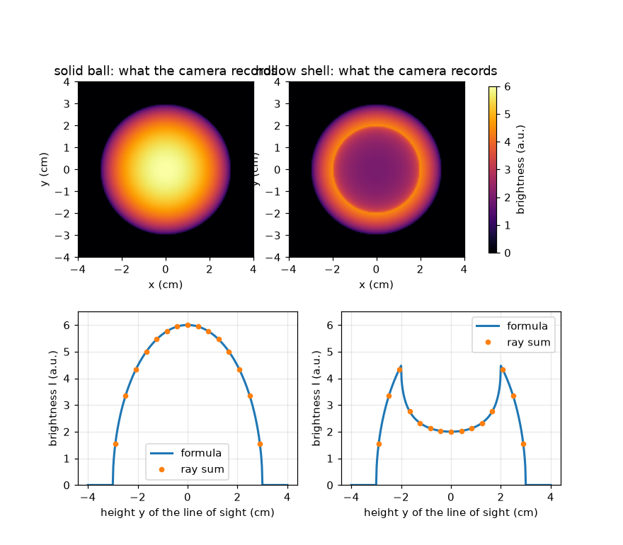
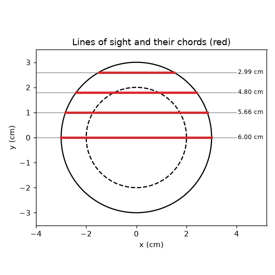

# సెషన్ 1: ఒక ఫోటో ప్రతి దృష్టి రేఖ వెంబడి ఉన్న కాంతిని కలుపుతుంది

[Session 1 — हिन्दी](README.hi.md)

*స్థాయి 1 (భావనాత్మక ఇంటరాక్టివ్ మోడల్) · సుమారు 60 నిమిషాలు · openabel*

> ఇది సరళీకరించిన విద్యా మోడల్. ఇది ధృవీకరించబడిన డిజైన్ సాధనం కాదు; నిజమైన నిర్మాణాలు, విద్యుత్ ఇన్‌స్టాలేషన్‌లు, వాహనాలు, పారిశ్రామిక ప్రక్రియలు లేదా వైద్య నిర్ణయాల కోసం దీనిని ఉపయోగించకూడదు.

**ముందస్తు అవసరాలు (Prerequisites)**

- పైథాగరస్ సిద్ధాంతం (Pythagoras' theorem).
- మీరు PRIMER.md చదివి, `python start.py 1` ను ఒకసారి రన్ చేసి ఉండాలి.

**అభ్యాస లక్ష్యాలు (Learning objectives).** ఈ సెషన్ తర్వాత మీరు:

- ఒక కెమెరా పిక్సెల్ ఒక బిందువును కాకుండా, మొత్తం దృష్టి రేఖ వెంబడి ఉన్న మొత్తాన్ని ఎందుకు నమోదు చేస్తుందో వివరించగలరు.
- ఒక గోళం గుండా వెళ్ళే జ్యా (chord) పొడవును మరియు ఏకరీతిగా ప్రకాశించే గోళం యొక్క ప్రకాశ ప్రొఫైల్‌ను (brightness profile) లెక్కించగలరు.
- ఒక కిరణం వెంబడి బ్రూట్-ఫోర్స్ మొత్తంతో (brute-force sum) ఒక సూత్రాన్ని సరిచూడగలరు.
- బోలుగా ఉన్న ప్రకాశించే కవచం (shell) దాని అంచు దగ్గర ఎందుకు అత్యంత ప్రకాశవంతంగా కనిపిస్తుందో వివరించగలరు.

## A. నిజ జీవిత సమస్య
కొవ్వొత్తి జ్వాల ఒక త్రిమితీయ (3D) ప్రకాశించే ముద్ద, కానీ దాని ఫోటో చదునుగా ఉంటుంది. ప్రతి పిక్సెల్ జ్వాలలోని ఒక బిందువును మాత్రమే చూడదు: కెమెరా నుండి జ్వాల గుండా వెళ్ళే రేఖ వెంబడి ఏర్పడిన మొత్తం కాంతిని అది చూస్తుంది. ప్రకాశించే గోళాన్ని పక్క నుండి చూసినప్పుడు ఒక పిక్సెల్ ఎంత ప్రకాశవంతంగా ఉంటుంది, మరియు బోలు గోళం ఘన గోళం కంటే భిన్నంగా ఎందుకు కనిపిస్తుంది? (ఇది ఇమేజింగ్ గురించి సాధారణ విద్య, ఏ భద్రతా నిర్ణయానికీ కొలత పద్ధతి కాదు.)

## B. భావన మరియు సిద్ధాంతం
R వ్యాసార్థం గల ఒక గోళాన్ని పక్క నుండి చూడండి. మధ్య నుండి y ఎత్తులో ఉన్న ఒక దృష్టి రేఖ (line of sight) జ్యా (chord) అని పిలువబడే ఒక సరళ రేఖాఖండం వెంబడి గోళం గుండా వెళ్తుంది. గోళం అన్నిచోట్లా eps0 ఉద్గారంతో (emission) (మార్గం యొక్క ప్రతి సెంటీమీటర్‌కు ఏర్పడే కాంతి, యాదృచ్ఛిక యూనిట్లలో a.u. per cm) సమానంగా ప్రకాశిస్తే, పిక్సెల్ eps0 గుణకారం జ్యా పొడవును నమోదు చేస్తుంది. లంబకోణ త్రిభుజంపై (సగం జ్యా, y, R) పైథాగరస్ జ్యాను ఇస్తుంది. లోపల r_in వ్యాసార్థం గల ఖాళీ భాగం ఉన్న బోలు కవచం కోసం, రంధ్రం గుండా వెళ్ళే జ్యాను తీసివేయండి. ఒక రేఖ వెంబడి ఒక రాశిని కలపడాన్ని రేఖా సమాకలనం (line integral) అంటారు; ఇక్కడ ఉద్గారం స్థిరంగా ఉంది, కాబట్టి ఇది కేవలం ఉద్గారం గుణకారం పొడవు.

| చిహ్నం | అర్థం | యూనిట్ |
|---|---|---|
| R | గోళం యొక్క బయటి వ్యాసార్థం | cm |
| r_in | ఖాళీ రంధ్రం యొక్క లోపలి వ్యాసార్థం (ఘన గోళానికి 0) | cm |
| y | మధ్య నుండి దృష్టి రేఖ ఎత్తు | cm |
| eps0 | ఉద్గారం: మార్గం యొక్క ప్రతి cm కు ఏర్పడే కాంతి | a.u. per cm |
| I(y) | y ఎత్తులో పిక్సెల్ నమోదు చేసే ప్రకాశం | a.u. |

**ఊహలు (Assumptions)**

- వస్తువు ఒక పరిపూర్ణ గోళం, ప్రకాశించే ప్రాంతం లోపల అన్నిచోట్లా ఒకే ప్రకాశం.
- వస్తువు పారదర్శకం (transparent): దారిలో ఏర్పడిన కాంతి శోషించబడదు లేదా చెదరదు.
- కెమెరా సమాంతర దృష్టి రేఖల వెంబడి చూస్తుంది (దూరంగా ఉన్న, ఆదర్శ కెమెరా).

$$ \mathrm{chord}(y,R)=2\sqrt{R^2-y^2}\quad(|y|<R),\qquad 0\ \text{otherwise} $$

$$ I(y)=\varepsilon_0\,\mathrm{chord}(y,R)\quad\text{(solid ball)} $$

$$ I(y)=\varepsilon_0\big(\mathrm{chord}(y,R)-\mathrm{chord}(y,r_\mathrm{in})\big)\quad\text{(hollow shell)} $$

## C. దృశ్య వివరణ
మొదటి చిత్రం ఒక ఘన గోళం యొక్క కెమెరా ఫోటోను (మధ్యలో అత్యంత ప్రకాశవంతం, eps0 = 1 a.u. per cm మరియు R = 3 cm కు 6 a.u.) 2 cm లోపలి వ్యాసార్థం గల బోలు కవచం పక్కన చూపిస్తుంది: కవచానికి చీకటి మధ్యభాగం (2 a.u.) మరియు y = 2 cm వద్ద ఒక ప్రకాశవంతమైన వలయం (4.47 a.u.) ఉన్నాయి. ప్రతి ఫోటో కింద ప్రకాశ ప్రొఫైల్ ఉంది; చుక్కలు కిరణాల వెంబడి బ్రూట్-ఫోర్స్ మొత్తం, అవి సూత్రంపై సరిగ్గా కూర్చుంటాయి. రెండవ చిత్రం గోళం గుండా నాలుగు దృష్టి రేఖలను మరియు వాటి జ్యా పొడవులను ఎరుపు రంగులో గీస్తుంది: మధ్య గుండా వెళ్ళే రేఖ అత్యంత పొడవైనది, అంచు దగ్గరి రేఖ పొట్టిది.

*ఘన ప్రకాశించే గోళం మరియు బోలు కవచం యొక్క కెమెరా ఫోటోలు మరియు ప్రకాశ ప్రొఫైల్‌లు (చుక్కలు: బ్రూట్-ఫోర్స్ కిరణ మొత్తాలు).*

*ఒక గోళం గుండా నాలుగు దృష్టి రేఖలు మరియు వాటి జ్యా పొడవులు (ఎరుపు).*

## D. ఇంటరాక్టివ్ సిమ్యులేషన్
పాఠాన్ని రన్ చేయండి (`python start.py 1`), తర్వాత లైవ్ యాప్‌ను తెరవండి: [సెషన్ 1: పక్క నుండి చూసిన ప్రకాశించే గోళం](https://krunalpanchal1995.github.io/pan-iit-oss/openabel/session-01/) (లేదా ఈ ఫోల్డర్‌లోని `app.html`). దృష్టి రేఖ స్లయిడర్‌ను కదిలించి ఎరుపు జ్యాను మరియు ప్రొఫైల్‌పై ప్రకాశ చుక్కను గమనించండి; తర్వాత బోలు శాతాన్ని (hollow percentage) పెంచి చీకటి మధ్యభాగం కనిపించడం చూడండి.

**సవాలు.** ప్రొఫైల్ మధ్యలో ప్రకాశాన్ని అత్యంత ప్రకాశవంతమైన బిందువులో గరిష్టంగా సగం చేయండి (బోలు స్లయిడర్ ఉపయోగించండి).

## E. సాధించిన ఉదాహరణ మరియు ప్రయోగం
**సమస్య.** R = 3 cm వ్యాసార్థం గల ఘన గోళానికి eps0 = 2 a.u. per cm ఉద్గారం ఉంది. y = 1.8 cm వద్ద ఉన్న దృష్టి రేఖపై కెమెరా ఏమి నమోదు చేస్తుంది?

1. సంఖ్యలను వర్గం చేయండి: R^2 = 9 మరియు y^2 = 3.24.
2. R^2 - y^2 = 5.76, దాని వర్గమూలం 2.4 cm.
3. జ్యా 2 * 2.4 = 4.8 cm.
4. ప్రకాశం = eps0 * జ్యా = 2 a.u. per cm * 4.8 cm = 9.6 a.u.
5. సరిచూపు (sanity check): మధ్య రేఖ 2 * 3 * 2 = 12 a.u. ఇస్తుంది, ఇది 9.6 కంటే పెద్దది, అలాగే ఉండాలి; యూనిట్లు (a.u. per cm గుణకారం cm) a.u. ఇస్తాయి.

**సమాధానం.** జ్యా 4.8 cm, పిక్సెల్ 9.6 a.u. నమోదు చేస్తుంది.

**ప్రయోగం.** చీకటి గదిలో ఒక ఫ్రాస్టెడ్ (ఒపల్) లైట్ బల్బును లేదా లోపలి నుండి వెలిగించిన పింగ్-పాంగ్ బంతిని ఫోన్‌తో పక్క నుండి ఫోటో తీసి చూడండి. ఘన ప్రకాశానికి మధ్యభాగం అత్యంత ప్రకాశవంతంగా కనిపిస్తుంది. గాజు కాంతిని చెదరగొట్టి శోషిస్తుంది మరియు కెమెరా ప్రకాశం రేఖీయంగా ఉండదు కాబట్టి నిజమైన బల్బు మోడల్ నుండి భిన్నంగా ఉంటుంది; ఆదర్శ పారదర్శక ప్రకాశానికి మాత్రమే మోడల్ ఖచ్చితమైనది.

## F. మూల్యాంకనం మరియు డిజైన్ సవాలు
**ప్రశ్న రకం A: భావనాత్మక.** ఘన ప్రకాశించే గోళం మధ్యభాగం ఎందుకు అత్యంత ప్రకాశవంతమైన పిక్సెల్, మరియు బోలు కవచం మధ్య కంటే అంచు వద్ద ఎందుకు ఎక్కువ ప్రకాశవంతంగా ఉండగలదు?

సూచన

మధ్య గుండా వెళ్ళే రేఖకు మరియు రంధ్రం అంచు దగ్గరి రేఖకు ప్రకాశించే పదార్థం గుండా మార్గ పొడవులను పోల్చండి.

దశలవారీ పరిష్కారం

పిక్సెల్ మార్గం వెంబడి కాంతిని కలుపుతుంది, కాబట్టి ప్రకాశించే పదార్థం గుండా పొడవైన మార్గం ప్రకాశవంతమైన పిక్సెల్‌ను ఇస్తుంది. ఘన గోళంలో మధ్య గుండా వెళ్ళే రేఖ అత్యంత పొడవైనది. కవచంలో మధ్య రేఖ తన పొడవులో ఎక్కువ భాగాన్ని ఖాళీ రంధ్రంలో గడుపుతుంది, కాబట్టి పొట్టి గోడలు మాత్రమే లెక్కలోకి వస్తాయి; రంధ్రాన్ని తాకుతూ వెళ్ళే రేఖ గోడ లోపల ఎక్కువ దూరం ప్రయాణిస్తుంది, కాబట్టి అత్యంత ప్రకాశవంతమైన రేఖ లోపలి వ్యాసార్థాన్ని తాకేది.

**ప్రశ్న రకం B: సంఖ్యాత్మక.** ఒక ఘన గోళానికి R = 2.5 cm మరియు eps0 = 1.2 a.u. per cm. y = 1.5 cm వద్ద మరియు y = 0 వద్ద జ్యా మరియు ప్రకాశాన్ని కనుగొనండి. యూనిట్లను సరిచూడండి.

సూచన

జ్యా = 2 sqrt(R^2 - y^2) ఉపయోగించండి: y = 1.5 వద్ద, R^2 - y^2 = 6.25 - 2.25 = 4.

దశలవారీ పరిష్కారం

y = 1.5 cm వద్ద: జ్యా = 2 * sqrt(4) = 4 cm మరియు I = 1.2 * 4 = 4.8 a.u. y = 0 వద్ద: జ్యా = 2R = 5 cm మరియు I = 1.2 * 5 = 6.0 a.u. యూనిట్లు: (a.u. per cm) గుణకారం cm = a.u. సరిచూపు: మధ్య నుండి దూరంగా ఉన్న రేఖ పొట్టిది కాబట్టి అది మసకగా ఉంటుంది.

**ప్రశ్న రకం C: గ్రాఫ్ మరియు సిమ్యులేషన్ వ్యాఖ్యానం.** బోలు కవచం ప్రొఫైల్‌లో (R = 3 cm, r_in = 2 cm), అత్యంత ప్రకాశవంతమైన బిందువు ఎక్కడ ఉంది, దాని విలువ ఎంత? మధ్యభాగం ఎందుకు కేవలం 2 a.u.?

సూచన

అత్యంత ప్రకాశవంతమైన రేఖ లోపలి వృత్తాన్ని తాకుతుంది: y = r_in. 2 sqrt(R^2 - r_in^2) ను లెక్కించండి.

దశలవారీ పరిష్కారం

అత్యంత ప్రకాశవంతమైన బిందువు y = 2 cm వద్ద ఉంది, I = 2 sqrt(9 - 4) = 2 sqrt(5) = 4.47 a.u. మధ్య రేఖకు బయటి గోళం గుండా 6 cm జ్యా నుండి రంధ్రం గుండా 4 cm తీసివేస్తే 2 cm, కాబట్టి I = 2 a.u. అందువల్ల ప్రొఫైల్‌కు మధ్యలో ఒక గుంట మరియు రెండు ప్రకాశవంతమైన భుజాలు ఉంటాయి, దీనిని అంచు ప్రకాశనం (limb brightening) అంటారు.

**ప్రశ్న రకం D: డిజైన్ మరియు ఆప్టిమైజేషన్ సవాలు.** డిజైన్: ఒక ప్రకాశించే కవచానికి బయటి వ్యాసార్థం 3 cm. మధ్య ప్రకాశం గరిష్ట ప్రకాశంలో గరిష్టంగా సగం ఉండేలా లోపలి వ్యాసార్థాన్ని ఎంచుకోండి. 1 cm వ్యాసార్థం గల రంధ్రం సరిపోతుందా? లెక్కతో సమర్థించండి.

సూచన

నిష్పత్తి I(0) / I_max = sqrt((R - r_in) / (R + r_in)). దానిని 1/2 గా పెట్టండి.

దశలవారీ పరిష్కారం

I(0) / I_max = sqrt((R - r_in) / (R + r_in)) <= 1/2 అంటే (R - r_in) / (R + r_in) <= 1/4, కాబట్టి r_in >= 0.6 R = 1.8 cm. 1 cm రంధ్రం సరిపోదు: నిష్పత్తి sqrt(2/4) = 0.71. r_in = 2 cm తో నిష్పత్తి sqrt(1/5) = 0.45, ఇది పనిచేస్తుంది. రాజీ (trade-off): పెద్ద రంధ్రం బలమైన చీకటి మధ్యభాగాన్ని ఇస్తుంది కానీ ప్రకాశించే గోడ సన్నగా అవుతుంది, కాబట్టి మొత్తం చిత్రం మసకగా ఉంటుంది.

[RUBRIC.md](../../RUBRIC.md) తో మిమ్మల్ని మీరు స్కోర్ చేసుకోండి. కాగితంపై పని చేయడానికి [కార్యాచరణ షీట్](activity_sheet.md) ప్రింట్ చేయండి.

## సాధారణ అపోహలు
| సాధారణ అపోహ | వాస్తవంగా నిజమైనది |
|---|---|
| ఒక పిక్సెల్ వస్తువులోని ఒక బిందువు వద్ద ప్రకాశాన్ని నమోదు చేస్తుంది. | ఒక పిక్సెల్ వస్తువు గుండా మొత్తం దృష్టి రేఖ వెంబడి ప్రకాశం మొత్తాన్ని నమోదు చేస్తుంది. |
| ఫోటోలో చీకటి మధ్యభాగం అంటే వస్తువు మధ్యలో ప్రకాశం లేదని అర్థం. | చీకటి మధ్యభాగం బోలు మధ్యను సూచించవచ్చు, కానీ ఆకారం తెలిస్తేనే; స్వచ్ఛమైన రేఖా సమాకలనం ఒక్కటే రేఖ వెంబడి ప్రకాశం ఎలా విస్తరించి ఉందో చెప్పదు. |
| అత్యంత ప్రకాశవంతమైన పిక్సెల్ ప్రకాశం అత్యంత బలంగా ఉన్నచోట ఉంటుంది. | ప్రకాశించే పదార్థం గుండా మార్గం మొత్తంగా అత్యంత పొడవైన లేదా బలమైనచోట అది ఉంటుంది; కవచానికి అది లోపలి అంచు వద్ద, ఉద్గారం అత్యధికంగా ఉన్నచోట కాదు. |

## పదకోశం (Glossary)
- **దృష్టి రేఖ (line of sight)**: కెమెరా పిక్సెల్ నుండి వస్తువు గుండా వెళ్ళే సరళ రేఖ
- **జ్యా (chord)**: దృష్టి రేఖ ఒక వృత్తం లేదా గోళం లోపల ఉండే సరళ రేఖాఖండం
- **ఉద్గారం (emission)**: వస్తువు లోపల మార్గం యొక్క ఒక యూనిట్ పొడవుకు ఏర్పడే కాంతి
- **రేఖా సమాకలనం (line integral)**: ఒక రేఖ వెంబడి ఒక రాశిని కలపడం; ఇక్కడ ఉద్గారం గుణకారం పొడవు
- **అంచు ప్రకాశనం (limb brightening)**: బోలు వస్తువు మధ్య కంటే అంచు దగ్గర ఎక్కువ ప్రకాశవంతంగా ఉండే ప్రొఫైల్

## ముగింపు
1. [exercises.md](exercises.md) లోని మూడు కోడింగ్ పనులు చేయండి.
2. మీ మార్పుల తర్వాత `python start.py 1` ను మళ్ళీ రన్ చేయండి. అది చెక్‌పాయింట్‌తో ముగుస్తుంది; అది `PASS` అని ప్రింట్ చేసినప్పుడు, మీరు పూర్తి చేసినట్లు. (చెక్‌పాయింట్ మాత్రమే: `python start.py check 1`.)

తదుపరి: [సెషన్ 2](../session-02/README.md)
