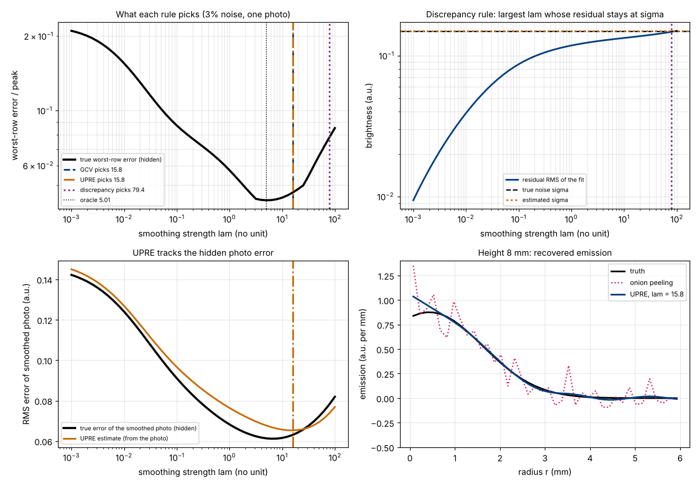
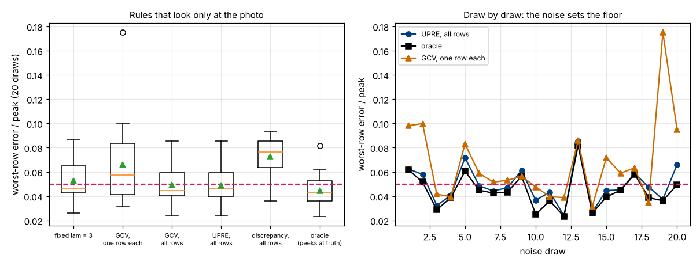

# Session 4: No peeking at the truth: choosing the smoothing from the photo alone

*Level 3 (simulation and validation) · about 90 minutes · openabel*

> This is a simplified educational model. It is not a validated design tool and must not be used for real structures, electrical installations, vehicles, industrial processes or medical decisions.

**Prerequisites**

- Session 3: onion peeling, noise gain and the smoothing strength `lam`.
- Matrix times vector, the trace of a matrix (the sum of its diagonal) and a standard deviation (explained in Section B).

**Learning objectives.** After this session you can:

- Estimate the noise size sigma from the photo alone, and check the estimate against the truth in a simulation.
- Compute three truth-free scores for the smoothing strength: the discrepancy principle, unbiased predictive risk (UPRE) and generalised cross-validation (GCV).
- Verify the leave-one-out shortcut by honest refitting, and verify that UPRE is unbiased by Monte Carlo.
- Explain why one `lam` chosen from all rows of a photo beats one `lam` per row.
- Say honestly how close a truth-free rule gets to the best possible choice, and why no rule can beat the noise.

## A. Real-world problem
In Session 3 the smoothing strength was chosen by trying several values and keeping the one whose answer was closest to the true flame. With a real photograph nobody knows the true flame, so that recipe is impossible. What can the photo itself tell us about how much smoothing it needs? It turns out to tell us quite a lot: the size of its own noise, and how well a smoothed copy of it would predict a clean copy. (This is general education about image processing, not a measurement method for any safety decision.)

## B. Concept and theory
The smoothed answer is linear in the photo: eps_hat = G I, with G = (W^T W + lam s D^T D)^-1 W^T from Session 3. The smoothed *photo* is A I with A = W G, the *hat matrix*. The trace of A, written df, counts how many numbers the smoothed photo is really made of (the *effective parameters*): df = N when lam = 0, because the photo is copied, and df falls towards 2 as lam grows.

Three quantities describe a choice of lam, using only the photo I: the residual sum of squares rss = |I - A I|^2 (averaged over the rows if several rows share one lam), the effective parameters df, and the noise size sigma, which is read from the photo too. A smooth profile has tiny second differences d_i = I_(i+1) - 2 I_i + I_(i-1), so what remains in d is noise, with standard deviation sqrt(6) sigma. The median absolute deviation (MAD) of d, times 1.4826 to match a Gaussian, gives sigma and is hardly moved by the few places where the flame's own curvature is large.

The three rules, each choosing lam from a grid:

- **Discrepancy principle:** the largest lam whose residual stays at the noise level, rss / N <= sigma^2.
- **UPRE:** the lam with the smallest UPRE(lam) = rss + 2 sigma^2 df - N sigma^2, an unbiased estimate of the prediction error |A I - I_clean|^2.
- **GCV:** the lam with the smallest GCV(lam) = N rss / (N - df)^2. It needs no sigma. It rests on leave-one-out cross-validation: hide pixel i, refit, predict it. For a linear smoother the prediction error is (I_i - (A I)_i) / (1 - A_ii) with no refitting, and GCV replaces each A_ii by their average df / N.

| Symbol | Meaning | Unit |
|---|---|---|
| I | the photo (brightness profile, one or more rows) | a.u. |
| N | number of pixels across one row | none |
| lam | smoothing strength (a pure number) | none |
| A | hat matrix: smoothed photo = A I | none |
| df | effective parameters, the trace of A | none |
| rss | squared residual of the smoothed photo, \|I - A I\|^2 | a.u.^2 |
| sigma | standard deviation of the photo noise | a.u. |

**Assumptions**

- The flame is steady and round about a known axis; each row is inverted separately (Session 3).
- The noise is independent from pixel to pixel with one size sigma for the whole photo.
- The camera brightness is proportional to the light (no gamma curve, no compression).
- The photo of the true flame is smooth compared with its noise at second-difference scale.

$$ \hat\sigma = \frac{1.4826}{\sqrt6}\,\mathrm{median}\,\bigl|\,d_i-\mathrm{median}(d)\,\bigr|,\qquad d_i=I_{i+1}-2I_i+I_{i-1} $$

$$ \mathrm{UPRE}(\lambda)=\mathrm{rss}+2\sigma^{2}\,\mathrm{df}-N\sigma^{2},\qquad \mathrm{GCV}(\lambda)=\frac{N\,\mathrm{rss}}{(N-\mathrm{df})^{2}} $$

$$ e_i^{\mathrm{loo}}=\frac{I_i-(AI)_i}{1-A_{ii}}\quad(\text{leave-one-out error, no refitting}) $$

## C. Visual explanation
The four panels use one 3 percent noise candle photo. Top left: the true worst-row error against lam, a curve we are not allowed to see, with the lam picked by each rule. GCV and UPRE both pick 15.8 and give an error of 0.047 against 0.043 for the best possible lam (5.0); the discrepancy rule picks 79.4 and gives 0.078. Top right shows why the discrepancy rule over-smooths: the residual of the fit only climbs to the noise line at lam of about 80, because even a perfect smoother leaves less than sigma behind (it spends df numbers on fitting part of the noise). Bottom left: the UPRE estimate, computed from the photo, follows the hidden true error of the smoothed photo and has its minimum at about the same place. Bottom right: at height 8 mm, onion peeling is wild, the UPRE-smoothed profile follows the truth.

*Four panels for one noisy candle photo: errors and the lam each rule picks, the discrepancy rule, UPRE against the hidden error, and the recovered emission at height 8 mm.*

The second figure repeats the choice on 20 different noise draws. UPRE and GCV on all rows have a mean worst-row error of 0.049 (best possible: 0.044); GCV applied to one row at a time is worse (0.066) and sometimes wild (worst draw 0.175); the discrepancy rule is worst (0.073). Right panel, draw by draw: the black line, the best any single lam could do, already exceeds the 0.05 line on 6 of the 20 draws. The noise draw sets a floor.

*Worst-row error for five rules over 20 noise draws, and draw by draw for UPRE, the oracle and per-row GCV.*

## D. Interactive simulation
Run the lesson (`python start.py 4`), then open the live app: [Session 4: choosing the smoothing from the photo alone](https://krunalpanchal1995.github.io/pan-iit-oss/openabel/session-04/) (or `app.html` in this folder). Pick a noise level and a noise seed (the seed is a new random photo), then move the rule slider between GCV, UPRE and discrepancy and watch the chosen lam against the dotted best lam in the first view. Change the number of rows the choice may look at from 1 to 20 and see how the choice settles down. The other views show the fitted photo and the recovered profile.

**Challenge.** At 4 percent noise with seed 5, choose the rule and the number of rows so that the worst-row error is within 2 percent of the best any smoothing strength could do. (Hint: watch how the choice settles down as the rule sees more rows; the discrepancy rule never gets there.)

## E. Worked example and experiment
**Problem.** For the height-8 row of the 3 percent candle photo (N = 40 pixels), the noise estimated from all 20 rows is sigma = 0.150, so sigma^2 = 0.0224 and N sigma^2 = 0.896. Smoothed with lam = 0.3, 3 and 15.8, the fit leaves rss = 0.596, 0.829 and 0.921 with df = 16.76, 10.11 and 7.27. Score the three values with all three rules.

1. UPRE = rss + 2 sigma^2 df - N sigma^2. For lam = 0.3: 0.596 + 2 x 0.0224 x 16.76 - 0.896 = 0.596 + 0.751 - 0.896 = 0.451. For lam = 3: 0.829 + 0.453 - 0.896 = 0.386. For lam = 15.8: 0.921 + 0.326 - 0.896 = 0.351. The smallest is lam = 15.8.
2. GCV = N rss / (N - df)^2. For lam = 0.3: 40 x 0.596 / 23.24^2 = 0.0441. For lam = 3: 40 x 0.829 / 29.89^2 = 0.0371. For lam = 15.8: 40 x 0.921 / 32.73^2 = 0.0344. Again lam = 15.8 is smallest.
3. Discrepancy: rss / N is 0.0149, 0.0207 and 0.0230 against sigma^2 = 0.0224. The first two pass; lam = 15.8 fails (just). Among these three, the largest that passes is lam = 3.
4. Truth, which the rules never saw: the emission errors are 0.060, 0.044 and 0.047. UPRE and GCV chose 15.8 (0.047) and the discrepancy rule chose 3 (0.044); both are close to the best, and the more smoothing the rule allows, the more it relies on the noise estimate being right.

**Answer.** UPRE and GCV prefer lam = 15.8 (UPRE 0.351, GCV 0.0344); the discrepancy rule, limited to these three values, picks lam = 3. The true errors are 0.047 and 0.044.

**Experiment.** Keep a phone on a stand and photograph a plain sheet of white paper twice in the same light without touching anything. Open both pictures as arrays (for example with Python and an image library), subtract one from the other, and divide the standard deviation of the difference by sqrt(2): that is the noise size sigma of one picture in brightness steps. Compare it with the second-difference estimate on a single row of one picture (use a smooth part of the paper, with a slight gradient from the lighting). They should agree within about 10 to 20 percent. A real phone differs from the model because JPEG compression makes neighbouring pixels' noise correlated, the brightness is not proportional to the light, and the noise is a little larger in bright parts; the model assumes independent noise of one size.

## Real-world application and mini-project: Choose the smoothing for the candle without peeking (classroom exercise only)
A lab gives you only the noisy photo of the candle-like flame (`noisy_candle(clean_candle(), 0.03, rng)`), not the true emission. Write a function that picks one lam for the whole photo and returns it, using `noise_sigma` and the rules of Section B but never `candle_emission`. Then grade it, because this is a simulation and the truth is known: run it on 20 different noise draws (`compare_methods`) and compare its worst-row error at heights 4, 8 and 12 mm with the best single lam (the oracle) and with the fixed lam = 3 of Session 3. Then repeat at 1 percent and at 6 percent noise. This is a teaching exercise on synthetic data; it is not a method for measuring a real flame.

**Deliverable:** A script that prints, for each rule, the mean, median and worst error over the 20 draws and the number of draws at or below 0.05, a figure of the 20 draws, and a sentence on whether the roadmap line "at or below 0.05 for all 20 draws" can be met.

**Success looks like:** Choosing from all rows, UPRE has mean 0.049 and median 0.046 (the oracle: 0.044 and 0.043), beating the fixed lam = 3 (0.053). GCV on one row at a time is erratic (mean 0.066, worst 0.175). The line "0.05 on every draw" cannot be met by any rule: even the oracle reaches it on only 14 of 20 draws (UPRE 13 of 20), because the 3 percent noise itself sets the floor. At 6 percent noise UPRE (mean 0.080) clearly beats the fixed lam = 3 (0.102), whose value was tuned for 3 percent: the rule adapts, the fixed value does not.

## F. Assessment and design challenge
**Question type A: Conceptual.** Why can we not choose lam by making the residual |I - A I| as small as possible?

Hint

What lam gives the smallest possible residual, and what does the recovered profile look like then?

Step-by-step solution

The residual is smallest, in fact zero, at lam = 0, where the smoothed photo is the photo itself and the inversion is plain onion peeling: it fits the noise perfectly and amplifies it into a wild profile. A good choice should leave a residual about as large as the noise, not zero. That is the idea of the discrepancy principle, and UPRE and GCV correct the residual for the df numbers that the smoother spends on fitting noise.

**Question type B: Numerical.** A photo has N = 50 pixels and noise sigma = 0.2. Smoothing with lam1 leaves rss = 1.5 with df = 15; lam2 leaves rss = 1.9 with df = 9. Compute UPRE, GCV and the discrepancy test for both, and say which lam each rule prefers.

Hint

UPRE = rss + 2 sigma^2 df - N sigma^2 with sigma^2 = 0.04 and N sigma^2 = 2.0; GCV = N rss / (N - df)^2; the test is rss / N <= sigma^2.

Step-by-step solution

lam1: UPRE = 1.5 + 2 x 0.04 x 15 - 2.0 = 0.70; GCV = 50 x 1.5 / 35^2 = 0.0612; rss / N = 0.030 <= 0.04 passes. lam2: UPRE = 1.9 + 0.72 - 2.0 = 0.62; GCV = 50 x 1.9 / 41^2 = 0.0565; rss / N = 0.038 <= 0.04 passes. UPRE and GCV both prefer lam2 (smaller scores). Both values pass the discrepancy test, and that rule takes the largest lam that passes, so it also prefers lam2 (the more smoothing). Units: the scores are in a.u. squared.

**Question type C: Graph and simulation interpretation.** In the top right panel of the first figure, the residual of the fit reaches the dashed noise line only at lam of about 80, while the best lam is about 5. What does this tell you about the discrepancy rule?

Hint

How large is the residual of a perfect smoother compared with sigma? Think of df.

Step-by-step solution

A smoother that uses df numbers to describe the photo fits part of the noise, so even a perfect one leaves a residual smaller than sigma: about sigma^2 (N - df) / N in the mean square. At the best lam (df about 9 of 40) that is roughly 0.78 sigma^2, well below the line. The discrepancy rule waits until the residual rises all the way to sigma^2, which needs a far stronger lam, so it over-smooths. UPRE and GCV account for df and do not.

**Question type D: Design and optimisation challenge.** Design: for the candle photo at 1, 3 and 6 percent noise, run `compare_methods(clean_candle(), frac)` and report the mean worst-row error of UPRE on all rows, of the oracle and of the fixed lam = 3. Which rule would you ship, and how does the chosen lam change with the noise?

Hint

Also print the median of `choose_lam(img, "upre")` over the draws for each noise level.

Step-by-step solution

At 1 percent: UPRE 0.023, oracle 0.021, fixed lam = 3 0.024. At 3 percent: 0.049, 0.044, 0.053. At 6 percent: 0.080, 0.072, 0.102. The median lam chosen by UPRE grows with the noise: about 1.6, 10 and 40, as it should (more noise needs more smoothing), while the oracle's lam grows from about 0.9 to 6 to 25, so UPRE leans to slightly stronger smoothing than the best. Ship UPRE on all rows (or GCV if sigma cannot be trusted): it is within about 10 percent of the oracle at each noise level, and it adapts, while the fixed value is tuned for one noise level only. Assumptions: independent noise of one size, the same flame shape, 20 rows to pool.

Score yourself with [RUBRIC.md](../../RUBRIC.md). Print the [activity sheet](activity_sheet.md) to work on paper.

## Common misconceptions
| Common misconception | What is actually true |
|---|---|
| Choose the smoothing that makes the picture look nicest. | "Looks smooth" is also what over-smoothing looks like. A rule based on the noise level and the effective parameters gives a number that does not depend on taste. |
| The best fit to the photo is the best answer. | The best fit (lam = 0) fits the noise too. A good fit leaves a residual about the size of the noise, a little less. |
| A truth-free rule finds the best lam. | It finds a good lam, here within about 10 percent of the best error on average, but not the best one for each photo; the noise draw sets a floor no rule can beat. |
| A rule that works on one row works on every row separately. | One row has only 40 numbers, so the choice is noisy (worst draw 0.175). All rows share the same noise and the same flame physics; pooling them gives a steadier choice. |

## Glossary
- **discrepancy principle**: choosing the strongest smoothing whose residual stays at the noise level
- **hat matrix**: the matrix A that turns the photo into its smoothed copy, A I
- **effective parameters (df)**: the trace of the hat matrix, how many numbers the smoothed photo is made of
- **UPRE**: unbiased predictive risk estimate, an estimate of the smoothed photo's error computed from the photo and the noise size
- **GCV**: generalised cross-validation, a leave-one-out score that needs no noise size
- **median absolute deviation (MAD)**: a robust measure of spread, hardly moved by a few large values
- **oracle**: a rule that looks at the truth; it gives a yardstick but is not a method

## Finish
1. Do the three coding tasks in [exercises.md](exercises.md).
2. Run `python start.py 4` again after your changes. It ends with the checkpoint; when it prints `PASS`, you are done. (Checkpoint only: `python start.py check 4`.)

Next: [Session 5: Where is the axis? Finding the flame's symmetry axis from the photo](../session-05/README.md).
