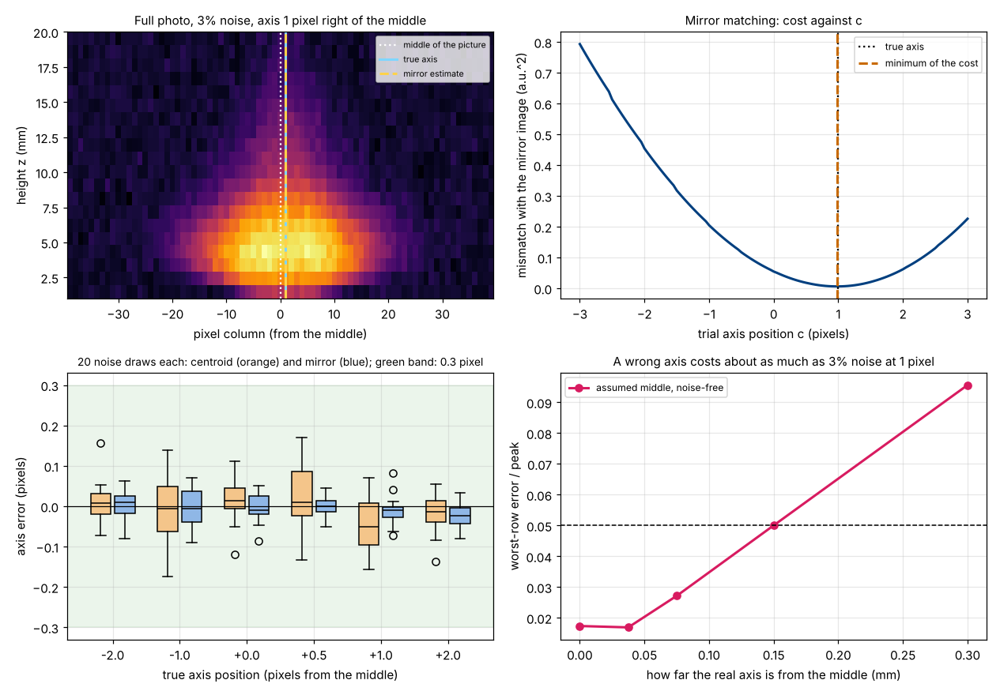
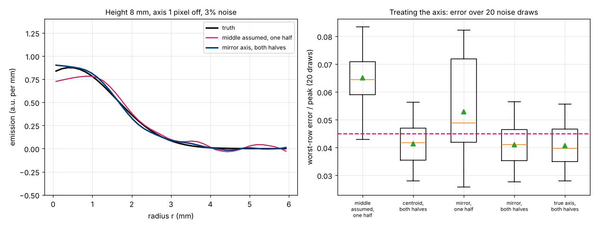

# Session 5: Where is the axis? Finding the flame's symmetry axis from the photo

*Level 3 (simulation and validation) · about 90 minutes · openabel*

> This is a simplified educational model. It is not a validated design tool and must not be used for real structures, electrical installations, vehicles, industrial processes or medical decisions.

**Prerequisites**

- Session 3: the ring matrix, onion peeling and the smoothing strength `lam`; Session 4 is useful but not required.
- Averages, squared differences and fitting a parabola through three points (explained in Section B).

**Learning objectives.** After this session you can:

- Say what a wrong axis position costs the recovered flame, with and without noise, in pixels and millimetres.
- Build the ring matrix for pixels at any offset from the axis, so that a photo never has to be resampled.
- Find the axis from the photo alone with two finders (the centroid and mirror matching) and grade them against a photo whose true axis you moved yourself.
- Explain why interpolating a noisy photo can fool a finder ("pixel locking"), and fix it by smoothing first.
- Show that finding the axis and then using both halves of the photo reaches the roadmap's 0.045, while one half does not.

## A. Real-world problem
Every inversion so far assumed that the flame's axis runs exactly through the middle of one pixel column. A real camera is never aligned that well: the flame sits a fraction of a pixel to one side. One pixel here is 0.15 mm, and a one-pixel mistake already costs about as much as 3 percent noise does. Can the photo itself tell us where the axis is? Yes, because a round flame looks the same on the left and on the right of its axis. (This is general education about image processing, not a measurement method for any safety decision.)

## B. Concept and theory
Measure positions in pixels from the middle column of the photo (right is positive). A full photo has 2N - 1 = 79 columns for N = 40 rings of width dr = R / N = 0.15 mm. If the axis is at position `a`, the column at x looks along a line of sight at offset y = |x - a| dr from the axis. The ring matrix row for that pixel has, for ring j between radii r_j and r_(j+1), the chord length

2 [ sqrt(r_(j+1)^2 - y^2) - sqrt(r_j^2 - y^2) ]

(a square root of a negative number counts as 0). Because y can be any number, the matrix is written for the actual pixel offsets and the photo is never resampled, so no noise is blurred. A wrong `a` changes y of every pixel by the same amount, and that changes every row of the matrix: for ring 10 (1.50 to 1.65 mm), a pixel at y = 1.50 mm has a chord of 1.375 mm, and the same pixel read 1 pixel (0.15 mm) further out, at y = 1.65 mm, has 0.

Two finders, both reading only the photo:

- **Centroid.** The centre of mass of a symmetric glow lies on its axis: a = sum(x I) / sum(I). Only the columns where the row-averaged, lightly smoothed photo exceeds 10 percent of its peak are summed, so the far, noise-only pixels do not pull. Its weakness: that window of columns is cut at pixel boundaries, which biases the centroid by up to 0.05 pixel for some axis positions, and it moves with the noise.
- **Mirror matching.** If the axis is at c, the photo reflected about c equals the photo: I(2c - x) = I(x). Slide c and measure cost(c) = mean over x of [I(x) - I(2c - x)]^2 for all rows together; the lowest point is the axis, refined by a parabola through the lowest points. I(2c - x) falls between pixels and must be interpolated, which averages two noisy pixels and lowers the noise more at some c than at others. The cost then prefers those c: **pixel locking**, about 0.14 pixel of scatter here. Smoothing the photo first with a Gaussian of 2 pixels makes neighbouring pixels alike, so the interpolation no longer changes the noise much, while the axis of a smooth glow does not move.

Once the axis is found, both halves are inverted at once: each half carries independent noise, so using all 79 pixels instead of 40 lowers the noise of the answer.

| Symbol | Meaning | Unit |
|---|---|---|
| x | pixel column, from the middle column of the photo | pixel |
| a, c | axis position, true or trial | pixel |
| dr | size of one pixel (R / N) | 0.15 mm |
| y | offset of a line of sight from the axis, \|x - a\| dr | mm |
| I(x) | brightness of column x | a.u. |
| cost(c) | mean squared mismatch between the photo and its mirror image about c | a.u.^2 |

**Assumptions**

- One steady, upright flame whose axis is a single straight line for all heights.
- The camera looks exactly sideways and its pixels are square; the brightness is proportional to the light.
- Noise is independent from pixel to pixel with one size.
- The axis is within 3 pixels of the middle (the search range of the finder).

$$ a_{\mathrm{centroid}}=\frac{\sum_x x\,I(x)}{\sum_x I(x)},\qquad \mathrm{cost}(c)=\operatorname*{mean}_x\bigl[I(x)-I(2c-x)\bigr]^2 $$

$$ W_{ij}=2\left[\sqrt{r_{j+1}^2-y_i^2}-\sqrt{r_j^2-y_i^2}\right]_+,\qquad y_i=|x_i-a|\,dr $$

## C. Visual explanation
The first figure uses one noisy photo (3 percent) whose axis is 1 pixel to the right of the middle. Top left: the photo, with the middle of the picture, the true axis and the mirror estimate. Top right: the mirror cost against the trial axis c; its lowest point is at +0.98 for this photo (the centroid says +0.94; the truth is +1.00). Bottom left: over 20 noise draws at each of 6 true axis positions, the mirror finder (blue) scatters less than the centroid (orange) and both stay inside the 0.3 pixel band. Bottom right: if the middle is wrongly assumed, even a noise-free photo is recovered with an error of 0.050 at 1 pixel and 0.096 at 2 pixels (0.017 is the error of the smoothing alone).

*Four panels: the full photo with the true and estimated axis, the mirror cost curve, axis errors of both finders over 20 draws at 6 axis positions, and the cost of a wrong axis.*

The second figure compares five treatments over the same 20 photos (axis 1 pixel off, 3 percent noise). Left: the recovered emission at 8 mm for one photo. Right: worst-row error for each treatment. Assuming the middle gives a mean of 0.065; finding the axis by mirror matching and using both halves gives 0.041, the same as using the true axis (0.041); using one half only, even with the axis found, gives 0.053.

*Recovered emission at 8 mm height for three treatments, and the worst-row error of five treatments over 20 noise draws.*

## D. Interactive simulation
Run the lesson (`python start.py 5`), then open the live app: [Session 5: where is the axis?](https://krunalpanchal1995.github.io/pan-iit-oss/openabel/session-05/) (or `app.html` in this folder). Move the true axis with the slider, pick the axis the inversion uses (the middle, the centroid, mirror matching, or the true axis, which no real experiment can know) and the number of halves, and watch the worst-row error. In the first view the hollow circles are the photo reflected about the axis in use: they lie on the filled ones only when the axis is right. The second view shows the mirror cost with the true axis, the centroid and the lowest point marked; reduce the number of rows the finders may look at from 20 to 1 and watch the minimum become unreliable.

**Challenge.** The real axis is 1 pixel (0.15 mm) right of the middle, noise 3 percent, draw 16. Choose how to find the axis (not the true axis, which nobody knows) and how many halves to use so that the worst-row error is at or below 0.045. (Hint: with the axis found, using only one half still misses the line on this draw.)

## E. Worked example and experiment
**Problem.** One row of a photo has seven pixel values I = 0, 2, 6, 9, 7, 3, 1 at positions x = 0, 1, ..., 6. Find the axis with both finders.

1. Centroid: sum(x I) = 0 + 2 + 12 + 27 + 28 + 15 + 6 = 90 and sum(I) = 28, so a = 90 / 28 = 3.21.
2. Mirror cost at c = 3 (the mirror of x is 6 - x, always a whole pixel): the differences I(x) - I(6 - x) are -1, -1, -1, 0, 1, 1, 1, so cost = 6 / 7 = 0.86. At c = 3.5 (mirror 7 - x, six pixels have a partner): the differences at x = 1 to 6 are 1, 3, 2, -2, -3, -1, so cost = (1 + 9 + 4 + 4 + 9 + 1) / 6 = 4.67. At c = 2.5 (mirror 5 - x, partners for x = 0 to 5): -3, -5, -3, 3, 5, 3, so cost = (9 + 25 + 9 + 9 + 25 + 9) / 6 = 14.33.
3. A parabola through the three lowest points, with spacing h = 0.5, has its lowest point at c = 3 + h (f(2.5) - f(3.5)) / (2 [f(2.5) - 2 f(3) + f(3.5)]) = 3 + 0.5 (14.33 - 4.67) / (2 [14.33 - 1.71 + 4.67]) = 3 + 0.14 = 3.14.

**Answer.** The centroid gives 3.21, mirror matching 3.14; they agree to within 0.1 pixel (0.015 mm), and a reading by eye would say 3. Neither finder saw the truth.

**Experiment.** Put a round object with a smooth, soft edge (a ball of cotton wool, or a candle flame in a still room) against a dark background and photograph it from the side with a phone on a stand. Open the picture as an array (for example with Python and an image library), average a few rows across the object, and find its axis with the centroid and with mirror matching. Then cut the first 3 columns off the array and repeat: measured from the left edge of the array, the axis must move by exactly 3 pixels, which tests the finders on real data. When the object is round and well lit the two finders should agree within about a tenth of a pixel. A real picture differs from the model because lens distortion, a leaning flame, uneven lighting or a camera that is not exactly sideways make the left and right halves different, and then the axis the finders report is only the best compromise.

## Real-world application and mini-project: Find the axis of the candle photo and invert with it (classroom exercise only)
A lab hands you the full candle photo (`clean_candle_full(shift)` plus `noisy`), but not the shift. Write a function that finds the axis from the photo alone, with `axis_mirror` or `axis_centroid` or your own version, and uses it for an inversion with both halves (`worst_row_error(img, axis, both=True)`, which only grades). Then grade the whole pipeline, because this is a simulation and the truth is known: run `compare_axis_methods(1.0, 0.03, 20)` and compare the mean worst-row error of the five treatments, and the axis error of both finders. Then repeat for an axis 0.5 and 2 pixels off and at 1 and 6 percent noise. This is a teaching exercise on synthetic data; it is not a method for measuring a real flame.

**Deliverable:** A script that prints, for each treatment, the mean, median and worst error over the 20 draws and the number of draws at or below 0.045, a figure of the five boxes, and a sentence on whether the roadmap line "at or below 0.045 with the axis 1 pixel off" is met.

**Success looks like:** With the axis found by mirror matching and both halves used, the mean worst-row error is 0.041 (median 0.041, worst draw 0.057), the same as with the true axis (0.041), against 0.065 when the middle is assumed. The roadmap line is met on average but not on every draw: 13 of the 20 draws are at or below 0.045, with the true axis too, so the noise draw sets the rest. The centroid gives 0.041 as well but scatters more (axis error sd 0.046 against 0.040 pixel). Using one half only costs 0.053 even with the axis found. The same pipeline gives 0.041 for an axis 0.5 pixel off and 0.044 for 2 pixels, against 0.048 and 0.110 for assuming the middle.

## F. Assessment and design challenge
**Question type A: Conceptual.** Why is the brightest pixel a poor estimate of the flame's axis?

Hint

Look at the profile of the flame at 4 mm height, and think about what one noisy pixel is worth.

Step-by-step solution

Two reasons. First, the flame is a hollow glow ring at its base, so the brightness can peak off the axis: at 4 mm the brightest pixel in the noise-free photo is 4 pixels (0.6 mm) away from it. Low in the flame the profile is also flat on top (at 2 mm it changes by only 5 percent over 5 pixels), so the brightest pixel could be a few pixels either way. Second, one pixel carries one noise value of about 3 percent of the peak, which shifts the position of a flat-topped maximum by pixels. The centroid and the mirror cost use every pixel of the photo (and all its rows), so their noise averages out, and they use the symmetry of the whole profile, not its peak.

**Question type B: Numerical.** A row has the values I = 1, 4, 8, 6, 2 at positions x = 0, 1, 2, 3, 4. Compute the centroid, and the mirror cost at c = 1.5, 2 and 2.5, using only pixels that have a partner inside the row. What does each finder say?

Hint

The mirror of x about c is 2c - x. At c = 2 it is 4 - x; at c = 2.5 it is 5 - x; at c = 1.5 it is 3 - x.

Step-by-step solution

Centroid: (0 + 4 + 16 + 18 + 8) / 21 = 46 / 21 = 2.19. Cost at c = 2: the differences I(x) - I(4 - x) are -1, -2, 0, 2, 1, so cost = (1 + 4 + 0 + 4 + 1) / 5 = 2. At c = 2.5: partners for x = 1 to 4, differences 2, 2, -2, -2, so cost = 16 / 4 = 4. At c = 1.5: partners for x = 0 to 3, differences -5, -4, 4, 5, so cost = (25 + 16 + 16 + 25) / 4 = 20.5. The lowest of the three is c = 2; a parabola through them has its lowest point at 2 + 0.5 (20.5 - 4) / (2 [20.5 - 4 + 4]) = 2.20. Both finders say about 2.2 pixels. Units: pixels for the axis, a.u. squared for the cost.

**Question type C: Graph and simulation interpretation.** In the right panel of the second figure, the boxes "mirror, one half" and "mirror, both halves" use the same axis, yet the first is higher. What does this tell you?

Hint

How many independent noisy pixels does each inversion use?

Step-by-step solution

The axis is not the only thing that costs accuracy. Inverting one half uses about 40 pixels, inverting both uses 79, and the two halves carry independent noise, so the noise of the answer falls by roughly the square root of 2 (the mean error goes from 0.053 to 0.041 here). Finding the axis lets you use both halves; without it the second half is useless, because pixels with a wrong offset do harm. That is why the roadmap target of 0.045 needs both steps.

**Question type D: Design and optimisation challenge.** Design: for a candle photo with 3 percent noise and the axis 0.5, 1 and 2 pixels from the middle, run `compare_axis_methods(shift)` and report the mean worst-row error of "assume the middle (one half)", of "mirror axis, both halves" and of "true axis, both halves". When can you skip the axis search?

Hint

Compare the cost of a wrong axis with the noise floor, which is about 0.041 here.

Step-by-step solution

Assuming the middle: 0.048, 0.065 and 0.110 for 0.5, 1 and 2 pixels. Mirror axis, both halves: 0.041, 0.041 and 0.044. True axis, both halves: 0.042, 0.041 and 0.043. So the search costs nothing measurable at any shift, because its own error (sd about 0.04 pixel) is far below the damage of 1 pixel. The one half with the middle assumed is 0.007 above the floor at 0.5 pixel and 0.07 above it at 2 pixels. You could skip the search only when the camera is known to be aligned within about 0.25 pixel (0.04 mm), where the noise-free damage (0.017) equals that of a perfect axis, and you would then also give up the second half. Assumptions: a steady flame with one straight axis, independent noise, a camera that looks sideways.

Score yourself with [RUBRIC.md](../../RUBRIC.md). Print the [activity sheet](activity_sheet.md) to work on paper.

## Common misconceptions
| Common misconception | What is actually true |
|---|---|
| The middle column of the photo is the axis. | Only if the camera is aligned perfectly; a fraction of a pixel off already costs as much as 3 percent noise, and 2 pixels cost twice that. |
| The brightest pixel marks the axis. | The base of the flame is a hollow ring, and one noisy pixel moves a flat top by pixels. Use the whole photo. |
| Interpolating a photo to mirror it is harmless. | Interpolation changes the noise differently at different shifts, so the cost prefers some axis positions (pixel locking, about 0.14 pixel of scatter). Smooth the photo first. |
| A sub-pixel axis is a precise measurement. | It is a precise number for an ideal round, upright flame. A leaning or flickering flame has an axis that depends on the height and the moment, and the finder then reports only a compromise. |

## Glossary
- **symmetry axis**: the line about which the round flame looks the same on both sides
- **centroid**: the centre of mass of the brightness, which lies on the axis of a symmetric glow
- **mirror matching**: finding the axis as the position about which the photo best matches its own reflection
- **pixel locking**: a bias of a sub-pixel finder towards whole or half pixel positions, caused by interpolating noisy pixels
- **sub-pixel**: smaller than one pixel, here a fraction of 0.15 mm
- **no inverse crime**: making the photo with a different, finer method than the one used to invert it

## Finish
1. Do the three coding tasks in [exercises.md](exercises.md).
2. Run `python start.py 5` again after your changes. It ends with the checkpoint; when it prints `PASS`, you are done. (Checkpoint only: `python start.py check 5`.)

Next: the [roadmap](../../promo/roadmap.md). Session 6 is yours to build.
