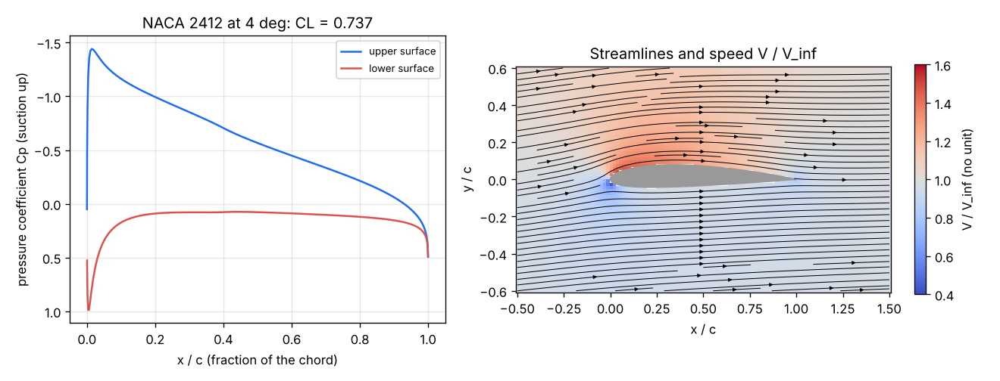
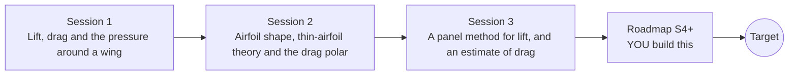

# openairfoil

[](https://github.com/KrunalPanchal1995/pan-iit-oss/actions/workflows/tests.yml)   [](https://colab.research.google.com/github/KrunalPanchal1995/pan-iit-oss/blob/main/openairfoil/sessions/session-01/lesson.ipynb) [](https://krunalpanchal1995.github.io/pan-iit-oss/openairfoil/)

**Estimate airfoil lift and drag with a panel method, in three sessions.**

openairfoil teaches how the shape of a wing decides its lift and drag, and therefore how much fuel a plane burns, from the lift equation and Bernoulli to NACA airfoils, thin-airfoil theory and a working panel method, using only Python and a browser.

- **Start from zero.** Session 1 needs only school arithmetic: dynamic pressure, lift = weight, and the stall speed.
- **See the flow.** Every session ships a slider app that runs in the browser; Session 3 solves a full panel method live as you move the sliders.
- **Know you got it right.** Each session ends with a checkpoint that prints PASS or FAIL against hand calculations, exact solutions and conservation checks.
- **Build the missing half.** The repo stops at Session 3 on purpose; the roadmap shows the path to the Target.

[Target](#the-target) · [Who is this for](#who-is-this-for) · [Quick start](#quick-start) · [Sessions](#sessions) · [Roadmap](#roadmap) · [Contribute](#contribute) · [Explainer PDF](docs/explainer.pdf)

> **This repo is incomplete on purpose.** Sessions 1 to 3 are here and fully working. The finished Target below is a preview of what the community can build next. We show you the path, not the code. Sessions 4 and up are yours.

## The Target

A small airfoil analyser for any NACA 4-digit section: the panel method of Session 3 coupled to a boundary layer that grows along the surface under the computed pressure, turns turbulent, and separates near stall. For NACA 0012 and 2412 it draws the pressure, the streamlines and the boundary-layer thickness, and a full drag polar with stall, and it checks itself against published wind-tunnel data: a lift slope near 0.105 per degree, a minimum drag near 0.0055 at Re = 6 million and a CL_max near 1.6. Your goal over the coming sessions: build that analyser yourself and use it to choose the wing section that burns the least fuel.



*Starting point for the Target: pressure distribution and streamlines round NACA 2412 at 4 degrees from the Session 3 panel method (CL = 0.737). The Target adds the boundary layer, the drag polar and stall.*

Try it live:

- [Session 3 live panel method](https://krunalpanchal1995.github.io/pan-iit-oss/openairfoil/session-03/)
- [Math Visual Studio](https://krunalpanchal1995.github.io/studio/)

How the Target is reached is shown only as a path in [promo/roadmap.md](promo/roadmap.md).

## Who is this for
**higher secondary to advanced undergraduate (levels 4-6).** Topic area: Aerospace, Automotive and Transportation.

Prerequisites:

- School arithmetic, squares and square roots; the idea of force and pressure.
- Python 3.10 or newer; if `python --version` works, you are ready. PRIMER.md explains the rest.
- No prior GitHub, fluid mechanics or calculus experience is needed; Session 3 explains the linear system it solves.

New to Python? Read [PRIMER.md](PRIMER.md) first (10 minutes).

## Quick start

No installation knowledge needed. You need [Git](https://git-scm.com/downloads) and [Python 3.10+](https://www.python.org/downloads/) (Windows: tick "Add Python to PATH"). On Mac and Linux type `python3` wherever this page says `python`.

```bash
git clone https://github.com/KrunalPanchal1995/pan-iit-oss.git
cd pan-iit-oss/openairfoil
python start.py 1
```

`start.py` creates a private environment, installs what is needed and runs Session 1 with its checkpoint. Next: `python start.py 2`, `python start.py 3`, or `python start.py test` to check everything. Only a checkpoint: `python start.py check 1`.

<!-- friendly-help -->
<details>
<summary><b>Not working? Common fixes (no Git, "python not found", no internet)</b></summary>

- **No Git?** You do not need it. On the main page of this collection click the green **Code** button, then **Download ZIP**, unzip it, open a terminal inside the folder `pan-iit-oss-main/openairfoil` and run `python start.py 1`. The ZIP holds every project, so it is large; the live apps need no download at all.
- **"python is not recognized" or "command not found".** On Windows try `py start.py 1`. On Mac and Linux try `python3 start.py 1`. If neither works, install Python from [python.org](https://www.python.org/downloads/) and tick "Add Python to PATH".
- **Needs internet once.** The first run downloads NumPy and Matplotlib into a private folder (`.venv`); after that it works offline.
- **Rather not install anything?** Open the [live apps](https://krunalpanchal1995.github.io/pan-iit-oss/openairfoil/) in your browser, or use the Colab badge at the top of this page.
- **Still stuck?** [Open an issue](https://github.com/KrunalPanchal1995/pan-iit-oss/issues/new?title=%5Bopenairfoil%5D%20) with your operating system and the message you see. Questions from beginners are welcome.

</details>

Four lines turn the idea of Session 1 into a result (they work as they are): Save it as `try.py` and run it with `python start.py run try.py` (this uses the private environment, where NumPy is installed):

```python
import numpy as np
rho, V, S, m = 1.225, 50.0, 16.0, 1000.0      # air density, speed, wing area, mass
print(np.round(m * 9.81 / (0.5 * rho * V**2 * S), 3))   # -> 0.4   lift coefficient needed to fly level
print(np.round(2 * np.pi * np.radians(5), 3))           # -> 0.548 thin-airfoil CL at 5 degrees
```

Every session also opens in your browser with sliders (no install): [live apps](https://krunalpanchal1995.github.io/pan-iit-oss/openairfoil/). Or use the Colab badge above for the notebook.

## Sessions

| # | Session | Model level | Time | Live app |
|---|---|---|---|---|
| 1 | [Lift, drag and the pressure around a wing](sessions/session-01/README.md) | Level 1: conceptual interactive model | 60 min | [open](https://krunalpanchal1995.github.io/pan-iit-oss/openairfoil/session-01/) |
| 2 | [Airfoil shape, thin-airfoil theory and the drag polar](sessions/session-02/README.md) | Level 2: mathematical engineering model | 75 min | [open](https://krunalpanchal1995.github.io/pan-iit-oss/openairfoil/session-02/) |
| 3 | [A panel method for lift, and an estimate of drag](sessions/session-03/README.md) | Level 3: simulation and validation | 90 min | [open](https://krunalpanchal1995.github.io/pan-iit-oss/openairfoil/session-03/) |

Each session follows the same six steps: A real-world problem, B concept and theory, C visual explanation, D interactive simulation, E worked example and experiment, F assessment and design challenge. Each ends with `checkpoint.py`, which prints `PASS` or `FAIL` against reference numbers. Session 3 also contains the real-world mini-project: **Choose the wing section of a small two-seater**.

## Architecture



| Folder or file | What is inside |
|---|---|
| `sessions/` | three sessions: README (A-F), `lesson.py`, notebook, live app, exercises, activity sheet, checkpoint |
| `promo/` | the Target: media, live links, and the roadmap (path only) |
| `docs/` | `explainer.tex` and the built `explainer.pdf` |
| `tests/` | runs every lesson and checkpoint headless |
| `start.py` | one command to set up and run anything |
| `QUALITY.md`, `RUBRIC.md` | the quality checklist and the scoring rubric |
| `.github/` | CI, PDF build, Pages deploy, issue and PR templates |

## Roadmap

| Milestone | What you will build | Difficulty |
|---|---|---|
| Session 4: A laminar boundary layer (Thwaites) | Thwaites' integral method marching along each surface from the stagnation point, using the panel Vt. | intermediate |
| Session 5: Transition and a turbulent boundary layer | Michel's transition criterion and Head's entrainment method, with the drag from the Squire-Young formula. | advanced |
| Session 6: The drag polar of an airfoil | cd from Session 5 for a sweep of angles, plotted as cl against cd, with the best section L/D marked. | intermediate |
| Session 7: Separation and an estimate of stall | Detect separation from the shape factor H and reduce the effective lift as the separated part grows. | advanced |
| Session 8: From airfoil to wing (Prandtl lifting line) | A lifting-line solver with a Fourier series for the circulation along the span. | advanced |

Full detail with a checkpoint per milestone: [promo/roadmap.md](promo/roadmap.md).

## Contribute
New to GitHub? Read [CONTRIBUTING.md](CONTRIBUTING.md); it starts from zero. Pick an issue labelled `good first issue`. Translations into Hindi, Telugu, Tamil and Malayalam are welcome.

<details>
<summary>Development</summary>

```bash
python start.py test        # runs every lesson and checkpoint
```
Lessons use `# %%` cell markers so they open as notebooks in VS Code. See [QUALITY.md](QUALITY.md) for the standard every session meets.
</details>

## License
MIT. See [LICENSE](LICENSE). Media in `promo/media` is (c) Krunal Panchal, CC BY 4.0.

## Acknowledgments
Part of the [PAN IIT OSS](https://hellofoss.tech-iitb.org/projects) open-source teaching collection, modelled on the structure of [openspline](https://github.com/openspline/openspline). Built on ideas from the Math Visual Studio at https://krunalpanchal1995.github.io/studio/. The NACA 4-digit equations and the reference airfoil data come from Abbott and von Doenhoff, *Theory of Wing Sections* (Dover, 1959); the panel method follows Hess and Smith (1967) as taught in Katz and Plotkin, *Low-Speed Aerodynamics*.
