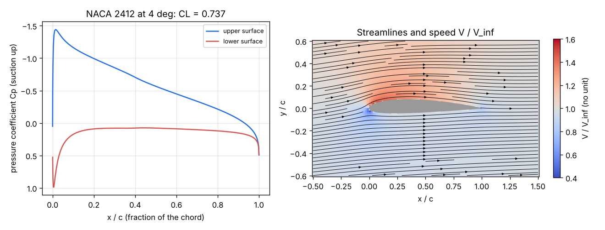

# What you are building toward

A small airfoil analyser for any NACA 4-digit section: the panel method of Session 3 coupled to a boundary layer that grows along the surface under the computed pressure, turns turbulent, and separates near stall. For NACA 0012 and 2412 it draws the pressure, the streamlines and the boundary-layer thickness, and a full drag polar with stall, and it checks itself against published wind-tunnel data: a lift slope near 0.105 per degree, a minimum drag near 0.0055 at Re = 6 million and a CL_max near 1.6. Your goal over the coming sessions: build that analyser yourself and use it to choose the wing section that burns the least fuel.

*Starting point for the Target: pressure distribution and streamlines round NACA 2412 at 4 degrees from the Session 3 panel method (CL = 0.737). The Target adds the boundary layer, the drag polar and stall.*

The finished analyser comes from a private reference build. Its code is not published; the roadmap shows the path so you can build your own.

Live links:

- [Session 3: a live panel method](https://krunalpanchal1995.github.io/pan-iit-oss/openairfoil/session-03/)
- [Math Visual Studio](https://krunalpanchal1995.github.io/studio/)
