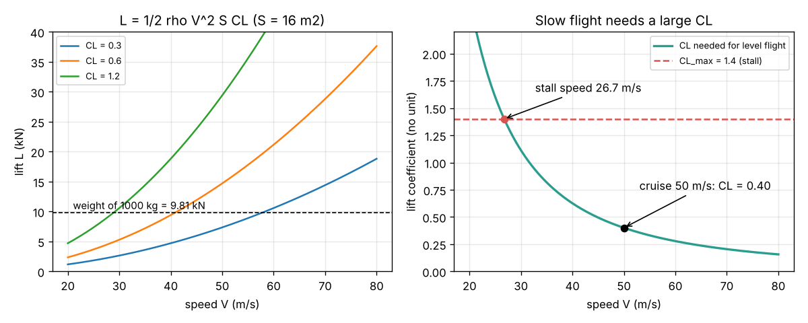
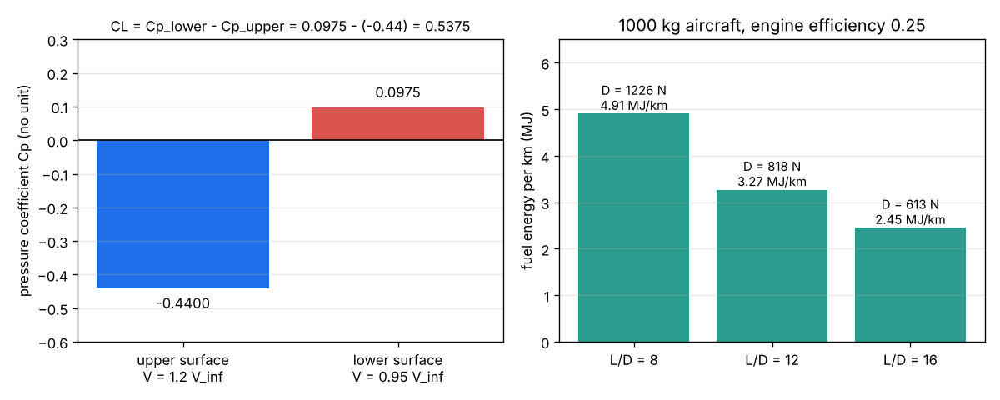

# Session 1: Lift, drag and the pressure around a wing

*Level 1 (conceptual interactive model) · about 60 minutes · openairfoil*

> This is a simplified educational model. It is not a validated design tool and must not be used for real structures, electrical installations, vehicles, industrial processes or medical decisions.

**Prerequisites**

- School arithmetic, squares and square roots; the idea of force (N) and pressure (Pa).
- You have read PRIMER.md and run `python start.py 1` once.

**Learning objectives.** After this session you can:

- Compute dynamic pressure, lift and drag from L = q S CL and D = q S CD.
- Find the lift coefficient a wing needs for level flight, and the stall speed.
- Explain why thrust = drag = weight / (L/D), and turn drag into fuel energy per kilometre.
- Use Bernoulli's equation and the pressure coefficient to explain where lift comes from.

## A. Real-world problem
A small two-seater aeroplane of 1000 kg must hold up its weight with lift, and its engine must push against drag for every kilometre it flies. Why does the wing need a certain speed to fly, what happens when it flies too slowly, and why does the drag, and so the fuel burnt, depend on the shape of the wing? (General education only: this is a simplified model, not an aircraft design method.)

## B. Concept and theory
Moving air carries a pressure of motion, the dynamic pressure q = 1/2 rho V^2 (in Pa when rho is in kg/m3 and V in m/s). Every aerodynamic force is written as q times the wing area S times a number that depends only on the shape and angle of the wing: lift L = q S CL (at right angles to the oncoming air) and drag D = q S CD (along it). In level flight lift equals weight, so the wing must work at CL = m g / (q S); flying slower means a larger CL, which the wing gets by meeting the air at a larger angle. Every wing has a maximum CL_max, beyond which the flow breaks away from the upper surface (stall); the slowest level-flight speed is the stall speed sqrt(2 m g / (rho S CL_max)). In steady cruise the thrust equals the drag, and since L = W the drag is W / (L/D): the lift-to-drag ratio measures how good the shape is. The work against drag over 1 km is D x 1000 m, and an engine and propeller that turn a share eta of the fuel energy into thrust work need D x 1000 / eta of fuel energy. Where does lift come from? Along a streamline of steady low-speed air, p + 1/2 rho V^2 is constant (Bernoulli), so where the air speeds up the pressure drops. The pressure coefficient Cp = (p - p_inf) / q_inf = 1 - (V / V_inf)^2 is 1 where the air stops, 0 where it moves at free-stream speed and negative (suction) where it is faster. If the air above a wing is faster than below, the lower surface pushes up harder than the upper surface pushes down; for a toy wing with uniform speeds, CL = Cp_lower - Cp_upper.

| Symbol | Meaning | Unit |
|---|---|---|
| rho | air density, 1.225 at sea level | kg/m3 |
| V, V_inf | flight speed (free-stream speed) | m/s |
| q | dynamic pressure 1/2 rho V^2 | Pa |
| S | wing area (seen from above) | m2 |
| L, D | lift and drag forces | N |
| CL, CD | lift and drag coefficients | no unit |
| m, g | aircraft mass and gravity 9.81 | kg, m/s2 |
| Cp | pressure coefficient (p - p_inf) / q | no unit |

**Assumptions**

- Steady, level flight at constant speed: lift = weight and thrust = drag.
- Low speed (well below the speed of sound), so the air density does not change along the wing.
- Sea-level standard air, rho = 1.225 kg/m3.
- CL, CD and the toy-wing speeds are given numbers here; Sessions 2 and 3 compute them.

$$ q = \tfrac12 \rho V^2,\qquad L = q\,S\,C_L,\qquad D = q\,S\,C_D $$

$$ C_{L,\mathrm{needed}} = \frac{m g}{q S},\qquad V_{\mathrm{stall}} = \sqrt{\frac{2 m g}{\rho S C_{L,\max}}} $$

$$ T = D = \frac{m g}{L/D},\qquad E_{\mathrm{fuel}}\ \text{per km} = \frac{D \times 1000\ \mathrm{m}}{\eta} $$

$$ p + \tfrac12 \rho V^2 = \mathrm{const},\qquad C_p = \frac{p - p_\infty}{q_\infty} = 1 - \left(\frac{V}{V_\infty}\right)^2 $$

## C. Visual explanation
The first figure shows that lift grows with the square of speed: at CL = 0.6 a 16 m2 wing makes 9.4 kN at 40 m/s but 37.6 kN at 80 m/s. The right panel shows the CL needed by the 1000 kg aircraft: 0.40 at a 50 m/s cruise, rising steeply as it slows until it meets CL_max = 1.4 at the stall speed of 26.7 m/s. The second figure shows the toy wing (air 1.2 times faster on top, 0.95 times underneath: Cp = -0.44 and +0.0975, CL = 0.5375) and the fuel energy per kilometre for three shapes: L/D 8, 12 and 16 need 4.91, 3.27 and 2.45 MJ per km.

*Lift grows with V squared; slow flight needs a large CL until the wing stalls at 26.7 m/s.*

*Left: faster air on top gives suction and lift. Right: a better L/D cuts the fuel per kilometre.*

## D. Interactive simulation
Run the lesson (`python start.py 1`), then open the live app: [Session 1: lift, drag and stall](https://krunalpanchal1995.github.io/pan-iit-oss/openairfoil/session-01/) (or `app.html` in this folder). Change the mass, the speed and the wing area and watch the lift and weight arrows. Open the CL view to see the needed CL climb towards CL_max as you slow down, and read the drag and the fuel energy per kilometre.

**Challenge.** Make a 1000 kg aircraft (CD 0.03 or more) stall at 26 m/s or slower while its drag at 50 m/s stays below 800 N.

## E. Worked example and experiment
**Problem.** A 1000 kg aircraft with a 16 m2 wing cruises at 50 m/s at sea level. Find the dynamic pressure, the CL it needs and its stall speed for CL_max = 1.4. With CD = 0.03, find the drag, L/D and the fuel energy per kilometre for an engine-and-propeller efficiency of 0.25. Finally find CL for a toy wing with air 1.2 times faster than V_inf on top and 0.95 times underneath.

1. q = 0.5 x 1.225 x 50^2 = 1531.25 Pa.
2. Weight = 1000 x 9.81 = 9810 N, so CL = 9810 / (1531.25 x 16) = 9810 / 24500 = 0.4004.
3. Stall speed = sqrt(2 x 9810 / (1.225 x 16 x 1.4)) = sqrt(19620 / 27.44) = sqrt(715.0) = 26.74 m/s.
4. Drag = 1531.25 x 16 x 0.03 = 735 N; L/D = 0.4004 / 0.03 = 13.35 (check: 9810 / 735 = 13.35).
5. Fuel energy per km = 735 N x 1000 m / 0.25 = 2.94 x 10^6 J = 2.94 MJ.
6. Toy wing: Cp_upper = 1 - 1.2^2 = -0.44, Cp_lower = 1 - 0.95^2 = 0.0975, CL = 0.0975 - (-0.44) = 0.5375.

**Answer.** q = 1531 Pa, CL = 0.400, stall at 26.7 m/s; D = 735 N, L/D = 13.4, 2.94 MJ per km; toy wing CL = 0.54.

**Experiment.** Hold a strip of paper just under your lower lip so it hangs down, and blow hard across its top. The strip rises: the fast air above it has a lower pressure than the still air below. Then hold your flat hand out of a moving bus or car window (safely, never out into traffic) and tilt it slightly: the push upward grows with the angle and roughly with the square of the speed. The model ignores how the flow curves round a real shape, which Sessions 2 and 3 add, and real air also creates friction drag the toy model leaves out.

## F. Assessment and design challenge
**Question type A: Conceptual.** Why does a slow aircraft have to fly with its nose higher (a larger angle of attack) than a fast one, and why can it not fly slower than the stall speed?

Hint

Look at CL = m g / (q S) and remember q grows with V squared.

Step-by-step solution

The weight is fixed, so q S CL must stay equal to m g. When V halves, q falls to a quarter, so CL must grow four times. The wing gets more CL by meeting the air at a larger angle. But CL cannot grow forever: above CL_max the air separates from the upper surface and the lift drops (stall). The speed at which the needed CL equals CL_max is the stall speed; slower than that the wing cannot hold up the weight.

**Question type B: Numerical.** A wing of 12 m2 flies at 60 m/s at sea level with CL = 0.5. Find q and the lift. Can it hold up a 1200 kg aircraft? Check the units.

Hint

q = 1/2 rho V^2, then L = q S CL; compare with m g.

Step-by-step solution

q = 0.5 x 1.225 x 3600 = 2205 Pa. L = 2205 x 12 x 0.5 = 13230 N = 13.2 kN. Weight = 1200 x 9.81 = 11772 N. Since 13.2 kN is more than 11.8 kN, yes (it would climb, or it can fly at a smaller CL). Units: Pa x m2 = N.

**Question type C: Graph and simulation interpretation.** In the lift-against-speed figure, read the lift at CL = 0.6 at 40 m/s and at 80 m/s. By what factor does it grow, and why is the curve not a straight line?

Hint

Lift is proportional to V squared.

Step-by-step solution

About 9.4 kN at 40 m/s and 37.6 kN at 80 m/s: a factor of 4 for twice the speed, because q = 1/2 rho V^2 grows with the square of V. A straight line would mean lift proportional to V, which is wrong.

**Question type D: Design and optimisation challenge.** Design: choose the wing area of a 1000 kg aircraft so that it stalls at no more than 25 m/s with flaps giving CL_max = 1.5. What CL will it then need in a 50 m/s cruise, and why would a designer not simply make the wing much bigger?

Hint

Solve the stall-speed formula for S: S = 2 m g / (rho V^2 CL_max).

Step-by-step solution

S = 2 x 9810 / (1.225 x 625 x 1.5) = 19620 / 1148.4 = 17.1 m2. In cruise q = 1531 Pa, so CL = 9810 / (1531 x 17.1) = 0.375. Trade-off: a bigger wing lands slower but has more surface rubbing against the air (more friction drag in cruise), more weight and more cost; designers use flaps to raise CL_max for landing instead of carrying a huge wing all the time.

Score yourself with [RUBRIC.md](../../RUBRIC.md). Print the [activity sheet](activity_sheet.md) to work on paper.

## Common misconceptions
| Common misconception | What is actually true |
|---|---|
| The air on top must speed up because it has further to travel and must meet the bottom air at the trailing edge (equal transit time). | There is no such rule; the air on top actually arrives at the trailing edge well before the air underneath. The speeds come from the shape and angle (the circulation), computed in Session 3. |
| Lift is proportional to speed. | Lift is proportional to the square of the speed: twice as fast gives four times the lift at the same CL. |
| A stall means the engine stopped. | An aerodynamic stall means the wing has passed CL_max and the flow has separated; it has nothing to do with the engine. |
| Drag only matters for fast aircraft. | In cruise the engine must supply thrust equal to the drag the whole way; L/D directly sets the fuel burnt per kilometre at every speed. |

## Glossary
- **dynamic pressure**: q = 1/2 rho V^2, the pressure of motion of the oncoming air
- **lift coefficient CL**: lift divided by q S; depends on shape and angle of attack
- **stall**: loss of lift when the angle is so large that the flow separates from the upper surface
- **lift-to-drag ratio**: L / D = CL / CD, the aerodynamic efficiency of a wing or aircraft
- **pressure coefficient**: Cp = (p - p_inf) / q; 1 at a stagnation point, negative where the air is faster than the free stream

## Finish
1. Do the three coding tasks in [exercises.md](exercises.md).
2. Run `python start.py 1` again after your changes. It ends with the checkpoint; when it prints `PASS`, you are done. (Checkpoint only: `python start.py check 1`.)

Next: [Session 2](../session-02/README.md)
