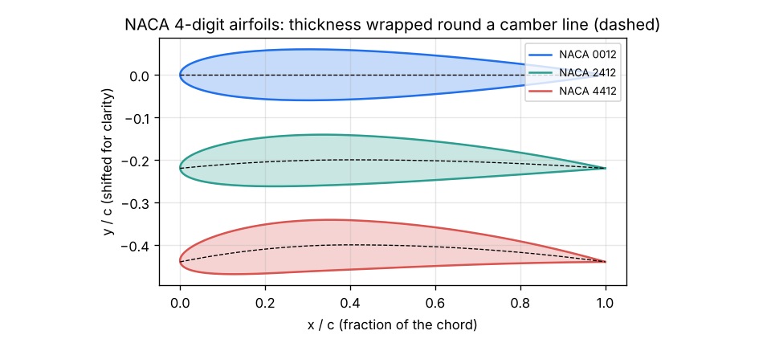
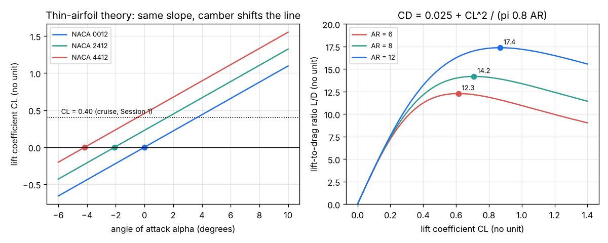

# Session 2: Airfoil shape, thin-airfoil theory and the drag polar

*Level 2 (mathematical engineering model) · about 75 minutes · openairfoil*

> This is a simplified educational model. It is not a validated design tool and must not be used for real structures, electrical installations, vehicles, industrial processes or medical decisions.

**Prerequisites**

- Session 1: lift, drag, CL and the CL needed in cruise.
- Angles in degrees and radians; reading a formula with a square root. The integral in Section B is computed by the code.

**Learning objectives.** After this session you can:

- Build the outline of any NACA 4-digit airfoil from its camber line and thickness.
- Use thin-airfoil theory, CL = 2 pi (alpha - alpha_L0), and explain why camber shifts the lift line.
- Write the drag polar CD = CD0 + CL^2 / (pi e AR) and explain induced drag.
- Find the best lift-to-drag ratio and the angle a wing needs for a given CL.

## A. Real-world problem
Session 1 found that our 1000 kg aircraft needs CL = 0.40 in cruise. Which wing section gives that, and at what angle? And once we know the lift, how large is the drag of the whole aircraft, and what is the best L/D it can reach? (Simplified low-speed model; not an aircraft design method.)

## B. Concept and theory
A wing section (airfoil) is described by its chord c (nose to tail), its camber line (the curved middle line) and its thickness wrapped round that line. The NACA 4-digit family names this with four digits: NACA 2412 has a maximum camber m = 2 percent of the chord at p = 4 tenths of the chord from the nose, and a maximum thickness of 12 percent. Thin-airfoil theory replaces the airfoil by its camber line covered with a sheet of tiny vortices, and demands that the air slides along the line and leaves the sharp trailing edge smoothly (the Kutta condition). The result is CL = 2 pi (alpha - alpha_L0) with alpha in radians: the lift slope 2 pi per radian (0.110 per degree) is the same for every thin airfoil, and only the camber line sets the zero-lift angle alpha_L0 through an integral of its slope. A symmetric airfoil has alpha_L0 = 0; camber makes alpha_L0 negative so the wing lifts even at zero angle; thickness does not appear at all. A real wing has a finite span b, and the air leaks round its tips. The tip vortices tilt the lift slightly backwards, which is an induced drag that grows with CL squared. With the aspect ratio AR = b^2 / S and a span efficiency e (about 0.7 to 0.9) the drag polar of the whole aircraft is CD = CD0 + CL^2 / (pi e AR), where CD0 is the parasite drag at zero lift (friction of the wing, fuselage, tail, wheels). L/D = CL / CD is largest where the two parts are equal, which gives CL* = sqrt(CD0 pi e AR) and (L/D)max = 1 / (2 sqrt(CD0 k)) with k = 1 / (pi e AR). Long, slender wings (gliders) have high AR and high L/D.

| Symbol | Meaning | Unit |
|---|---|---|
| c | chord, nose to trailing edge (x and y are given as fractions of c) | m |
| m, p, t | max camber, its position, max thickness (fractions of c) | no unit |
| alpha | angle of attack between chord line and oncoming air | degrees or rad |
| alpha_L0 | zero-lift angle of attack | degrees |
| AR | aspect ratio b^2 / S | no unit |
| e | span efficiency (1 for an ideal elliptical wing) | no unit |
| CD0 | parasite drag coefficient of the aircraft at zero lift | no unit |
| k | induced-drag factor 1 / (pi e AR) | no unit |

**Assumptions**

- Thin airfoil, small angles, attached flow (well below stall).
- Two-dimensional flow for the airfoil: an infinitely long wing of constant section.
- The aircraft drag polar is a parabola with constant CD0 and e (illustrative values).
- Low speed, no compressibility.

$$ y_c = \frac{m}{p^2}\left(2 p x - x^2\right)\ (x<p),\qquad y_c = \frac{m}{(1-p)^2}\left(1 - 2p + 2 p x - x^2\right)\ (x\ge p) $$

$$ y_t = 5t\left(0.2969\sqrt{x} - 0.1260x - 0.3516x^2 + 0.2843x^3 - 0.1036x^4\right) $$

$$ C_L = 2\pi(\alpha - \alpha_{L0}),\qquad \alpha_{L0} = -\frac1\pi\int_0^\pi \frac{dy_c}{dx}\,(\cos\theta - 1)\,d\theta,\quad x = \tfrac12(1-\cos\theta) $$

$$ C_D = C_{D0} + k C_L^2,\qquad k = \frac{1}{\pi e A\!R},\qquad A\!R = \frac{b^2}{S} $$

$$ C_L^* = \sqrt{C_{D0}/k},\qquad (L/D)_{\max} = \frac{1}{2\sqrt{C_{D0}\,k}} $$

## C. Visual explanation
The first figure draws NACA 0012, 2412 and 4412 with their camber lines: the same 12 percent thickness wrapped round a straight, a gently curved and a more curved line. The second figure shows the thin-airfoil lift lines: all three are parallel (slope 0.110 per degree), and camber moves the line to the left, to alpha_L0 = 0, -2.08 and -4.15 degrees. To give CL = 0.40, NACA 0012 needs 3.65 degrees and NACA 2412 only 1.57 degrees. On the right, L/D against CL for CD0 = 0.025 and e = 0.8 rises, peaks and falls; a longer wing (AR 6, 8, 12) gives best L/D of 12.3, 14.2 and 17.4 at larger CL.

*NACA 0012, 2412 and 4412: 12 percent thickness wrapped round their camber lines (dashed).*

*Left: thin-airfoil lift lines, shifted by camber. Right: L/D of the drag polar for three aspect ratios.*

## D. Interactive simulation
Run the lesson (`python start.py 2`), then open the live app: [Session 2: camber, lift line and drag polar](https://krunalpanchal1995.github.io/pan-iit-oss/openairfoil/session-02/) (or `app.html` in this folder). Change the camber and its position and watch the airfoil and the zero-lift angle move. Change the angle of attack to move along the lift line, then open the polar view and change the aspect ratio and CD0 to find the best L/D.

**Challenge.** Cruise at CL = 0.40 (within 0.03) with an angle of attack between 0 and 2 degrees and an aircraft L/D of at least 13.

## E. Worked example and experiment
**Problem.** For NACA 2412 find m, p and t, the zero-lift angle, CL at 4 degrees and the angle needed for CL = 0.40 (thin-airfoil theory). The aircraft has AR = 8, e = 0.8 and CD0 = 0.025: find k, CD and L/D at CL = 0.40, and the best L/D.

1. NACA 2412: m = 0.02, p = 0.4, t = 0.12.
2. The integral of the camber slope (computed in `alpha_zero_lift`) gives alpha_L0 = -2.077 degrees, about -2.08.
3. CL(4 degrees) = 2 pi x (4 + 2.077) x pi / 180 = 6.283 x 0.10606 = 0.666.
4. Angle for CL 0.40: 0.40 / (2 pi) = 0.0637 rad = 3.65 degrees above alpha_L0, so alpha = 3.65 - 2.08 = 1.57 degrees.
5. k = 1 / (pi x 0.8 x 8) = 1 / 20.11 = 0.04974. CD = 0.025 + 0.04974 x 0.16 = 0.025 + 0.00796 = 0.03296; L/D = 0.40 / 0.03296 = 12.1.
6. Best: CL* = sqrt(0.025 / 0.04974) = 0.709, (L/D)max = 1 / (2 sqrt(0.025 x 0.04974)) = 1 / (2 x 0.03526) = 14.2.

**Answer.** alpha_L0 = -2.08 degrees, CL(4 deg) = 0.666, alpha for CL 0.40 = 1.57 degrees; CD = 0.0330 and L/D = 12.1 at cruise; best L/D 14.2 at CL = 0.71.

**Experiment.** Bend a paper strip (or a thin plastic ruler) into a gentle arc and hold it in the stream of a table fan at zero angle: it is pushed towards the side its arc bulges to, while a flat strip at zero angle is not. That is camber giving lift at zero angle. Wind-tunnel data for NACA 2412 (Abbott and von Doenhoff, Theory of Wing Sections) show a zero-lift angle close to -2 degrees and a slope a little below 2 pi, because the real boundary layer slightly weakens the circulation; the model knows nothing about stall, which real airfoils reach at about 14 to 16 degrees.

## F. Assessment and design challenge
**Question type A: Conceptual.** Two airfoils have the same thickness but one is symmetric and one is cambered. According to thin-airfoil theory, how do their lift lines differ, and which one needs the smaller angle to give CL = 0.40?

Hint

Which quantity in CL = 2 pi (alpha - alpha_L0) depends on camber?

Step-by-step solution

The slope 2 pi per radian is the same for both; only the zero-lift angle differs. The cambered airfoil has a negative alpha_L0, so its line is shifted left and it gives the same CL at a smaller angle (for NACA 2412, 1.57 degrees against 3.65 for NACA 0012).

**Question type B: Numerical.** NACA 4412 has twice the camber of NACA 2412. Find its zero-lift angle and its CL at 2 degrees from thin-airfoil theory. Show the working.

Hint

Thin-airfoil alpha_L0 is proportional to m for a fixed p.

Step-by-step solution

alpha_L0 = 2 x (-2.077) = -4.15 degrees. CL = 2 pi x (2 + 4.154) x pi / 180 = 6.283 x 0.1074 = 0.675. Sanity check: it is between 0 and the stall value of about 1.5, and above the NACA 2412 value at 2 degrees (0.447).

**Question type C: Graph and simulation interpretation.** In the L/D figure, how do the best L/D and the CL where it occurs change when the aspect ratio rises from 6 to 12? Explain the shape of each curve.

Hint

Read the dots; the left side is dominated by CD0, the right side by induced drag.

Step-by-step solution

Best L/D rises from 12.3 (at CL 0.61) to 17.4 (at CL 0.87). At small CL the drag is mostly CD0, so L/D grows almost in proportion to CL; at large CL the induced drag k CL^2 dominates and L/D falls like 1 / (k CL). A higher AR shrinks k, so the induced part matters later and the peak is higher and further right.

**Question type D: Design and optimisation challenge.** Design: with CD0 = 0.025 and e = 0.8, what aspect ratio gives a best L/D of at least 15? For a 16 m2 wing, what span is that? Name two reasons not to choose a much larger AR.

Hint

Invert (L/D)max = 0.5 sqrt(pi e AR / CD0): AR = 4 (L/D)^2 CD0 / (pi e).

Step-by-step solution

AR = 4 x 225 x 0.025 / (pi x 0.8) = 22.5 / 2.513 = 8.95, so about 9 (best L/D 15.0). Span b = sqrt(AR S) = sqrt(9 x 16) = 12 m. Trade-offs: a long, slender wing must be stronger and so heavier at the root (larger bending moment), it needs a bigger hangar and parking space, and it rolls more slowly. Gliders accept these for L/D of 40 or more.

Score yourself with [RUBRIC.md](../../RUBRIC.md). Print the [activity sheet](activity_sheet.md) to work on paper.

## Common misconceptions
| Common misconception | What is actually true |
|---|---|
| A symmetric airfoil cannot make lift. | It makes lift as soon as alpha is not zero; that is how aerobatic aircraft fly upside down. Camber only shifts the zero-lift angle. |
| Thickness is what makes an airfoil lift. | In thin-airfoil theory thickness has no effect on CL; the panel method in Session 3 shows it adds only a few percent. |
| Induced drag is a kind of friction. | It is a pressure drag caused by the tip vortices tilting the lift backwards; it exists even in a frictionless fluid. |
| Flying faster always costs more drag. | Induced drag falls as speed rises (CL gets smaller); total drag has a minimum at the speed for best L/D. |

## Glossary
- **chord**: straight line from the leading edge to the trailing edge; its length c
- **camber**: curvature of the middle line of an airfoil
- **angle of attack**: angle between the chord line and the oncoming air
- **Kutta condition**: the flow leaves a sharp trailing edge smoothly, which fixes the amount of circulation and so the lift
- **induced drag**: drag due to lift on a finite wing, caused by the tip vortices
- **aspect ratio**: span squared divided by wing area, b^2 / S

## Finish
1. Do the three coding tasks in [exercises.md](exercises.md).
2. Run `python start.py 2` again after your changes. It ends with the checkpoint; when it prints `PASS`, you are done. (Checkpoint only: `python start.py check 2`.)

Next: [Session 3](../session-03/README.md)
