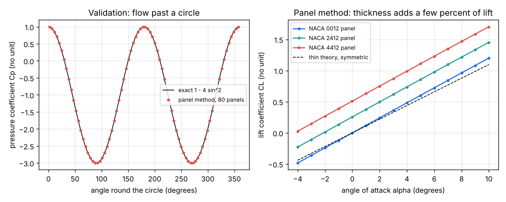
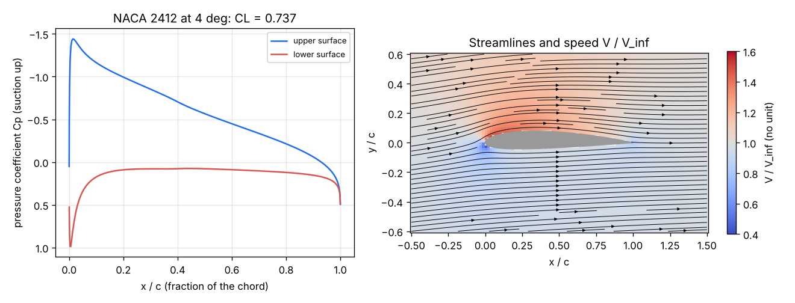
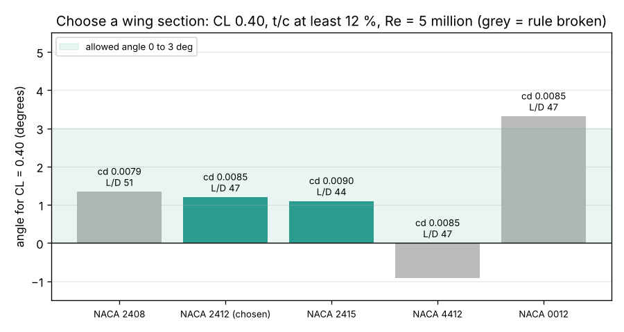

# Session 3: A panel method for lift, and an estimate of drag

*Level 3 (simulation and validation) · about 90 minutes · openairfoil*

> This is a simplified educational model. It is not a validated design tool and must not be used for real structures, electrical installations, vehicles, industrial processes or medical decisions.

**Prerequisites**

- Session 1: Cp from Bernoulli; Session 2: NACA airfoils, angle of attack, Kutta condition.
- Vectors (dot product with a unit normal); solving a set of linear equations (NumPy does it for you).

**Learning objectives.** After this session you can:

- Build a source-and-vortex (Hess-Smith) panel method and solve it as a linear system.
- Validate it: the exact flow past a circle, lift from pressure against lift from circulation, panel convergence.
- Compare the panel CL with thin-airfoil theory and explain the effect of thickness.
- Add a skin-friction drag estimate and choose a wing section for a small aircraft.

## A. Real-world problem
Thin-airfoil theory ignores thickness and gives no pressure along the surface, so it cannot tell us where the suction is or how the flow behaves near the nose. Can we compute the speed and pressure all round any airfoil, prove the code is right on a case with an exact answer, then estimate the airfoil's lift and drag and choose a wing section for our 1000 kg aircraft? (A simplified teaching model, not a design tool.)

## B. Concept and theory
We model low-speed air as a potential flow: steady, incompressible and frictionless. Such flows can be added together, so we build the flow round an airfoil from the free stream plus simple pieces. Cut the surface into N straight panels. Each panel j carries a source sheet of its own strength q_j (air flows out of it) and a vortex sheet of one shared strength gamma (air swirls round it). The velocity a sheet induces at any point has a closed form in the panel's coordinates: a source gives u = q ln(r1 / r2) / (2 pi) and v = q beta / (2 pi), where r1 and r2 are the distances to the panel ends and beta is the angle the panel fills; a vortex gives the same pieces swapped. The N + 1 unknowns come from N + 1 equations: no flow through any panel at its midpoint (flow tangency) and the Kutta condition that the tangential speeds on the two panels at the trailing edge are equal in size. Solving the linear system gives the surface speed Vt, then Cp = 1 - Vt^2 (with V_inf = 1), and summing the pressure times the panel length gives the force. A second, independent route is the Kutta-Joukowski theorem: the lift per unit span is rho V Gamma, so CL = 2 Gamma / (V c), with the circulation Gamma = gamma times the perimeter. The potential flow has no friction, so it predicts zero drag on any closed body (d'Alembert's paradox). Real airfoil drag at small angles is mostly skin friction in the thin boundary layer, which depends on the Reynolds number Re = V c / nu. A classic estimate uses the turbulent flat-plate law Cf = 0.074 / Re^0.2 on both surfaces, times a form factor for thickness: cd = 2 Cf (1 + 2 t/c + 60 (t/c)^4).

| Symbol | Meaning | Unit |
|---|---|---|
| N | number of panels (160 in the lesson) | no unit |
| q_j | source strength of panel j | m/s (V_inf = 1) |
| gamma, Gamma | vortex strength per length, total circulation | m/s, m2/s |
| Vt | tangential surface speed relative to V_inf | no unit |
| Re | Reynolds number V c / nu | no unit |
| nu | kinematic viscosity of air, 1.5e-5 | m2/s |
| Cf | skin-friction coefficient of one surface | no unit |
| cl, cd | section (2-D) lift and drag coefficients | no unit |

**Assumptions**

- Two-dimensional, steady, incompressible, inviscid flow for the pressure and lift.
- Constant source strength on each panel and one constant vortex strength on all panels.
- Drag from a fully turbulent flat-plate law with a thickness form factor, valid at small angles only.
- No stall, no laminar flow and no interaction between the boundary layer and the pressure.

$$ \left(\vec V_\infty + \sum_j q_j \vec u^{\,s}_{ij} + \gamma \sum_j \vec u^{\,v}_{ij}\right)\cdot \hat n_i = 0,\quad i = 1..N $$

$$ V_{t,1} = -V_{t,N}\quad\text{(Kutta condition)} $$

$$ C_p = 1 - V_t^2,\qquad C_L = -\frac1c\sum_i C_{p,i}\,l_i\,(\hat n_i \times \hat e_{\infty})\quad\text{and}\quad C_L = \frac{2\Gamma}{c} $$

$$ Re = \frac{V c}{\nu},\qquad C_f = \frac{0.074}{Re^{0.2}},\qquad c_d = 2 C_f\left(1 + 2\frac tc + 60\left(\frac tc\right)^4\right) $$

## C. Visual explanation
Figure 1 validates the code. On the left, the panel Cp on a circle lies on the exact curve 1 - 4 sin^2(theta) (largest error about 6e-15). On the right, the panel CL of NACA 0012, 2412 and 4412 against angle: straight lines slightly steeper than the thin-airfoil 2 pi line, because thickness adds lift (NACA 0012 at 5 degrees: 0.6025 against 0.548). Figure 2 is NACA 2412 at 4 degrees: a sharp suction peak of Cp = -1.44 just behind the nose on the upper surface, a mild positive pressure underneath, CL = 0.737, and the streamlines and speed around it. Figure 3 is the mini-project: the angle each candidate needs for CL = 0.40 and its drag estimate.

*Validation: exact flow past a circle, and panel CL against angle compared with thin-airfoil theory.*

*NACA 2412 at 4 degrees: surface pressure and streamlines from the panel method.*

*Mini-project: angle needed for CL = 0.40 and the drag estimate of five candidate sections.*

## D. Interactive simulation
Run the lesson (`python start.py 3`), then open the live app: [Session 3: a live panel method](https://krunalpanchal1995.github.io/pan-iit-oss/openairfoil/session-03/) (or `app.html` in this folder). The app solves an 80-panel method live in your browser each time you move a slider. Change the camber, thickness and angle of attack and watch the pressure arrows round the airfoil, the Cp curve and the lift line. The readout gives the panel CL, the thin-airfoil CL and the drag estimate for the cruise of the mini-project (50 m/s, chord 1.5 m).

**Challenge.** Give CL between 0.38 and 0.42 at 0 to 3 degrees with a section at least 12 percent thick and a drag estimate of at most 0.0086 at 50 m/s.

## E. Worked example and experiment
**Problem.** Solve NACA 0012 at 5 degrees with 160 panels. Compare CL with thin-airfoil theory and with its thickness-corrected value 2 pi (1 + 0.77 t/c) alpha. Then estimate the drag for a 1.5 m chord at 50 m/s and the section L/D.

1. Build the outline (80 points per side, cosine spacing) and solve the 161 x 161 system.
2. Panel results: CL from pressure = 0.6025, from circulation = 0.6052 (they agree within 0.5 percent); pressure drag 0.0002, nearly zero as d'Alembert says.
3. Thin-airfoil theory: 2 pi x 5 x pi / 180 = 0.548. Thickness-corrected: 0.548 x (1 + 0.77 x 0.12) = 0.599, within 0.6 percent of the panel value.
4. Re = 50 x 1.5 / 1.5e-5 = 5 x 10^6. Re^0.2 = 21.87, so Cf = 0.074 / 21.87 = 0.00338.
5. Form factor = 1 + 0.24 + 60 x 0.12^4 = 1.252; cd = 2 x 0.00338 x 1.252 = 0.00848.
6. Section L/D = 0.6025 / 0.00848 = 71.

**Answer.** CL = 0.603 (thin theory 0.548, corrected 0.599), cd = 0.0085 at Re = 5 million, section L/D about 71.

**Experiment.** Published wind-tunnel data for NACA 0012 at Re of about 6 million (Abbott and von Doenhoff) give a lift slope of roughly 0.105 to 0.11 per degree and a minimum drag of about 0.0055 to 0.006 for a smooth model. The panel slope (0.120 per degree) is higher, because the real boundary layer thickens near the trailing edge and weakens the circulation; the fully turbulent drag estimate is higher than the smooth measurement, because real airfoils keep some laminar flow near the nose. Neither part predicts stall. Coupling the two is the road to the Target.

## Real-world application and mini-project: Choose the wing section of a small two-seater
The 1000 kg aircraft of Session 1 cruises at 50 m/s with a 16 m2 wing of chord 1.5 m and needs CL = 0.40. The wing spar needs a section at least 12 percent thick, and the cabin floor should be level in cruise, so the wing must meet the air at 0 to 3 degrees. The candidates are NACA 2408, 2412, 2415, 4412 and 0012. Use `alpha_for_cl` and `cd_profile` from Session 3 at Re = 5 million. These rules are illustrative, not a certification standard.

**Deliverable:** A script that prints, for each section, the angle for CL = 0.40, the drag estimate, the section L/D and whether it meets both rules, chooses the lowest-drag section that does, and saves a figure.

**Success looks like:** NACA 2412 is chosen: 1.20 degrees, cd = 0.0085, section L/D about 47. NACA 2408 is rejected as too thin, 4412 needs -0.91 degrees and 0012 needs 3.32 degrees; the report notes that the friction estimate cannot tell 2412, 4412 and 0012 apart, which is a reason to build the boundary-layer model of the roadmap.

## F. Assessment and design challenge
**Question type A: Conceptual.** The panel method gives almost zero drag on the airfoil. Is the code wrong? Where does the real drag come from?

Hint

Think about which physical effect the potential-flow model leaves out.

Step-by-step solution

The code is right: an inviscid, steady flow round a closed body in two dimensions has zero drag (d'Alembert's paradox), and the small leftover 0.0002 is numerical error that shrinks with more panels. Real airfoil drag comes from viscosity: skin friction in the boundary layer and, at larger angles, pressure drag from a thick or separated wake. That is why we add the friction estimate separately.

**Question type B: Numerical.** A model aircraft wing has a chord of 1.2 m and flies at 30 m/s. Find Re, Cf and the drag estimate cd for a 15 percent thick section.

Hint

Re = V c / nu with nu = 1.5e-5; then Cf = 0.074 / Re^0.2 and the form factor.

Step-by-step solution

Re = 30 x 1.2 / 1.5e-5 = 2.4 x 10^6. Re^0.2 = 18.88, Cf = 0.074 / 18.88 = 0.00392. Form factor = 1 + 0.30 + 60 x 0.15^4 = 1.330. cd = 2 x 0.00392 x 1.330 = 0.0104. It is larger than the 0.0085 of the worked example because Re is lower (more friction) and the section is thicker.

**Question type C: Graph and simulation interpretation.** In the pressure figure for NACA 2412 at 4 degrees, where is the lowest pressure, what is its Cp, and which surface contributes most of the lift?

Hint

The Cp axis is drawn upside down so suction points up; lift is the area between the curves.

Step-by-step solution

The suction peak is on the upper surface very close to the nose (x/c about 0.01), with Cp about -1.44. The upper curve encloses most of the area: the lower surface has a small positive Cp of about +0.1. So most of the lift is suction on the top, not push on the bottom. The peak is also where the boundary layer is most at risk later: after it the pressure rises towards the trailing edge.

**Question type D: Design and optimisation challenge.** Design: the 1000 kg aircraft needs CL = 0.40 at 50 m/s (chord 1.5 m), a section at least 12 percent thick for the spar, and an angle of 0 to 3 degrees. Compare NACA 2408, 2412, 2415, 4412 and 0012 and choose one. What does the choice trade off?

Hint

Use `choose_section` from the lesson.

Step-by-step solution

Angles for CL 0.40: 2408 1.34, 2412 1.20, 2415 1.10, 4412 -0.91 and 0012 3.32 degrees. Drag estimates: 0.00787, 0.00848, 0.00900, 0.00848 and 0.00848. NACA 2408 has the lowest drag but is too thin; 4412 needs a negative angle and 0012 more than 3 degrees. NACA 2412 meets every rule with the lowest drag (section L/D about 47) and is chosen. Trade-off: a thicker section is stronger and lighter to build but has more drag; the angle rule is about the cabin attitude, not aerodynamics. The friction estimate does not see camber, so a real comparison needs the boundary-layer model of the roadmap.

Score yourself with [RUBRIC.md](../../RUBRIC.md). Print the [activity sheet](activity_sheet.md) to work on paper.

## Common misconceptions
| Common misconception | What is actually true |
|---|---|
| A simulation is right because the picture looks right. | It must be validated: here against the exact circle solution, by two independent lift routes (pressure and circulation), and by convergence with more panels. |
| The section L/D of about 70 is the L/D of the aircraft. | The aircraft also has a fuselage, tail and induced drag (Session 2), so its L/D is nearer 12 to 15. |
| A panel method can predict stall. | It has no viscosity, so CL keeps growing in a straight line; stall needs a boundary-layer model. |
| Lift is mostly the air pushing up on the bottom surface. | For a typical airfoil most of the lift is suction on the upper surface, especially near the nose. |

## Glossary
- **panel method**: a numerical method that covers a body with flat panels carrying sources and vortices and solves for their strengths
- **potential flow**: an idealised steady, incompressible, frictionless flow without swirl except in concentrated vortices
- **circulation**: the amount of swirl round the airfoil; lift per unit span equals rho V Gamma
- **Reynolds number**: Re = V c / nu, the ratio of inertia to viscous effects
- **boundary layer**: the thin layer of air next to the surface that is slowed by friction
- **d'Alembert's paradox**: a steady inviscid flow exerts zero drag on a closed body

## Finish
1. Do the three coding tasks in [exercises.md](exercises.md).
2. Run `python start.py 3` again after your changes. It ends with the checkpoint; when it prints `PASS`, you are done. (Checkpoint only: `python start.py check 3`.)

Next: the [roadmap](../../promo/roadmap.md). Session 4 is yours to build.
