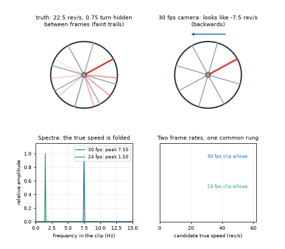
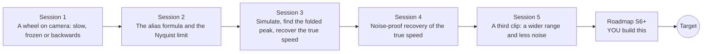

# openalias

[](https://github.com/KrunalPanchal1995/pan-iit-oss/actions/workflows/tests.yml)   [](https://colab.research.google.com/github/KrunalPanchal1995/pan-iit-oss/blob/main/openalias/sessions/session-01/lesson.ipynb) [](https://krunalpanchal1995.github.io/pan-iit-oss/openalias/)

**Why wheels run backwards on film, and how to recover the true speed.**

openalias teaches aliasing, the wagon-wheel effect and the sampling theorem with a spinning marker and a few lines of NumPy, then shows how two frame rates reveal the true frequency.

- **Start from zero.** Session 1 needs only school arithmetic and angles; no signal processing is assumed.
- **See it move.** Every session ships a slider app that runs in the browser, with labelled graphs.
- **Know you got it right.** Each session ends with a checkpoint that prints PASS or FAIL against hand calculations and the exact folding formula.
- **Build the missing half.** The repo stops at Session 5 on purpose; the roadmap shows the path to the Target.

[Target](#the-target) · [Who is this for](#who-is-this-for) · [Quick start](#quick-start) · [Sessions](#sessions) · [Roadmap](#roadmap) · [Contribute](#contribute) · [Explainer PDF](docs/explainer.pdf)

> **This repo is incomplete on purpose.** Sessions 1 to 5 are here and fully working. The finished Target below is a preview of what the community can build next. We show you the path, not the code. Sessions 6 and up are yours.

## The Target

A fan with eight blades, one painted red, spins at a secret speed. On the top left the true motion is drawn with faint trails for the three quarters of a turn the camera never sees; on the top right the 30 frames per second camera shows the red blade creeping backwards. Below, the spectra of the two clips (30 and 24 frames per second) show folded peaks, and two ladders of allowed speeds meet at a single rung: 22.5 revolutions per second, 1350 rpm. Your goal over the coming sessions: build the right-hand side yourself, then make it robust to noise.



*Target: a wagon wheel, folded spectra and the recovered true speed*

- [Math Visual Studio: aliasing of a puffing flame filmed at a fixed frame rate (video)](promo/media/studio_aliasing.mp4)

- [A sweep of frequencies folding back below the Nyquist limit (video)](promo/media/alias_sweep.mp4)

Try it live:

- [Math Visual Studio: aliasing and the frame rate of a camera (Atlas S113)](https://krunalpanchal1995.github.io/studio/#atlas?ch=S113&ex=1)

How the Target was made is shown only as a path in [promo/roadmap.md](promo/roadmap.md).

## Who is this for
**higher secondary to advanced undergraduate (levels 4-6).** Topic area: Statistics, Research and Experimental Methods.

Prerequisites:

- School arithmetic, angles in degrees, and what a frequency in hertz means.
- Python 3.10 or newer; if `python --version` works, you are ready. PRIMER.md explains the rest.
- No prior GitHub, FFT or signal-processing experience is needed.

New to Python? Read [PRIMER.md](PRIMER.md) first (10 minutes).

## Quick start

No installation knowledge needed. You need [Git](https://git-scm.com/downloads) and [Python 3.10+](https://www.python.org/downloads/) (Windows: tick "Add Python to PATH"). On Mac and Linux type `python3` wherever this page says `python`.

```bash
git clone https://github.com/KrunalPanchal1995/pan-iit-oss.git
cd pan-iit-oss/openalias
python start.py 1
```

`start.py` creates a private environment, installs what is needed and runs Session 1 with its checkpoint. Next: `python start.py 2`, `python start.py 3`, or `python start.py test` to check everything. Only a checkpoint: `python start.py check 1`.

<!-- friendly-help -->
<details>
<summary><b>Not working? Common fixes (no Git, "python not found", no internet)</b></summary>

- **No Git?** You do not need it. On the main page of this collection click the green **Code** button, then **Download ZIP**, unzip it, open a terminal inside the folder `pan-iit-oss-main/openalias` and run `python start.py 1`. The ZIP holds every project, so it is large; the live apps need no download at all.
- **"python is not recognized" or "command not found".** On Windows try `py start.py 1`. On Mac and Linux try `python3 start.py 1`. If neither works, install Python from [python.org](https://www.python.org/downloads/) and tick "Add Python to PATH".
- **Needs internet once.** The first run downloads NumPy and Matplotlib into a private folder (`.venv`); after that it works offline.
- **Rather not install anything?** Open the [live apps](https://krunalpanchal1995.github.io/pan-iit-oss/openalias/) in your browser, or use the Colab badge at the top of this page.
- **Still stuck?** [Open an issue](https://github.com/KrunalPanchal1995/pan-iit-oss/issues/new?title=%5Bopenalias%5D%20) with your operating system and the message you see. Questions from beginners are welcome.

</details>

A few lines turn the idea of Session 1 into a result (they work as they are): Save it as `try.py` and run it with `python start.py run try.py` (this uses the private environment, where NumPy is installed):

```python
import numpy as np
f, fs = 28.0, 30.0                    # wheel turns 28 rev/s, camera takes 30 frames/s
step = (360 * f / fs + 180) % 360 - 180   # shortest turn between frames, degrees
print(round(step, 1), round(step / 360 * fs, 2))   # -> -24.0 -2.0: it seems to turn BACKWARDS at 2 rev/s
```

Every session also opens in your browser with sliders (no install): [live apps](https://krunalpanchal1995.github.io/pan-iit-oss/openalias/). Or use the Colab badge above for the notebook.

## Sessions

| # | Session | Model level | Time | Live app |
|---|---|---|---|---|
| 1 | [A wheel on camera: slow, frozen or backwards](sessions/session-01/README.md) | Level 1: conceptual interactive model | 60 min | [open](https://krunalpanchal1995.github.io/pan-iit-oss/openalias/session-01/) |
| 2 | [The alias formula and the Nyquist limit](sessions/session-02/README.md) | Level 2: mathematical engineering model | 75 min | [open](https://krunalpanchal1995.github.io/pan-iit-oss/openalias/session-02/) |
| 3 | [Simulate, find the folded peak, recover the true speed](sessions/session-03/README.md) | Level 3: simulation and validation | 90 min | [open](https://krunalpanchal1995.github.io/pan-iit-oss/openalias/session-03/) |
| 4 | [Noise-proof recovery of the true speed](sessions/session-04/README.md) | Level 3: simulation and validation | 90 min | [open](https://krunalpanchal1995.github.io/pan-iit-oss/openalias/session-04/) |
| 5 | [A third clip: a wider range and less noise](sessions/session-05/README.md) | Level 3: simulation and validation | 90 min | [open](https://krunalpanchal1995.github.io/pan-iit-oss/openalias/session-05/) |

Each session follows the same six steps: A real-world problem, B concept and theory, C visual explanation, D interactive simulation, E worked example and experiment, F assessment and design challenge. Each ends with `checkpoint.py`, which prints `PASS` or `FAIL` against reference numbers. Session 3 also contains the real-world mini-project: **How fast does the fan really turn?**, Session 4 the mini-project **Recover the speed from noisy apparent speeds**, and Session 5 the mini-project **Choose three frame rates and recover a fast fan**.

## Architecture



| Folder or file | What is inside |
|---|---|
| `sessions/` | five sessions: README (A-F), `lesson.py`, notebook, live app, exercises, activity sheet, checkpoint |
| `promo/` | the Target: media, live links, and the roadmap (path only) |
| `docs/` | `explainer.tex` and the built `explainer.pdf` |
| `tests/` | runs every lesson and checkpoint headless |
| `start.py` | one command to set up and run anything |
| `QUALITY.md`, `RUBRIC.md` | the quality checklist and the scoring rubric |
| `.github/` | CI, PDF build, Pages deploy, issue and PR templates |

## Roadmap

| Milestone | What you will build | Difficulty |
|---|---|---|
| Session 6: Fans with many identical blades | A clip renderer and a measurement function for N identical blades, with one blade tinted to tell them apart. | advanced |
| Session 7: A fan that spins up | A tracker that follows the folded apparent speed through time and reconstructs the true speed curve. | advanced |
| Session 8: Real cameras: variable frame rate and rolling shutter | A simulator with frame timestamps from a clock with 0.5 percent jitter and a line-by-line shutter, plus a correction. | advanced |

Full detail with a checkpoint per milestone: [promo/roadmap.md](promo/roadmap.md).

## Contribute
New to GitHub? Read [CONTRIBUTING.md](CONTRIBUTING.md); it starts from zero. Pick an issue labelled `good first issue`. Translations into Hindi, Telugu, Tamil and Malayalam are welcome.

<details>
<summary>Development</summary>

```bash
python start.py test        # runs every lesson and checkpoint
```
Lessons use `# %%` cell markers so they open as notebooks in VS Code. See [QUALITY.md](QUALITY.md) for the standard every session meets.
</details>

## License
MIT. See [LICENSE](LICENSE). Media in `promo/media` is (c) Krunal Panchal, CC BY 4.0.

## Acknowledgments
Part of the [PAN IIT OSS](https://hellofoss.tech-iitb.org/projects) open-source teaching collection, modelled on the structure of [openspline](https://github.com/openspline/openspline). Built on ideas from the Math Visual Studio at https://krunalpanchal1995.github.io/studio/.
