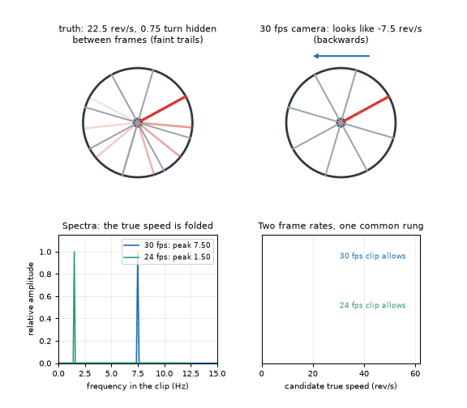

# What you are building toward

A fan with eight blades, one painted red, spins at a secret speed. On the top left the true motion is drawn with faint trails for the three quarters of a turn the camera never sees; on the top right the 30 frames per second camera shows the red blade creeping backwards. Below, the spectra of the two clips (30 and 24 frames per second) show folded peaks, and two ladders of allowed speeds meet at a single rung: 22.5 revolutions per second, 1350 rpm. Your goal over the coming sessions: build the right-hand side yourself, then make it robust to noise.

*Target: a wagon wheel, folded spectra and the recovered true speed*

- [Math Visual Studio: aliasing of a puffing flame filmed at a fixed frame rate (video)](media/studio_aliasing.mp4)

- [A sweep of frequencies folding back below the Nyquist limit (video)](media/alias_sweep.mp4)

These results come from a private reference build. The code is not published; the roadmap shows the path so you can build your own.

Live links:

- [Math Visual Studio: aliasing and the frame rate of a camera (Atlas S113)](https://krunalpanchal1995.github.io/studio/#atlas?ch=S113&ex=1)
