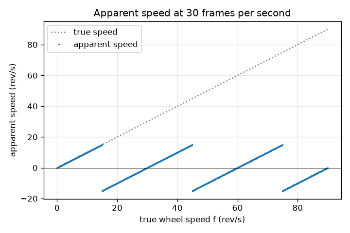
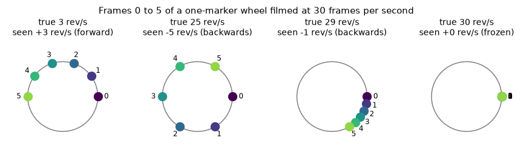

# सत्र 1: कैमरे पर एक पहिया: धीमा, थमा हुआ या उल्टा

*स्तर 1 (वैचारिक इंटरैक्टिव मॉडल) · लगभग 60 मिनट · openalias*

> यह एक सरलीकृत शैक्षिक मॉडल (simplified educational model) है। यह कोई सत्यापित डिज़ाइन टूल नहीं है और इसका उपयोग वास्तविक संरचनाओं, बिजली की स्थापनाओं, वाहनों, औद्योगिक प्रक्रियाओं या चिकित्सा निर्णयों के लिए नहीं किया जाना चाहिए।

**पूर्व-आवश्यकताएँ (Prerequisites)**

- डिग्री में कोण, और एक पूरा चक्कर = 360 डिग्री।
- आपने PRIMER.md पढ़ लिया है और `python start.py 1` एक बार चला लिया है।

**सीखने के उद्देश्य (Learning objectives).** इस सत्र के बाद आप:

- समझा सकेंगे कि जो कैमरा निश्चित क्षणों पर तस्वीरें लेता है, वह किसी पहिये को धीरे घूमता हुआ, उल्टा घूमता हुआ या बिल्कुल न घूमता हुआ क्यों दिखा सकता है।
- दो फ्रेमों (frames) के बीच का घुमाव और किसी निशान (marker) की आभासी गति (apparent speed) हाथ से और Python में निकाल सकेंगे।
- वास्तविक गति के सापेक्ष आभासी गति का ग्राफ़ (एक आरी-दाँत / sawtooth) पढ़ सकेंगे।
- अनुमान लगा सकेंगे कि कौन-सी फ्रेम दर (frame rate) किसी दिए गए पहिये को थमा हुआ दिखाएगी।

## A. वास्तविक दुनिया की समस्या
पुरानी वेस्टर्न फ़िल्मों में घोड़े आगे दौड़ते हैं पर बग्घी के पहिये उल्टे घूमते दिखते हैं। वीडियो में हेलिकॉप्टर के ब्लेड कभी-कभी थमे हुए दिखते हैं। पहिये या ब्लेड में कोई खराबी नहीं है: कैमरा लगातार नहीं देखता, वह हर सेकंड 24 या 30 तस्वीरें लेता है। दो तस्वीरों के बीच पहिया कई बार घूम सकता है, और दिमाग बिंदुओं को सबसे सरल तरीके से जोड़ता है। क्या हम ठीक-ठीक अनुमान लगा सकते हैं कि दर्शक क्या देखेगा, और पहिया किस दिशा में जाता हुआ दिखेगा?

## B. अवधारणा और सिद्धांत
एक पहिये पर एक निशान लगाइए जो प्रति सेकंड f चक्कर (revolutions per second, rev/s) घूमता है। कैमरा प्रति सेकंड fs फ्रेम लेता है, इसलिए फ्रेम 1/fs सेकंड के अंतर पर होते हैं। इतने समय में निशान step = 360 f / fs डिग्री घूमता है, जो एक पूरे चक्कर से बहुत अधिक भी हो सकता है। दर्शक फ्रेमों के बीच हुए पूरे चक्कर नहीं गिन सकता; वह केवल यह देखता है कि निशान अभी कहाँ है और मान लेता है कि वह पुरानी जगह से नई जगह तक सबसे छोटे रास्ते से गया। वह सबसे छोटा चिह्नित (signed) घुमाव, step को -180 से +180 डिग्री की सीमा में मोड़ने (fold) पर मिलता है। मोड़े गए step को प्रति सेकंड फ्रेमों की संख्या से गुणा करके 360 से भाग देने पर rev/s में आभासी गति मिलती है। ऋणात्मक आभासी गति का अर्थ है कि पहिया उल्टा घूमता दिखता है। प्रति फ्रेम ठीक 180 डिग्री टिमटिमाहट सीमा (flicker limit) है: दोनों दिशाएँ बराबर छोटी दिखती हैं। प्रति फ्रेम f में पूरे चक्करों की कोई पूर्ण संख्या जोड़ने से (अर्थात f में fs जोड़ने से) ऐसा कुछ नहीं बदलता जो कैमरा देख सके।

| प्रतीक | अर्थ | इकाई |
|---|---|---|
| f | पहिये की वास्तविक गति | rev/s |
| fs | कैमरे की फ्रेम दर | frames/s |
| step | दो फ्रेमों के बीच वास्तविक घुमाव | डिग्री |
| fold(step) | वही घुमाव -180 से +180 डिग्री में मोड़ा हुआ | डिग्री |
| f_app | आभासी गति (चिह्नित) | rev/s |

**मान्यताएँ (Assumptions)**

- पहिया स्थिर गति से घूमता है।
- केवल एक निशान (पहिये पर उसकी कोई प्रतियाँ नहीं)।
- कैमरे का शटर तात्क्षणिक (instantaneous shutter) है: हर फ्रेम एक बिल्कुल स्पष्ट स्नैपशॉट है।
- दर्शक हमेशा फ्रेमों के बीच सबसे छोटे घुमाव का अनुसरण करता है।

$$ \text{step}=360^\circ\,\frac{f}{f_s} $$

$$ \mathrm{fold}(\theta)=\big((\theta+180^\circ)\bmod 360^\circ\big)-180^\circ $$

$$ f_{\text{app}}=\frac{\mathrm{fold}(\text{step})}{360^\circ}\,f_s=f-k\,f_s,\qquad k=\mathrm{round}\!\left(\frac{f}{f_s}\right) $$

## C. दृश्य व्याख्या
पहला चित्र 30 फ्रेम प्रति सेकंड पर फ़िल्माए गए चार पहिया गतियों के लिए फ्रेम 0 से 5 में निशान दिखाता है: 3 rev/s पर वह धीरे-धीरे आगे सरकता है; 25 rev/s पर वह प्रति फ्रेम 300 डिग्री कूदता है और 5 rev/s पर उल्टा जाता दिखता है; 29 rev/s पर वह बहुत धीरे उल्टा जाता दिखता है; 30 rev/s पर वह स्थिर रहता है। दूसरा चित्र वास्तविक गति के सापेक्ष आभासी गति दिखाता है: एक आरी-दाँत जो 15 rev/s तक वास्तविक गति का अनुसरण करता है, -15 पर कूदता है और 30 rev/s पर वापस शून्य तक चढ़ता है, फिर दोहराता है।

*30 fps पर वास्तविक गति के सापेक्ष आभासी गति: एक आरी-दाँत जो हर 30 rev/s पर दोहराता है।*

*चार पहिया गतियों के लिए 30 fps पर फ्रेम 0 से 5 में निशान: धीमा, उल्टा, लगभग थमा हुआ, थमा हुआ।*

## D. इंटरैक्टिव सिमुलेशन
पाठ चलाइए (`python start.py 1`), फिर लाइव ऐप खोलिए: [सत्र 1: पहिया और कैमरा](https://krunalpanchal1995.github.io/pan-iit-oss/openalias/session-01/) (या इस फ़ोल्डर में `app.html`)। 30 फ्रेम प्रति सेकंड पर पहिया गति स्लाइडर को 0 से 60 rev/s तक खींचिए और लाल व नीले बिंदुओं को देखिए, फिर ग्राफ़ दृश्य खोलिए और पता लगाइए कि पहिया कहाँ उल्टा जाता दिखता है। फ्रेम दर बदलिए और आरी-दाँत को फैलते हुए देखिए।

**चुनौती (Challenge).** 20 rev/s या उससे तेज़ घूमने वाले पहिये को पूरी तरह थमा हुआ दिखाइए।

## E. हल किया गया उदाहरण और प्रयोग
**समस्या.** एक पहिया 28 rev/s घूमता है और 30 फ्रेम प्रति सेकंड पर फ़िल्माया जाता है। फ्रेमों के बीच निशान कितना घूमता है, दर्शक क्या देखता है, और पहिया कितनी तेज़ जाता दिखता है?

1. फ्रेमों के बीच घुमाव: step = 360 x 28 / 30 = 336 डिग्री।
2. दर्शक सबसे छोटा रास्ता देखता है: 336 डिग्री वही जगह है जो 336 - 360 = -24 डिग्री, इसलिए निशान हर फ्रेम में 24 डिग्री उल्टा जाता दिखता है।
3. आभासी गति = -24 / 360 x 30 = -2 rev/s।
4. f - k fs से जाँच: k = round(28 / 30) = 1, इसलिए 28 - 30 = -2 rev/s। दोनों विधियाँ मेल खाती हैं।

**उत्तर.** निशान वास्तव में प्रति फ्रेम 336 डिग्री घूमता है, पर 24 डिग्री उल्टा घूमता दिखता है: पहिया 2 rev/s पर उल्टा जाता दिखता है।

**प्रयोग (Experiment).** टेबल फ़ैन के एक ब्लेड पर टेप लगाइए और फ़ोन से उसे सामान्य वीडियो (लगभग 30 fps) में और फिर स्लो मोशन (120 या 240 fps) में फ़िल्माइए। स्लो-मोशन क्लिप वास्तविक गति दिखाती है; सूत्र से अनुमान लगाइए कि सामान्य क्लिप में क्या दिखना चाहिए और तुलना कीजिए। अंतर फ़ोन के कारण आते हैं: वास्तविक फ्रेम दर 29.97 हो सकती है या बदलती रह सकती है, शटर हर फ्रेम के एक भाग तक खुला रहता है (गति धुंधलापन / motion blur) और कुछ सेंसर पंक्तियों को एक के बाद एक पढ़ते हैं (रोलिंग शटर / rolling shutter)। मॉडल में इनमें से कुछ भी नहीं है।

## F. मूल्यांकन और डिज़ाइन चुनौती
**प्रश्न प्रकार A: वैचारिक (Conceptual).** एक पहिया fs rev/s से थोड़ा धीमा घूमता है (उदाहरण के लिए 30 fps पर 29 rev/s)। वह धीरे-धीरे उल्टा क्यों घूमता दिखता है, आगे क्यों नहीं?

संकेत

दो फ्रेमों के बीच निशान लगभग एक पूरा चक्कर घूमता है। इसकी तुलना एक पूरे चक्कर से कीजिए।

चरण-दर-चरण हल

दो फ्रेमों के बीच निशान 348 डिग्री घूमता है, जो एक पूरे चक्कर से 12 डिग्री कम है। आँख पूरे चक्कर को अनदेखा करती है और देखती है कि निशान अपनी शुरुआत से 12 डिग्री पहले रुका, इसलिए वह प्रति फ्रेम 12 डिग्री उल्टा जाता दिखता है: -12 / 360 x 30 = -1 rev/s। fs से थोड़ा तेज़ पहिया अपनी शुरुआत से थोड़ा आगे रुकेगा और धीरे-धीरे आगे जाता दिखेगा।

**प्रश्न प्रकार B: संख्यात्मक (Numerical).** एक पहिया 33 rev/s घूमता है और 24 फ्रेम प्रति सेकंड पर फ़िल्माया जाता है। प्रति फ्रेम घुमाव, आभासी घुमाव और आभासी गति निकालिए। एक तर्कसंगतता जाँच (sanity check) कीजिए।

संकेत

step = 360 f / fs, फिर -180 से +180 डिग्री में मोड़िए।

चरण-दर-चरण हल

step = 360 x 33 / 24 = 495 डिग्री। मोड़ने पर: 495 - 360 = 135 डिग्री। आभासी गति = 135 / 360 x 24 = +9 rev/s (आगे)। जाँच: f - k fs, जहाँ k = round(33 / 24) = round(1.375) = 1, से 33 - 24 = 9 rev/s मिलता है। तर्कसंगतता: आभासी गति का परिमाण कभी fs / 2 = 12 rev/s से अधिक नहीं हो सकता, और 9 इससे कम है।

**प्रश्न प्रकार C: ग्राफ़ और सिमुलेशन की व्याख्या.** 30 फ्रेम प्रति सेकंड के आरी-दाँत ग्राफ़ का उपयोग करके बताइए कि 0 से 60 rev/s के बीच किन वास्तविक गतियों पर पहिया उल्टा जाता दिखता है, और कहाँ वह थमा हुआ दिखता है?

संकेत

उल्टा का अर्थ है कि वक्र शून्य से नीचे है।

चरण-दर-चरण हल

वक्र 15 < f < 30 rev/s और 45 < f < 60 rev/s के लिए शून्य से नीचे है: उल्टा। यह f = 0, 30 और 60 rev/s पर शून्य को छूता है: थमा हुआ। ठीक f = 15 और 45 rev/s पर आभासी गति का परिमाण 15 है, जो टिमटिमाहट सीमा है, और दिशा नहीं बताई जा सकती। इकाइयाँ: दोनों अक्षों पर rev/s।

**प्रश्न प्रकार D: डिज़ाइन और अनुकूलन (optimisation) चुनौती.** एक पहिया 29 rev/s घूमता है। आप 24, 25, 28, 29, 30 या 60 फ्रेम प्रति सेकंड से फ़िल्मा सकते हैं। कौन-सा विकल्प उसे अधिकतम 1 rev/s पर धीरे-धीरे आगे घूमता दिखाता है? कौन-सा विकल्प उसकी वास्तविक गति दिखाता है? वास्तविक-गति वाले विकल्प की क्या कीमत है?

संकेत

हर फ्रेम दर के लिए f - fs x round(f / fs) निकालिए।

चरण-दर-चरण हल

आभासी गतियाँ हैं +5 (24 fps), +4 (25 fps), +1 (28 fps), 0 (29 fps, थमा हुआ), -1 (30 fps, उल्टा) और +29 (60 fps)। केवल 28 fps अधिकतम 1 rev/s की धीमी आगे की गति दिखाता है। केवल 60 fps सच दिखाता है, क्योंकि 60, 29 के दोगुने से अधिक है (सत्र 2 यह नियम समझाता है)। समझौता (trade-off): फ्रेम दर दोगुनी करने से डेटा की मात्रा दोगुनी हो जाती है और प्रति फ्रेम अधिक प्रकाश चाहिए।

[RUBRIC.md](../../RUBRIC.md) से स्वयं को अंक दीजिए। कागज़ पर काम करने के लिए [गतिविधि पत्रक](activity_sheet.md) प्रिंट कीजिए।

## सामान्य भ्रांतियाँ
| सामान्य भ्रांति (misconception) | वास्तव में क्या सच है |
|---|---|
| कैमरा खराब है, या पहिया अपनी गति बदलता है। | कुछ नहीं बदलता: पहिया स्थिर रूप से घूमता है; प्रभाव केवल उसे निश्चित क्षणों पर देखने से आता है। |
| तेज़ पहिया हमेशा तेज़ दिखता है। | fs/2 के बाद आभासी गति फिर घटती है, f = fs पर शून्य पहुँचती है और फिर दोहराती है: आभासी गति एक आरी-दाँत है, सीधी रेखा नहीं। |
| वैगन-व्हील प्रभाव (wagon-wheel effect) के लिए कैमरा ज़रूरी है। | जो भी नमूना (sample) लेता है वह ऐसा करता है, उदाहरण के लिए टिमटिमाता लैंप या स्ट्रोब, और टिमटिमाती रोशनी में स्वयं आँख भी। |
| उल्टा घूमना केवल दिमाग का दृष्टि-भ्रम (optical illusion) है। | यह ठीक वही है जो तस्वीरों में है: हर फ्रेम में निशान वास्तव में 'उल्टी' स्थिति पर बैठा है। नमूना मान इसे वास्तविक उल्टी गति से अलग नहीं करते। |

## शब्दावली
- **फ्रेम दर (frame rate)**: प्रति सेकंड ली गई तस्वीरें, frames/s (fps) में
- **चक्कर (revolution)**: पहिये का एक पूरा घुमाव, 360 डिग्री
- **मोड़ना (fold)**: पूरे चक्कर जोड़कर या घटाकर किसी कोण को -180 से +180 डिग्री की सीमा में लाना
- **आभासी गति (apparent speed)**: वह गति जो तस्वीरों का क्रम दिखाता प्रतीत होता है; ऋणात्मक का अर्थ उल्टा
- **एलियासिंग (aliasing)**: एक तेज़ बदलाव जिसे बहुत कम बार देखा जाता है और जो धीमे बदलाव के रूप में दिखता है

## समापन
1. [exercises.md](exercises.md) में दिए तीन कोडिंग कार्य कीजिए।
2. अपने बदलावों के बाद `python start.py 1` फिर से चलाइए। यह चेकपॉइंट (checkpoint) के साथ समाप्त होता है; जब यह `PASS` छापे, तो आपका काम पूरा है। (केवल चेकपॉइंट: `python start.py check 1`।)

आगे: [सत्र 2](../session-02/README.md)
