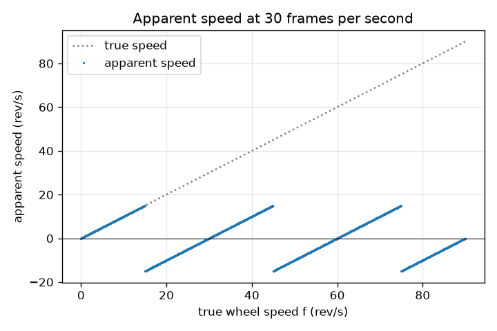
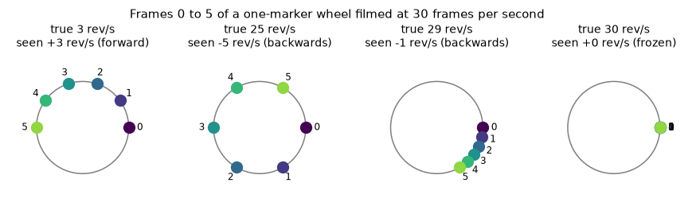

# Session 1: A wheel on camera: slow, frozen or backwards

[Session 1 — हिन्दी](README.hi.md) · [Session 1 — മലയാളം](README.ml.md) · [Session 1 — தமிழ்](README.ta.md) · [Session 1 — తెలుగు](README.te.md)

*Level 1 (conceptual interactive model) · about 60 minutes · openalias*

> This is a simplified educational model. It is not a validated design tool and must not be used for real structures, electrical installations, vehicles, industrial processes or medical decisions.

**Prerequisites**

- Angles in degrees and one full turn = 360 degrees.
- You have read PRIMER.md and run `python start.py 1` once.

**Learning objectives.** After this session you can:

- Explain why a camera that takes pictures at fixed instants can show a wheel turning slowly, backwards or not at all.
- Compute the turn between two frames and the apparent speed of a marker, by hand and in Python.
- Read a graph of apparent speed against true speed (a sawtooth).
- Predict which frame rates make a given wheel look frozen.

## A. Real-world problem
In old westerns the stagecoach wheels seem to turn backwards while the horses gallop forward. Helicopter blades on video sometimes freeze. Nothing is wrong with the wheel or the blades: a camera does not watch continuously, it takes 24 or 30 pictures every second. Between two pictures the wheel can turn many times, and the brain connects the dots in the simplest way. Can we predict exactly what a viewer will see, and which way the wheel seems to go?

## B. Concept and theory
Paint one marker on a wheel that turns f revolutions per second (rev/s). The camera takes fs frames per second, so frames are 1/fs seconds apart. In that time the marker turns step = 360 f / fs degrees, which may be much more than one full turn. A viewer cannot count full turns that happen between frames; they only see where the marker is now and assume the shortest way from the old place to the new one. That shortest signed turn is the step folded into the range -180 to +180 degrees. Multiplying the folded step by the number of frames per second and dividing by 360 gives the apparent speed in rev/s. A negative apparent speed means the wheel seems to turn backwards. Exactly 180 degrees per frame is the flicker limit: both ways look equally short. Adding fs to f (one extra whole turn per frame) changes nothing the camera can see.

| Symbol | Meaning | Unit |
|---|---|---|
| f | true wheel speed | rev/s |
| fs | frame rate of the camera | frames/s |
| step | true turn between two frames | degrees |
| fold(step) | the same turn folded into -180 to +180 degrees | degrees |
| f_app | apparent speed (signed) | rev/s |

**Assumptions**

- The wheel turns at a constant speed.
- One marker only (no copies of it on the wheel).
- The camera has an instantaneous shutter: each frame is a perfectly sharp snapshot.
- The viewer always follows the shortest turn between frames.

$$ \text{step}=360^\circ\,\frac{f}{f_s} $$

$$ \mathrm{fold}(\theta)=\big((\theta+180^\circ)\bmod 360^\circ\big)-180^\circ $$

$$ f_{\text{app}}=\frac{\mathrm{fold}(\text{step})}{360^\circ}\,f_s=f-k\,f_s,\qquad k=\mathrm{round}\!\left(\frac{f}{f_s}\right) $$

## C. Visual explanation
The first figure shows the marker in frames 0 to 5 for four wheel speeds filmed at 30 frames per second: at 3 rev/s it creeps forward; at 25 rev/s it hops 300 degrees per frame and seems to go backwards at 5 rev/s; at 29 rev/s it seems to go backwards very slowly; at 30 rev/s it sits still. The second figure plots apparent speed against true speed: a sawtooth that follows the true speed up to 15 rev/s, jumps to -15 and climbs back to zero at 30 rev/s, then repeats.

*Apparent speed against true speed at 30 fps: a sawtooth that repeats every 30 rev/s.*

*Marker in frames 0 to 5 at 30 fps for four wheel speeds: slow, backwards, almost frozen, frozen.*

## D. Interactive simulation
Run the lesson (`python start.py 1`), then open the live app: [Session 1: the wheel and the camera](https://krunalpanchal1995.github.io/pan-iit-oss/openalias/session-01/) (or `app.html` in this folder). Drag the wheel speed slider through 0 to 60 rev/s at 30 frames per second and watch the red and blue dots, then open the graph view and find where the wheel seems to go backwards. Change the frame rate and see the sawtooth stretch.

**Challenge.** Make a wheel that spins at 20 rev/s or faster look completely frozen.

## E. Worked example and experiment
**Problem.** A wheel turns 28 rev/s and is filmed at 30 frames per second. How far does the marker turn between frames, what does the viewer see, and how fast does the wheel seem to go?

1. Turn between frames: step = 360 x 28 / 30 = 336 degrees.
2. The viewer sees the shortest way: 336 degrees is the same place as 336 - 360 = -24 degrees, so the marker seems to move 24 degrees backwards each frame.
3. Apparent speed = -24 / 360 x 30 = -2 rev/s.
4. Check with f - k fs: k = round(28 / 30) = 1, so 28 - 30 = -2 rev/s. The two methods agree.

**Answer.** The marker really turns 336 degrees per frame, but is seen to turn 24 degrees backwards: the wheel seems to go backwards at 2 rev/s.

**Experiment.** Mark one blade of a table fan with tape and film it with a phone at normal video (about 30 fps) and then in slow motion (120 or 240 fps). The slow-motion clip shows the true speed; predict what the normal clip must show with the formula and compare. Differences come from the phone: the real frame rate may be 29.97 or vary, the shutter is open for a part of each frame (motion blur) and some sensors read rows one after the other (rolling shutter). The model has none of these.

## F. Assessment and design challenge
**Question type A: Conceptual.** A wheel turns slightly slower than fs rev/s (for example 29 rev/s at 30 fps). Why does it seem to turn slowly backwards, and not forward?

Hint

Between two frames the marker turns almost one full turn. Compare it with a full turn.

Step-by-step solution

Between two frames the marker turns 348 degrees, which is 12 degrees short of a full turn. The eye ignores the full turn and sees the marker land 12 degrees before where it started, so it seems to move 12 degrees backwards per frame: -12 / 360 x 30 = -1 rev/s. A wheel slightly faster than fs would land slightly past its start and seem to move slowly forward.

**Question type B: Numerical.** A wheel turns 33 rev/s and is filmed at 24 frames per second. Find the turn per frame, the apparent turn and the apparent speed. Do a sanity check.

Hint

step = 360 f / fs, then fold into -180 to +180 degrees.

Step-by-step solution

step = 360 x 33 / 24 = 495 degrees. Folded: 495 - 360 = 135 degrees. Apparent speed = 135 / 360 x 24 = +9 rev/s (forward). Check: f - k fs with k = round(33 / 24) = round(1.375) = 1 gives 33 - 24 = 9 rev/s. Sanity: the apparent speed can never exceed fs / 2 = 12 rev/s in size, and 9 is below it.

**Question type C: Graph and simulation interpretation.** Using the sawtooth graph for 30 frames per second, for which true speeds between 0 and 60 rev/s does the wheel seem to go backwards, and where does it seem frozen?

Hint

Backwards means the curve is below zero.

Step-by-step solution

The curve is below zero for 15 < f < 30 rev/s and for 45 < f < 60 rev/s: backwards. It touches zero at f = 0, 30 and 60 rev/s: frozen. At exactly f = 15 and 45 rev/s the apparent speed is 15 in size, the flicker limit, and the direction cannot be told. Units: rev/s on both axes.

**Question type D: Design and optimisation challenge.** A wheel turns 29 rev/s. You may film with 24, 25, 28, 29, 30 or 60 frames per second. Which choice shows it turning slowly forward at no more than 1 rev/s? Which choice shows its true speed? What does the true-speed choice cost?

Hint

Compute f - fs x round(f / fs) for each frame rate.

Step-by-step solution

The apparent speeds are +5 (24 fps), +4 (25 fps), +1 (28 fps), 0 (29 fps, frozen), -1 (30 fps, backwards) and +29 (60 fps). Only 28 fps shows slow forward motion of at most 1 rev/s. Only 60 fps shows the truth, because 60 is above twice 29 (Session 2 explains this rule). Trade-off: doubling the frame rate doubles the amount of data and needs more light per frame.

Score yourself with [RUBRIC.md](../../RUBRIC.md). Print the [activity sheet](activity_sheet.md) to work on paper.

## Common misconceptions
| Common misconception | What is actually true |
|---|---|
| The camera is broken, or the wheel changes its speed. | Nothing changes: the wheel turns steadily; the effect comes only from looking at it at fixed instants. |
| A faster wheel always looks faster. | Past fs/2 the apparent speed jumps to a backwards value, climbs back to zero at f = fs and then repeats: apparent speed is a sawtooth, not a line. |
| The wagon-wheel effect needs a camera. | Anything that samples does it, for example a flickering lamp or a strobe, and the eye itself under a flickering light. |
| The backwards turning is an optical illusion in the brain only. | It is exactly what the pictures contain: in every frame the marker really sits at the 'backwards' position, and from the frames alone nobody can tell this from true backwards motion. |

## Glossary
- **frame rate**: pictures taken per second, in frames/s (fps)
- **revolution**: one full turn of a wheel, 360 degrees
- **fold**: bring an angle into the range -180 to +180 degrees by adding or subtracting whole turns
- **apparent speed**: the speed the picture sequence seems to show; negative means backwards
- **aliasing**: a fast change that is looked at too rarely and shows up as a slower one

## Finish
1. Do the three coding tasks in [exercises.md](exercises.md).
2. Run `python start.py 1` again after your changes. It ends with the checkpoint; when it prints `PASS`, you are done. (Checkpoint only: `python start.py check 1`.)

Next: [Session 2](../session-02/README.md)
