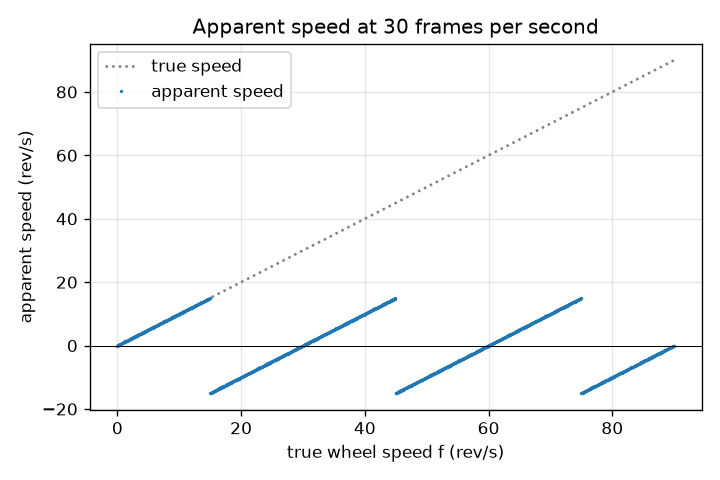
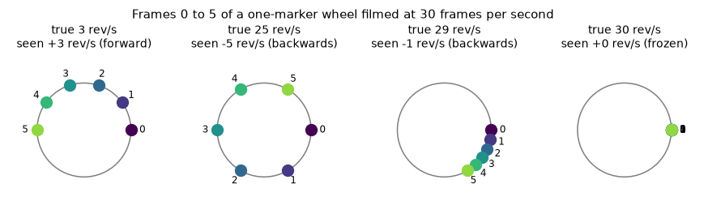

# സെഷൻ 1: ക്യാമറയിലെ ഒരു ചക്രം: പതുക്കെ, നിശ്ചലം അല്ലെങ്കിൽ പിന്നോട്ട്

[Session 1 — हिन्दी](README.hi.md)

*ലെവൽ 1 (ആശയപരമായ ഇന്ററാക്ടീവ് മോഡൽ) · ഏകദേശം 60 മിനിറ്റ് · openalias*

> ഇത് ലളിതമാക്കിയ ഒരു വിദ്യാഭ്യാസ മോഡലാണ്. ഇത് സാധൂകരിക്കപ്പെട്ട (validated) ഒരു ഡിസൈൻ ഉപകരണമല്ല; യഥാർത്ഥ നിർമ്മിതികൾ, ഇലക്ട്രിക്കൽ ഇൻസ്റ്റലേഷനുകൾ, വാഹനങ്ങൾ, വ്യാവസായിക പ്രക്രിയകൾ അല്ലെങ്കിൽ മെഡിക്കൽ തീരുമാനങ്ങൾ എന്നിവയ്ക്ക് ഇത് ഉപയോഗിക്കരുത്.

**മുൻ‌വ്യവസ്ഥകൾ (Prerequisites)**

- ഡിഗ്രിയിലുള്ള കോണുകൾ; ഒരു പൂർണ്ണ ഭ്രമണം = 360 ഡിഗ്രി.
- നിങ്ങൾ PRIMER.md വായിക്കുകയും `python start.py 1` ഒരിക്കൽ റൺ ചെയ്യുകയും ചെയ്തിട്ടുണ്ട്.

**പഠന ലക്ഷ്യങ്ങൾ (Learning objectives).** ഈ സെഷനു ശേഷം നിങ്ങൾക്ക് കഴിയും:

- നിശ്ചിത നിമിഷങ്ങളിൽ ചിത്രങ്ങൾ എടുക്കുന്ന ഒരു ക്യാമറ, ഒരു ചക്രം പതുക്കെ കറങ്ങുന്നതായോ പിന്നോട്ട് കറങ്ങുന്നതായോ ഒട്ടും കറങ്ങാത്തതായോ കാണിക്കുന്നത് എന്തുകൊണ്ടെന്ന് വിശദീകരിക്കാൻ.
- രണ്ട് ഫ്രെയിമുകൾക്കിടയിലെ ഭ്രമണവും ഒരു മാർക്കറിന്റെ ദൃശ്യവേഗതയും (apparent speed) കൈകൊണ്ടും Python-ലും കണക്കാക്കാൻ.
- യഥാർത്ഥ വേഗതയ്ക്കെതിരെ ദൃശ്യവേഗതയുടെ ഗ്രാഫ് (ഒരു സോടൂത്ത് - sawtooth) വായിക്കാൻ.
- ഒരു നിശ്ചിത ചക്രം നിശ്ചലമായി കാണപ്പെടുന്നത് ഏതൊക്കെ ഫ്രെയിം റേറ്റുകളിലാണെന്ന് പ്രവചിക്കാൻ.

## A. യഥാർത്ഥ ലോക പ്രശ്നം
പഴയ വെസ്റ്റേൺ സിനിമകളിൽ കുതിരകൾ മുന്നോട്ട് കുതിക്കുമ്പോൾ കുതിരവണ്ടിയുടെ ചക്രങ്ങൾ പിന്നോട്ട് കറങ്ങുന്നതായി തോന്നും. വീഡിയോയിൽ ഹെലികോപ്റ്റർ ബ്ലേഡുകൾ ചിലപ്പോൾ നിശ്ചലമായി നിൽക്കും. ചക്രത്തിനോ ബ്ലേഡുകൾക്കോ ഒരു കുഴപ്പവുമില്ല: ക്യാമറ തുടർച്ചയായി നോക്കുന്നില്ല, അത് ഓരോ സെക്കൻഡിലും 24 അല്ലെങ്കിൽ 30 ചിത്രങ്ങൾ എടുക്കുന്നു. രണ്ട് ചിത്രങ്ങൾക്കിടയിൽ ചക്രം പലതവണ കറങ്ങിയേക്കാം, തലച്ചോറ് ഏറ്റവും ലളിതമായ രീതിയിൽ ബിന്ദുക്കളെ ബന്ധിപ്പിക്കുന്നു. ഒരു കാഴ്ചക്കാരൻ എന്ത് കാണുമെന്നും ചക്രം ഏത് ദിശയിൽ പോകുന്നതായി തോന്നുമെന്നും നമുക്ക് കൃത്യമായി പ്രവചിക്കാൻ കഴിയുമോ?

## B. ആശയവും സിദ്ധാന്തവും
സെക്കൻഡിൽ f പരിക്രമണങ്ങൾ (rev/s) കറങ്ങുന്ന ഒരു ചക്രത്തിൽ ഒരു മാർക്കർ വരയ്ക്കുക. ക്യാമറ സെക്കൻഡിൽ fs ഫ്രെയിമുകൾ എടുക്കുന്നു, അതിനാൽ ഫ്രെയിമുകൾ തമ്മിൽ 1/fs സെക്കൻഡ് അകലമുണ്ട്. ആ സമയത്ത് മാർക്കർ step = 360 f / fs ഡിഗ്രി കറങ്ങുന്നു, ഇത് ഒരു പൂർണ്ണ ഭ്രമണത്തേക്കാൾ വളരെ കൂടുതലായിരിക്കാം. ഫ്രെയിമുകൾക്കിടയിൽ നടക്കുന്ന പൂർണ്ണ ഭ്രമണങ്ങൾ കാഴ്ചക്കാരന് എണ്ണാൻ കഴിയില്ല; മാർക്കർ ഇപ്പോൾ എവിടെയാണെന്ന് മാത്രമേ അവർ കാണുന്നുള്ളൂ, പഴയ സ്ഥാനത്തുനിന്ന് പുതിയതിലേക്കുള്ള ഏറ്റവും ചെറിയ വഴി അവർ അനുമാനിക്കുന്നു. ആ ഏറ്റവും ചെറിയ ചിഹ്നസഹിത (signed) ഭ്രമണം എന്നത് -180 മുതൽ +180 ഡിഗ്രി വരെയുള്ള പരിധിയിലേക്ക് മടക്കിയ (folded) step ആണ്. മടക്കിയ step-നെ സെക്കൻഡിലെ ഫ്രെയിമുകളുടെ എണ്ണം കൊണ്ട് ഗുണിച്ച് 360 കൊണ്ട് ഹരിച്ചാൽ rev/s-ൽ ദൃശ്യവേഗത ലഭിക്കും. നെഗറ്റീവ് ദൃശ്യവേഗത എന്നാൽ ചക്രം പിന്നോട്ട് കറങ്ങുന്നതായി തോന്നുന്നു എന്നാണ്. ഫ്രെയിമിന് കൃത്യം 180 ഡിഗ്രി എന്നത് ഫ്ലിക്കർ പരിധി (flicker limit) ആണ്: രണ്ട് വഴികളും ഒരുപോലെ ചെറുതായി തോന്നും. ഓരോ ഫ്രെയിമിലും f-ലേക്ക് ഒരു പൂർണ്ണസംഖ്യ ഭ്രമണങ്ങൾ ചേർക്കുന്നത് (അതായത്, f-ലേക്ക് fs ചേർക്കുന്നത്) ക്യാമറയ്ക്ക് കാണാൻ കഴിയുന്ന ഒന്നിനെയും മാറ്റുന്നില്ല.

| ചിഹ്നം | അർത്ഥം | യൂണിറ്റ് |
|---|---|---|
| f | ചക്രത്തിന്റെ യഥാർത്ഥ വേഗത | rev/s |
| fs | ക്യാമറയുടെ ഫ്രെയിം റേറ്റ് | frames/s |
| step | രണ്ട് ഫ്രെയിമുകൾക്കിടയിലെ യഥാർത്ഥ ഭ്രമണം | ഡിഗ്രി |
| fold(step) | അതേ ഭ്രമണം -180 മുതൽ +180 ഡിഗ്രിയിലേക്ക് മടക്കിയത് | ഡിഗ്രി |
| f_app | ദൃശ്യവേഗത (ചിഹ്നസഹിതം) | rev/s |

**അനുമാനങ്ങൾ (Assumptions)**

- ചക്രം സ്ഥിരമായ വേഗതയിൽ കറങ്ങുന്നു.
- ഒരു മാർക്കർ മാത്രം (ചക്രത്തിൽ അതിന്റെ പകർപ്പുകൾ ഇല്ല).
- ക്യാമറയ്ക്ക് തൽക്ഷണ ഷട്ടർ ഉണ്ട്: ഓരോ ഫ്രെയിമും തികച്ചും വ്യക്തമായ ഒരു സ്നാപ്പ്ഷോട്ട് ആണ്.
- കാഴ്ചക്കാരൻ എപ്പോഴും ഫ്രെയിമുകൾക്കിടയിലെ ഏറ്റവും ചെറിയ ഭ്രമണം പിന്തുടരുന്നു.

$$ \text{step}=360^\circ\,\frac{f}{f_s} $$

$$ \mathrm{fold}(\theta)=\big((\theta+180^\circ)\bmod 360^\circ\big)-180^\circ $$

$$ f_{\text{app}}=\frac{\mathrm{fold}(\text{step})}{360^\circ}\,f_s=f-k\,f_s,\qquad k=\mathrm{round}\!\left(\frac{f}{f_s}\right) $$

## C. ദൃശ്യ വിശദീകരണം
സെക്കൻഡിൽ 30 ഫ്രെയിമിൽ ചിത്രീകരിച്ച നാല് ചക്ര വേഗതകൾക്കായി 0 മുതൽ 5 വരെയുള്ള ഫ്രെയിമുകളിലെ മാർക്കർ ആദ്യ ചിത്രം കാണിക്കുന്നു: 3 rev/s-ൽ അത് പതുക്കെ മുന്നോട്ട് നീങ്ങുന്നു; 25 rev/s-ൽ അത് ഫ്രെയിമിന് 300 ഡിഗ്രി ചാടുന്നു, 5 rev/s-ൽ പിന്നോട്ട് പോകുന്നതായി തോന്നുന്നു; 29 rev/s-ൽ വളരെ പതുക്കെ പിന്നോട്ട് പോകുന്നതായി തോന്നുന്നു; 30 rev/s-ൽ അത് നിശ്ചലമായി ഇരിക്കുന്നു. രണ്ടാമത്തെ ചിത്രം യഥാർത്ഥ വേഗതയ്ക്കെതിരെ ദൃശ്യവേഗത പ്ലോട്ട് ചെയ്യുന്നു: 15 rev/s വരെ യഥാർത്ഥ വേഗതയെ പിന്തുടരുന്ന, -15-ലേക്ക് ചാടി 30 rev/s-ൽ പൂജ്യത്തിലേക്ക് തിരികെ കയറുന്ന, പിന്നെ ആവർത്തിക്കുന്ന ഒരു സോടൂത്ത്.

*30 fps-ൽ യഥാർത്ഥ വേഗതയ്ക്കെതിരെ ദൃശ്യവേഗത: ഓരോ 30 rev/s-ലും ആവർത്തിക്കുന്ന ഒരു സോടൂത്ത്.*

*നാല് ചക്ര വേഗതകൾക്കായി 30 fps-ൽ 0 മുതൽ 5 വരെ ഫ്രെയിമുകളിലെ മാർക്കർ: പതുക്കെ, പിന്നോട്ട്, ഏതാണ്ട് നിശ്ചലം, നിശ്ചലം.*

## D. ഇന്ററാക്ടീവ് സിമുലേഷൻ
പാഠം റൺ ചെയ്യുക (`python start.py 1`), തുടർന്ന് ലൈവ് ആപ്പ് തുറക്കുക: [സെഷൻ 1: ചക്രവും ക്യാമറയും](https://krunalpanchal1995.github.io/pan-iit-oss/openalias/session-01/) (അല്ലെങ്കിൽ ഈ ഫോൾഡറിലെ `app.html`). സെക്കൻഡിൽ 30 ഫ്രെയിമിൽ ചക്ര വേഗത സ്ലൈഡർ 0 മുതൽ 60 rev/s വരെ വലിച്ച് ചുവപ്പും നീലയും ബിന്ദുക്കൾ നിരീക്ഷിക്കുക, തുടർന്ന് ഗ്രാഫ് വ്യൂ തുറന്ന് ചക്രം എവിടെയാണ് പിന്നോട്ട് പോകുന്നതായി തോന്നുന്നതെന്ന് കണ്ടെത്തുക. ഫ്രെയിം റേറ്റ് മാറ്റി സോടൂത്ത് നീളുന്നത് കാണുക.

**വെല്ലുവിളി (Challenge).** 20 rev/s അല്ലെങ്കിൽ അതിലും വേഗത്തിൽ കറങ്ങുന്ന ഒരു ചക്രത്തെ പൂർണ്ണമായും നിശ്ചലമായി കാണിക്കുക.

## E. പരിഹരിച്ച ഉദാഹരണവും പരീക്ഷണവും
**പ്രശ്നം.** ഒരു ചക്രം 28 rev/s കറങ്ങുന്നു, സെക്കൻഡിൽ 30 ഫ്രെയിമിൽ ചിത്രീകരിക്കുന്നു. ഫ്രെയിമുകൾക്കിടയിൽ മാർക്കർ എത്ര കറങ്ങുന്നു, കാഴ്ചക്കാരൻ എന്ത് കാണുന്നു, ചക്രം എത്ര വേഗത്തിൽ പോകുന്നതായി തോന്നുന്നു?

1. ഫ്രെയിമുകൾക്കിടയിലെ ഭ്രമണം: step = 360 x 28 / 30 = 336 ഡിഗ്രി.
2. കാഴ്ചക്കാരൻ ഏറ്റവും ചെറിയ വഴി കാണുന്നു: 336 ഡിഗ്രി എന്നത് 336 - 360 = -24 ഡിഗ്രിയുടെ അതേ സ്ഥാനമാണ്, അതിനാൽ മാർക്കർ ഓരോ ഫ്രെയിമിലും 24 ഡിഗ്രി പിന്നോട്ട് നീങ്ങുന്നതായി തോന്നുന്നു.
3. ദൃശ്യവേഗത = -24 / 360 x 30 = -2 rev/s.
4. f - k fs ഉപയോഗിച്ച് പരിശോധിക്കുക: k = round(28 / 30) = 1, അതിനാൽ 28 - 30 = -2 rev/s. രണ്ട് രീതികളും യോജിക്കുന്നു.

**ഉത്തരം.** മാർക്കർ യഥാർത്ഥത്തിൽ ഫ്രെയിമിന് 336 ഡിഗ്രി കറങ്ങുന്നു, പക്ഷേ 24 ഡിഗ്രി പിന്നോട്ട് കറങ്ങുന്നതായി കാണപ്പെടുന്നു: ചക്രം 2 rev/s-ൽ പിന്നോട്ട് പോകുന്നതായി തോന്നുന്നു.

**പരീക്ഷണം.** ഒരു ടേബിൾ ഫാനിന്റെ ഒരു ബ്ലേഡിൽ ടേപ്പ് ഒട്ടിച്ച് അടയാളപ്പെടുത്തുക, ഒരു ഫോൺ ഉപയോഗിച്ച് സാധാരണ വീഡിയോയിൽ (ഏകദേശം 30 fps) പിന്നെ സ്ലോ മോഷനിൽ (120 അല്ലെങ്കിൽ 240 fps) ചിത്രീകരിക്കുക. സ്ലോ-മോഷൻ ക്ലിപ്പ് യഥാർത്ഥ വേഗത കാണിക്കുന്നു; സാധാരണ ക്ലിപ്പ് എന്ത് കാണിക്കണമെന്ന് ഫോർമുല ഉപയോഗിച്ച് പ്രവചിച്ച് താരതമ്യം ചെയ്യുക. വ്യത്യാസങ്ങൾ ഫോണിൽ നിന്നാണ് വരുന്നത്: യഥാർത്ഥ ഫ്രെയിം റേറ്റ് 29.97 ആകാം അല്ലെങ്കിൽ മാറിക്കൊണ്ടിരിക്കാം, ഓരോ ഫ്രെയിമിന്റെയും ഒരു ഭാഗം സമയം ഷട്ടർ തുറന്നിരിക്കുന്നു (മോഷൻ ബ്ലർ - motion blur), ചില സെൻസറുകൾ വരികൾ ഒന്നിനുപുറകെ ഒന്നായി വായിക്കുന്നു (റോളിംഗ് ഷട്ടർ - rolling shutter). മോഡലിൽ ഇവയൊന്നുമില്ല.

## F. വിലയിരുത്തലും ഡിസൈൻ വെല്ലുവിളിയും
**ചോദ്യ തരം A: ആശയപരം.** ഒരു ചക്രം fs rev/s-നേക്കാൾ അല്പം പതുക്കെ കറങ്ങുന്നു (ഉദാഹരണത്തിന് 30 fps-ൽ 29 rev/s). അത് മുന്നോട്ടല്ല, പതുക്കെ പിന്നോട്ട് കറങ്ങുന്നതായി തോന്നുന്നത് എന്തുകൊണ്ട്?

സൂചന

രണ്ട് ഫ്രെയിമുകൾക്കിടയിൽ മാർക്കർ ഏതാണ്ട് ഒരു പൂർണ്ണ ഭ്രമണം കറങ്ങുന്നു. അതിനെ ഒരു പൂർണ്ണ ഭ്രമണവുമായി താരതമ്യം ചെയ്യുക.

ഘട്ടം ഘട്ടമായുള്ള പരിഹാരം

രണ്ട് ഫ്രെയിമുകൾക്കിടയിൽ മാർക്കർ 348 ഡിഗ്രി കറങ്ങുന്നു, ഇത് ഒരു പൂർണ്ണ ഭ്രമണത്തേക്കാൾ 12 ഡിഗ്രി കുറവാണ്. കണ്ണ് പൂർണ്ണ ഭ്രമണം അവഗണിക്കുകയും മാർക്കർ തുടങ്ങിയ സ്ഥാനത്തിന് 12 ഡിഗ്രി മുമ്പ് എത്തുന്നതായി കാണുകയും ചെയ്യുന്നു, അതിനാൽ അത് ഫ്രെയിമിന് 12 ഡിഗ്രി പിന്നോട്ട് നീങ്ങുന്നതായി തോന്നുന്നു: -12 / 360 x 30 = -1 rev/s. fs-നേക്കാൾ അല്പം വേഗതയുള്ള ഒരു ചക്രം അതിന്റെ തുടക്കത്തിന് അല്പം അപ്പുറം എത്തുകയും പതുക്കെ മുന്നോട്ട് നീങ്ങുന്നതായി തോന്നുകയും ചെയ്യും.

**ചോദ്യ തരം B: സംഖ്യാപരം.** ഒരു ചക്രം 33 rev/s കറങ്ങുന്നു, സെക്കൻഡിൽ 24 ഫ്രെയിമിൽ ചിത്രീകരിക്കുന്നു. ഫ്രെയിമിനുള്ള ഭ്രമണം, ദൃശ്യ ഭ്രമണം, ദൃശ്യവേഗത എന്നിവ കണ്ടെത്തുക. ഒരു യുക്തിപരിശോധന (sanity check) നടത്തുക.

സൂചന

step = 360 f / fs, പിന്നെ -180 മുതൽ +180 ഡിഗ്രിയിലേക്ക് മടക്കുക.

ഘട്ടം ഘട്ടമായുള്ള പരിഹാരം

step = 360 x 33 / 24 = 495 ഡിഗ്രി. മടക്കിയത്: 495 - 360 = 135 ഡിഗ്രി. ദൃശ്യവേഗത = 135 / 360 x 24 = +9 rev/s (മുന്നോട്ട്). പരിശോധന: k = round(33 / 24) = round(1.375) = 1 ഉപയോഗിച്ച് f - k fs = 33 - 24 = 9 rev/s. യുക്തിപരിശോധന: ദൃശ്യവേഗതയുടെ വലുപ്പം ഒരിക്കലും fs / 2 = 12 rev/s കവിയില്ല, 9 അതിനു താഴെയാണ്.

**ചോദ്യ തരം C: ഗ്രാഫ്, സിമുലേഷൻ വ്യാഖ്യാനം.** സെക്കൻഡിൽ 30 ഫ്രെയിമിനുള്ള സോടൂത്ത് ഗ്രാഫ് ഉപയോഗിച്ച്, 0 മുതൽ 60 rev/s വരെയുള്ള ഏത് യഥാർത്ഥ വേഗതകളിലാണ് ചക്രം പിന്നോട്ട് പോകുന്നതായി തോന്നുന്നത്, എവിടെയാണ് നിശ്ചലമായി തോന്നുന്നത്?

സൂചന

പിന്നോട്ട് എന്നാൽ വക്രം പൂജ്യത്തിന് താഴെയാണ്.

ഘട്ടം ഘട്ടമായുള്ള പരിഹാരം

15 < f < 30 rev/s-നും 45 < f < 60 rev/s-നും വക്രം പൂജ്യത്തിന് താഴെയാണ്: പിന്നോട്ട്. f = 0, 30, 60 rev/s-ൽ അത് പൂജ്യത്തെ തൊടുന്നു: നിശ്ചലം. കൃത്യം f = 15, 45 rev/s-ൽ ദൃശ്യവേഗതയുടെ വലുപ്പം 15 ആണ്, ഫ്ലിക്കർ പരിധി, ദിശ പറയാൻ കഴിയില്ല. യൂണിറ്റുകൾ: രണ്ട് അക്ഷങ്ങളിലും rev/s.

**ചോദ്യ തരം D: ഡിസൈൻ, ഒപ്റ്റിമൈസേഷൻ വെല്ലുവിളി.** ഒരു ചക്രം 29 rev/s കറങ്ങുന്നു. നിങ്ങൾക്ക് സെക്കൻഡിൽ 24, 25, 28, 29, 30 അല്ലെങ്കിൽ 60 ഫ്രെയിമിൽ ചിത്രീകരിക്കാം. ഏത് തിരഞ്ഞെടുപ്പാണ് അതിനെ 1 rev/s-ൽ കൂടാതെ പതുക്കെ മുന്നോട്ട് കറങ്ങുന്നതായി കാണിക്കുന്നത്? ഏത് തിരഞ്ഞെടുപ്പാണ് അതിന്റെ യഥാർത്ഥ വേഗത കാണിക്കുന്നത്? യഥാർത്ഥ-വേഗത തിരഞ്ഞെടുപ്പിന്റെ വില എന്താണ്?

സൂചന

ഓരോ ഫ്രെയിം റേറ്റിനും f - fs x round(f / fs) കണക്കാക്കുക.

ഘട്ടം ഘട്ടമായുള്ള പരിഹാരം

ദൃശ്യവേഗതകൾ +5 (24 fps), +4 (25 fps), +1 (28 fps), 0 (29 fps, നിശ്ചലം), -1 (30 fps, പിന്നോട്ട്), +29 (60 fps) എന്നിവയാണ്. 28 fps മാത്രമേ പരമാവധി 1 rev/s-ലുള്ള പതുക്കെയുള്ള മുന്നോട്ടുള്ള ചലനം കാണിക്കുന്നുള്ളൂ. 60 fps മാത്രമേ സത്യം കാണിക്കുന്നുള്ളൂ, കാരണം 60 എന്നത് 29-ന്റെ ഇരട്ടിയേക്കാൾ കൂടുതലാണ് (സെഷൻ 2 ഈ നിയമം വിശദീകരിക്കുന്നു). വിട്ടുവീഴ്ച (trade-off): ഫ്രെയിം റേറ്റ് ഇരട്ടിയാക്കുന്നത് ഡാറ്റയുടെ അളവ് ഇരട്ടിയാക്കുന്നു, ഓരോ ഫ്രെയിമിനും കൂടുതൽ വെളിച്ചം വേണം.

[RUBRIC.md](../../RUBRIC.md) ഉപയോഗിച്ച് സ്വയം സ്കോർ ചെയ്യുക. കടലാസിൽ പ്രവർത്തിക്കാൻ [ആക്ടിവിറ്റി ഷീറ്റ്](activity_sheet.md) പ്രിന്റ് ചെയ്യുക.

## സാധാരണ തെറ്റിദ്ധാരണകൾ
| സാധാരണ തെറ്റിദ്ധാരണ | യഥാർത്ഥത്തിൽ സത്യം എന്താണ് |
|---|---|
| ക്യാമറ കേടാണ്, അല്ലെങ്കിൽ ചക്രം അതിന്റെ വേഗത മാറ്റുന്നു. | ഒന്നും മാറുന്നില്ല: ചക്രം സ്ഥിരമായി കറങ്ങുന്നു; നിശ്ചിത നിമിഷങ്ങളിൽ നോക്കുന്നതിൽ നിന്ന് മാത്രമാണ് ഈ പ്രഭാവം വരുന്നത്. |
| വേഗതയേറിയ ചക്രം എപ്പോഴും വേഗതയേറിയതായി കാണപ്പെടുന്നു. | fs/2 കഴിഞ്ഞാൽ ദൃശ്യവേഗത വീണ്ടും കുറയുന്നു, f = fs-ൽ പൂജ്യത്തിലെത്തുന്നു, പിന്നെ ആവർത്തിക്കുന്നു: ദൃശ്യവേഗത ഒരു സോടൂത്ത് ആണ്, ഒരു രേഖയല്ല. |
| വാഗൺ-വീൽ പ്രഭാവത്തിന് (wagon-wheel effect) ഒരു ക്യാമറ ആവശ്യമാണ്. | സാമ്പിൾ ചെയ്യുന്ന എന്തും ഇത് ചെയ്യുന്നു, ഉദാഹരണത്തിന് മിന്നുന്ന വിളക്ക് അല്ലെങ്കിൽ സ്ട്രോബ്, മിന്നുന്ന വെളിച്ചത്തിൽ കണ്ണ് പോലും. |
| പിന്നോട്ടുള്ള കറക്കം തലച്ചോറിലെ ഒരു ദൃഷ്ടിഭ്രമം (optical illusion) മാത്രമാണ്. | ചിത്രങ്ങളിൽ ഉള്ളത് കൃത്യമായി അതാണ്: ഓരോ ഫ്രെയിമിലും മാർക്കർ യഥാർത്ഥത്തിൽ 'പിന്നോട്ടുള്ള' സ്ഥാനത്താണ്. സാമ്പിൾ മൂല്യങ്ങൾ അതിനെ യഥാർത്ഥ പിന്നോട്ടുള്ള ചലനത്തിൽ നിന്ന് വേർതിരിക്കുന്നില്ല. |

## പദാവലി (Glossary)
- **ഫ്രെയിം റേറ്റ് (frame rate)**: സെക്കൻഡിൽ എടുക്കുന്ന ചിത്രങ്ങൾ, frames/s (fps)-ൽ
- **പരിക്രമണം (revolution)**: ഒരു ചക്രത്തിന്റെ ഒരു പൂർണ്ണ ഭ്രമണം, 360 ഡിഗ്രി
- **മടക്കൽ (fold)**: പൂർണ്ണ ഭ്രമണങ്ങൾ കൂട്ടിയോ കുറച്ചോ ഒരു കോണിനെ -180 മുതൽ +180 ഡിഗ്രി പരിധിയിലേക്ക് കൊണ്ടുവരിക
- **ദൃശ്യവേഗത (apparent speed)**: ചിത്ര ശ്രേണി കാണിക്കുന്നതായി തോന്നുന്ന വേഗത; നെഗറ്റീവ് എന്നാൽ പിന്നോട്ട്
- **അലിയാസിംഗ് (aliasing)**: വളരെ അപൂർവ്വമായി നോക്കുന്ന ഒരു വേഗമേറിയ മാറ്റം, അത് പതുക്കെയുള്ള ഒന്നായി പ്രത്യക്ഷപ്പെടുന്നു

## പൂർത്തിയാക്കുക
1. [exercises.md](exercises.md)-ലെ മൂന്ന് കോഡിംഗ് ടാസ്കുകൾ ചെയ്യുക.
2. നിങ്ങളുടെ മാറ്റങ്ങൾക്കു ശേഷം `python start.py 1` വീണ്ടും റൺ ചെയ്യുക. അത് ചെക്ക്‌പോയിന്റോടെ അവസാനിക്കുന്നു; അത് `PASS` പ്രിന്റ് ചെയ്യുമ്പോൾ, നിങ്ങൾ പൂർത്തിയാക്കി. (ചെക്ക്‌പോയിന്റ് മാത്രം: `python start.py check 1`.)

അടുത്തത്: [സെഷൻ 2](../session-02/README.md)
