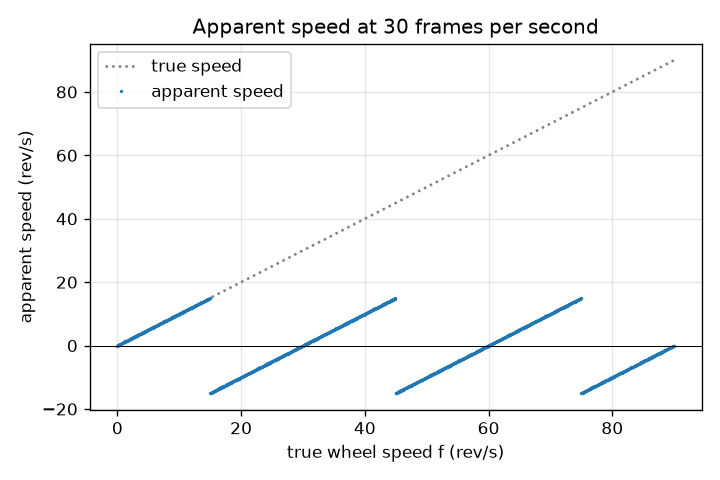
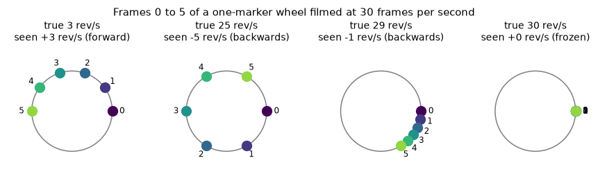

# அமர்வு 1: கேமராவில் ஒரு சக்கரம்: மெதுவாக, உறைந்து அல்லது பின்னோக்கி

[Session 1 — हिन्दी](README.hi.md) · [Session 1 — മലയാളം](README.ml.md) · [Session 1 — தமிழ்](README.ta.md)

*நிலை 1 (கருத்தியல் ஊடாடும் மாதிரி) · சுமார் 60 நிமிடங்கள் · openalias*

> இது ஒரு எளிமைப்படுத்தப்பட்ட கல்வி மாதிரி. இது சரிபார்க்கப்பட்ட (validated) வடிவமைப்புக் கருவி அல்ல; உண்மையான கட்டமைப்புகள், மின் நிறுவல்கள், வாகனங்கள், தொழில்துறை செயல்முறைகள் அல்லது மருத்துவ முடிவுகளுக்கு இதைப் பயன்படுத்தக் கூடாது.

**முன்தேவைகள் (Prerequisites)**

- டிகிரியில் கோணங்கள்; ஒரு முழுச் சுற்று = 360 டிகிரி.
- நீங்கள் PRIMER.md படித்து, `python start.py 1` ஐ ஒருமுறை இயக்கியிருக்கிறீர்கள்.

**கற்றல் நோக்கங்கள் (Learning objectives).** இந்த அமர்வுக்குப் பிறகு உங்களால் முடியும்:

- நிலையான கணங்களில் படம் எடுக்கும் கேமரா, ஒரு சக்கரம் மெதுவாகச் சுழல்வதாகவோ, பின்னோக்கிச் சுழல்வதாகவோ அல்லது சுழலாமலே இருப்பதாகவோ ஏன் காட்டக்கூடும் என்பதை விளக்க.
- இரண்டு பிரேம்களுக்கு இடையிலான சுழற்சியையும் ஒரு குறியின் தோற்ற வேகத்தையும் (apparent speed) கையாலும் Python-இலும் கணக்கிட.
- உண்மை வேகத்துக்கு எதிரான தோற்ற வேகத்தின் வரைபடத்தை (ஒரு ரம்பப்பல் வடிவம் - sawtooth) படிக்க.
- கொடுக்கப்பட்ட சக்கரம் எந்த பிரேம் வீதங்களில் உறைந்தது போலத் தெரியும் என்று கணிக்க.

## A. நிஜ உலகப் பிரச்சினை
பழைய வெஸ்டர்ன் திரைப்படங்களில், குதிரைகள் முன்னோக்கிப் பாயும்போது குதிரை வண்டியின் சக்கரங்கள் பின்னோக்கிச் சுழல்வது போலத் தெரியும். வீடியோவில் ஹெலிகாப்டர் இறக்கைகள் சில நேரங்களில் உறைந்து நிற்கும். சக்கரத்திலோ இறக்கைகளிலோ எந்தக் கோளாறும் இல்லை: கேமரா தொடர்ச்சியாகப் பார்ப்பதில்லை, அது ஒவ்வொரு வினாடியும் 24 அல்லது 30 படங்களை எடுக்கிறது. இரண்டு படங்களுக்கு இடையில் சக்கரம் பல முறை சுழலலாம், மூளை புள்ளிகளை எளிமையான வழியில் இணைக்கிறது. ஒரு பார்வையாளர் சரியாக என்ன பார்ப்பார், சக்கரம் எந்தத் திசையில் செல்வதாகத் தோன்றும் என்று நம்மால் துல்லியமாகக் கணிக்க முடியுமா?

## B. கருத்தும் கோட்பாடும்
வினாடிக்கு f சுற்றுகள் (rev/s) சுழலும் ஒரு சக்கரத்தில் ஒரு குறியை வரையுங்கள். கேமரா வினாடிக்கு fs பிரேம்களை எடுக்கிறது, எனவே பிரேம்கள் 1/fs வினாடி இடைவெளியில் உள்ளன. அந்த நேரத்தில் குறி step = 360 f / fs டிகிரி சுழல்கிறது, இது ஒரு முழுச் சுற்றை விட மிக அதிகமாக இருக்கலாம். பிரேம்களுக்கு இடையில் நிகழும் முழுச் சுற்றுகளைப் பார்வையாளரால் எண்ண முடியாது; குறி இப்போது எங்கே இருக்கிறது என்பதை மட்டுமே அவர்கள் பார்க்கிறார்கள், பழைய இடத்திலிருந்து புதிய இடத்துக்கான மிகக் குறுகிய வழியை அனுமானிக்கிறார்கள். அந்த மிகக் குறுகிய குறியிட்ட (signed) சுழற்சி என்பது -180 முதல் +180 டிகிரி வரம்புக்குள் மடிக்கப்பட்ட (folded) step ஆகும். மடிக்கப்பட்ட step-ஐ வினாடிக்கான பிரேம்களின் எண்ணிக்கையால் பெருக்கி 360-ஆல் வகுத்தால் rev/s-இல் தோற்ற வேகம் கிடைக்கும். எதிர்மறைத் தோற்ற வேகம் என்றால் சக்கரம் பின்னோக்கிச் சுழல்வது போலத் தோன்றுகிறது. ஒரு பிரேமுக்குச் சரியாக 180 டிகிரி என்பது மினுக்கல் வரம்பு (flicker limit): இரு வழிகளும் சமமாகக் குறுகியதாகத் தோன்றும். ஒவ்வொரு பிரேமுக்கும் f உடன் முழு எண்ணிக்கைச் சுற்றுகளைச் சேர்ப்பது (அதாவது f உடன் fs ஐச் சேர்ப்பது) கேமரா காணக்கூடிய எதையும் மாற்றாது.

| குறியீடு | பொருள் | அலகு |
|---|---|---|
| f | சக்கரத்தின் உண்மை வேகம் | rev/s |
| fs | கேமராவின் பிரேம் வீதம் | frames/s |
| step | இரண்டு பிரேம்களுக்கு இடையிலான உண்மைச் சுழற்சி | டிகிரி |
| fold(step) | அதே சுழற்சி -180 முதல் +180 டிகிரிக்குள் மடிக்கப்பட்டது | டிகிரி |
| f_app | தோற்ற வேகம் (குறியிட்டது) | rev/s |

**அனுமானங்கள் (Assumptions)**

- சக்கரம் நிலையான வேகத்தில் சுழல்கிறது.
- ஒரே ஒரு குறி மட்டும் (சக்கரத்தில் அதன் நகல்கள் இல்லை).
- கேமராவுக்கு உடனடி ஷட்டர் உள்ளது: ஒவ்வொரு பிரேமும் முழுமையாகத் தெளிவான ஒரு ஸ்னாப்ஷாட்.
- பார்வையாளர் எப்போதும் பிரேம்களுக்கு இடையிலான மிகக் குறுகிய சுழற்சியைப் பின்பற்றுகிறார்.

$$ \text{step}=360^\circ\,\frac{f}{f_s} $$

$$ \mathrm{fold}(\theta)=\big((\theta+180^\circ)\bmod 360^\circ\big)-180^\circ $$

$$ f_{\text{app}}=\frac{\mathrm{fold}(\text{step})}{360^\circ}\,f_s=f-k\,f_s,\qquad k=\mathrm{round}\!\left(\frac{f}{f_s}\right) $$

## C. காட்சி விளக்கம்
வினாடிக்கு 30 பிரேம்களில் படமாக்கப்பட்ட நான்கு சக்கர வேகங்களுக்கு, பிரேம் 0 முதல் 5 வரையிலான குறியை முதல் படம் காட்டுகிறது: 3 rev/s இல் அது மெதுவாக முன்னேறுகிறது; 25 rev/s இல் அது ஒரு பிரேமுக்கு 300 டிகிரி தாவுகிறது, 5 rev/s இல் பின்னோக்கிச் செல்வது போலத் தோன்றுகிறது; 29 rev/s இல் மிக மெதுவாகப் பின்னோக்கிச் செல்வது போலத் தோன்றுகிறது; 30 rev/s இல் அசையாமல் நிற்கிறது. இரண்டாவது படம் உண்மை வேகத்துக்கு எதிராகத் தோற்ற வேகத்தை வரைகிறது: 15 rev/s வரை உண்மை வேகத்தைப் பின்தொடர்ந்து, -15 க்குத் தாவி, 30 rev/s இல் பூஜ்ஜியத்துக்குத் திரும்ப ஏறி, பின்னர் மீண்டும் நிகழும் ஒரு ரம்பப்பல் வடிவம்.

*30 fps இல் உண்மை வேகத்துக்கு எதிரான தோற்ற வேகம்: ஒவ்வொரு 30 rev/s க்கும் மீண்டும் நிகழும் ரம்பப்பல் வடிவம்.*

*நான்கு சக்கர வேகங்களுக்கு 30 fps இல் பிரேம் 0 முதல் 5 வரையிலான குறி: மெதுவாக, பின்னோக்கி, கிட்டத்தட்ட உறைந்து, உறைந்து.*

## D. ஊடாடும் உருவகப்படுத்தல் (Interactive simulation)
பாடத்தை இயக்குங்கள் (`python start.py 1`), பின்னர் நேரடிச் செயலியைத் திறங்கள்: [அமர்வு 1: சக்கரமும் கேமராவும்](https://krunalpanchal1995.github.io/pan-iit-oss/openalias/session-01/) (அல்லது இந்தக் கோப்புறையில் உள்ள `app.html`). வினாடிக்கு 30 பிரேம்களில் சக்கர வேக ஸ்லைடரை 0 முதல் 60 rev/s வரை இழுத்து, சிவப்பு மற்றும் நீலப் புள்ளிகளைக் கவனியுங்கள், பின்னர் வரைபடக் காட்சியைத் திறந்து சக்கரம் எங்கே பின்னோக்கிச் செல்வது போலத் தோன்றுகிறது என்று கண்டறியுங்கள். பிரேம் வீதத்தை மாற்றி, ரம்பப்பல் வடிவம் நீள்வதைப் பாருங்கள்.

**சவால் (Challenge).** 20 rev/s அல்லது அதைவிட வேகமாகச் சுழலும் ஒரு சக்கரத்தை முழுமையாக உறைந்தது போலத் தோன்றச் செய்யுங்கள்.

## E. தீர்க்கப்பட்ட எடுத்துக்காட்டும் சோதனையும்
**பிரச்சினை.** ஒரு சக்கரம் 28 rev/s சுழல்கிறது, வினாடிக்கு 30 பிரேம்களில் படமாக்கப்படுகிறது. பிரேம்களுக்கு இடையில் குறி எவ்வளவு சுழல்கிறது, பார்வையாளர் என்ன பார்க்கிறார், சக்கரம் எவ்வளவு வேகமாகச் செல்வது போலத் தோன்றுகிறது?

1. பிரேம்களுக்கு இடையிலான சுழற்சி: step = 360 x 28 / 30 = 336 டிகிரி.
2. பார்வையாளர் மிகக் குறுகிய வழியைப் பார்க்கிறார்: 336 டிகிரி என்பது 336 - 360 = -24 டிகிரியின் அதே இடம், எனவே குறி ஒவ்வொரு பிரேமிலும் 24 டிகிரி பின்னோக்கி நகர்வது போலத் தோன்றுகிறது.
3. தோற்ற வேகம் = -24 / 360 x 30 = -2 rev/s.
4. f - k fs கொண்டு சரிபாருங்கள்: k = round(28 / 30) = 1, எனவே 28 - 30 = -2 rev/s. இரு முறைகளும் ஒத்துப்போகின்றன.

**விடை.** குறி உண்மையில் ஒரு பிரேமுக்கு 336 டிகிரி சுழல்கிறது, ஆனால் 24 டிகிரி பின்னோக்கிச் சுழல்வதாகக் காணப்படுகிறது: சக்கரம் 2 rev/s இல் பின்னோக்கிச் செல்வது போலத் தோன்றுகிறது.

**சோதனை.** ஒரு மேசை மின்விசிறியின் ஒரு இறக்கையில் டேப் ஒட்டிக் குறியிட்டு, ஒரு போனில் சாதாரண வீடியோவில் (சுமார் 30 fps) பிறகு ஸ்லோ மோஷனில் (120 அல்லது 240 fps) படமாக்குங்கள். ஸ்லோ-மோஷன் கிளிப் உண்மை வேகத்தைக் காட்டுகிறது; சாதாரண கிளிப் என்ன காட்ட வேண்டும் என்று சூத்திரத்தைக் கொண்டு கணித்து ஒப்பிடுங்கள். வேறுபாடுகள் போனிலிருந்து வருகின்றன: உண்மையான பிரேம் வீதம் 29.97 ஆக இருக்கலாம் அல்லது மாறலாம், ஒவ்வொரு பிரேமின் ஒரு பகுதி நேரம் ஷட்டர் திறந்திருக்கும் (இயக்க மங்கல் - motion blur), சில சென்சார்கள் வரிசைகளை ஒன்றன்பின் ஒன்றாகப் படிக்கின்றன (ரோலிங் ஷட்டர் - rolling shutter). மாதிரியில் இவை எதுவும் இல்லை.

## F. மதிப்பீடும் வடிவமைப்புச் சவாலும்
**கேள்வி வகை A: கருத்தியல்.** ஒரு சக்கரம் fs rev/s ஐ விடச் சற்று மெதுவாகச் சுழல்கிறது (எடுத்துக்காட்டாக 30 fps இல் 29 rev/s). அது ஏன் முன்னோக்கி அல்லாமல், மெதுவாகப் பின்னோக்கிச் சுழல்வது போலத் தோன்றுகிறது?

குறிப்பு

இரண்டு பிரேம்களுக்கு இடையில் குறி கிட்டத்தட்ட ஒரு முழுச் சுற்று சுழல்கிறது. அதை ஒரு முழுச் சுற்றுடன் ஒப்பிடுங்கள்.

படிப்படியான தீர்வு

இரண்டு பிரேம்களுக்கு இடையில் குறி 348 டிகிரி சுழல்கிறது, இது ஒரு முழுச் சுற்றை விட 12 டிகிரி குறைவு. கண் முழுச் சுற்றைப் புறக்கணித்து, குறி தொடங்கிய இடத்துக்கு 12 டிகிரி முன்னதாக வந்து சேர்வதைப் பார்க்கிறது, எனவே அது ஒரு பிரேமுக்கு 12 டிகிரி பின்னோக்கி நகர்வது போலத் தோன்றுகிறது: -12 / 360 x 30 = -1 rev/s. fs ஐ விடச் சற்று வேகமான சக்கரம் தொடக்கத்தைச் சற்றுத் தாண்டி வந்து சேர்ந்து, மெதுவாக முன்னோக்கி நகர்வது போலத் தோன்றும்.

**கேள்வி வகை B: எண்ணியல்.** ஒரு சக்கரம் 33 rev/s சுழல்கிறது, வினாடிக்கு 24 பிரேம்களில் படமாக்கப்படுகிறது. ஒரு பிரேமுக்கான சுழற்சி, தோற்றச் சுழற்சி, தோற்ற வேகம் ஆகியவற்றைக் கண்டறியுங்கள். ஒரு நம்பகத்தன்மைச் சோதனை (sanity check) செய்யுங்கள்.

குறிப்பு

step = 360 f / fs, பின்னர் -180 முதல் +180 டிகிரிக்குள் மடியுங்கள்.

படிப்படியான தீர்வு

step = 360 x 33 / 24 = 495 டிகிரி. மடிக்கப்பட்டது: 495 - 360 = 135 டிகிரி. தோற்ற வேகம் = 135 / 360 x 24 = +9 rev/s (முன்னோக்கி). சரிபார்ப்பு: k = round(33 / 24) = round(1.375) = 1 உடன் f - k fs = 33 - 24 = 9 rev/s. நம்பகத்தன்மை: தோற்ற வேகத்தின் அளவு ஒருபோதும் fs / 2 = 12 rev/s ஐத் தாண்டாது, 9 அதற்குக் கீழே உள்ளது.

**கேள்வி வகை C: வரைபடம் மற்றும் உருவகப்படுத்தல் விளக்கம்.** வினாடிக்கு 30 பிரேம்களுக்கான ரம்பப்பல் வரைபடத்தைப் பயன்படுத்தி, 0 முதல் 60 rev/s வரையிலான எந்த உண்மை வேகங்களில் சக்கரம் பின்னோக்கிச் செல்வது போலத் தோன்றுகிறது, எங்கே உறைந்தது போலத் தோன்றுகிறது?

குறிப்பு

பின்னோக்கி என்றால் வளைவு பூஜ்ஜியத்துக்குக் கீழே உள்ளது.

படிப்படியான தீர்வு

15 < f < 30 rev/s க்கும் 45 < f < 60 rev/s க்கும் வளைவு பூஜ்ஜியத்துக்குக் கீழே உள்ளது: பின்னோக்கி. f = 0, 30, 60 rev/s இல் அது பூஜ்ஜியத்தைத் தொடுகிறது: உறைந்து. சரியாக f = 15, 45 rev/s இல் தோற்ற வேகத்தின் அளவு 15, மினுக்கல் வரம்பு, திசையைச் சொல்ல முடியாது. அலகுகள்: இரு அச்சுகளிலும் rev/s.

**கேள்வி வகை D: வடிவமைப்பு மற்றும் உகப்பாக்கச் சவால்.** ஒரு சக்கரம் 29 rev/s சுழல்கிறது. நீங்கள் வினாடிக்கு 24, 25, 28, 29, 30 அல்லது 60 பிரேம்களில் படமாக்கலாம். எந்தத் தேர்வு அதை 1 rev/s க்கு மிகாமல் மெதுவாக முன்னோக்கிச் சுழல்வதாகக் காட்டுகிறது? எந்தத் தேர்வு அதன் உண்மை வேகத்தைக் காட்டுகிறது? உண்மை-வேகத் தேர்வின் விலை என்ன?

குறிப்பு

ஒவ்வொரு பிரேம் வீதத்துக்கும் f - fs x round(f / fs) ஐக் கணக்கிடுங்கள்.

படிப்படியான தீர்வு

தோற்ற வேகங்கள் +5 (24 fps), +4 (25 fps), +1 (28 fps), 0 (29 fps, உறைந்து), -1 (30 fps, பின்னோக்கி), +29 (60 fps). 28 fps மட்டுமே அதிகபட்சம் 1 rev/s இல் மெதுவான முன்னோக்கிய இயக்கத்தைக் காட்டுகிறது. 60 fps மட்டுமே உண்மையைக் காட்டுகிறது, ஏனெனில் 60 என்பது 29 இன் இருமடங்கை விட அதிகம் (அமர்வு 2 இந்த விதியை விளக்குகிறது). சமரசம் (trade-off): பிரேம் வீதத்தை இரட்டிப்பது தரவின் அளவை இரட்டிக்கிறது, ஒவ்வொரு பிரேமுக்கும் அதிக ஒளி தேவை.

[RUBRIC.md](../../RUBRIC.md) கொண்டு உங்களுக்கு நீங்களே மதிப்பெண் இடுங்கள். தாளில் வேலை செய்ய [செயல்பாட்டுத் தாளை](activity_sheet.md) அச்சிடுங்கள்.

## பொதுவான தவறான கருத்துகள்
| பொதுவான தவறான கருத்து | உண்மையில் சரியானது என்ன |
|---|---|
| கேமரா பழுதாகியுள்ளது, அல்லது சக்கரம் தன் வேகத்தை மாற்றுகிறது. | எதுவும் மாறவில்லை: சக்கரம் நிலையாகச் சுழல்கிறது; நிலையான கணங்களில் பார்ப்பதால் மட்டுமே இந்த விளைவு வருகிறது. |
| வேகமான சக்கரம் எப்போதும் வேகமாகத் தெரியும். | fs/2 ஐத் தாண்டியதும் தோற்ற வேகம் மீண்டும் குறைகிறது, f = fs இல் பூஜ்ஜியத்தை அடைந்து பின்னர் மீண்டும் நிகழ்கிறது: தோற்ற வேகம் ஒரு ரம்பப்பல் வடிவம், நேர்கோடு அல்ல. |
| வண்டிச் சக்கர விளைவுக்கு (wagon-wheel effect) கேமரா தேவை. | மாதிரி எடுக்கும் (sample) எதுவும் இதைச் செய்யும், எடுத்துக்காட்டாக மினுங்கும் விளக்கு அல்லது ஸ்ட்ரோப், மினுங்கும் ஒளியில் கண்ணும் கூட. |
| பின்னோக்கிச் சுழற்சி மூளையில் மட்டும் நிகழும் ஒரு காட்சி மாயை (optical illusion). | படங்களில் இருப்பது சரியாக அதுவே: ஒவ்வொரு பிரேமிலும் குறி உண்மையில் 'பின்னோக்கிய' இடத்தில் உள்ளது. மாதிரி மதிப்புகள் அதை உண்மையான பின்னோக்கிய இயக்கத்திலிருந்து வேறுபடுத்துவதில்லை. |

## சொற்களஞ்சியம் (Glossary)
- **பிரேம் வீதம் (frame rate)**: வினாடிக்கு எடுக்கப்படும் படங்கள், frames/s (fps) இல்
- **சுற்று (revolution)**: ஒரு சக்கரத்தின் ஒரு முழுச் சுழற்சி, 360 டிகிரி
- **மடித்தல் (fold)**: முழுச் சுற்றுகளைக் கூட்டி அல்லது கழித்து ஒரு கோணத்தை -180 முதல் +180 டிகிரி வரம்புக்குள் கொண்டுவருதல்
- **தோற்ற வேகம் (apparent speed)**: படத் தொடர் காட்டுவது போலத் தோன்றும் வேகம்; எதிர்மறை என்றால் பின்னோக்கி
- **அலியாசிங் (aliasing)**: மிக அரிதாகப் பார்க்கப்படும் ஒரு வேகமான மாற்றம், மெதுவான ஒன்றாகத் தோன்றுவது

## முடிக்க
1. [exercises.md](exercises.md) இல் உள்ள மூன்று நிரலாக்கப் பணிகளைச் செய்யுங்கள்.
2. உங்கள் மாற்றங்களுக்குப் பிறகு `python start.py 1` ஐ மீண்டும் இயக்குங்கள். அது சோதனைச் சாவடியுடன் (checkpoint) முடிகிறது; அது `PASS` என அச்சிடும்போது, நீங்கள் முடித்துவிட்டீர்கள். (சோதனைச் சாவடி மட்டும்: `python start.py check 1`.)

அடுத்து: [அமர்வு 2](../session-02/README.md)
