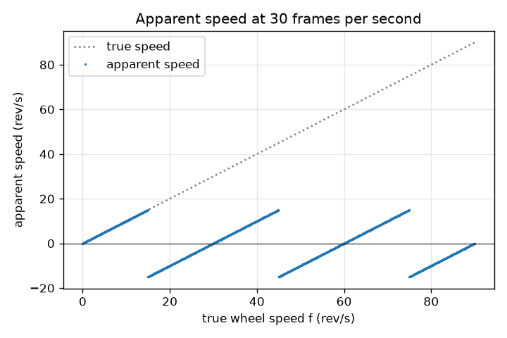
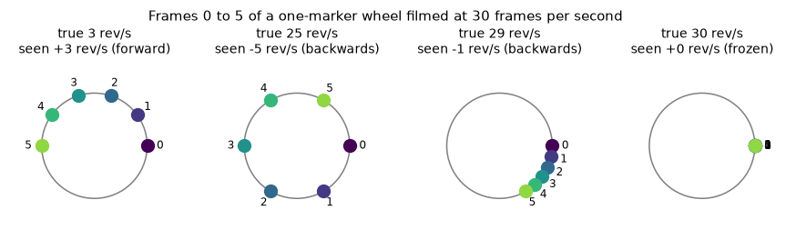

# సెషన్ 1: కెమెరాలో ఒక చక్రం: నెమ్మదిగా, నిశ్చలంగా లేదా వెనక్కి

[Session 1 — हिन्दी](README.hi.md) · [Session 1 — മലയാളം](README.ml.md) · [Session 1 — தமிழ்](README.ta.md) · [Session 1 — తెలుగు](README.te.md)

*స్థాయి 1 (భావనాత్మక ఇంటరాక్టివ్ మోడల్) · సుమారు 60 నిమిషాలు · openalias*

> ఇది సరళీకరించిన ఒక విద్యా మోడల్. ఇది ధృవీకరించబడిన (validated) డిజైన్ సాధనం కాదు; నిజమైన నిర్మాణాలు, విద్యుత్ ఇన్‌స్టలేషన్‌లు, వాహనాలు, పారిశ్రామిక ప్రక్రియలు లేదా వైద్య నిర్ణయాల కోసం దీనిని ఉపయోగించకూడదు.

**ముందస్తు అవసరాలు (Prerequisites)**

- డిగ్రీలలో కోణాలు; ఒక పూర్తి భ్రమణం = 360 డిగ్రీలు.
- మీరు PRIMER.md చదివి, `python start.py 1` ను ఒకసారి రన్ చేశారు.

**అభ్యాస లక్ష్యాలు (Learning objectives).** ఈ సెషన్ తర్వాత మీరు చేయగలరు:

- స్థిరమైన క్షణాలలో చిత్రాలు తీసే కెమెరా, ఒక చక్రం నెమ్మదిగా తిరుగుతున్నట్లు, వెనక్కి తిరుగుతున్నట్లు లేదా అసలు తిరగనట్లు ఎందుకు చూపించగలదో వివరించడం.
- రెండు ఫ్రేమ్‌ల మధ్య భ్రమణాన్ని మరియు ఒక మార్కర్ యొక్క దృశ్య వేగాన్ని (apparent speed) చేతితో మరియు Python లో లెక్కించడం.
- నిజ వేగానికి వ్యతిరేకంగా దృశ్య వేగం గ్రాఫ్‌ను (ఒక రంపపు పళ్ళ ఆకారం - sawtooth) చదవడం.
- ఇచ్చిన చక్రం ఏ ఫ్రేమ్ రేట్లలో నిశ్చలంగా కనిపిస్తుందో అంచనా వేయడం.

## A. నిజ జీవిత సమస్య
పాత వెస్టర్న్ సినిమాలలో గుర్రాలు ముందుకు దూసుకెళ్తుంటే గుర్రపు బండి చక్రాలు వెనక్కి తిరుగుతున్నట్లు కనిపిస్తాయి. వీడియోలో హెలికాప్టర్ రెక్కలు కొన్నిసార్లు నిశ్చలంగా నిలిచిపోతాయి. చక్రంలో గానీ రెక్కలలో గానీ ఏ లోపమూ లేదు: కెమెరా నిరంతరం చూడదు, అది ప్రతి సెకనుకు 24 లేదా 30 చిత్రాలు తీస్తుంది. రెండు చిత్రాల మధ్య చక్రం చాలాసార్లు తిరగవచ్చు, మెదడు బిందువులను అత్యంత సరళమైన రీతిలో కలుపుతుంది. ఒక వీక్షకుడు సరిగ్గా ఏమి చూస్తాడో, చక్రం ఏ దిశలో వెళ్తున్నట్లు కనిపిస్తుందో మనం ఖచ్చితంగా అంచనా వేయగలమా?

## B. భావన మరియు సిద్ధాంతం
సెకనుకు f పరిభ్రమణాలు (rev/s) తిరిగే ఒక చక్రంపై ఒక మార్కర్ గీయండి. కెమెరా సెకనుకు fs ఫ్రేమ్‌లు తీస్తుంది, కాబట్టి ఫ్రేమ్‌ల మధ్య 1/fs సెకన్ల దూరం ఉంటుంది. ఆ సమయంలో మార్కర్ step = 360 f / fs డిగ్రీలు తిరుగుతుంది, ఇది ఒక పూర్తి భ్రమణం కంటే చాలా ఎక్కువ కావచ్చు. ఫ్రేమ్‌ల మధ్య జరిగే పూర్తి భ్రమణాలను వీక్షకుడు లెక్కించలేడు; మార్కర్ ఇప్పుడు ఎక్కడ ఉందో మాత్రమే వారు చూస్తారు, పాత స్థానం నుండి కొత్త స్థానానికి అతి చిన్న దారిని ఊహిస్తారు. ఆ అతి చిన్న గుర్తుతో కూడిన (signed) భ్రమణం అంటే -180 నుండి +180 డిగ్రీల పరిధిలోకి మడిచిన (folded) step. మడిచిన step ను సెకనుకు ఫ్రేమ్‌ల సంఖ్యతో గుణించి 360 తో భాగిస్తే rev/s లో దృశ్య వేగం వస్తుంది. రుణాత్మక దృశ్య వేగం అంటే చక్రం వెనక్కి తిరుగుతున్నట్లు కనిపిస్తుంది. ఒక ఫ్రేమ్‌కు సరిగ్గా 180 డిగ్రీలు అనేది మినుకు పరిమితి (flicker limit): రెండు దారులూ సమానంగా చిన్నవిగా కనిపిస్తాయి. ప్రతి ఫ్రేమ్‌కు f కు పూర్ణ సంఖ్యలో భ్రమణాలు కలపడం (అంటే f కు fs కలపడం) కెమెరా చూడగలిగే దేనినీ మార్చదు.

| గుర్తు | అర్థం | యూనిట్ |
|---|---|---|
| f | చక్రం యొక్క నిజ వేగం | rev/s |
| fs | కెమెరా ఫ్రేమ్ రేట్ | frames/s |
| step | రెండు ఫ్రేమ్‌ల మధ్య నిజ భ్రమణం | డిగ్రీలు |
| fold(step) | అదే భ్రమణం -180 నుండి +180 డిగ్రీలలోకి మడిచినది | డిగ్రీలు |
| f_app | దృశ్య వేగం (గుర్తుతో) | rev/s |

**ఊహలు (Assumptions)**

- చక్రం స్థిర వేగంతో తిరుగుతుంది.
- ఒకే ఒక మార్కర్ (చక్రంపై దాని నకళ్ళు లేవు).
- కెమెరాకు తక్షణ షట్టర్ ఉంది: ప్రతి ఫ్రేమ్ పూర్తిగా స్పష్టమైన ఒక స్నాప్‌షాట్.
- వీక్షకుడు ఎల్లప్పుడూ ఫ్రేమ్‌ల మధ్య అతి చిన్న భ్రమణాన్ని అనుసరిస్తాడు.

$$ \text{step}=360^\circ\,\frac{f}{f_s} $$

$$ \mathrm{fold}(\theta)=\big((\theta+180^\circ)\bmod 360^\circ\big)-180^\circ $$

$$ f_{\text{app}}=\frac{\mathrm{fold}(\text{step})}{360^\circ}\,f_s=f-k\,f_s,\qquad k=\mathrm{round}\!\left(\frac{f}{f_s}\right) $$

## C. దృశ్య వివరణ
సెకనుకు 30 ఫ్రేమ్‌లలో చిత్రీకరించిన నాలుగు చక్ర వేగాల కోసం ఫ్రేమ్ 0 నుండి 5 వరకు మార్కర్‌ను మొదటి చిత్రం చూపిస్తుంది: 3 rev/s వద్ద అది నెమ్మదిగా ముందుకు జరుగుతుంది; 25 rev/s వద్ద అది ఫ్రేమ్‌కు 300 డిగ్రీలు దూకుతుంది, 5 rev/s వద్ద వెనక్కి వెళ్తున్నట్లు కనిపిస్తుంది; 29 rev/s వద్ద చాలా నెమ్మదిగా వెనక్కి వెళ్తున్నట్లు కనిపిస్తుంది; 30 rev/s వద్ద కదలకుండా ఉంటుంది. రెండవ చిత్రం నిజ వేగానికి వ్యతిరేకంగా దృశ్య వేగాన్ని ప్లాట్ చేస్తుంది: 15 rev/s వరకు నిజ వేగాన్ని అనుసరించి, -15 కు దూకి, 30 rev/s వద్ద సున్నాకు తిరిగి ఎక్కి, ఆపై పునరావృతమయ్యే రంపపు పళ్ళ ఆకారం.

*30 fps వద్ద నిజ వేగానికి వ్యతిరేకంగా దృశ్య వేగం: ప్రతి 30 rev/s కు పునరావృతమయ్యే రంపపు పళ్ళ ఆకారం.*

*నాలుగు చక్ర వేగాల కోసం 30 fps వద్ద ఫ్రేమ్ 0 నుండి 5 వరకు మార్కర్: నెమ్మదిగా, వెనక్కి, దాదాపు నిశ్చలం, నిశ్చలం.*

## D. ఇంటరాక్టివ్ సిమ్యులేషన్
పాఠాన్ని రన్ చేయండి (`python start.py 1`), ఆపై లైవ్ యాప్ తెరవండి: [సెషన్ 1: చక్రం మరియు కెమెరా](https://krunalpanchal1995.github.io/pan-iit-oss/openalias/session-01/) (లేదా ఈ ఫోల్డర్‌లోని `app.html`). సెకనుకు 30 ఫ్రేమ్‌ల వద్ద చక్ర వేగం స్లైడర్‌ను 0 నుండి 60 rev/s వరకు లాగి ఎరుపు మరియు నీలం బిందువులను గమనించండి, ఆపై గ్రాఫ్ వ్యూ తెరిచి చక్రం ఎక్కడ వెనక్కి వెళ్తున్నట్లు కనిపిస్తుందో కనుగొనండి. ఫ్రేమ్ రేట్ మార్చి రంపపు పళ్ళ ఆకారం సాగడం చూడండి.

**సవాలు (Challenge).** 20 rev/s లేదా అంతకంటే వేగంగా తిరిగే చక్రాన్ని పూర్తిగా నిశ్చలంగా కనిపించేలా చేయండి.

## E. సాధించిన ఉదాహరణ మరియు ప్రయోగం
**సమస్య.** ఒక చక్రం 28 rev/s తిరుగుతుంది, సెకనుకు 30 ఫ్రేమ్‌లలో చిత్రీకరించబడుతుంది. ఫ్రేమ్‌ల మధ్య మార్కర్ ఎంత తిరుగుతుంది, వీక్షకుడు ఏమి చూస్తాడు, చక్రం ఎంత వేగంగా వెళ్తున్నట్లు కనిపిస్తుంది?

1. ఫ్రేమ్‌ల మధ్య భ్రమణం: step = 360 x 28 / 30 = 336 డిగ్రీలు.
2. వీక్షకుడు అతి చిన్న దారిని చూస్తాడు: 336 డిగ్రీలు అంటే 336 - 360 = -24 డిగ్రీల అదే స్థానం, కాబట్టి మార్కర్ ప్రతి ఫ్రేమ్‌లో 24 డిగ్రీలు వెనక్కి కదులుతున్నట్లు కనిపిస్తుంది.
3. దృశ్య వేగం = -24 / 360 x 30 = -2 rev/s.
4. f - k fs తో సరిచూడండి: k = round(28 / 30) = 1, కాబట్టి 28 - 30 = -2 rev/s. రెండు పద్ధతులూ ఏకీభవిస్తాయి.

**సమాధానం.** మార్కర్ నిజానికి ఫ్రేమ్‌కు 336 డిగ్రీలు తిరుగుతుంది, కానీ 24 డిగ్రీలు వెనక్కి తిరుగుతున్నట్లు కనిపిస్తుంది: చక్రం 2 rev/s వద్ద వెనక్కి వెళ్తున్నట్లు కనిపిస్తుంది.

**ప్రయోగం.** ఒక టేబుల్ ఫ్యాన్ యొక్క ఒక రెక్కపై టేప్ అతికించి గుర్తు పెట్టండి, ఫోన్‌తో సాధారణ వీడియోలో (సుమారు 30 fps) ఆపై స్లో మోషన్‌లో (120 లేదా 240 fps) చిత్రీకరించండి. స్లో-మోషన్ క్లిప్ నిజ వేగాన్ని చూపిస్తుంది; సాధారణ క్లిప్ ఏమి చూపించాలో సూత్రంతో అంచనా వేసి పోల్చండి. తేడాలు ఫోన్ నుండి వస్తాయి: నిజమైన ఫ్రేమ్ రేట్ 29.97 కావచ్చు లేదా మారవచ్చు, ప్రతి ఫ్రేమ్‌లో కొంత భాగం షట్టర్ తెరిచి ఉంటుంది (చలన అస్పష్టత - motion blur), కొన్ని సెన్సార్లు వరుసలను ఒకదాని తర్వాత ఒకటి చదువుతాయి (రోలింగ్ షట్టర్ - rolling shutter). మోడల్‌లో వీటిలో ఏదీ లేదు.

## F. మూల్యాంకనం మరియు డిజైన్ సవాలు
**ప్రశ్న రకం A: భావనాత్మకం.** ఒక చక్రం fs rev/s కంటే కొంచెం నెమ్మదిగా తిరుగుతుంది (ఉదాహరణకు 30 fps వద్ద 29 rev/s). అది ముందుకు కాకుండా, నెమ్మదిగా వెనక్కి తిరుగుతున్నట్లు ఎందుకు కనిపిస్తుంది?

సూచన

రెండు ఫ్రేమ్‌ల మధ్య మార్కర్ దాదాపు ఒక పూర్తి భ్రమణం తిరుగుతుంది. దానిని ఒక పూర్తి భ్రమణంతో పోల్చండి.

దశలవారీ పరిష్కారం

రెండు ఫ్రేమ్‌ల మధ్య మార్కర్ 348 డిగ్రీలు తిరుగుతుంది, ఇది పూర్తి భ్రమణం కంటే 12 డిగ్రీలు తక్కువ. కన్ను పూర్తి భ్రమణాన్ని విస్మరించి, మార్కర్ ప్రారంభించిన చోటుకు 12 డిగ్రీలు ముందే చేరడం చూస్తుంది, కాబట్టి అది ఫ్రేమ్‌కు 12 డిగ్రీలు వెనక్కి కదులుతున్నట్లు కనిపిస్తుంది: -12 / 360 x 30 = -1 rev/s. fs కంటే కొంచెం వేగంగా తిరిగే చక్రం తన ప్రారంభ స్థానం కొంచెం దాటి చేరి, నెమ్మదిగా ముందుకు కదులుతున్నట్లు కనిపిస్తుంది.

**ప్రశ్న రకం B: సంఖ్యాత్మకం.** ఒక చక్రం 33 rev/s తిరుగుతుంది, సెకనుకు 24 ఫ్రేమ్‌లలో చిత్రీకరించబడుతుంది. ఫ్రేమ్‌కు భ్రమణం, దృశ్య భ్రమణం మరియు దృశ్య వేగం కనుగొనండి. ఒక సహేతుకత తనిఖీ (sanity check) చేయండి.

సూచన

step = 360 f / fs, ఆపై -180 నుండి +180 డిగ్రీలలోకి మడవండి.

దశలవారీ పరిష్కారం

step = 360 x 33 / 24 = 495 డిగ్రీలు. మడిచినది: 495 - 360 = 135 డిగ్రీలు. దృశ్య వేగం = 135 / 360 x 24 = +9 rev/s (ముందుకు). తనిఖీ: k = round(33 / 24) = round(1.375) = 1 తో f - k fs = 33 - 24 = 9 rev/s. సహేతుకత: దృశ్య వేగం పరిమాణం ఎప్పుడూ fs / 2 = 12 rev/s ను మించదు, 9 దాని కంటే తక్కువ.

**ప్రశ్న రకం C: గ్రాఫ్ మరియు సిమ్యులేషన్ వ్యాఖ్యానం.** సెకనుకు 30 ఫ్రేమ్‌ల రంపపు పళ్ళ గ్రాఫ్ ఉపయోగించి, 0 నుండి 60 rev/s మధ్య ఏ నిజ వేగాలలో చక్రం వెనక్కి వెళ్తున్నట్లు కనిపిస్తుంది, ఎక్కడ నిశ్చలంగా కనిపిస్తుంది?

సూచన

వెనక్కి అంటే వక్రం సున్నా కంటే కింద ఉంది.

దశలవారీ పరిష్కారం

15 < f < 30 rev/s మరియు 45 < f < 60 rev/s కు వక్రం సున్నా కంటే కింద ఉంది: వెనక్కి. f = 0, 30 మరియు 60 rev/s వద్ద అది సున్నాను తాకుతుంది: నిశ్చలం. సరిగ్గా f = 15 మరియు 45 rev/s వద్ద దృశ్య వేగం పరిమాణం 15, మినుకు పరిమితి, దిశను చెప్పలేము. యూనిట్లు: రెండు అక్షాలపై rev/s.

**ప్రశ్న రకం D: డిజైన్ మరియు ఆప్టిమైజేషన్ సవాలు.** ఒక చక్రం 29 rev/s తిరుగుతుంది. మీరు సెకనుకు 24, 25, 28, 29, 30 లేదా 60 ఫ్రేమ్‌లతో చిత్రీకరించవచ్చు. ఏ ఎంపిక దానిని 1 rev/s మించకుండా నెమ్మదిగా ముందుకు తిరుగుతున్నట్లు చూపిస్తుంది? ఏ ఎంపిక దాని నిజ వేగాన్ని చూపిస్తుంది? నిజ-వేగ ఎంపిక ఖర్చు ఏమిటి?

సూచన

ప్రతి ఫ్రేమ్ రేట్‌కు f - fs x round(f / fs) లెక్కించండి.

దశలవారీ పరిష్కారం

దృశ్య వేగాలు +5 (24 fps), +4 (25 fps), +1 (28 fps), 0 (29 fps, నిశ్చలం), -1 (30 fps, వెనక్కి) మరియు +29 (60 fps). 28 fps మాత్రమే గరిష్టంగా 1 rev/s తో నెమ్మదైన ముందుకు కదలికను చూపిస్తుంది. 60 fps మాత్రమే సత్యాన్ని చూపిస్తుంది, ఎందుకంటే 60 అనేది 29 కి రెట్టింపు కంటే ఎక్కువ (సెషన్ 2 ఈ నియమాన్ని వివరిస్తుంది). రాజీ (trade-off): ఫ్రేమ్ రేట్‌ను రెట్టింపు చేయడం డేటా మొత్తాన్ని రెట్టింపు చేస్తుంది, ప్రతి ఫ్రేమ్‌కు ఎక్కువ కాంతి అవసరం.

[RUBRIC.md](../../RUBRIC.md) తో మీకు మీరే స్కోర్ ఇచ్చుకోండి. కాగితంపై పని చేయడానికి [కార్యాచరణ పత్రాన్ని](activity_sheet.md) ప్రింట్ చేయండి.

## సాధారణ అపోహలు
| సాధారణ అపోహ | వాస్తవంగా నిజం ఏమిటి |
|---|---|
| కెమెరా పాడైంది, లేదా చక్రం తన వేగాన్ని మారుస్తుంది. | ఏదీ మారదు: చక్రం స్థిరంగా తిరుగుతుంది; స్థిరమైన క్షణాలలో చూడటం వల్ల మాత్రమే ఈ ప్రభావం వస్తుంది. |
| వేగవంతమైన చక్రం ఎల్లప్పుడూ వేగంగా కనిపిస్తుంది. | fs/2 దాటిన తర్వాత దృశ్య వేగం మళ్ళీ తగ్గుతుంది, f = fs వద్ద సున్నాకు చేరి ఆపై పునరావృతమవుతుంది: దృశ్య వేగం ఒక రంపపు పళ్ళ ఆకారం, సరళ రేఖ కాదు. |
| బండి-చక్ర ప్రభావానికి (wagon-wheel effect) కెమెరా అవసరం. | నమూనాలు తీసే (sample) ఏదైనా ఇది చేస్తుంది, ఉదాహరణకు మినుకుమినుకుమనే దీపం లేదా స్ట్రోబ్, మినుకుమనే వెలుగులో కన్ను కూడా. |
| వెనక్కి తిరగడం మెదడులో మాత్రమే జరిగే దృష్టి భ్రమ (optical illusion). | చిత్రాలలో ఉన్నది సరిగ్గా అదే: ప్రతి ఫ్రేమ్‌లో మార్కర్ నిజంగా 'వెనక్కి' స్థానంలో ఉంది. నమూనా విలువలు దానిని నిజమైన వెనక్కి కదలిక నుండి వేరు చేయవు. |

## పదకోశం (Glossary)
- **ఫ్రేమ్ రేట్ (frame rate)**: సెకనుకు తీసే చిత్రాలు, frames/s (fps) లో
- **పరిభ్రమణం (revolution)**: చక్రం యొక్క ఒక పూర్తి భ్రమణం, 360 డిగ్రీలు
- **మడవడం (fold)**: పూర్తి భ్రమణాలను కలిపి లేదా తీసివేసి ఒక కోణాన్ని -180 నుండి +180 డిగ్రీల పరిధిలోకి తీసుకురావడం
- **దృశ్య వేగం (apparent speed)**: చిత్రాల క్రమం చూపిస్తున్నట్లు అనిపించే వేగం; రుణాత్మకం అంటే వెనక్కి
- **అలియాసింగ్ (aliasing)**: చాలా అరుదుగా చూడబడే వేగవంతమైన మార్పు, నెమ్మదైనదిగా కనిపించడం

## ముగించండి
1. [exercises.md](exercises.md) లోని మూడు కోడింగ్ పనులు చేయండి.
2. మీ మార్పుల తర్వాత `python start.py 1` ను మళ్ళీ రన్ చేయండి. అది చెక్‌పాయింట్‌తో ముగుస్తుంది; అది `PASS` అని ప్రింట్ చేసినప్పుడు, మీరు పూర్తి చేశారు. (చెక్‌పాయింట్ మాత్రమే: `python start.py check 1`.)

తదుపరి: [సెషన్ 2](../session-02/README.md)
