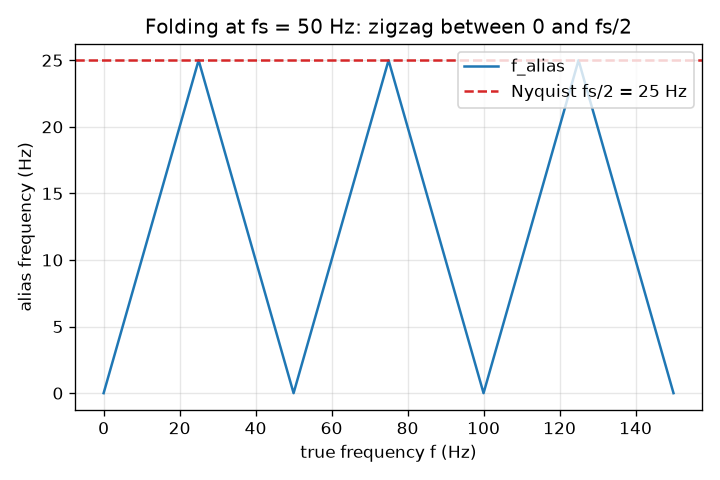
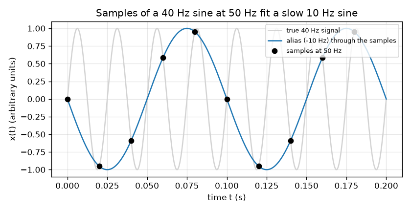

# Session 2: The alias formula and the Nyquist limit

*Level 2 (mathematical engineering model) · about 75 minutes · openalias*

> This is a simplified educational model. It is not a validated design tool and must not be used for real structures, electrical installations, vehicles, industrial processes or medical decisions.

**Prerequisites**

- Session 1: apparent speed of a filmed wheel.
- The sine function and the idea of frequency in hertz.

**Learning objectives.** After this session you can:

- Sample a sine wave and show that two different frequencies give identical samples.
- Use f_alias = |f - k fs| with k = round(f / fs) and place the result in the range 0 to fs/2.
- State the Nyquist limit and the rule fs > 2 f_max.
- Solve a design problem: the minimum frame rate to measure a given wheel or fan speed.

## A. Real-world problem
A sound card, an oscilloscope and a camera all measure a continuous signal only at fixed instants. Session 1 found the sawtooth by looking at pictures. Engineers need a rule: if the fastest thing in the signal oscillates at f_max hertz, how often must we measure so that no fast signal is mistaken for a slow one? And how do we know which slow signal a fast one will pose as? A table fan with four blades turns 12 rev/s: what frame rate shows it correctly?

## B. Concept and theory
Sampling a signal sin(2 pi f t) at the instants t_n = n / fs gives the numbers x[n] = sin(2 pi f n / fs). If we replace f by f + k fs, where k is a whole number, the angle grows by 2 pi k n, a whole number of turns, and the samples do not change. So every frequency in the list ..., f - fs, f, f + fs, f + 2 fs, ... gives the same samples; and because sin(-a) = -sin(a) the negative of each gives the same samples up to a sign. Choose k = round(f / fs). Then f - k fs lies between -fs/2 and +fs/2 and is the smallest of the equivalent frequencies; its size is the alias frequency. It equals f for f below fs/2 and folds back (zigzags) above. The limit fs/2 is the Nyquist frequency. A signal whose highest frequency is f_max is safe only if fs > 2 f_max; exactly 2 f_max is not enough (a sine sampled at its zero crossings gives all zeros). For a wheel with N identical blades or spokes, the picture repeats N times per turn, so the signal frequency is N f, not f; the apparent wheel speed is the signed alias of N f divided by N.

| Symbol | Meaning | Unit |
|---|---|---|
| f | signal frequency | Hz |
| fs | sampling rate | samples/s (Hz) |
| k | nearest whole number of sampling rates, round(f / fs) | no unit |
| f_alias | alias frequency, \|f - k fs\| | Hz |
| f_N | Nyquist frequency, fs / 2 | Hz |
| N | number of identical blades or spokes | no unit |
| f_pattern | frequency of the repeating picture, N f | Hz |

**Assumptions**

- The signal is a pure sine (a real signal is a sum of sines, and each one aliases on its own).
- Sampling instants are exactly 1/fs apart and instantaneous.
- Round halves upward; the tie f = fs/2 + j fs is the flicker limit where the alias is exactly fs/2.
- Blades are identical, so only the pattern frequency N f is visible.

$$ x[n]=\sin\!\left(2\pi f\,\frac{n}{f_s}\right) $$

$$ \sin\!\left(2\pi (f+k f_s)\frac{n}{f_s}\right)=\sin\!\left(2\pi f\frac{n}{f_s}+2\pi k n\right)=\sin\!\left(2\pi f\frac{n}{f_s}\right) $$

$$ f_{\text{alias}}=\left|f-k f_s\right|,\quad k=\mathrm{round}\!\left(\frac{f}{f_s}\right),\quad 0\le f_{\text{alias}}\le \frac{f_s}{2} $$

$$ f_s>2f_{\max}\quad\text{(Nyquist condition)},\qquad f_{\text{pattern}}=N f $$

## C. Visual explanation
The first figure shows a 40 Hz sine (grey) sampled 50 times a second (black dots). The dots do not show 40 Hz: a slow 10 Hz sine (blue) passes through every dot, with its sign reversed because 40 - 50 = -10. The second figure plots the alias frequency against the true frequency at fs = 50 Hz: it rises to 25 Hz (the Nyquist frequency, red dashed line), falls back to zero at 50 Hz, rises again, and so on; the same alias height is reached by many different true frequencies.

*Alias frequency against true frequency at fs = 50 Hz, with the Nyquist limit at 25 Hz.*

*A 40 Hz sine sampled at 50 Hz: the samples lie on a -10 Hz (alias) sine.*

## D. Interactive simulation
Run the lesson (`python start.py 2`), then open the live app: [Session 2: sampling a sine](https://krunalpanchal1995.github.io/pan-iit-oss/openalias/session-02/) (or `app.html` in this folder). Move the signal frequency slider up from 1 Hz at fs = 50 Hz and watch the blue sine stop following the grey one when the frequency passes 25 Hz. In the folding view, see the dot follow the zigzag.

**Challenge.** Choose a sampling rate for a 40 Hz signal that satisfies the Nyquist condition (above 80 Hz).

## E. Worked example and experiment
**Problem.** A 40 Hz sine is sampled at 50 Hz. Find the alias frequency, the signed alias, and check with one sample.

1. Nyquist frequency = 50 / 2 = 25 Hz. Since 40 Hz is above 25 Hz, aliasing will happen.
2. k = round(40 / 50) = round(0.8) = 1.
3. Signed alias = 40 - 1 x 50 = -10 Hz, so the alias frequency is 10 Hz.
4. Check with sample n = 1: x[1] = sin(2 pi x 40 / 50) = sin(2 pi x 0.8) = sin(288 degrees) = -0.951.
5. A -10 Hz sine gives sin(2 pi x (-10) / 50) = sin(-72 degrees) = -0.951. They match.

**Answer.** The alias frequency is 10 Hz (signed -10 Hz); the 40 Hz samples are exactly those of a -10 Hz sine. The 40 Hz signal poses as a slow 10 Hz one.

**Experiment.** Play a rising tone from a tone-generator website while you record it on a phone or a computer with the sampling rate set low (for example 8000 Hz in a recording program with a choice of rates); the recorded pitch will fall after the tone passes half the sampling rate, as the formula predicts. Real recorders hide this with an anti-alias filter before sampling (Session 3), so the effect may be weak or absent: that is model versus reality.

## F. Assessment and design challenge
**Question type A: Conceptual.** After a signal has been sampled, can any processing of the samples tell a 40 Hz sine from its 10 Hz alias at fs = 50 Hz? Why is the only real cure a change before sampling?

Hint

Look at the sample values you derived for the worked example.

Step-by-step solution

No. The samples of 40 Hz and -10 Hz are identical numbers, so no function of the samples can tell them apart. The information is lost at the instant of sampling. The cure must act before: sample faster (fs above 2 f_max) or remove frequencies above fs/2 with a low-pass (anti-alias) filter first.

**Question type B: Numerical.** A 130 Hz signal is sampled at 100 Hz. Find the alias frequency and give two other frequencies that give the same samples.

Hint

k = round(130 / 100); then use f -/+ fs and the sign symmetry.

Step-by-step solution

k = round(1.3) = 1, so f_alias = |130 - 100| = 30 Hz (signed +30). Frequencies with the same samples: 30 + 100 = 130, 30 - 100 = -70 (so 70 Hz up to a sign), 30 + 200 = 230, and the negatives. So 70 Hz and 170 Hz alias to 30 Hz as well. Sanity: 30 is between 0 and fs/2 = 50.

**Question type C: Graph and simulation interpretation.** On the folding graph for fs = 50 Hz, at which true frequencies from 0 to 150 Hz is the alias exactly 10 Hz?

Hint

Draw a horizontal line at 10 Hz and read where it crosses the zigzag.

Step-by-step solution

The zigzag crosses 10 Hz at f = 10, 40, 60, 90, 110 and 140 Hz. They come in pairs symmetric about each multiple of 50: 50 -/+ 10, 100 -/+ 10, 150 - 10 (and 0 + 10).

**Question type D: Design and optimisation challenge.** Design: a four-blade fan turns 12 rev/s. A phone can film at 30, 60, 100 or 120 frames per second. Which rates show the true speed and direction? What is the minimum, and what does a higher rate cost?

Hint

The picture repeats N f = 48 times per second. Apply the Nyquist condition to the pattern.

Step-by-step solution

The pattern frequency is 4 x 12 = 48 Hz, so fs must be above 2 x 48 = 96 frames per second: only 100 and 120 fps work (apparent +12 rev/s). At 30 fps the fan seems to turn at -3 rev/s (48 - 60 = -12 Hz, divided by 4) and at 60 fps also -3 rev/s. Exactly 96 would sit on the limit. A higher rate costs more data, more light per frame (shorter exposure) and storage; 100 fps is the cheapest choice with a margin of 4 percent only, 120 fps gives a safe margin of 25 percent.

Score yourself with [RUBRIC.md](../../RUBRIC.md). Print the [activity sheet](activity_sheet.md) to work on paper.

## Common misconceptions
| Common misconception | What is actually true |
|---|---|
| Sampling at exactly twice the highest frequency is enough. | The condition is fs strictly above 2 f_max; at exactly 2 f_max a sine can be missed completely (all samples zero) or its amplitude is wrong. |
| Aliasing only happens when the signal is much faster than the sampling rate. | It starts as soon as f passes fs/2; a signal at 0.6 fs already shows up at 0.4 fs. |
| For a four-blade fan the signal frequency is the fan speed. | The picture repeats four times per turn, so the signal frequency is 4 times the fan speed, and the frame rate has to be judged against that. |
| The alias frequency is just f modulo fs. | It is the distance to the nearest multiple of fs, so it folds: f = 40 Hz at fs = 50 Hz gives 10 Hz, not 40 Hz. |

## Glossary
- **sampling rate**: how many measurements per second, in hertz
- **Nyquist frequency**: half the sampling rate, the highest frequency that is not aliased
- **alias**: a false lower frequency that a too-fast signal shows up as
- **folding**: the zigzag of alias frequency against true frequency
- **anti-alias filter**: a low-pass filter placed before sampling that removes frequencies above fs/2

## Finish
1. Do the three coding tasks in [exercises.md](exercises.md).
2. Run `python start.py 2` again after your changes. It ends with the checkpoint; when it prints `PASS`, you are done. (Checkpoint only: `python start.py check 2`.)

Next: [Session 3](../session-03/README.md)
