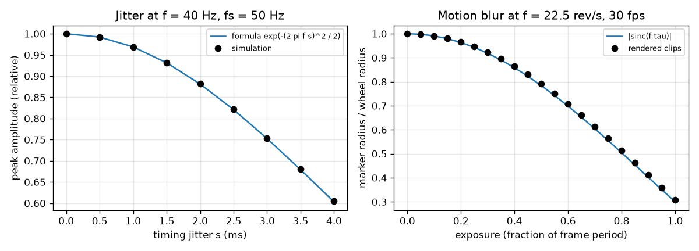
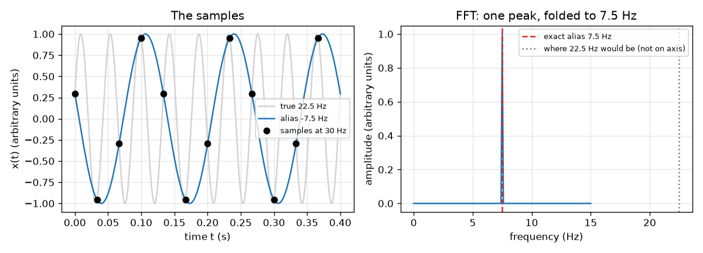
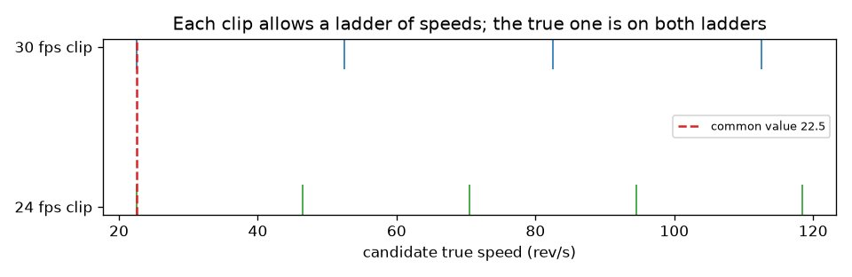

# Session 3: Simulate, find the folded peak, recover the true speed

*Level 3 (simulation and validation) · about 90 minutes · openalias*

> This is a simplified educational model. It is not a validated design tool and must not be used for real structures, electrical installations, vehicles, industrial processes or medical decisions.

**Prerequisites**

- Session 1: apparent speed.
- Session 2: the alias formula and Nyquist.
- The idea that an FFT lists the frequencies in a signal (explained in Section B).

**Learning objectives.** After this session you can:

- Generate sampled signals and rendered marker clips in code, with optional jitter and exposure blur.
- Find the folded peak with the FFT and validate it against the exact folding formula.
- Recover the true frequency from two frame rates and state when the answer is unique.
- Measure how timing jitter and shutter exposure change what is seen, and compare with the formulas.

## A. Real-world problem
You are handed two video clips of a fan, one filmed at 30 and one at 24 frames per second, and nothing else. In each the marked blade seems to turn backwards, slowly. The fan could be turning at almost any of an endless list of speeds. How do you find the real one, how sure can you be, and what do real cameras (blurry shutters, uneven timing) do to your measurement?

## B. Concept and theory
The FFT of N samples taken at rate fs lists the frequencies 0, fs/N, 2 fs/N, ..., fs/2; a pure sine appears as a peak at the alias frequency, so the peak position can be tested against the formula of Session 2 to within one bin, fs/N. A clip of a marker gives an apparent speed with a sign: each frame's marker angle is found, the steps between frames are folded into -180 to +180 degrees and averaged. One clip says f = a1 + k1 fs1 for a whole number k1; a second clip says f = a2 + k2 fs2. Only values that appear in both lists are possible. If both apparent speeds are signed, the pair repeats only after lcm(fs1, fs2) rev/s (whole-number rates), so the answer is unique below that limit; with the same rate twice, or a rate that is a multiple of the other, the limit stays small. If only the sizes |a| are known, we also have to try -a. Two real effects: timing jitter of standard deviation s turns the phase of every sample by a random amount 2 pi f s, which shrinks the coherent peak by exp(-(2 pi f s)^2 / 2); and a shutter open for tau seconds averages the signal over tau, multiplying a sine of frequency f by |sinc(f tau)|, sinc(x) = sin(pi x) / (pi x), a built-in low-pass filter that acts before sampling.

| Symbol | Meaning | Unit |
|---|---|---|
| N | number of samples or frames | no unit |
| fs | sampling or frame rate | Hz |
| a1, a2 | signed apparent speeds measured in clip 1 and 2 | rev/s |
| k1, k2 | unknown whole numbers | no unit |
| L | unambiguous range, lcm(fs1, fs2) | rev/s |
| s | standard deviation of timing jitter | s |
| tau | exposure time (shutter open) | s |

**Assumptions**

- Constant rotation speed during both clips.
- Whole-number frame rates for the lcm rule.
- Jitter is random, independent from frame to frame, with zero mean.
- The marker is a small blob; its centroid gives its angle.
- Educational model: it ignores rolling shutter, lens distortion and variable frame rates of real cameras.

$$ \Delta f_{\text{bin}}=\frac{f_s}{N} $$

$$ f=a_1+k_1f_{s1}=a_2+k_2f_{s2} $$

$$ L=\mathrm{lcm}(f_{s1},f_{s2}) $$

$$ \frac{A_{\text{measured}}}{A}=e^{-\frac{1}{2}(2\pi f s)^2},\qquad \frac{A_{\text{exposed}}}{A}=\left|\frac{\sin(\pi f\tau)}{\pi f\tau}\right| $$

## C. Visual explanation
The first figure shows the 22.5 Hz signal sampled at 30 Hz: its samples fit a -7.5 Hz sine, and its FFT has one tall peak at 7.5 Hz, exactly where the formula says (the true 22.5 Hz is not even on the axis). The second figure shows the two ladders of allowed speeds for the 30 and 24 fps clips: blue ticks at -7.5 + 30 k, green ticks at -1.5 + 24 m; they meet at 22.5 and next at 142.5. The third figure compares simulation (dots) with the jitter and exposure formulas (curves): they agree.

*Simulation against the jitter formula (left) and the exposure sinc formula (right).*

*A 22.5 Hz sine sampled at 30 Hz: samples fit the -7.5 Hz alias and the FFT peak sits at 7.5 Hz.*

*Ladders of allowed true speeds for the 30 and 24 fps clips meet at 22.5 rev/s.*

## D. Interactive simulation
Run the lesson (`python start.py 3`), then open the live app: [Session 3: two clips, one fan](https://krunalpanchal1995.github.io/pan-iit-oss/openalias/session-03/) (or `app.html` in this folder). Set a true speed, then change the two frame rates and watch the two ladders and the spectra. Find rates for which the answer stays unique over a wide range, and rates for which it does not.

**Challenge.** Choose two frame rates so that a 70 rev/s fan can be recovered (the unambiguous range must exceed 70 rev/s).

## E. Worked example and experiment
**Problem.** The 30 fps clip shows the marker at -7.5 rev/s and the 24 fps clip shows it at -1.5 rev/s. The fan turns at less than 60 rev/s. Find its true speed and say how sure you are.

1. Clip 1 allows f = -7.5 + 30 k: ..., -7.5, 22.5, 52.5, 82.5, ...
2. Clip 2 allows f = -1.5 + 24 m: ..., -1.5, 22.5, 46.5, 70.5, ...
3. Values in both lists below 60: only 22.5 (k = 1 and m = 1). Check: -7.5 + 30 = 22.5 and -1.5 + 24 = 22.5.
4. Next common value: 22.5 + lcm(30, 24) = 22.5 + 120 = 142.5, far above the bound, so the answer is unique below 142.5 rev/s.
5. In rpm: 22.5 x 60 = 1350 rpm. Also check the simulation: sampled at 30 Hz the FFT peak is at 7.5 Hz, matching the formula.

**Answer.** The fan turns 22.5 rev/s (1350 rpm), and this is the only possibility below 142.5 rev/s.

**Experiment.** Film a real fan with a marked blade at two settings of your phone (for example 30 and 24 fps if it offers them, or 30 and 25) and measure the apparent speeds by counting frames per marker turn. Compare the recovered speed with a slow-motion clip at 240 fps. Differences come from nominal frame rates (29.97 instead of 30), motion blur that shrinks the marker's contrast, rolling shutter and counting error: the model assumes exact rates and perfect snapshots.

## Real-world application and mini-project: How fast does the fan really turn?
A fan with one blade marked in red was filmed twice: once at 30 frames per second and once at 24 frames per second. At 30 fps the marker seems to turn backwards, at 24 fps it also seems to turn backwards but much more slowly. The clips are the function `mystery_fan(fs)` of Session 3 (do not read the true speed from its code). The fan is known to turn at less than 60 revolutions per second. Measure both clips, recover the true speed, and confirm it with a third clip filmed at 25 fps.

**Deliverable:** A script that measures the apparent speed in each clip with `measure_apparent`, prints the ladder of candidate speeds of each clip, names the speed common to both below 60 rev/s (in rev/s and in rpm), predicts the apparent speed of a 25 fps clip with the alias formula and checks it by measuring, and saves a picture with the two ladders.

**Success looks like:** The recovered speed is 22.5 rev/s (1350 rpm) within 0.1 rev/s, and the 25 fps prediction (-2.5 rev/s) agrees with the measurement within 0.05 rev/s.

## F. Assessment and design challenge
**Question type A: Conceptual.** Why does a long exposure act as an anti-alias filter, and why can this not be repaired after the video is recorded?

Hint

Averaging a fast oscillation over a time much longer than one cycle gives about zero.

Step-by-step solution

During the exposure the sensor adds up the light, which averages the signal over tau seconds; a sine of frequency f is multiplied by |sinc(f tau)|, which is small once f tau is above 1. So fast motion is smeared away before the camera samples it and cannot fold. Afterwards the blur has already removed the information (a fully blurred marker has no position left), so no processing can bring it back.

**Question type B: Numerical.** A frame clock has 1 millisecond of random timing jitter. By what factor does the peak of a 40 Hz signal shrink? Do the same for a 400 Hz signal. Which signal suffers more and why?

Hint

factor = exp(-(2 pi f s)^2 / 2).

Step-by-step solution

At 40 Hz: 2 pi x 40 x 0.001 = 0.2513, squared 0.0632, half 0.0316, factor exp(-0.0316) = 0.969, a loss of 3.1 percent. At 400 Hz: 2.513, squared 6.32, half 3.16, factor exp(-3.16) = 0.042, the peak is almost gone. The higher true frequency suffers more because the same timing error is a larger fraction of one cycle. It is the true frequency, not the alias, that counts.

**Question type C: Graph and simulation interpretation.** In the spectrum figure the FFT of the 22.5 Hz signal sampled at 30 Hz peaks at 7.5 Hz. Name four other true frequencies that would give a peak at the same place.

Hint

The unsigned alias 7.5 Hz comes from f = 7.5 + 30 k and f = -7.5 + 30 k.

Step-by-step solution

7.5 + 30 = 37.5, 22.5 (given), 52.5, 67.5, 82.5 and 7.5 itself. So the peak position alone cannot tell which one it was; a second frame rate is needed. The bin spacing here is 30 / 300 = 0.1 Hz, so the peak is read to about 0.05 Hz.

**Question type D: Design and optimisation challenge.** Design: the first camera runs at 30 fps and fan speeds up to 100 rev/s must be recovered uniquely from signed measurements. Which second frame rate would you choose from 15, 20, 24, 25 and 60? Justify the choice.

Hint

The unique range is lcm(30, fs2); it must exceed 100.

Step-by-step solution

lcm(30, 15) = 30, lcm(30, 20) = 60 and lcm(30, 60) = 60 all fail (they are too small because the rates share large factors). lcm(30, 24) = 120 and lcm(30, 25) = 150 work. Choose 25 fps: the largest range (150 rev/s) gives margin if the true speed is a little above 100. Trade-off: the ladder rungs are spaced 30 and 25 rev/s apart, and the common rungs near each other differ by a few rev/s only when the rates are close, so measurement noise must stay below that difference; very close rates (such as 30 and 29) give a huge range but need very accurate measurements.

Score yourself with [RUBRIC.md](../../RUBRIC.md). Print the [activity sheet](activity_sheet.md) to work on paper.

## Common misconceptions
| Common misconception | What is actually true |
|---|---|
| Two clips always give a unique answer. | Only below lcm(fs1, fs2). The same rate twice, or 60 and 30, give no new information. |
| The FFT peak is where the true frequency is. | It is where the alias is; the true frequency has to be reconstructed with extra information. |
| Jitter only adds random noise. | It also lowers the peak itself by exp(-(2 pi f s)^2 / 2), and it hurts high true frequencies the most. |
| Motion blur is only a defect. | It is a helpful anti-alias filter: it removes the fast motion that would otherwise fold. It cannot be undone, and a fully blurred marker (exposure 1 frame period at f = fs) is gone. |

## Glossary
- **FFT**: fast Fourier transform: an algorithm that splits a list of samples into its frequencies
- **bin**: one frequency slot of the FFT, of width fs/N
- **lcm**: least common multiple: the smallest number both rates divide into
- **jitter**: random error in the instants at which samples are taken
- **exposure**: the time the shutter is open for one frame
- **centroid**: the centre of mass of the bright pixels of the marker

## Finish
1. Do the three coding tasks in [exercises.md](exercises.md).
2. Run `python start.py 3` again after your changes. It ends with the checkpoint; when it prints `PASS`, you are done. (Checkpoint only: `python start.py check 3`.)

Next: [Session 4: Noise-proof recovery of the true speed](../session-04/README.md).
