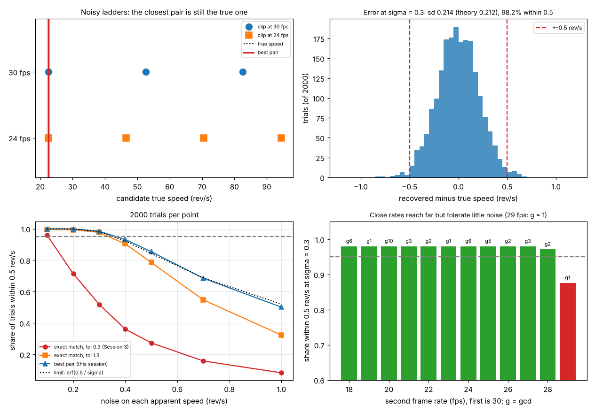

# Session 4: Noise-proof recovery of the true speed

*Level 3 (simulation and validation) · about 90 minutes · openalias*

> This is a simplified educational model. It is not a validated design tool and must not be used for real structures, electrical installations, vehicles, industrial processes or medical decisions.

**Prerequisites**

- Session 3: apparent speed as a signed number, the ladder of candidate speeds and the recovery from two frame rates.
- A standard deviation, and the idea of a random error (explained in Section B).

**Learning objectives.** After this session you can:

- Say where the noise of a measured apparent speed comes from, and how it falls as the clip gets longer.
- Explain why demanding an exact match between the two ladders fails once the measurements are noisy.
- Recover the most likely true speed from two noisy apparent speeds by choosing the best pair of rungs, and report an uncertainty.
- Check the recovery with 2000 simulated trials against the roadmap line, and against the theoretical limit no rule can beat.
- Explain how the choice of the two frame rates trades the unambiguous range against the noise the pair can survive.

## A. Real-world problem
In Session 3 the apparent speeds were exact, and the true speed was the one number on both ladders. A real measurement is noisy: the marker is found a few pixels off, or the clip has only a few frames. With 0.3 rev/s of noise on both apparent speeds, the Session 3 rule, which accepts two rungs closer than 0.3 rev/s, gives a correct answer in only about half of the cases and no answer at all in the rest. How do you recover the true speed when the numbers are slightly wrong, and how sure can you be? (This is general education about signal processing, not a measurement method for any safety decision.)

## B. Concept and theory
A clip of n frames gives n marker angles, each wrong by a random amount of standard deviation `angle_sd` (radians; a marker found 1 pixel off on a wheel of radius 20 pixels is 0.05 rad). The apparent speed is the mean turn per frame. The mean of the turns telescopes, so only the first and the last angle matter, and the noise of the apparent speed is

sigma = fs sqrt(2) angle_sd / (2 pi (n - 1)).

It falls like 1 / (n - 1): a longer clip helps far more than a better marker. A 5 frame clip at 30 fps with the marker 3.6 pixels off gives sigma = 0.30 rev/s, the roadmap's example.

Each clip allows a ladder of rungs, a + k fs. With noise, the rungs of the true pair differ by n1 - n2, which has standard deviation sqrt(2) sigma = 0.42 rev/s for sigma = 0.3, so a tolerance of 0.3 lets only about half of the true pairs through. Instead of a yes/no tolerance, score every pair of rungs (c1, c2) by its gap |c1 - c2| and take the pair with the smallest gap. For equal noise the most likely speed for that pair is the middle, (c1 + c2) / 2: the least-squares, and also the maximum-likelihood, answer. The rungs are searched 4 sigma beyond the expected range, because noise can push a rung of a speed near the edge outside it; the final answer is clipped back into the range.

The error of the middle is (n1 + n2) / 2, with standard deviation sigma / sqrt(2) = 0.21 rev/s. That is the best any rule can do with two numbers. The chance of being within a tolerance t is erf(t / sigma), and the band of 2 standard deviations holds 95 percent. A wrong pair beats the true pair only if |n1 - n2| exceeds half the gap between neighbouring pairs; for whole-number rates that gap is gcd(fs1, fs2), 6 for 30 and 24 fps. The second-best gap tells how safe the choice was: the margin is (runner-up gap - best gap) / (sqrt(2) sigma).

| Symbol | Meaning | Unit |
|---|---|---|
| f | true speed | rev/s |
| fs1, fs2 | the two frame rates | frames/s |
| a1, a2 | measured apparent speeds (signed, noisy) | rev/s |
| sigma | noise (standard deviation) of each apparent speed | rev/s |
| c1, c2 | rungs: a1 + k fs1 and a2 + m fs2 | rev/s |
| gap | \|c1 - c2\| for a pair of rungs | rev/s |
| n | number of frames in a clip | none |

**Assumptions**

- Gaussian noise of one known size on both apparent speeds, no systematic error.
- One steady speed in the range 5 to 59 rev/s, and exact, whole-number frame rates.
- The noise size sigma is known or measured from repeated clips.

$$ \sigma=\frac{f_s\sqrt2\,\sigma_\theta}{2\pi\,(n-1)},\qquad \hat f=\frac{c_1+c_2}{2},\qquad \mathrm{sd}(\hat f)=\frac{\sigma}{\sqrt2},\qquad P(|\hat f-f|\le t)=\operatorname{erf}\!\left(\frac{t}{\sigma}\right) $$

## C. Visual explanation
The first figure has four panels. Top left: one noisy trial (true speed 22.5, measured -7.41 and -1.47 instead of -7.5 and -1.5): the two ladders have rungs near 22.5 that are slightly apart, and the best pair, 22.56 +- 0.21, is far closer than any other pair. Top right: the recovered minus the true speed over 2000 trials at sigma = 0.3; the standard deviation is 0.214 (theory 0.212) and 98.2 percent are within 0.5. Bottom left: the share of trials within 0.5 rev/s against the noise. The Session 3 rule (red) falls to 52 percent at sigma = 0.3; the best pair (blue) follows the dotted limit erf(0.5 / sigma); exact matching with a wide tolerance of 1.3 (orange) is almost as good at 0.3 but falls behind as the noise grows and stays silent when no pair is close enough. Bottom right: the second frame rate at sigma = 0.3. Every rate from 18 to 28 fps gives at least 96 percent, but 29 fps, whose range is 870 rev/s, gives about 87 percent: with the rates only 1 apart a wrong pair wins as soon as the two errors differ by more than 0.5 rev/s, which at sigma = 0.3 happens in up to a quarter of the trials.

*Four panels: one noisy trial with its ladders, the error histogram of 2000 trials, the share right against noise for three rules, and the share right for second frame rates from 18 to 29 fps.*

## D. Interactive simulation
Run the lesson (`python start.py 4`), then open the live app: [Session 4: noise-proof recovery](https://krunalpanchal1995.github.io/pan-iit-oss/openalias/session-04/) (or `app.html` in this folder). Set the noise and the true speed, pick the rule (the Session 3 rule, exact matching with a wide tolerance, or the best pair) and a noise draw (a new random measurement). The first view draws the two noisy ladders and the answer with its band; the second view shows how often each rule is right over 400 trials, with a dot for your settings. Change the second frame rate and watch the dot at 29 fps.

**Challenge.** At noise 0.3 rev/s with the 30 and 24 fps pair, choose the rule so that at least 95 percent of 400 trials are within 0.5 rev/s. (Hint: the Session 3 rule gets about half.)

## E. Worked example and experiment
**Problem.** Rates 30 and 24 fps, sigma = 0.3 rev/s, expected range 5 to 59 rev/s. The measured apparent speeds are a1 = -7.2 and a2 = -1.8 rev/s. Recover the speed with an uncertainty.

1. The rungs of clip 1 are -7.2 + 30 k: 22.8 and 52.8 in the range. The rungs of clip 2 are -1.8 + 24 m: 22.2 and 46.2.
2. The gaps: |22.8 - 22.2| = 0.6, |52.8 - 46.2| = 6.6, |22.8 - 46.2| = 23.4 and |52.8 - 22.2| = 30.6. The Session 3 rule needs a gap of at most 0.3, so it gives no answer. The best pair is (22.8, 22.2).
3. The middle is (22.8 + 22.2) / 2 = 22.5 rev/s. The uncertainty is sigma / sqrt(2) = 0.21 rev/s, so a band of 2 standard deviations is 22.08 to 22.92. The margin is (6.6 - 0.6) / (0.3 x 1.414) = 14.1, so the choice of pair is safe.

**Answer.** 22.5 +- 0.21 rev/s (1350 rpm), with a safe choice of pair.

**Experiment.** Film a ceiling fan or a toy wheel with a bright mark ten times, 5 frames each (a phone filming at 30 fps for a sixth of a second), from the same position. Find the marker in each frame, compute the apparent speed of each clip as in Session 3, and take the standard deviation of the ten numbers: that is sigma. Compare it with fs sqrt(2) angle_sd / (2 pi (n - 1)), where angle_sd is the scatter of the marker angle of one frame about a smooth fit (in radians). They should agree within about a quarter, with ten clips. A real phone differs from the model because the frame rate is not exactly nominal, the speed drifts a little and the noise of the marker position is not the same in every frame.

## Real-world application and mini-project: Recover the speed from noisy apparent speeds (classroom exercise only)
A lab hands you two noisy apparent speeds for a fan filmed at 30 and 24 fps, a noise size of 0.3 rev/s, and the expected range 5 to 59 rev/s. Write a function that returns the most likely true speed and its uncertainty (`recover_noisy`), without using the true speed. Then grade it, because this is a simulation and the truth is known: run `run_trials("pairs", 0.3, 2000)` and compare the share of trials within 0.5 rev/s with the Session 3 rule (`"exact"`) and a wide tolerance (`"wide"`), and check that the band of 2 standard deviations holds about 95 percent of the errors. Then repeat at sigma = 0.1, 0.5 and 1.0 rev/s. This is a teaching exercise on synthetic data; it is not a method for measuring a real machine.

**Deliverable:** A script that prints, for each rule, the share of 2000 trials within 0.5 rev/s and the share with no answer, the coverage of the 2 standard deviation band, and a sentence on whether the roadmap line (95 percent within 0.5 rev/s) is met.

**Success looks like:** At sigma = 0.3 the Session 3 rule is right in 52 percent of the trials (and silent in 47 percent), the wide tolerance in 97.7 percent (silent in 0.7 percent), and the best pair in 98.5 percent, which meets the roadmap line and sits at the theoretical limit erf(0.5 / 0.3) = 98.2 percent. The errors of the best pair have a standard deviation of 0.215 rev/s (theory 0.212) and the 2 standard deviation band holds 95.2 percent of them. At sigma = 1.0 no rule gets above 52 percent: the limit erf(0.5 / 1.0) says so, and only a longer clip, a smaller sigma, can help.

## F. Assessment and design challenge
**Question type A: Conceptual.** The measurements are good to 0.3 rev/s and the Session 3 rule asks for a match within 0.3 rev/s. Why does it still fail about half of the time?

Hint

The rule compares the two rungs of the true pair with each other. How large is the difference of two noisy numbers?

Step-by-step solution

Each rung of the true pair carries its own noise of 0.3, and the rule looks at their difference n1 - n2, which has standard deviation sqrt(2) x 0.3 = 0.42 rev/s. A tolerance of 0.3 is only 0.7 of that, so only about erf(0.5) = 52 percent of the true pairs pass; the rest are rejected and the rule gives no answer. The tolerance has to be several times sigma, or better, the pairs have to be compared with each other instead of with a fixed limit.

**Question type B: Numerical.** Rates 30 and 25 fps, sigma = 0.4 rev/s, expected range 5 to 59 rev/s. The measured apparent speeds are a1 = 4.3 and a2 = 8.8 rev/s. List the pairs of rungs with the smallest gaps, give the recovered speed with its uncertainty and the margin, and say what the Session 3 rule (tolerance 0.3) does.

Hint

Rungs are 4.3 + 30 k and 8.8 + 25 m, searched from 5 - 1.6 to 59 + 1.6 rev/s (4 sigma beyond the range).

Step-by-step solution

Rungs of clip 1: 4.3 and 34.3. Rungs of clip 2: 8.8, 33.8 and 58.8. The smallest gaps are |34.3 - 33.8| = 0.5 (middle 34.05) and |4.3 - 8.8| = 4.5 (middle 6.55); the next is 24.5. The best pair is (34.3, 33.8): the speed is 34.05 rev/s. The uncertainty is 0.4 / sqrt(2) = 0.28 rev/s. The margin is (4.5 - 0.5) / (0.4 x 1.414) = 7.1, so the choice is safe. The Session 3 rule needs a gap of at most 0.3 and gets 0.5, so it gives no answer. Units: rev/s.

**Question type C: Graph and simulation interpretation.** In the bottom left panel, at sigma = 0.7 the best pair is right in 68.5 percent of the trials, about the same as the dotted limit, while the Session 3 rule is right in 16 percent. What does this tell you about the remaining 31 percent of failures?

Hint

What is the standard deviation of the error of the best pair at sigma = 0.7, and what share of a bell curve lies beyond 0.5 rev/s?

Step-by-step solution

The error of the middle has standard deviation 0.7 / sqrt(2) = 0.49 rev/s, so 0.5 rev/s is only 1.0 standard deviations and erf(0.5 / 0.7) = 69 percent of the errors fall inside it. The best pair is not choosing a wrong pair of rungs here (the gap between neighbouring pairs is 6 rev/s); its error is just the noise that two numbers carry, and no rule can remove it. The remaining 31 percent can only be reduced by a smaller sigma (a longer clip), not by a cleverer rule.

**Question type D: Design and optimisation challenge.** Design: a marker is found with an error of 0.1 rad in each frame of a clip filmed at 30 fps. How many frames does a clip need so that the recovery is within 0.5 rev/s in at least 95 percent of the trials, and in at least 99 percent? (Take the same noise for the 24 fps clip; it is a little less, 0.8 times.)

Hint

sigma = fs sqrt(2) angle_sd / (2 pi (n - 1)) and the share within 0.5 rev/s is erf(0.5 / sigma).

Step-by-step solution

sigma = 30 x 1.414 x 0.1 / (2 pi (n - 1)) = 0.675 / (n - 1). For n = 2 that is 0.675 and erf(0.5 / 0.675) = 70 percent; n = 3 gives sigma = 0.338 and 96.4 percent, which meets 95 percent; n = 4 gives 0.225 and 99.8 percent, which meets 99 percent. So 3 frames are enough for 95 percent and 4 for 99 percent. Assumptions: Gaussian noise, independent angle errors, a steady speed, and the pair 30 and 24 fps (a wrong pair is then negligible: it needs a noise difference of more than 3 rev/s).

Score yourself with [RUBRIC.md](../../RUBRIC.md). Print the [activity sheet](activity_sheet.md) to work on paper.

## Common misconceptions
| Common misconception | What is actually true |
|---|---|
| If the measurements are good to 0.3, a match within 0.3 is good enough. | The match compares two noisy numbers, whose difference is sqrt(2) times as noisy: the tolerance must be several times sigma. |
| A wide tolerance solves it. | It works at small noise but stays silent when the true pair falls outside it, and at larger noise it accepts wrong pairs or none; scoring the pairs always gives an answer and says how safe it is. |
| A cleverer rule can reach any accuracy. | With two noisy numbers the error of the answer has standard deviation sigma / sqrt(2) whatever the rule; only more frames (smaller sigma) help. |
| Two frame rates that are close together are best, because the range is huge. | The range is lcm(fs1, fs2), but the pairs are only gcd(fs1, fs2) apart: for 30 and 29 fps a difference of 0.5 rev/s between the two errors already makes a wrong pair win. |

## Glossary
- **rung**: one candidate true speed on the ladder of a clip, a + k fs
- **gap**: the distance between a rung of clip 1 and a rung of clip 2
- **best pair**: the pair of rungs with the smallest gap; the middle of the pair is the recovered speed
- **maximum likelihood**: the answer that makes the measurements most probable; for equal Gaussian noise it is the least-squares answer
- **margin**: how many noise sizes the best pair beats the runner-up by
- **standard deviation (sd)**: the typical size of a random error
- **coverage**: the share of trials in which the true value falls inside the stated band

## Finish
1. Do the three coding tasks in [exercises.md](exercises.md).
2. Run `python start.py 4` again after your changes. It ends with the checkpoint; when it prints `PASS`, you are done. (Checkpoint only: `python start.py check 4`.)

Next: [Session 5: A third clip: a wider range and less noise](../session-05/README.md).
