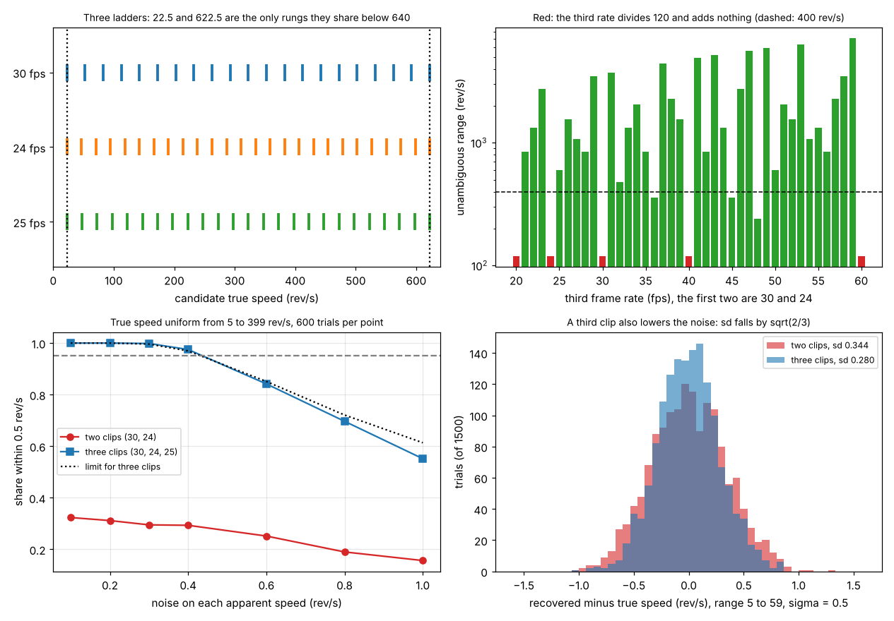

# Session 5: A third clip: a wider range and less noise

*Level 3 (simulation and validation) · about 90 minutes · openalias*

> This is a simplified educational model. It is not a validated design tool and must not be used for real structures, electrical installations, vehicles, industrial processes or medical decisions.

**Prerequisites**

- Session 3: the ladder of candidate speeds, the recovery from two frame rates and the range lcm(fs1, fs2).
- Session 4 is useful for the noisy part (best set of rungs, uncertainty), but not needed for Sections B to E up to Step 2.
- Least common multiple (explained in Section B).

**Learning objectives.** After this session you can:

- Find the speeds that sit on all three ladders, and show that 30, 24 and 25 fps leave only 22.5 rev/s below 400 rev/s, where two clips leave four candidates.
- Explain why the unambiguous range is the least common multiple of all the frame rates, and say exactly when a third rate adds nothing.
- Choose a third frame rate for a required range, and notice when a rate that helps is still not enough.
- Recover the speed from three noisy clips with an uncertainty, and show that the third clip also lowers the noise by sqrt(2/3).
- Check all of this with an exhaustive search and with simulated trials.

## A. Real-world problem
Two clips at 30 and 24 fps cannot tell 22.5 rev/s from 142.5, 262.5 or 382.5 rev/s: the pair of pictures repeats every lcm(30, 24) = 120 rev/s. A turbine, a drill or a model engine can easily turn faster than that. A third clip at 25 fps stretches the range to 600 rev/s. Why does it work, which third frame rate helps and which does not, and what does the extra clip do to the noise? (This is general education about signal processing, not a measurement method for any safety decision.)

## B. Concept and theory
Each clip allows a ladder of rungs a + k fs. A speed that sits on all the ladders at once fits every clip; with two clips there are several, with three almost always one.

A wrong speed f' = f + d looks the same as f on a clip at frame rate fs when d is a whole number of frame rates, d = k fs. It looks the same on all three clips only when d is a multiple of fs1, of fs2 and of fs3 at once, that is d = k lcm(fs1, fs2, fs3). So the unambiguous range is the least common multiple of all the rates: lcm(30, 24, 25) = 600. A third rate adds nothing when it already divides the lcm of the other two: next to 30 and 24, whose lcm is 120, the rates 20, 24, 30, 40 and 60 fps change nothing. A rate can also help and still not be enough: 36 fps gives lcm(30, 24, 36) = 360, below a required 400.

With noise (Session 4), choose the set of rungs, one per ladder, whose members are closest to each other: the score of a set is the sum of the squared distances of the rungs from their mean, and the answer is the mean (least squares). The error of the mean of n independent errors has standard deviation sigma / sqrt(n): 0.17 rev/s for three clips against 0.21 for two at sigma = 0.3. The chance of being within t is erf(t sqrt(n) / (sigma sqrt 2)), which is Session 4's erf(t / sigma) for n = 2. As before the rungs are searched 4 sigma beyond the range, and the answer is clipped back into it. The margin is how many sigma the best set beats the runner-up by.

| Symbol | Meaning | Unit |
|---|---|---|
| f | true speed | rev/s |
| fs1, fs2, fs3 | the three frame rates | frames/s |
| a1, a2, a3 | apparent speeds (signed) | rev/s |
| lcm | least common multiple: the smallest number all the rates divide into | rev/s |
| sigma | noise on each apparent speed | rev/s |
| n | number of clips | none |

**Assumptions**

- Whole-number, exact frame rates, signed apparent speeds, one steady speed.
- Equal Gaussian noise on every apparent speed (for the noisy part).
- All clips filmed at the same time, or at least of a speed that does not change.

$$ f'=f+d\ \text{looks the same on all clips}\iff d=k\,\mathrm{lcm}(f_{s1},f_{s2},f_{s3}),\qquad \mathrm{sd}(\hat f)=\frac{\sigma}{\sqrt n},\qquad P(|\hat f-f|\le t)=\operatorname{erf}\!\left(\frac{t\sqrt n}{\sigma\sqrt2}\right) $$

## C. Visual explanation
The first figure has four panels. Top left: the three ladders (rungs every 30, 24 and 25 rev/s) for a true speed of 22.5; the only rungs shared by all three below 640 are at 22.5 and 622.5 (the dotted lines). Top right: the range of the three rates for every third rate from 20 to 60 fps next to 30 and 24; the red bars (20, 24, 30, 40 and 60 fps) divide 120 and add nothing; the dashed line is 400 rev/s, and the green bars at 36, 45 and 48 fps lie below it. Bottom left: the share of simulated trials within 0.5 rev/s, with the true speed uniform from 5 to 399 rev/s. Two clips (red) are right in only about 30 percent of the trials, because the range is 120; three clips (blue) are right in 99.8 percent at sigma = 0.3 and follow the dotted limit up to sigma of about 0.6. Bottom right: in the range 5 to 59, where two clips are enough, the third clip still narrows the error from a standard deviation of 0.344 to 0.280 rev/s at sigma = 0.5 (theory 0.354 and 0.289).

*Four panels: three ladders with the speeds they share, the range for each third rate, the share right against noise for two and three clips, and the error with two and three clips.*

## D. Interactive simulation
Run the lesson (`python start.py 5`), then open the live app: [Session 5: a third clip](https://krunalpanchal1995.github.io/pan-iit-oss/openalias/session-05/) (or `app.html` in this folder). Pick the three frame rates and the true speed. The first view draws the three ladders, circles the speeds that sit on all of them and shades the range in which the answer is unique; the second view shows the range of the three rates for every possible third rate, in red where the rate adds nothing. Set the noise above zero to see the best set of rungs, its uncertainty and its margin; the presets show two clips only, 25 fps, 20 fps (no help) and 36 fps (not enough).

**Challenge.** A fan turns at 380 rev/s. Choose three frame rates (the first at least 30) so that only one speed below 400 rev/s fits all three clips. (Hint: the third rate must not divide the lcm of the first two, and the lcm of all three must exceed 400.)

## E. Worked example and experiment
**Problem.** A fan is filmed at 30, 24 and 25 fps. The apparent speeds are -7.5, -1.5 and -2.5 rev/s. Which speeds below 400 rev/s fit, with two clips and with three?

1. Clip 1 allows -7.5 + 30 k: 22.5, 52.5, 82.5, ..., 382.5. Clip 2 allows -1.5 + 24 m: 22.5, 46.5, 70.5, 94.5, 118.5, 142.5, ..., 382.5. The speeds on both ladders: 22.5, 142.5, 262.5 and 382.5 (120 apart, since 4 x 30 = 5 x 24 = 120).
2. Clip 3 allows -2.5 + 25 j: 22.5, 47.5, 72.5, 97.5, 122.5, 147.5, ... Test each candidate: 142.5 + 2.5 = 145 is not a multiple of 25 (it is 5.8 of them), 262.5 + 2.5 = 265 gives 10.6, 382.5 + 2.5 = 385 gives 15.4. Only 22.5 is on all three ladders.
3. The next shared speed is 22.5 + lcm(30, 24, 25) = 22.5 + 600 = 622.5.

**Answer.** Two clips: 22.5, 142.5, 262.5 and 382.5 rev/s. Three clips: only 22.5 rev/s, unique up to 600 rev/s.

**Noisy version (sigma = 0.3).** The apparent speeds are measured as -7.3, -1.7 and -2.4. The rungs near 22.5 are 22.7, 22.3 and 22.6, with mean 22.53; their spread is 0.167^2 + 0.233^2 + 0.067^2 = 0.087. The best other set, (142.7, 142.3, 147.6), has a spread of 17.4. The answer is 22.53 +- 0.17 rev/s, and the margin is (4.17 - 0.29) / 0.3 = 12.9.

**Experiment.** Film a desk fan with its guard on (about 20 to 25 rev/s) with a mark on one blade, at the frame rates your phone or camera offers (24, 25 and 30 fps are common). Measure the apparent speed of each clip as in Session 3, list the speeds that fit each clip up to a speed you consider possible (say 100 rev/s), and find the one on all three ladders. Check the result against the speed on the fan's label (rpm divided by 60). A real camera differs from the model: its frame rates are only nominal, so rungs from clips with slightly wrong rates slide apart at large k, and the largest range you can trust is smaller than the lcm.

## Real-world application and mini-project: Choose three frame rates and recover a fast fan (classroom exercise only)
A lab needs to measure fans that turn up to 400 rev/s with clips at 30 and 24 fps that it already has. Choose the third frame rate from 20 to 60 fps with `rate_table(30, 24, range(20, 61))`, then check the choice in a simulation, because the truth is known: recover the speed with `common_speeds` for noise-free clips, and with `recover_noisy_n` and `run_trials` for noisy ones (sigma = 0.3 rev/s, true speed uniform from 5 to 399 rev/s). Report the unambiguous range, the share of trials within 0.5 rev/s with two and with three clips, and the standard deviation of the error. This is a teaching exercise on synthetic data; it is not a method for measuring a real machine.

**Deliverable:** A script that prints the range of each candidate third rate, the common speeds for the chosen rates, and the share of trials within 0.5 rev/s with two and three clips, and a sentence that says which third rates fail and why.

**Success looks like:** Of the 41 third rates from 20 to 60 fps, 8 fail the 400 rev/s requirement because their range stays at or below 400 (20, 24, 30, 36, 40, 45, 48 and 60 fps) and the other 33 work (25 fps gives 600). With 25 fps and noise-free clips the only speed below 400 that fits all three is the true one for every speed tested (1199 speeds from 0.5 to 599.5). With sigma = 0.3 the share within 0.5 rev/s is 99.9 percent with three clips against 28 percent with two, and the error of the three-clip answer has standard deviation sigma / sqrt(3) = 0.17.

## F. Assessment and design challenge
**Question type A: Conceptual.** With 30 and 24 fps, a speed 120 rev/s above the true one fools both clips. Why does it no longer fool a third clip at 25 fps?

Hint

When does adding d rev/s to a speed leave the apparent speed of a clip unchanged?

Step-by-step solution

Adding d to the speed leaves the apparent speed on a clip at fs unchanged when d is a whole number of frame rates. 120 = 4 x 30 = 5 x 24, so it fools clips 1 and 2, but 120 / 25 = 4.8 is not a whole number, so clip 3 sees a different apparent speed (it changes by 120 - 5 x 25 = -5 rev/s). The first d that works for all three is a common multiple of 30, 24 and 25: 600.

**Question type B: Numerical.** The first two rates are 30 and 24 fps. For third rates of 20, 25, 36 and 40 fps give the range of the three rates, and say which make a fan of up to 400 rev/s recoverable.

Hint

The range is lcm(30, 24, r), and lcm(30, 24) = 120.

Step-by-step solution

20 fps divides 120, so the range stays 120. 25 fps: lcm(120, 25) = 600. 36 fps: lcm(120, 36) = 360. 40 fps divides 120, so 120. Only 25 fps gives a range above 400 rev/s (600), so only it makes the 400 rev/s fan recoverable. 36 fps helps (360 > 120) but is not enough. Units: rev/s.

**Question type C: Graph and simulation interpretation.** In the top right panel the bars at 36, 45 and 48 fps are green (they help) but lie below the dashed 400 rev/s line. What does that mean for a fan of 380 rev/s filmed with 30, 24 and 45 fps?

Hint

What is the range of 30, 24 and 45 fps, and what does a speed above the range look like?

Step-by-step solution

The range of 30, 24 and 45 fps is lcm(30, 24, 45) = 360 rev/s. 380 = 20 + 360, so a fan at 380 rev/s looks exactly like one at 20 rev/s on all three clips, and both 20 and 380 rev/s fit. A rate that helps only extends the range to its lcm; the range needed (here above 400) must be checked, and 25 fps (600) or any of the 33 rates with lcm above 400 would work.

**Question type D: Design and optimisation challenge.** Design: you have clips at 30 and 24 fps and must measure fans up to 400 rev/s with noise 0.3 rev/s. Which third frame rates in 20 to 60 fps work, which one would you choose, and what share of trials will be within 0.5 rev/s?

Hint

Use `rate_table(30, 24, range(20, 61))`, and `run_trials` for the noisy share.

Step-by-step solution

Rates with a range above 400: every rate from 20 to 60 except 20, 24, 30, 36, 40, 45, 48 and 60 (so 33 rates work, for example 25 with 600, 26 with 1560, 29 with 3480). With sigma = 0.3 the share within 0.5 rev/s is about 99.8 percent for 25, 26, 27, 29, 35 and 50 fps alike, so the noise does not decide; choose by practicality: 25 fps is a standard camera rate and its range of 600 rev/s covers the 400 rev/s requirement with a margin. At sigma = 1 the choices differ by only a few points (about 52 to 58 percent in tests of 500 trials each), which is close to the sampling error of such a test. Assumptions: nominal frame rates are exact, the speed is steady, noise is independent and Gaussian.

Score yourself with [RUBRIC.md](../../RUBRIC.md). Print the [activity sheet](activity_sheet.md) to work on paper.

## Common misconceptions
| Common misconception | What is actually true |
|---|---|
| Any third frame rate extends the range. | Only one that does not divide the lcm of the first two: next to 30 and 24, the rates 20, 24, 30, 40 and 60 fps add nothing. |
| The range of three clips is the largest of the pairwise ranges. | It is the lcm of all three rates: for 30, 24 and 36 fps the pairs give 120, 180 and 72, but the range is 360. |
| A rate that extends the range extends it far enough. | It extends it to the new lcm only: 36 fps next to 30 and 24 gives 360, below 400. |
| The extra clip only adds range. | It also averages the noise: the error falls from sigma / sqrt(2) to sigma / sqrt(3), by a factor 0.82. |

## Glossary
- **common speed**: a candidate speed that sits on every ladder
- **lcm (least common multiple)**: the smallest positive number that all the given rates divide into
- **unambiguous range**: the speeds below the lcm of all the rates; above it the answer repeats
- **set of rungs**: one rung from each ladder; the best set is the one whose members are closest to each other
- **margin**: how many noise sizes the best set beats the runner-up by
- **nominal frame rate**: the rate the camera is labelled with, which is only approximately the true one

## Finish
1. Do the three coding tasks in [exercises.md](exercises.md).
2. Run `python start.py 5` again after your changes. It ends with the checkpoint; when it prints `PASS`, you are done. (Checkpoint only: `python start.py check 5`.)

Next: the [roadmap](../../promo/roadmap.md). Session 6 is yours to build.
