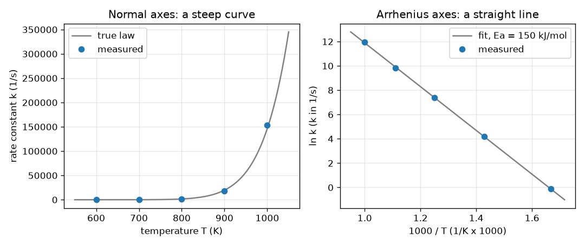

# सत्र 1: तापमान के साथ अभिक्रिया की गति तेज़ी से बढ़ती है

*स्तर 1 (वैचारिक इंटरैक्टिव मॉडल) · लगभग 60 मिनट · openarrhenius*

> यह एक सरलीकृत शैक्षिक मॉडल है। यह कोई प्रमाणित डिज़ाइन उपकरण नहीं है और इसका उपयोग वास्तविक संरचनाओं, विद्युत संस्थापनों, वाहनों, औद्योगिक प्रक्रियाओं या चिकित्सा निर्णयों के लिए नहीं किया जाना चाहिए।

**पूर्व-आवश्यकताएँ (Prerequisites)**

- स्कूल का बीजगणित: सीधी रेखाएँ, y = m x + c।
- लघुगणक (logarithms): ln और exp एक-दूसरे के विपरीत हैं।
- आपने PRIMER.md पढ़ लिया है और एक बार `python start.py 1` चला लिया है।

**सीखने के उद्देश्य (Learning objectives)।** इस सत्र के बाद आप:

- आर्रेनियस नियम (Arrhenius law) k = A exp(-Ea/(R T)) का मान सही इकाइयों और केल्विन के साथ निकाल सकेंगे।
- समझा सकेंगे कि ln k को 1000/T के विरुद्ध आलेखित करने पर वक्र एक सीधी रेखा में क्यों बदल जाता है।
- हाथ वाले सूत्रों से न्यूनतम वर्ग (least squares) विधि द्वारा सीधी रेखा फ़िट कर सकेंगे और उसकी ढलान (slope) से Ea पढ़ सकेंगे।
- तुलना कर सकेंगे कि अलग-अलग सक्रियण ऊर्जाएँ (activation energies) k को कितनी तेज़ी से बढ़ाती हैं।

## A. वास्तविक जीवन की समस्या
गर्म दिन में दूध जल्दी ख़राब हो जाता है, और गैस की लौ को जलने से पहले एक चिंगारी चाहिए। दोनों ही स्थितियों में रासायनिक अभिक्रिया (chemical reaction) गर्म होने पर तेज़ चलती है, और वह भी आश्चर्यजनक मात्रा में, थोड़ी-सी नहीं। एक रसायनज्ञ पाँच तापमानों पर दर स्थिरांक (rate constant) k (एक संख्या जो बताती है कि एक अभिक्रिया कितनी तेज़ चलती है, यहाँ 1/s में) मापता है और मान इतनी तेज़ी से चढ़ते हैं कि एक साधारण ग्राफ़ उनमें से अधिकांश को छिपा देता है। हम इन्हीं संख्याओं को कैसे बनाएँ कि एक पैमाना (ruler) उत्तर पढ़ सके, और वह रेखा हमें अभिक्रिया के बारे में क्या बताती है?

## B. अवधारणा और सिद्धांत
आर्रेनियस नियम कहता है k = A exp(-Ea/(R T))। T केल्विन में निरपेक्ष तापमान (absolute temperature) है, Ea सक्रियण ऊर्जा है, यानी ऊर्जा की वह पहाड़ी जिस पर अणुओं को चढ़ना पड़ता है, R = 8.3145 J/(mol K) गैस स्थिरांक (gas constant) है, और A एक दर-पैमाना है जिसकी इकाई k जैसी ही है। क्योंकि R T सामान्य ऊष्मीय ऊर्जा (thermal energy) है, संख्या Ea/(R T) बताती है कि पहाड़ी, एक अणु की सामान्य ऊर्जा से कितने गुना ऊँची है; यह जितनी बड़ी होगी, exp(-Ea/(R T)) उतना छोटा होगा और अभिक्रिया उतनी धीमी। प्राकृतिक लघुगणक लेने पर ln k = ln A - (Ea/R)(1/T) मिलता है, जो 1/T में एक सीधी रेखा है। हम x = 1000/T (ताकि संख्याएँ लगभग 1 के क्रम की हों) को y = ln k के विरुद्ध आलेखित करते हैं; ढलान s = -Ea/(1000 R) है, इसलिए kJ/mol में Ea = -s गुणा 8.3145 है। रेखा न्यूनतम वर्ग विधि से चुनी जाती है: वह रेखा जो ऊर्ध्वाधर अंतरालों के वर्गों का योग सबसे छोटा कर दे। इसकी ढलान Sxy/Sxx है और इसका अंतःखंड (intercept) ybar - ढलान गुणा xbar है।

| प्रतीक | अर्थ | इकाई |
|---|---|---|
| k | दर स्थिरांक | 1/s (प्रथम-कोटि अभिक्रिया के लिए) |
| A | पूर्व-घातांकी गुणांक (pre-exponential factor) | 1/s |
| Ea | सक्रियण ऊर्जा | kJ/mol (घातांक के अंदर J/mol में बदला जाता है) |
| R | गैस स्थिरांक, 8.3145 | J/(mol K) |
| T | निरपेक्ष तापमान | K |
| x, y | 1000/T और ln k, सीधी-रेखा निर्देशांक | 1/K गुणा 1000, कोई इकाई नहीं |
| s | 1000/T के विरुद्ध ln k की ढलान | कोई इकाई नहीं |

**मान्यताएँ (Assumptions)**

- केवल एक अभिक्रिया चरण दर को नियंत्रित करता है (एक बाद का सत्र दिखाता है कि ऐसा न होने पर क्या होता है)।
- तापमान केल्विन में है: डिग्री सेल्सियस में 273.15 जोड़ें।
- अध्ययन की गई सीमा में A और Ea, T पर निर्भर नहीं करते।
- मापन त्रुटियाँ यादृच्छिक और गुणात्मक (multiplicative) हैं (k का कुछ प्रतिशत)।
- यह एक सरलीकृत शिक्षण मॉडल है, रिएक्टर या प्रक्रिया डिज़ाइन करने का प्रमाणित उपकरण नहीं।

$$ k(T)=A\,\exp\!\left(-\frac{E_a}{R\,T}\right) $$

$$ \ln k=\ln A-\frac{E_a}{R}\cdot\frac{1}{T} $$

$$ s=\frac{S_{xy}}{S_{xx}},\quad S_{xx}=\sum_i (x_i-\bar x)^2,\quad S_{xy}=\sum_i (x_i-\bar x)(y_i-\bar y),\quad b=\bar y-s\,\bar x $$

$$ E_a\,[\mathrm{kJ/mol}]=-s\,R,\qquad s=\text{slope of }\ln k\text{ against }1000/T $$

## C. दृश्य व्याख्या
चित्र में एक ही पाँच मापे गए बिंदुओं से बने दो पैनल हैं। साधारण अक्षों (बाएँ) पर T के विरुद्ध k एक खड़ा वक्र है: 600 और 700 K के बिंदु 1000 K के बिंदुओं के पास फ़र्श पर पड़े रहते हैं, जो पूरे चित्र पर हावी हो जाते हैं। आर्रेनियस अक्षों (दाएँ) पर 1000/T के विरुद्ध ln k के बिंदु एक सीधी रेखा पर आ जाते हैं, और फ़िट की गई रेखा की ढलान -18.0 है, जिससे Ea लगभग 150 kJ/mol मिलती है। दाएँ आलेख पर बाएँ से दाएँ जाने का अर्थ है ठंडा होते जाना, इसलिए k घटता है। दो तापमानों के बीच की गति-वृद्धि स्थिर नहीं है: 600 से 700 K तक यह 73.4 गुना है पर 700 से 800 K तक केवल 25.1 गुना।

*वही पाँच डेटा बिंदु साधारण अक्षों पर (खड़ा वक्र) और आर्रेनियस अक्षों पर (ढलान -18.0 वाली सीधी रेखा, Ea लगभग 150 kJ/mol)।*

## D. इंटरैक्टिव सिमुलेशन
पाठ चलाएँ (`python start.py 1`), फिर लाइव ऐप खोलें: [सत्र 1: तापमान के विरुद्ध अभिक्रिया की गति](https://krunalpanchal1995.github.io/pan-iit-oss/openarrhenius/session-01/) (या इसी फ़ोल्डर में `app.html`)। सक्रियण ऊर्जा और तापमान के स्लाइडर हिलाएँ। बार दृश्य में ऊर्जा पहाड़ी की तुलना ऊष्मीय ऊर्जा R T से करें, पहले ग्राफ़ में k को वक्र के साथ बढ़ते देखें, और सीधी-रेखा दृश्य में देखें कि Ea बदलने से रेखा झुकती है जबकि बिंदु उस पर खिसकता है।

**चुनौती।** ऐसी सक्रियण ऊर्जा और तापमान खोजें जिससे k कम से कम 1000 प्रति s हो, जबकि तापमान 500 K या उससे कम रहे।

## E. हल किया गया उदाहरण और प्रयोग
**समस्या।** एक अभिक्रिया में A = 1e13 प्रति s और Ea = 150 kJ/mol है। 800 K पर k ज्ञात करें, और यह 600 K की तुलना में 700 K पर कितने गुना तेज़ चलती है।

1. ऊर्जा बदलें: Ea = 150 kJ/mol = 150000 J/mol।
2. घातांक: Ea/(R T) = 150000 / (8.3145 x 800) = 22.55 (एक शुद्ध संख्या)।
3. k(800 K) = 1e13 x exp(-22.55) = 1608 प्रति s।
4. अनुपात में गुणांक A कट जाता है: k(700)/k(600) = exp[(Ea/R)(1/600 - 1/700)] = 73.4।
5. जाँच (sanity check): अभिक्रिया गर्म होने पर तेज़ है (73.4, 1 से अधिक है) और 100 K का वही कदम ऊपर जाकर छोटा गुणांक देता है (700 से 800 K तक 25.1), जैसा कि चित्र दिखाता है।

**उत्तर।** k(800 K) = 1608 प्रति s; 600 K से 700 K जाने पर अभिक्रिया 73.4 गुना तेज़ हो जाती है।

**प्रयोग।** पानी के चार तापमानों पर एक स्पष्ट शक्कर-पानी और आयोडीन-घड़ी (iodine-clock) जैसी अभिक्रिया में लगने वाला समय स्टॉपवॉच से मापें (k के माप के रूप में 1/समय लें), T को केल्विन में लेकर 1000/T के विरुद्ध ln(1/समय) आलेखित करें और एक रेखा फ़िट करें। लगभग सीधी रेखा की अपेक्षा करें; ढलान एक आभासी (apparent) Ea देती है। मॉडल बनाम वास्तविकता: स्टॉपवॉच का समय k का एक मोटा माप है, मिश्रण के अभिक्रिया करते समय तापमान बदलता रहता है, और वास्तविक अभिक्रियाओं में अक्सर कई चरण होते हैं, इसलिए आभासी Ea एक-चरण वाले मान से भिन्न हो सकती है और रेखा मुड़ सकती है।

## F. मूल्यांकन और डिज़ाइन चुनौती
**प्रश्न प्रकार A: वैचारिक।** 1000/T के विरुद्ध ln k आलेखित करने पर सीधी रेखा क्यों मिलती है, और यदि आप इसके बजाय 1/T के विरुद्ध k आलेखित करें तो क्या दिखेगा?

संकेत

आर्रेनियस नियम का लघुगणक लें और उसकी तुलना y = m x + c से करें।

चरण-दर-चरण हल

ln k = ln A - (Ea/R)(1/T) का रूप y = c + m x है, जहाँ y = ln k और x = 1/T (हम 1000/T केवल संख्याओं को 1 के पास रखने के लिए लेते हैं)। ढलान -Ea/R है और अंतःखंड ln A है। स्वयं k को 1/T के विरुद्ध आलेखित करने पर एक घातांकी वक्र मिलेगा, रेखा नहीं, क्योंकि k में घातांक शामिल है।

**प्रश्न प्रकार B: संख्यात्मक।** Ea = 100 kJ/mol के लिए, 600 K से 700 K तक k कितने गुना बढ़ता है, और आर्रेनियस रेखा की ढलान क्या है? Ea = 150 kJ/mol के 73.4 गुना से तुलना करें।

संकेत

k(700)/k(600) = exp[(Ea/R)(1/600 - 1/700)] और ढलान = -Ea/(1000 R) का उपयोग करें, जहाँ R = 8.3145।

चरण-दर-चरण हल

गुणांक 17.5 है और ढलान -12.03 है (इकाई: कोई नहीं)। छोटी सक्रियण ऊर्जा छोटा गुणांक और कम खड़ी रेखा देती है। जाँच: गुणांक 1 से अधिक और 73.4 से कम है, जैसा कि नीची पहाड़ी के लिए होना चाहिए।

**प्रश्न प्रकार C: ग्राफ़ और सिमुलेशन की व्याख्या।** चित्र के दाएँ पैनल में फ़िट की गई ढलान -18.0 है। इसका अर्थ कौन-सी सक्रियण ऊर्जा है, और दोगुनी खड़ी रेखा का क्या अर्थ होगा?

संकेत

Ea (kJ/mol) = - ढलान x 8.3145।

चरण-दर-चरण हल

Ea = 18.0 x 8.3145 = 149.7 kJ/mol (फ़िट की गई ढलान -18.005 है)। दोगुनी खड़ी रेखा का अर्थ है दोगुनी सक्रियण ऊर्जा, लगभग 300 kJ/mol: अभिक्रिया तापमान के प्रति कहीं अधिक संवेदनशील होगी।

**प्रश्न प्रकार D: डिज़ाइन और अनुकूलन (optimisation) चुनौती।** डिज़ाइन: एक भट्ठी (furnace) अधिकतम 600 K तक पहुँच सकती है और आपको A = 1e13 प्रति s के साथ कम से कम 1000 प्रति s का k चाहिए। सबसे बड़ी सक्रियण ऊर्जा कौन-सी है जो काम करेगी? और Ea = 150 kJ/mol वाली अभिक्रिया को वही k पाने के लिए कितना तापमान चाहिए?

संकेत

A exp(-Ea/(R T)) = 1000 हल करें, अर्थात Ea/(R T) = ln(1e10)।

चरण-दर-चरण हल

Ea/(R T) = ln(1e10) = 23.03, इसलिए 600 K पर सबसे बड़ी Ea = 23.03 x 8.3145 x 600 / 1000 = 114.9 kJ/mol है। Ea = 150 kJ/mol के लिए तापमान T = 150000 / (8.3145 x 23.03) = 783.5 K है, जो भट्ठी की सीमा से काफ़ी ऊपर है। समझौता (trade-off): नीची पहाड़ी एक ठंडी (सस्ती, सुरक्षित) प्रक्रिया की अनुमति देती है, पर यह मुफ़्त चुनाव नहीं है, क्योंकि यह रसायन द्वारा तय होती है।

[RUBRIC.md](../../RUBRIC.md) से स्वयं को अंक दें। काग़ज़ पर काम करने के लिए [गतिविधि पत्रक (activity sheet)](activity_sheet.md) प्रिंट करें।

## सामान्य भ्रांतियाँ (Common misconceptions)
| सामान्य भ्रांति | वास्तव में क्या सच है |
|---|---|
| हर 10 डिग्री पर अभिक्रिया की दर दोगुनी हो जाती है। | यह केवल एक अंगूठा-नियम (rule of thumb) है। Ea = 150 kJ/mol के साथ 300 K से 310 K तक गुणांक 7.0 है, और ऊँचे तापमान पर प्रति 10 K गुणांक बहुत छोटा होता है। गुणांक Ea और T पर निर्भर करता है। |
| सूत्र में डिग्री सेल्सियस का उपयोग करें। | T केल्विन में होना चाहिए। 0 डिग्री सेल्सियस का तापमान 273.15 K है, और सेल्सियस संख्या के साथ 1/T अर्थहीन है। |
| अधिक सक्रियण ऊर्जा का अर्थ है तेज़ अभिक्रिया। | ऊँची पहाड़ी का अर्थ है दिए गए T पर धीमी अभिक्रिया, पर ऐसी जो गर्म करने पर तेज़ी से गति पकड़ती है: आर्रेनियस रेखा अधिक खड़ी होती है। |
| फ़िट की गई रेखा को हर बिंदु से होकर गुज़रना चाहिए। | वास्तविक डेटा में बिखराव (scatter) होता है; न्यूनतम वर्ग विधि वह रेखा देती है जो कुल मिलाकर सबसे निकट हो, और बिखराव त्रुटि के बारे में जानकारी है। |

## शब्दावली (Glossary)
- **दर स्थिरांक k (rate constant)**: एक संख्या जो बताती है कि एक अभिक्रिया कितनी तेज़ चलती है; इसकी इकाई अभिक्रिया पर निर्भर करती है (प्रथम कोटि के लिए 1/s)
- **सक्रियण ऊर्जा Ea (activation energy)**: वह ऊर्जा पहाड़ी जिस पर अभिक्रिया के लिए अणुओं को चढ़ना पड़ता है; आर्रेनियस आलेख की ढलान से पढ़ी जाती है
- **पूर्व-घातांकी गुणांक A (pre-exponential factor)**: नियम में दर-पैमाना; वह मान जिसकी ओर k अनंत तापमान पर पहुँचेगा
- **न्यूनतम वर्ग (least squares)**: वह रेखा चुनना जो ऊर्ध्वाधर अंतरालों के वर्गों का योग सबसे छोटा कर दे
- **आर्रेनियस आलेख (Arrhenius plot)**: 1/T (यहाँ 1000/T) के विरुद्ध ln k का ग्राफ़
- **केल्विन (kelvin)**: निरपेक्ष तापमान पैमाना, T(K) = T(डिग्री सेल्सियस) + 273.15

## समापन
1. [exercises.md](exercises.md) में दिए गए तीन कोडिंग कार्य करें।
2. अपने बदलावों के बाद `python start.py 1` फिर से चलाएँ। यह चेकपॉइंट के साथ समाप्त होता है; जब यह `PASS` छापे, तो आपका काम पूरा हो गया। (केवल चेकपॉइंट: `python start.py check 1`।)

आगे: [सत्र 2](../session-02/README.md)
