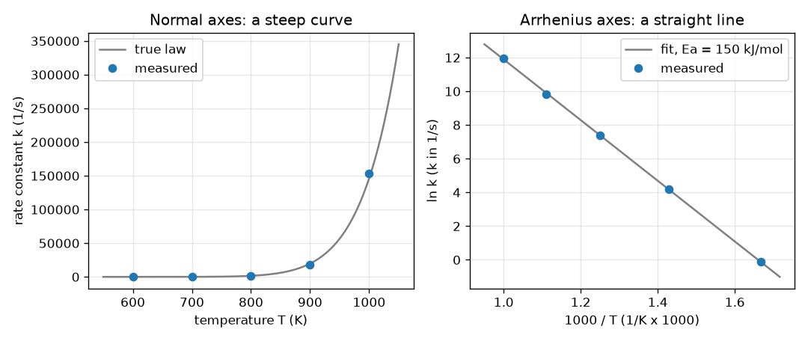

# സെഷൻ 1: താപനിലയോടൊപ്പം പ്രതിപ്രവർത്തന വേഗം കുത്തനെ ഉയരുന്നു

[Session 1 — हिन्दी](README.hi.md) · [Session 1 — മലയാളം](README.ml.md)

*ലെവൽ 1 (ആശയപരമായ ഇന്ററാക്ടീവ് മോഡൽ) · ഏകദേശം 60 മിനിറ്റ് · openarrhenius*

> ഇത് ലളിതമാക്കിയ ഒരു വിദ്യാഭ്യാസ മോഡലാണ്. ഇത് സാധൂകരിക്കപ്പെട്ട (validated) ഡിസൈൻ ഉപകരണമല്ല; യഥാർത്ഥ ഘടനകൾ, വൈദ്യുത സംവിധാനങ്ങൾ, വാഹനങ്ങൾ, വ്യാവസായിക പ്രക്രിയകൾ അല്ലെങ്കിൽ വൈദ്യശാസ്ത്ര തീരുമാനങ്ങൾ എന്നിവയ്ക്ക് ഇത് ഉപയോഗിക്കരുത്.

**മുൻ‌അറിവ് (Prerequisites)**

- സ്കൂൾ ബീജഗണിതം: നേർരേഖകൾ, y = m x + c.
- ലോഗരിതം (logarithm): ln-ഉം exp-ഉം പരസ്പരം വിപരീതങ്ങളാണ്.
- നിങ്ങൾ PRIMER.md വായിക്കുകയും `python start.py 1` ഒരിക്കൽ പ്രവർത്തിപ്പിക്കുകയും ചെയ്തിട്ടുണ്ട്.

**പഠന ലക്ഷ്യങ്ങൾ (Learning objectives).** ഈ സെഷനു ശേഷം നിങ്ങൾക്ക് കഴിയും:

- ശരിയായ യൂണിറ്റുകളും കെൽവിനും ഉപയോഗിച്ച് ആറേനിയസ് നിയമം (Arrhenius law) k = A exp(-Ea/(R T)) കണക്കാക്കാൻ.
- ln k-യെ 1000/T-ക്കെതിരെ പ്ലോട്ട് ചെയ്യുമ്പോൾ വക്രം ഒരു നേർരേഖയായി മാറുന്നത് എന്തുകൊണ്ടെന്ന് വിശദീകരിക്കാൻ.
- കൈ സൂത്രവാക്യങ്ങൾ ഉപയോഗിച്ച് ലീസ്റ്റ് സ്ക്വയേഴ്സ് (least squares) വഴി നേർരേഖ ഫിറ്റ് ചെയ്യാനും അതിന്റെ ചരിവിൽ (slope) നിന്ന് Ea വായിക്കാനും.
- വ്യത്യസ്ത സജീവന ഊർജ്ജങ്ങൾ (activation energies) k-യെ എത്ര കുത്തനെ ഉയർത്തുന്നു എന്ന് താരതമ്യം ചെയ്യാൻ.

## A. യഥാർത്ഥ ലോക പ്രശ്നം
ചൂടുള്ള ദിവസം പാൽ വേഗം കേടാകുന്നു, ഗ്യാസ് ജ്വാല കത്താൻ ഒരു തീപ്പൊരി വേണം. രണ്ടിടത്തും ചൂട് കൂടുമ്പോൾ ഒരു രാസപ്രവർത്തനം വേഗത്തിലാകുന്നു, അതും അല്പമല്ല, അത്ഭുതകരമായ അളവിൽ. ഒരു രസതന്ത്രജ്ഞൻ അഞ്ച് താപനിലകളിൽ റേറ്റ് കോൺസ്റ്റന്റ് (rate constant) k (ഒരു പ്രതിപ്രവർത്തനം എത്ര വേഗത്തിൽ നടക്കുന്നു എന്ന് പറയുന്ന സംഖ്യ, ഇവിടെ 1/s-ൽ) അളക്കുന്നു; മൂല്യങ്ങൾ വളരെ കുത്തനെ ഉയരുന്നതിനാൽ ഒരു സാധാരണ ഗ്രാഫ് അവയിൽ മിക്കതിനെയും മറയ്ക്കുന്നു. ഒരു സ്കെയിൽ കൊണ്ട് ഉത്തരം വായിക്കാവുന്ന വിധത്തിൽ ഇതേ സംഖ്യകൾ എങ്ങനെ വരയ്ക്കാം, ആ രേഖ പ്രതിപ്രവർത്തനത്തെക്കുറിച്ച് എന്തു പറയുന്നു?

## B. ആശയവും സിദ്ധാന്തവും
ആറേനിയസ് നിയമം പറയുന്നത് k = A exp(-Ea/(R T)) എന്നാണ്. T കെൽവിനിലുള്ള കേവല താപനില (absolute temperature) ആണ്, Ea സജീവന ഊർജ്ജമാണ്, അതായത് തന്മാത്രകൾ കയറേണ്ട ഊർജ്ജക്കുന്നിന്റെ ഉയരം, R = 8.3145 J/(mol K) വാതക സ്ഥിരാങ്കം (gas constant) ആണ്, A എന്നത് k-യുടെ അതേ യൂണിറ്റുള്ള ഒരു നിരക്ക് സ്കെയിലാണ്. R T സാധാരണ താപ ഊർജ്ജമായതിനാൽ, Ea/(R T) എന്ന സംഖ്യ ഒരു തന്മാത്രയ്ക്ക് സാധാരണ ഉള്ള ഊർജ്ജത്തേക്കാൾ കുന്ന് എത്ര മടങ്ങ് ഉയർന്നതാണെന്ന് പറയുന്നു; അത് വലുതാകുന്തോറും exp(-Ea/(R T)) ചെറുതാകുകയും പ്രതിപ്രവർത്തനം മന്ദഗതിയിലാകുകയും ചെയ്യുന്നു. സ്വാഭാവിക ലോഗരിതം (natural logarithm) എടുത്താൽ ln k = ln A - (Ea/R)(1/T) കിട്ടുന്നു, ഇത് 1/T-യിൽ ഒരു നേർരേഖയാണ്. നാം x = 1000/T (സംഖ്യകൾ ഏകദേശം 1-ന്റെ അളവിൽ വരാൻ) y = ln k-ക്കെതിരെ പ്ലോട്ട് ചെയ്യുന്നു; ചരിവ് s = -Ea/(1000 R) ആണ്, അതിനാൽ kJ/mol-ലെ Ea എന്നത് -s ഗുണം 8.3145 ആണ്. രേഖ തിരഞ്ഞെടുക്കുന്നത് ലീസ്റ്റ് സ്ക്വയേഴ്സ് വഴിയാണ്: ലംബ വിടവുകളുടെ വർഗ്ഗങ്ങളുടെ തുക ഏറ്റവും ചെറുതാക്കുന്ന രേഖ. അതിന്റെ ചരിവ് Sxy/Sxx ആണ്, ഇന്റർസെപ്റ്റ് (intercept) ybar - ചരിവ് ഗുണം xbar ആണ്.

| ചിഹ്നം | അർത്ഥം | യൂണിറ്റ് |
|---|---|---|
| k | റേറ്റ് കോൺസ്റ്റന്റ് | 1/s (ഒന്നാം ഓർഡർ പ്രതിപ്രവർത്തനത്തിന്) |
| A | പ്രീ-എക്സ്പോണൻഷ്യൽ ഘടകം (pre-exponential factor) | 1/s |
| Ea | സജീവന ഊർജ്ജം | kJ/mol (എക്സ്പോണന്റിനുള്ളിൽ J/mol ആക്കി മാറ്റുന്നു) |
| R | വാതക സ്ഥിരാങ്കം, 8.3145 | J/(mol K) |
| T | കേവല താപനില | K |
| x, y | 1000/T-ഉം ln k-ഉം, നേർരേഖാ നിർദ്ദേശാങ്കങ്ങൾ | 1/K ഗുണം 1000, യൂണിറ്റില്ല |
| s | 1000/T-ക്കെതിരെ ln k-യുടെ ചരിവ് | യൂണിറ്റില്ല |

**അനുമാനങ്ങൾ (Assumptions)**

- ഒരൊറ്റ പ്രതിപ്രവർത്തന ഘട്ടമാണ് നിരക്ക് നിയന്ത്രിക്കുന്നത് (അങ്ങനെയല്ലെങ്കിൽ എന്തു സംഭവിക്കുമെന്ന് പിന്നീടുള്ള ഒരു സെഷൻ കാണിക്കും).
- താപനില കെൽവിനിലാണ്: ഡിഗ്രി സെൽഷ്യസിനോട് 273.15 കൂട്ടുക.
- പഠിക്കുന്ന പരിധിയിൽ A-യും Ea-യും T-യെ ആശ്രയിക്കുന്നില്ല.
- അളവെടുപ്പ് പിശകുകൾ യാദൃച്ഛികവും ഗുണനപരവുമാണ് (k-യുടെ ഏതാനും ശതമാനം).
- ഇത് ലളിതമാക്കിയ ഒരു പഠന മോഡലാണ്, ഒരു റിയാക്ടറോ പ്രക്രിയയോ രൂപകൽപ്പന ചെയ്യാനുള്ള സാധൂകരിക്കപ്പെട്ട ഉപകരണമല്ല.

$$ k(T)=A\,\exp\!\left(-\frac{E_a}{R\,T}\right) $$

$$ \ln k=\ln A-\frac{E_a}{R}\cdot\frac{1}{T} $$

$$ s=\frac{S_{xy}}{S_{xx}},\quad S_{xx}=\sum_i (x_i-\bar x)^2,\quad S_{xy}=\sum_i (x_i-\bar x)(y_i-\bar y),\quad b=\bar y-s\,\bar x $$

$$ E_a\,[\mathrm{kJ/mol}]=-s\,R,\qquad s=\text{slope of }\ln k\text{ against }1000/T $$

## C. ദൃശ്യ വിശദീകരണം
ഒരേ അഞ്ച് അളന്ന ബിന്ദുക്കളിൽ നിന്ന് നിർമ്മിച്ച രണ്ട് പാനലുകൾ ചിത്രത്തിലുണ്ട്. സാധാരണ അക്ഷങ്ങളിൽ (ഇടത്) T-ക്കെതിരെ k ഒരു കുത്തനെയുള്ള വക്രമാണ്: 600-ലും 700 K-ലുമുള്ള ബിന്ദുക്കൾ തറയിൽ കിടക്കുന്നു, 1000 K-ലുള്ള ബിന്ദുക്കളാണ് ചിത്രത്തിൽ ആധിപത്യം പുലർത്തുന്നത്. ആറേനിയസ് അക്ഷങ്ങളിൽ (വലത്) 1000/T-ക്കെതിരെ ln k ബിന്ദുക്കൾ ഒരു നേർരേഖയിൽ വീഴുന്നു; ഫിറ്റ് ചെയ്ത രേഖയുടെ ചരിവ് -18.0 ആണ്, ഇത് ഏകദേശം 150 kJ/mol എന്ന Ea നൽകുന്നു. വലതുവശത്തെ പ്ലോട്ടിൽ ഇടത്തുനിന്ന് വലത്തോട്ട് പോകുന്നത് തണുപ്പിലേക്ക് പോകുന്നതാണ്, അതിനാൽ k കുറയുന്നു. രണ്ട് താപനിലകൾക്കിടയിലുള്ള വേഗവർദ്ധന സ്ഥിരമല്ല: 600-ൽ നിന്ന് 700 K-ലേക്ക് 73.4 മടങ്ങാണ്, എന്നാൽ 700-ൽ നിന്ന് 800 K-ലേക്ക് 25.1 മടങ്ങ് മാത്രം.

*ഒരേ അഞ്ച് ഡാറ്റാ ബിന്ദുക്കൾ സാധാരണ അക്ഷങ്ങളിൽ (കുത്തനെയുള്ള വക്രം), ആറേനിയസ് അക്ഷങ്ങളിൽ (ചരിവ് -18.0 ഉള്ള നേർരേഖ, Ea ഏകദേശം 150 kJ/mol).*

## D. ഇന്ററാക്ടീവ് സിമുലേഷൻ
പാഠം പ്രവർത്തിപ്പിക്കുക (`python start.py 1`), തുടർന്ന് ലൈവ് ആപ്പ് തുറക്കുക: [സെഷൻ 1: താപനിലയ്ക്കെതിരെ പ്രതിപ്രവർത്തന വേഗം](https://krunalpanchal1995.github.io/pan-iit-oss/openarrhenius/session-01/) (അല്ലെങ്കിൽ ഈ ഫോൾഡറിലെ `app.html`). സജീവന ഊർജ്ജ, താപനില സ്ലൈഡറുകൾ നീക്കുക. ബാർ കാഴ്ചയിൽ ഊർജ്ജക്കുന്നിനെ താപ ഊർജ്ജം R T-യുമായി താരതമ്യം ചെയ്യുക, ആദ്യ ഗ്രാഫിൽ വക്രത്തിലൂടെ k ഉയരുന്നത് നിരീക്ഷിക്കുക, നേർരേഖാ കാഴ്ചയിൽ Ea മാറ്റുമ്പോൾ രേഖ ചെരിയുന്നതും ബിന്ദു അതിലൂടെ നീങ്ങുന്നതും കാണുക.

**വെല്ലുവിളി.** താപനില 500 K-ലോ അതിൽ താഴെയോ നിലനിർത്തിക്കൊണ്ട് k സെക്കൻഡിൽ കുറഞ്ഞത് 1000 ആകുന്ന ഒരു സജീവന ഊർജ്ജവും താപനിലയും കണ്ടെത്തുക.

## E. ഉദാഹരണ പ്രശ്നവും പരീക്ഷണവും
**പ്രശ്നം.** ഒരു പ്രതിപ്രവർത്തനത്തിന് A = 1e13 per s-ഉം Ea = 150 kJ/mol-ഉം ആണ്. 800 K-ൽ k കണ്ടെത്തുക, 600 K-നെ അപേക്ഷിച്ച് 700 K-ൽ അത് എത്ര മടങ്ങ് വേഗത്തിലാണെന്നും.

1. ഊർജ്ജം മാറ്റുക: Ea = 150 kJ/mol = 150000 J/mol.
2. എക്സ്പോണന്റ്: Ea/(R T) = 150000 / (8.3145 x 800) = 22.55 (ശുദ്ധ സംഖ്യ).
3. k(800 K) = 1e13 x exp(-22.55) = 1608 per s.
4. ഒരു അനുപാതത്തിൽ A എന്ന ഘടകം റദ്ദാകുന്നു: k(700)/k(600) = exp[(Ea/R)(1/600 - 1/700)] = 73.4.
5. യുക്തിപരിശോധന (sanity check): ചൂട് കൂടുമ്പോൾ പ്രതിപ്രവർത്തനം വേഗത്തിലാണ് (73.4 എന്നത് 1-ന് മുകളിലാണ്), ചിത്രം കാണിക്കുന്നതുപോലെ ഉയർന്ന ഭാഗത്ത് അതേ 100 K ചുവട് ചെറിയ ഘടകം നൽകുന്നു (700-ൽ നിന്ന് 800 K-ലേക്ക് 25.1).

**ഉത്തരം.** k(800 K) = 1608 per s; 600 K-ൽ നിന്ന് 700 K-ലേക്ക് പോകുമ്പോൾ പ്രതിപ്രവർത്തനം 73.4 മടങ്ങ് വേഗത്തിലാകുന്നു.

**പരീക്ഷണം.** തെളിഞ്ഞ പഞ്ചസാര-വെള്ളം, അയോഡിൻ-ക്ലോക്ക് രീതിയിലുള്ള ഒരു പ്രതിപ്രവർത്തനം നാല് ജല താപനിലകളിൽ എടുക്കുന്ന സമയം ഒരു സ്റ്റോപ്പ് വാച്ച് കൊണ്ട് അളക്കുക (k-യുടെ അളവായി 1/സമയം എടുക്കുക), T കെൽവിനിലാക്കി ln(1/സമയം)-നെ 1000/T-ക്കെതിരെ പ്ലോട്ട് ചെയ്ത് ഒരു രേഖ ഫിറ്റ് ചെയ്യുക. ഏകദേശം നേർരേഖ പ്രതീക്ഷിക്കുക; ചരിവ് ഒരു പ്രത്യക്ഷ Ea നൽകുന്നു. മോഡലും യാഥാർത്ഥ്യവും: സ്റ്റോപ്പ് വാച്ച് സമയം k-യുടെ ഒരു പരുക്കൻ അളവാണ്, മിശ്രിതം പ്രതിപ്രവർത്തിക്കുമ്പോൾ താപനില മാറുന്നു, യഥാർത്ഥ പ്രതിപ്രവർത്തനങ്ങൾക്ക് പലപ്പോഴും നിരവധി ഘട്ടങ്ങളുണ്ട്; അതിനാൽ പ്രത്യക്ഷ Ea ഒറ്റ-ഘട്ട മൂല്യത്തിൽ നിന്ന് വ്യത്യസ്തമാകാം, രേഖ വളയാം.

## F. മൂല്യനിർണ്ണയവും ഡിസൈൻ വെല്ലുവിളിയും
**ചോദ്യ തരം A: ആശയപരം.** ln k-യെ 1000/T-ക്കെതിരെ പ്ലോട്ട് ചെയ്യുമ്പോൾ എന്തുകൊണ്ടാണ് നേർരേഖ കിട്ടുന്നത്, പകരം k-യെ 1/T-ക്കെതിരെ പ്ലോട്ട് ചെയ്താൽ എന്തു കാണും?

സൂചന

ആറേനിയസ് നിയമത്തിന്റെ ലോഗരിതം എടുത്ത് y = m x + c-യുമായി താരതമ്യം ചെയ്യുക.

ഘട്ടം ഘട്ടമായുള്ള പരിഹാരം

ln k = ln A - (Ea/R)(1/T) എന്നതിന് y = ln k, x = 1/T ആയി y = c + m x എന്ന രൂപമുണ്ട് (സംഖ്യകൾ 1-ന് അടുത്ത് നിലനിർത്താൻ മാത്രമാണ് നാം 1000/T ഉപയോഗിക്കുന്നത്). ചരിവ് -Ea/R ആണ്, ഇന്റർസെപ്റ്റ് ln A ആണ്. k-യെ തന്നെ 1/T-ക്കെതിരെ പ്ലോട്ട് ചെയ്താൽ ഒരു രേഖയല്ല, എക്സ്പോണൻഷ്യൽ വക്രമാണ് കിട്ടുക, കാരണം k-യിൽ എക്സ്പോണൻഷ്യൽ അടങ്ങിയിരിക്കുന്നു.

**ചോദ്യ തരം B: സംഖ്യാപരം.** Ea = 100 kJ/mol-ന്, 600 K-ൽ നിന്ന് 700 K-ലേക്ക് k എത്ര മടങ്ങ് വളരുന്നു, ആറേനിയസ് രേഖയുടെ ചരിവ് എന്താണ്? Ea = 150 kJ/mol-നുള്ള 73.4 മടങ്ങുമായി താരതമ്യം ചെയ്യുക.

സൂചന

R = 8.3145 ഉപയോഗിച്ച് k(700)/k(600) = exp[(Ea/R)(1/600 - 1/700)]-ഉം ചരിവ് = -Ea/(1000 R)-ഉം ഉപയോഗിക്കുക.

ഘട്ടം ഘട്ടമായുള്ള പരിഹാരം

ഘടകം 17.5 ആണ്, ചരിവ് -12.03 ആണ് (യൂണിറ്റ്: ഇല്ല). ചെറിയ സജീവന ഊർജ്ജം ചെറിയ ഘടകവും കുറഞ്ഞ കുത്തനെയുള്ള രേഖയും നൽകുന്നു. യുക്തിപരിശോധന: ഘടകം 1-ന് മുകളിലും 73.4-ന് താഴെയുമാണ്, താഴ്ന്ന കുന്നിന് അങ്ങനെയാകണം.

**ചോദ്യ തരം C: ഗ്രാഫ്, സിമുലേഷൻ വ്യാഖ്യാനം.** ചിത്രത്തിന്റെ വലതുവശത്തെ പാനലിൽ ഫിറ്റ് ചെയ്ത ചരിവ് -18.0 ആണ്. അത് ഏത് സജീവന ഊർജ്ജത്തെ സൂചിപ്പിക്കുന്നു, ഇരട്ടി കുത്തനെയുള്ള ഒരു രേഖ എന്തിനെ സൂചിപ്പിക്കും?

സൂചന

Ea (kJ/mol) = - ചരിവ് x 8.3145.

ഘട്ടം ഘട്ടമായുള്ള പരിഹാരം

Ea = 18.0 x 8.3145 = 149.7 kJ/mol (ഫിറ്റ് ചെയ്ത ചരിവ് -18.005 ആണ്). ഇരട്ടി കുത്തനെയുള്ള രേഖ എന്നാൽ ഇരട്ടി സജീവന ഊർജ്ജം, ഏകദേശം 300 kJ/mol: പ്രതിപ്രവർത്തനം താപനിലയോട് വളരെ കൂടുതൽ സംവേദനക്ഷമമായിരിക്കും.

**ചോദ്യ തരം D: ഡിസൈൻ, ഒപ്റ്റിമൈസേഷൻ വെല്ലുവിളി.** ഡിസൈൻ: ഒരു ചൂളയ്ക്ക് (furnace) പരമാവധി 600 K എത്താം, A = 1e13 per s ഉപയോഗിച്ച് k സെക്കൻഡിൽ കുറഞ്ഞത് 1000 വേണം. പ്രവർത്തിക്കുന്ന ഏറ്റവും വലിയ സജീവന ഊർജ്ജം എത്ര? Ea = 150 kJ/mol ഉള്ള ഒരു പ്രതിപ്രവർത്തനത്തിന് അതേ k എത്താൻ എന്തു താപനില വേണം?

സൂചന

A exp(-Ea/(R T)) = 1000 പരിഹരിക്കുക, അതായത് Ea/(R T) = ln(1e10).

ഘട്ടം ഘട്ടമായുള്ള പരിഹാരം

Ea/(R T) = ln(1e10) = 23.03, അതിനാൽ 600 K-ൽ ഏറ്റവും വലിയ Ea = 23.03 x 8.3145 x 600 / 1000 = 114.9 kJ/mol. Ea = 150 kJ/mol-ന് താപനില T = 150000 / (8.3145 x 23.03) = 783.5 K, ചൂളയുടെ പരിധിക്ക് വളരെ മുകളിൽ. വിട്ടുവീഴ്ച (trade-off): താഴ്ന്ന കുന്ന് തണുത്ത (ചെലവ് കുറഞ്ഞ, സുരക്ഷിതമായ) പ്രക്രിയ അനുവദിക്കുന്നു, പക്ഷേ അത് സ്വതന്ത്രമായ തിരഞ്ഞെടുപ്പല്ല, കാരണം അത് രസതന്ത്രം നിശ്ചയിക്കുന്നതാണ്.

[RUBRIC.md](../../RUBRIC.md) ഉപയോഗിച്ച് സ്വയം സ്കോർ ചെയ്യുക. പേപ്പറിൽ ചെയ്യാൻ [പ്രവർത്തന ഷീറ്റ്](activity_sheet.md) പ്രിന്റ് ചെയ്യുക.

## സാധാരണ തെറ്റിദ്ധാരണകൾ
| സാധാരണ തെറ്റിദ്ധാരണ | യഥാർത്ഥത്തിൽ ശരിയായത് |
|---|---|
| ഓരോ 10 ഡിഗ്രിക്കും പ്രതിപ്രവർത്തന നിരക്ക് ഇരട്ടിയാകുന്നു. | അത് ഒരു ഏകദേശ നിയമം (rule of thumb) മാത്രമാണ്. Ea = 150 kJ/mol-ൽ 300 K-ൽ നിന്ന് 310 K-ലേക്കുള്ള ഘടകം 7.0 ആണ്, ഉയർന്ന താപനിലയിൽ 10 K-ക്കുള്ള ഘടകം വളരെ ചെറുതാണ്. ഘടകം Ea-യെയും T-യെയും ആശ്രയിക്കുന്നു. |
| സൂത്രവാക്യത്തിൽ ഡിഗ്രി സെൽഷ്യസ് ഉപയോഗിക്കുക. | T കെൽവിനിലായിരിക്കണം. 0 ഡിഗ്രി സെൽഷ്യസ് 273.15 K ആണ്, സെൽഷ്യസ് സംഖ്യ ഉപയോഗിച്ചുള്ള 1/T അർത്ഥശൂന്യമാണ്. |
| ഉയർന്ന സജീവന ഊർജ്ജം എന്നാൽ വേഗതയേറിയ പ്രതിപ്രവർത്തനം. | ഉയർന്ന കുന്ന് എന്നാൽ ഒരു നിശ്ചിത T-യിൽ മന്ദഗതിയിലുള്ള പ്രതിപ്രവർത്തനം, എന്നാൽ ചൂടാക്കുമ്പോൾ വേഗത്തിൽ വേഗം കൂടുന്ന ഒന്ന്: ആറേനിയസ് രേഖ കൂടുതൽ കുത്തനെയാണ്. |
| ഫിറ്റ് ചെയ്ത രേഖ എല്ലാ ബിന്ദുക്കളിലൂടെയും കടന്നുപോകണം. | യഥാർത്ഥ ഡാറ്റയ്ക്ക് ചിതറൽ (scatter) ഉണ്ട്; മൊത്തത്തിൽ ഏറ്റവും അടുത്ത രേഖ ലീസ്റ്റ് സ്ക്വയേഴ്സ് നൽകുന്നു, ചിതറൽ പിശകിനെക്കുറിച്ചുള്ള വിവരമാണ്. |

## പദാവലി (Glossary)
- **റേറ്റ് കോൺസ്റ്റന്റ് k**: ഒരു പ്രതിപ്രവർത്തനം എത്ര വേഗത്തിൽ നടക്കുന്നു എന്ന് പറയുന്ന സംഖ്യ; അതിന്റെ യൂണിറ്റ് പ്രതിപ്രവർത്തനത്തെ ആശ്രയിക്കുന്നു (ഒന്നാം ഓർഡറിന് 1/s)
- **സജീവന ഊർജ്ജം Ea**: പ്രതിപ്രവർത്തിക്കാൻ തന്മാത്രകൾ കയറേണ്ട ഊർജ്ജക്കുന്ന്; ആറേനിയസ് പ്ലോട്ടിന്റെ ചരിവിൽ നിന്ന് വായിക്കുന്നു
- **പ്രീ-എക്സ്പോണൻഷ്യൽ ഘടകം A**: നിയമത്തിലെ നിരക്ക് സ്കെയിൽ; അനന്തമായ താപനിലയിൽ k എത്തുന്ന മൂല്യം
- **ലീസ്റ്റ് സ്ക്വയേഴ്സ്**: ലംബ വിടവുകളുടെ വർഗ്ഗങ്ങളുടെ തുക ഏറ്റവും ചെറുതാക്കുന്ന രേഖ തിരഞ്ഞെടുക്കൽ
- **ആറേനിയസ് പ്ലോട്ട് (Arrhenius plot)**: 1/T-ക്കെതിരെ (ഇവിടെ 1000/T) ln k-യുടെ ഗ്രാഫ്
- **കെൽവിൻ (kelvin)**: കേവല താപനില സ്കെയിൽ, T(K) = T(ഡിഗ്രി സെൽഷ്യസ്) + 273.15

## പൂർത്തിയാക്കുക
1. [exercises.md](exercises.md)-ലെ മൂന്ന് കോഡിംഗ് ടാസ്കുകൾ ചെയ്യുക.
2. നിങ്ങളുടെ മാറ്റങ്ങൾക്ക് ശേഷം `python start.py 1` വീണ്ടും പ്രവർത്തിപ്പിക്കുക. അത് ചെക്ക്പോയിന്റോടെ അവസാനിക്കുന്നു; അത് `PASS` പ്രിന്റ് ചെയ്യുമ്പോൾ നിങ്ങൾ പൂർത്തിയാക്കി. (ചെക്ക്പോയിന്റ് മാത്രം: `python start.py check 1`.)

അടുത്തത്: [സെഷൻ 2](../session-02/README.md)
