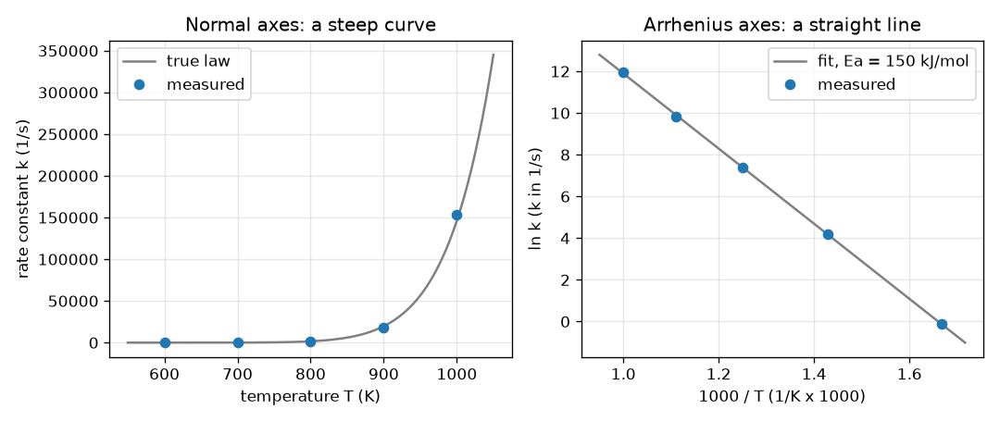

# அமர்வு 1: வெப்பநிலையுடன் வினை வேகம் செங்குத்தாக உயர்கிறது

[Session 1 — हिन्दी](README.hi.md) · [Session 1 — മലയാളം](README.ml.md) · [Session 1 — தமிழ்](README.ta.md)

*நிலை 1 (கருத்தியல் ஊடாடும் மாதிரி) · சுமார் 60 நிமிடங்கள் · openarrhenius*

> இது எளிமைப்படுத்தப்பட்ட ஒரு கல்வி மாதிரி. இது சரிபார்க்கப்பட்ட (validated) வடிவமைப்புக் கருவி அல்ல; உண்மையான கட்டமைப்புகள், மின் நிறுவல்கள், வாகனங்கள், தொழில்துறை செயல்முறைகள் அல்லது மருத்துவ முடிவுகளுக்கு இதைப் பயன்படுத்தக் கூடாது.

**முன்தேவைகள் (Prerequisites)**

- பள்ளி இயற்கணிதம்: நேர்கோடுகள், y = m x + c.
- மடக்கைகள் (logarithms): ln-ம் exp-ம் ஒன்றுக்கொன்று எதிர்மாறானவை.
- நீங்கள் PRIMER.md-ஐப் படித்து `python start.py 1`-ஐ ஒருமுறை இயக்கியிருக்கிறீர்கள்.

**கற்றல் நோக்கங்கள் (Learning objectives).** இந்த அமர்வுக்குப் பிறகு நீங்கள்:

- சரியான அலகுகள் மற்றும் கெல்வினுடன் ஆர்ஹீனியஸ் விதியை (Arrhenius law) k = A exp(-Ea/(R T)) கணக்கிட முடியும்.
- ln k-ஐ 1000/T-க்கு எதிராக வரையும்போது வளைவு ஏன் நேர்கோடாக மாறுகிறது என்பதை விளக்க முடியும்.
- கைச் சூத்திரங்களைக் கொண்டு மீச்சிறு வர்க்க முறையால் (least squares) நேர்கோட்டைப் பொருத்தி, அதன் சாய்விலிருந்து (slope) Ea-ஐப் படிக்க முடியும்.
- வெவ்வேறு கிளர்வு ஆற்றல்கள் (activation energies) k-ஐ எவ்வளவு செங்குத்தாக உயர்த்துகின்றன என்பதை ஒப்பிட முடியும்.

## A. நிஜ உலகச் சிக்கல்
சூடான நாளில் பால் விரைவாகக் கெட்டுப்போகிறது, எரிவாயுச் சுடர் எரிய ஒரு தீப்பொறி தேவை. இரண்டிலும் வெப்பம் அதிகமாகும்போது ஒரு வேதிவினை வேகமாக நடக்கிறது, அதுவும் சிறிதளவு அல்ல, வியக்கத்தக்க அளவில். ஒரு வேதியியலாளர் ஐந்து வெப்பநிலைகளில் வினைவேக மாறிலியை (rate constant) k (ஒரு வினை எவ்வளவு வேகமாக நடக்கிறது என்று சொல்லும் எண், இங்கு 1/s-இல்) அளக்கிறார்; மதிப்புகள் மிகச் செங்குத்தாக உயர்வதால் சாதாரண வரைபடம் அவற்றில் பெரும்பாலானவற்றை மறைத்துவிடுகிறது. ஒரு அளவுகோலால் விடையைப் படிக்கும்படி இதே எண்களை எப்படி வரையலாம், அந்தக் கோடு வினையைப் பற்றி என்ன சொல்கிறது?

## B. கருத்தும் கோட்பாடும்
ஆர்ஹீனியஸ் விதி k = A exp(-Ea/(R T)) என்கிறது. T என்பது கெல்வினில் உள்ள தனி வெப்பநிலை (absolute temperature), Ea என்பது கிளர்வு ஆற்றல், அதாவது மூலக்கூறுகள் ஏற வேண்டிய ஆற்றல் மலையின் உயரம், R = 8.3145 J/(mol K) என்பது வாயு மாறிலி (gas constant), A என்பது k-இன் அதே அலகுடைய ஒரு வேக அளவுகோல். R T என்பது வழக்கமான வெப்ப ஆற்றல் என்பதால், Ea/(R T) என்ற எண் ஒரு மூலக்கூறுக்கு வழக்கமாக உள்ள ஆற்றலைவிட மலை எத்தனை மடங்கு உயரமானது என்று சொல்கிறது; அது பெரியதாக ஆக exp(-Ea/(R T)) சிறியதாகி வினை மெதுவாகிறது. இயல் மடக்கை (natural logarithm) எடுத்தால் ln k = ln A - (Ea/R)(1/T) கிடைக்கிறது, இது 1/T-இல் ஒரு நேர்கோடு. நாம் x = 1000/T-ஐ (எண்கள் சுமார் 1 அளவில் இருக்க) y = ln k-க்கு எதிராக வரைகிறோம்; சாய்வு s = -Ea/(1000 R), எனவே kJ/mol-இல் Ea என்பது -s பெருக்கல் 8.3145. கோடு மீச்சிறு வர்க்க முறையால் தேர்ந்தெடுக்கப்படுகிறது: செங்குத்து இடைவெளிகளின் வர்க்கங்களின் கூட்டுத்தொகையை மிகச் சிறியதாக்கும் கோடு. அதன் சாய்வு Sxy/Sxx, வெட்டுத்துண்டு (intercept) ybar - சாய்வு பெருக்கல் xbar.

| குறியீடு | பொருள் | அலகு |
|---|---|---|
| k | வினைவேக மாறிலி | 1/s (முதல் வரிசை வினைக்கு) |
| A | முன்-அடுக்குக் காரணி (pre-exponential factor) | 1/s |
| Ea | கிளர்வு ஆற்றல் | kJ/mol (அடுக்குக்குள் J/mol ஆக மாற்றப்படுகிறது) |
| R | வாயு மாறிலி, 8.3145 | J/(mol K) |
| T | தனி வெப்பநிலை | K |
| x, y | 1000/T மற்றும் ln k, நேர்கோட்டு ஆயத்தொலைவுகள் | 1/K பெருக்கல் 1000, அலகு இல்லை |
| s | 1000/T-க்கு எதிராக ln k-இன் சாய்வு | அலகு இல்லை |

**அனுமானங்கள் (Assumptions)**

- ஒரே ஒரு வினைப் படி வேகத்தைக் கட்டுப்படுத்துகிறது (அப்படி இல்லையென்றால் என்ன ஆகும் என்பதைப் பிந்தைய அமர்வு காட்டும்).
- வெப்பநிலை கெல்வினில் உள்ளது: செல்சியஸ் டிகிரியுடன் 273.15 கூட்டவும்.
- ஆய்வு செய்யப்படும் வரம்பில் A-யும் Ea-யும் T-ஐச் சார்ந்திருக்கவில்லை.
- அளவீட்டுப் பிழைகள் சீரற்றவை, பெருக்கல் வகையானவை (k-இன் சில சதவீதம்).
- இது எளிமைப்படுத்தப்பட்ட கற்பித்தல் மாதிரி, ஒரு உலையையோ செயல்முறையையோ வடிவமைக்கச் சரிபார்க்கப்பட்ட கருவி அல்ல.

$$ k(T)=A\,\exp\!\left(-\frac{E_a}{R\,T}\right) $$

$$ \ln k=\ln A-\frac{E_a}{R}\cdot\frac{1}{T} $$

$$ s=\frac{S_{xy}}{S_{xx}},\quad S_{xx}=\sum_i (x_i-\bar x)^2,\quad S_{xy}=\sum_i (x_i-\bar x)(y_i-\bar y),\quad b=\bar y-s\,\bar x $$

$$ E_a\,[\mathrm{kJ/mol}]=-s\,R,\qquad s=\text{slope of }\ln k\text{ against }1000/T $$

## C. காட்சி விளக்கம்
ஒரே ஐந்து அளவிடப்பட்ட புள்ளிகளிலிருந்து உருவாக்கப்பட்ட இரண்டு பலகங்கள் படத்தில் உள்ளன. சாதாரண அச்சுகளில் (இடது) T-க்கு எதிராக k ஒரு செங்குத்தான வளைவு: 600 மற்றும் 700 K புள்ளிகள் தரையில் கிடக்கின்றன, 1000 K புள்ளிகள் படத்தை ஆக்கிரமிக்கின்றன. ஆர்ஹீனியஸ் அச்சுகளில் (வலது) 1000/T-க்கு எதிராக ln k புள்ளிகள் ஒரு நேர்கோட்டில் விழுகின்றன; பொருத்தப்பட்ட கோட்டின் சாய்வு -18.0, இது சுமார் 150 kJ/mol என்ற Ea-ஐத் தருகிறது. வலது வரைபடத்தில் இடமிருந்து வலமாகச் செல்வது குளிர்ச்சியை நோக்கிச் செல்வதாகும், எனவே k குறைகிறது. இரண்டு வெப்பநிலைகளுக்கு இடையிலான வேக அதிகரிப்பு மாறாதது அல்ல: 600-இலிருந்து 700 K-க்கு 73.4 மடங்கு, ஆனால் 700-இலிருந்து 800 K-க்கு 25.1 மடங்கு மட்டுமே.

*ஒரே ஐந்து தரவுப் புள்ளிகள் சாதாரண அச்சுகளில் (செங்குத்தான வளைவு) மற்றும் ஆர்ஹீனியஸ் அச்சுகளில் (சாய்வு -18.0 உள்ள நேர்கோடு, Ea சுமார் 150 kJ/mol).*

## D. ஊடாடும் உருவகப்படுத்தல்
பாடத்தை இயக்கவும் (`python start.py 1`), பிறகு நேரடி செயலியைத் திறக்கவும்: [அமர்வு 1: வெப்பநிலைக்கு எதிராக வினை வேகம்](https://krunalpanchal1995.github.io/pan-iit-oss/openarrhenius/session-01/) (அல்லது இந்தக் கோப்புறையில் உள்ள `app.html`). கிளர்வு ஆற்றல் மற்றும் வெப்பநிலை நழுவிகளை (sliders) நகர்த்தவும். பட்டைக் காட்சியில் ஆற்றல் மலையை வெப்ப ஆற்றல் R T-உடன் ஒப்பிடவும், முதல் வரைபடத்தில் வளைவின் வழியே k உயர்வதைக் கவனிக்கவும், நேர்கோட்டுக் காட்சியில் Ea-ஐ மாற்றும்போது கோடு சாய்வதையும் புள்ளி அதன் வழியே நகர்வதையும் பார்க்கவும்.

**சவால்.** வெப்பநிலையை 500 K அல்லது அதற்குக் கீழ் வைத்து, k வினாடிக்குக் குறைந்தது 1000 ஆக இருக்கும் ஒரு கிளர்வு ஆற்றலையும் வெப்பநிலையையும் கண்டறியவும்.

## E. தீர்க்கப்பட்ட உதாரணமும் சோதனையும்
**சிக்கல்.** ஒரு வினைக்கு A = 1e13 per s மற்றும் Ea = 150 kJ/mol. 800 K-இல் k-ஐக் கண்டறியவும், மேலும் 600 K-ஐ விட 700 K-இல் அது எத்தனை மடங்கு வேகமாக நடக்கிறது என்றும்.

1. ஆற்றலை மாற்றவும்: Ea = 150 kJ/mol = 150000 J/mol.
2. அடுக்கு: Ea/(R T) = 150000 / (8.3145 x 800) = 22.55 (தூய எண்).
3. k(800 K) = 1e13 x exp(-22.55) = 1608 per s.
4. ஒரு விகிதத்தில் A காரணி நீங்குகிறது: k(700)/k(600) = exp[(Ea/R)(1/600 - 1/700)] = 73.4.
5. நியாயச் சோதனை (sanity check): சூடாக இருக்கும்போது வினை வேகமாக உள்ளது (73.4 என்பது 1-க்கு மேல்), படம் காட்டுவது போல மேல் பகுதியில் அதே 100 K படி சிறிய காரணியைத் தருகிறது (700-இலிருந்து 800 K-க்கு 25.1).

**விடை.** k(800 K) = 1608 per s; 600 K-இலிருந்து 700 K-க்குச் செல்வது வினையை 73.4 மடங்கு வேகமாக்குகிறது.

**சோதனை.** தெளிவான சர்க்கரை-நீர் மற்றும் அயோடின்-கடிகார வகை வினை நான்கு நீர் வெப்பநிலைகளில் எடுக்கும் நேரத்தை ஒரு நிறுத்துக் கடிகாரத்தால் அளக்கவும் (k-இன் அளவாக 1/நேரம் எடுக்கவும்), T-ஐக் கெல்வினில் வைத்து ln(1/நேரம்)-ஐ 1000/T-க்கு எதிராக வரைந்து ஒரு கோட்டைப் பொருத்தவும். ஏறக்குறைய நேர்கோட்டை எதிர்பார்க்கவும்; சாய்வு ஒரு தோற்ற Ea-ஐத் தருகிறது. மாதிரியும் யதார்த்தமும்: நிறுத்துக் கடிகார நேரம் k-இன் ஒரு கரடுமுரடான அளவு, கலவை வினைபுரியும்போது வெப்பநிலை நகர்கிறது, உண்மையான வினைகளுக்குப் பெரும்பாலும் பல படிகள் உண்டு; எனவே தோற்ற Ea ஒற்றைப்-படி மதிப்பிலிருந்து வேறுபடலாம், கோடு வளையலாம்.

## F. மதிப்பீடும் வடிவமைப்புச் சவாலும்
**கேள்வி வகை A: கருத்தியல்.** ln k-ஐ 1000/T-க்கு எதிராக வரைந்தால் ஏன் நேர்கோடு கிடைக்கிறது, அதற்குப் பதிலாக k-ஐ 1/T-க்கு எதிராக வரைந்தால் என்ன காண்பீர்கள்?

குறிப்பு

ஆர்ஹீனியஸ் விதியின் மடக்கையை எடுத்து y = m x + c-உடன் ஒப்பிடவும்.

படிப்படியான தீர்வு

ln k = ln A - (Ea/R)(1/T) என்பது y = ln k, x = 1/T என y = c + m x வடிவில் உள்ளது (எண்களை 1-க்கு அருகில் வைக்கவே நாம் 1000/T பயன்படுத்துகிறோம்). சாய்வு -Ea/R, வெட்டுத்துண்டு ln A. k-ஐயே 1/T-க்கு எதிராக வரைந்தால் கோடு அல்ல, அடுக்குக்குறி வளைவு கிடைக்கும், ஏனெனில் k-இல் அடுக்குக்குறிச் சார்பு உள்ளது.

**கேள்வி வகை B: எண்ணியல்.** Ea = 100 kJ/mol-க்கு, 600 K-இலிருந்து 700 K-க்கு k எத்தனை மடங்கு வளர்கிறது, ஆர்ஹீனியஸ் கோட்டின் சாய்வு என்ன? Ea = 150 kJ/mol-க்கான 73.4 மடங்குடன் ஒப்பிடவும்.

குறிப்பு

R = 8.3145 உடன் k(700)/k(600) = exp[(Ea/R)(1/600 - 1/700)] மற்றும் சாய்வு = -Ea/(1000 R) பயன்படுத்தவும்.

படிப்படியான தீர்வு

காரணி 17.5, சாய்வு -12.03 (அலகு: இல்லை). சிறிய கிளர்வு ஆற்றல் சிறிய காரணியையும் குறைந்த செங்குத்துடைய கோட்டையும் தருகிறது. நியாயச் சோதனை: காரணி 1-க்கு மேலும் 73.4-க்குக் கீழும் உள்ளது, தாழ்வான மலைக்கு அப்படித்தான் இருக்க வேண்டும்.

**கேள்வி வகை C: வரைபடம் மற்றும் உருவகப்படுத்தல் விளக்கம்.** படத்தின் வலது பலகத்தில் பொருத்தப்பட்ட சாய்வு -18.0. அது எந்தக் கிளர்வு ஆற்றலைக் குறிக்கிறது, இரு மடங்கு செங்குத்தான கோடு எதைக் குறிக்கும்?

குறிப்பு

Ea (kJ/mol) = - சாய்வு x 8.3145.

படிப்படியான தீர்வு

Ea = 18.0 x 8.3145 = 149.7 kJ/mol (பொருத்தப்பட்ட சாய்வு -18.005). இரு மடங்கு செங்குத்தான கோடு என்றால் இரு மடங்கு கிளர்வு ஆற்றல், சுமார் 300 kJ/mol: வினை வெப்பநிலைக்கு மிக அதிக உணர்திறன் கொண்டதாக இருக்கும்.

**கேள்வி வகை D: வடிவமைப்பு மற்றும் உகப்பாக்கச் சவால்.** வடிவமைப்பு: ஒரு உலை (furnace) அதிகபட்சம் 600 K வரை செல்லும், A = 1e13 per s உடன் k வினாடிக்குக் குறைந்தது 1000 தேவை. வேலை செய்யும் மிகப் பெரிய கிளர்வு ஆற்றல் எது? Ea = 150 kJ/mol உள்ள வினை அதே k-ஐ அடைய என்ன வெப்பநிலை தேவை?

குறிப்பு

A exp(-Ea/(R T)) = 1000-ஐத் தீர்க்கவும், அதாவது Ea/(R T) = ln(1e10).

படிப்படியான தீர்வு

Ea/(R T) = ln(1e10) = 23.03, எனவே 600 K-இல் மிகப் பெரிய Ea = 23.03 x 8.3145 x 600 / 1000 = 114.9 kJ/mol. Ea = 150 kJ/mol-க்கு வெப்பநிலை T = 150000 / (8.3145 x 23.03) = 783.5 K, உலை வரம்பை விட மிக அதிகம். சமரசம் (trade-off): தாழ்வான மலை குளிர்ந்த (மலிவான, பாதுகாப்பான) செயல்முறையை அனுமதிக்கிறது, ஆனால் அது சுதந்திரமான தேர்வு அல்ல, ஏனெனில் அது வேதியியலால் தீர்மானிக்கப்படுகிறது.

[RUBRIC.md](../../RUBRIC.md) கொண்டு உங்களை நீங்களே மதிப்பிடுங்கள். தாளில் செய்ய [செயல்பாட்டுத் தாளை](activity_sheet.md) அச்சிடுங்கள்.

## பொதுவான தவறான கருத்துகள்
| பொதுவான தவறான கருத்து | உண்மையில் சரியானது |
|---|---|
| ஒவ்வொரு 10 டிகிரிக்கும் வினை வேகம் இரட்டிப்பாகிறது. | அது ஒரு தோராய விதி (rule of thumb) மட்டுமே. Ea = 150 kJ/mol-இல் 300 K-இலிருந்து 310 K-க்குக் காரணி 7.0, உயர் வெப்பநிலையில் 10 K-க்கான காரணி மிகச் சிறியது. காரணி Ea மற்றும் T-ஐச் சார்ந்தது. |
| சூத்திரத்தில் செல்சியஸ் டிகிரியைப் பயன்படுத்தவும். | T கெல்வினில் இருக்க வேண்டும். 0 டிகிரி செல்சியஸ் என்பது 273.15 K, செல்சியஸ் எண்ணுடன் 1/T பொருளற்றது. |
| அதிக கிளர்வு ஆற்றல் என்றால் வேகமான வினை. | உயரமான மலை என்றால் ஒரு குறிப்பிட்ட T-இல் மெதுவான வினை, ஆனால் சூடாக்கும்போது வேகமாக வேகம் கூடும் வினை: ஆர்ஹீனியஸ் கோடு அதிகச் செங்குத்தானது. |
| பொருத்தப்பட்ட கோடு எல்லாப் புள்ளிகள் வழியாகவும் செல்ல வேண்டும். | உண்மையான தரவில் சிதறல் (scatter) உண்டு; மீச்சிறு வர்க்க முறை ஒட்டுமொத்தமாக மிக நெருக்கமான கோட்டைத் தருகிறது, சிதறல் பிழை பற்றிய தகவல். |

## சொற்களஞ்சியம் (Glossary)
- **வினைவேக மாறிலி k**: ஒரு வினை எவ்வளவு வேகமாக நடக்கிறது என்று சொல்லும் எண்; அதன் அலகு வினையைப் பொறுத்தது (முதல் வரிசைக்கு 1/s)
- **கிளர்வு ஆற்றல் Ea**: வினைபுரிய மூலக்கூறுகள் ஏற வேண்டிய ஆற்றல் மலை; ஆர்ஹீனியஸ் வரைபடத்தின் சாய்விலிருந்து படிக்கப்படுகிறது
- **முன்-அடுக்குக் காரணி A**: விதியில் உள்ள வேக அளவுகோல்; முடிவிலா வெப்பநிலையில் k நெருங்கும் மதிப்பு
- **மீச்சிறு வர்க்க முறை**: செங்குத்து இடைவெளிகளின் வர்க்கங்களின் கூட்டுத்தொகையை மிகச் சிறியதாக்கும் கோட்டைத் தேர்ந்தெடுத்தல்
- **ஆர்ஹீனியஸ் வரைபடம் (Arrhenius plot)**: 1/T-க்கு (இங்கு 1000/T) எதிராக ln k-இன் வரைபடம்
- **கெல்வின் (kelvin)**: தனி வெப்பநிலை அளவுகோல், T(K) = T(செல்சியஸ் டிகிரி) + 273.15

## நிறைவு
1. [exercises.md](exercises.md)-இல் உள்ள மூன்று நிரலாக்கப் பணிகளைச் செய்யவும்.
2. உங்கள் மாற்றங்களுக்குப் பிறகு `python start.py 1`-ஐ மீண்டும் இயக்கவும். அது சோதனைச்சாவடியுடன் (checkpoint) முடிகிறது; அது `PASS` என அச்சிடும்போது நீங்கள் முடித்துவிட்டீர்கள். (சோதனைச்சாவடி மட்டும்: `python start.py check 1`.)

அடுத்து: [அமர்வு 2](../session-02/README.md)
