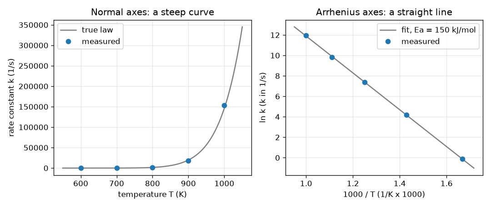

# సెషన్ 1: ఉష్ణోగ్రతతో చర్యా వేగం నిటారుగా పెరుగుతుంది

[Session 1 — हिन्दी](README.hi.md) · [Session 1 — മലയാളം](README.ml.md) · [Session 1 — தமிழ்](README.ta.md) · [Session 1 — తెలుగు](README.te.md)

*స్థాయి 1 (భావనాత్మక ఇంటరాక్టివ్ నమూనా) · సుమారు 60 నిమిషాలు · openarrhenius*

> ఇది సరళీకరించిన విద్యా నమూనా. ఇది ధృవీకరించబడిన (validated) డిజైన్ సాధనం కాదు; నిజమైన నిర్మాణాలు, విద్యుత్ సంస్థాపనలు, వాహనాలు, పారిశ్రామిక ప్రక్రియలు లేదా వైద్య నిర్ణయాల కోసం దీన్ని ఉపయోగించకూడదు.

**ముందస్తు జ్ఞానం (Prerequisites)**

- పాఠశాల బీజగణితం: సరళ రేఖలు, y = m x + c.
- సంవర్గమానాలు (logarithms): ln మరియు exp ఒకదానికొకటి విలోమాలు.
- మీరు PRIMER.md చదివి `python start.py 1` ఒకసారి నడిపారు.

**అభ్యసన లక్ష్యాలు (Learning objectives).** ఈ సెషన్ తర్వాత మీరు:

- సరైన యూనిట్లు మరియు కెల్విన్‌తో ఆర్హీనియస్ నియమాన్ని (Arrhenius law) k = A exp(-Ea/(R T)) లెక్కించగలరు.
- ln k ను 1000/T కి వ్యతిరేకంగా ప్లాట్ చేసినప్పుడు వక్రం ఎందుకు సరళ రేఖగా మారుతుందో వివరించగలరు.
- చేతి సూత్రాలతో కనిష్ఠ వర్గాల పద్ధతి (least squares) ద్వారా సరళ రేఖను ఫిట్ చేసి, దాని వాలు (slope) నుండి Ea ను చదవగలరు.
- వేర్వేరు ఉత్తేజన శక్తులు (activation energies) k ను ఎంత నిటారుగా పెంచుతాయో పోల్చగలరు.

## A. వాస్తవ ప్రపంచ సమస్య
వేడి రోజున పాలు త్వరగా పాడవుతాయి, గ్యాస్ మంట మండడానికి ఒక నిప్పురవ్వ కావాలి. రెండు సందర్భాల్లోనూ వేడి ఎక్కువైనప్పుడు ఒక రసాయన చర్య వేగంగా జరుగుతుంది, అదీ కొంచెం కాదు, ఆశ్చర్యకరమైన మొత్తంలో. ఒక రసాయన శాస్త్రవేత్త ఐదు ఉష్ణోగ్రతల వద్ద రేటు స్థిరాంకం (rate constant) k (ఒక చర్య ఎంత వేగంగా జరుగుతుందో చెప్పే సంఖ్య, ఇక్కడ 1/s లో) కొలుస్తారు; విలువలు చాలా నిటారుగా పెరగడం వల్ల సాధారణ గ్రాఫ్ వాటిలో చాలావాటిని దాచేస్తుంది. ఒక స్కేలుతో సమాధానం చదవగలిగేలా ఇవే సంఖ్యలను ఎలా గీయాలి, ఆ రేఖ చర్య గురించి ఏమి చెబుతుంది?

## B. భావన మరియు సిద్ధాంతం
ఆర్హీనియస్ నియమం k = A exp(-Ea/(R T)) అని చెబుతుంది. T అనేది కెల్విన్‌లో పరమ ఉష్ణోగ్రత (absolute temperature), Ea ఉత్తేజన శక్తి, అంటే అణువులు ఎక్కాల్సిన శక్తి కొండ ఎత్తు, R = 8.3145 J/(mol K) వాయు స్థిరాంకం (gas constant), A అనేది k యొక్క అదే యూనిట్ ఉన్న రేటు స్కేలు. R T సాధారణ ఉష్ణ శక్తి కాబట్టి, Ea/(R T) అనే సంఖ్య ఒక అణువుకు సాధారణంగా ఉండే శక్తి కంటే కొండ ఎన్ని రెట్లు ఎత్తుగా ఉందో చెబుతుంది; అది ఎంత పెద్దదైతే exp(-Ea/(R T)) అంత చిన్నదై చర్య అంత నెమ్మదిస్తుంది. సహజ సంవర్గమానం (natural logarithm) తీసుకుంటే ln k = ln A - (Ea/R)(1/T) వస్తుంది, ఇది 1/T లో ఒక సరళ రేఖ. మనం x = 1000/T ని (సంఖ్యలు సుమారు 1 స్థాయిలో ఉండేందుకు) y = ln k కి వ్యతిరేకంగా ప్లాట్ చేస్తాం; వాలు s = -Ea/(1000 R), కాబట్టి kJ/mol లో Ea అనేది -s గుణకారం 8.3145. రేఖను కనిష్ఠ వర్గాల పద్ధతి ద్వారా ఎంచుకుంటాం: నిలువు అంతరాల వర్గాల మొత్తాన్ని అతి చిన్నదిగా చేసే రేఖ. దాని వాలు Sxy/Sxx, అంతర్ఖండం (intercept) ybar - వాలు గుణకారం xbar.

| గుర్తు | అర్థం | యూనిట్ |
|---|---|---|
| k | రేటు స్థిరాంకం | 1/s (మొదటి క్రమ చర్యకు) |
| A | పూర్వ-ఘాతాంక కారకం (pre-exponential factor) | 1/s |
| Ea | ఉత్తేజన శక్తి | kJ/mol (ఘాతాంకం లోపల J/mol గా మార్చబడుతుంది) |
| R | వాయు స్థిరాంకం, 8.3145 | J/(mol K) |
| T | పరమ ఉష్ణోగ్రత | K |
| x, y | 1000/T మరియు ln k, సరళ రేఖ నిరూపకాలు | 1/K గుణకారం 1000, యూనిట్ లేదు |
| s | 1000/T కి వ్యతిరేకంగా ln k యొక్క వాలు | యూనిట్ లేదు |

**ఊహలు (Assumptions)**

- ఒకే ఒక చర్యా దశ రేటును నియంత్రిస్తుంది (అలా కాకపోతే ఏమవుతుందో తర్వాతి సెషన్ చూపిస్తుంది).
- ఉష్ణోగ్రత కెల్విన్‌లో ఉంటుంది: సెల్సియస్ డిగ్రీలకు 273.15 కలపండి.
- అధ్యయనం చేసే పరిధిలో A మరియు Ea లు T మీద ఆధారపడవు.
- కొలత దోషాలు యాదృచ్ఛికమైనవి, గుణకార రకమైనవి (k లో కొన్ని శాతం).
- ఇది సరళీకరించిన బోధనా నమూనా, రియాక్టర్ లేదా ప్రక్రియను రూపొందించడానికి ధృవీకరించబడిన సాధనం కాదు.

$$ k(T)=A\,\exp\!\left(-\frac{E_a}{R\,T}\right) $$

$$ \ln k=\ln A-\frac{E_a}{R}\cdot\frac{1}{T} $$

$$ s=\frac{S_{xy}}{S_{xx}},\quad S_{xx}=\sum_i (x_i-\bar x)^2,\quad S_{xy}=\sum_i (x_i-\bar x)(y_i-\bar y),\quad b=\bar y-s\,\bar x $$

$$ E_a\,[\mathrm{kJ/mol}]=-s\,R,\qquad s=\text{slope of }\ln k\text{ against }1000/T $$

## C. దృశ్య వివరణ
ఒకే ఐదు కొలిచిన బిందువుల నుండి తయారైన రెండు ప్యానెల్‌లు చిత్రంలో ఉన్నాయి. సాధారణ అక్షాలపై (ఎడమ) T కి వ్యతిరేకంగా k ఒక నిటారు వక్రం: 600 మరియు 700 K బిందువులు నేలపై పడి ఉంటాయి, 1000 K బిందువులు చిత్రాన్ని ఆక్రమిస్తాయి. ఆర్హీనియస్ అక్షాలపై (కుడి) 1000/T కి వ్యతిరేకంగా ln k బిందువులు ఒక సరళ రేఖపై పడతాయి; ఫిట్ చేసిన రేఖ వాలు -18.0, ఇది సుమారు 150 kJ/mol Ea ని ఇస్తుంది. కుడి ప్లాట్‌లో ఎడమ నుండి కుడికి వెళ్ళడం అంటే చల్లదనం వైపు వెళ్ళడం, కాబట్టి k తగ్గుతుంది. రెండు ఉష్ణోగ్రతల మధ్య వేగ పెరుగుదల స్థిరం కాదు: 600 నుండి 700 K కి 73.4 రెట్లు, కానీ 700 నుండి 800 K కి 25.1 రెట్లు మాత్రమే.

*ఒకే ఐదు డేటా బిందువులు సాధారణ అక్షాలపై (నిటారు వక్రం) మరియు ఆర్హీనియస్ అక్షాలపై (వాలు -18.0 ఉన్న సరళ రేఖ, Ea సుమారు 150 kJ/mol).*

## D. ఇంటరాక్టివ్ సిమ్యులేషన్
పాఠాన్ని నడపండి (`python start.py 1`), తర్వాత లైవ్ యాప్‌ను తెరవండి: [సెషన్ 1: ఉష్ణోగ్రతకు వ్యతిరేకంగా చర్యా వేగం](https://krunalpanchal1995.github.io/pan-iit-oss/openarrhenius/session-01/) (లేదా ఈ ఫోల్డర్‌లోని `app.html`). ఉత్తేజన శక్తి మరియు ఉష్ణోగ్రత స్లైడర్‌లను కదపండి. బార్ వీక్షణలో శక్తి కొండను ఉష్ణ శక్తి R T తో పోల్చండి, మొదటి గ్రాఫ్‌లో వక్రం వెంబడి k పెరగడం గమనించండి, సరళ రేఖ వీక్షణలో Ea మార్చినప్పుడు రేఖ వంగడం, బిందువు దాని వెంబడి జారడం చూడండి.

**సవాలు.** ఉష్ణోగ్రతను 500 K లేదా అంతకంటే తక్కువగా ఉంచుతూ k సెకనుకు కనీసం 1000 ఉండే ఉత్తేజన శక్తి మరియు ఉష్ణోగ్రతను కనుగొనండి.

## E. సాధించిన ఉదాహరణ మరియు ప్రయోగం
**సమస్య.** ఒక చర్యకు A = 1e13 per s మరియు Ea = 150 kJ/mol. 800 K వద్ద k కనుగొనండి, మరియు 600 K కంటే 700 K వద్ద అది ఎన్ని రెట్లు వేగంగా జరుగుతుందో కనుగొనండి.

1. శక్తిని మార్చండి: Ea = 150 kJ/mol = 150000 J/mol.
2. ఘాతాంకం: Ea/(R T) = 150000 / (8.3145 x 800) = 22.55 (శుద్ధ సంఖ్య).
3. k(800 K) = 1e13 x exp(-22.55) = 1608 per s.
4. ఒక నిష్పత్తిలో A కారకం రద్దవుతుంది: k(700)/k(600) = exp[(Ea/R)(1/600 - 1/700)] = 73.4.
5. సహేతుకత తనిఖీ (sanity check): వేడిగా ఉన్నప్పుడు చర్య వేగంగా ఉంది (73.4 అనేది 1 కంటే ఎక్కువ), చిత్రం చూపినట్లు పై భాగంలో అదే 100 K అడుగు చిన్న కారకాన్ని ఇస్తుంది (700 నుండి 800 K కి 25.1).

**సమాధానం.** k(800 K) = 1608 per s; 600 K నుండి 700 K కి వెళ్ళడం చర్యను 73.4 రెట్లు వేగవంతం చేస్తుంది.

**ప్రయోగం.** స్పష్టమైన చక్కెర-నీరు మరియు అయోడిన్-గడియారం తరహా చర్య నాలుగు నీటి ఉష్ణోగ్రతల వద్ద తీసుకునే సమయాన్ని స్టాప్‌వాచ్‌తో కొలవండి (k కొలతగా 1/సమయం తీసుకోండి), T ని కెల్విన్‌లో ఉంచి ln(1/సమయం) ను 1000/T కి వ్యతిరేకంగా ప్లాట్ చేసి ఒక రేఖను ఫిట్ చేయండి. దాదాపు సరళ రేఖను ఆశించండి; వాలు ఒక దృశ్య Ea ని ఇస్తుంది. నమూనా వర్సెస్ వాస్తవం: స్టాప్‌వాచ్ సమయం k యొక్క స్థూల కొలత, మిశ్రమం చర్య జరుపుతున్నప్పుడు ఉష్ణోగ్రత మారుతుంది, నిజమైన చర్యలకు తరచుగా అనేక దశలు ఉంటాయి; కాబట్టి దృశ్య Ea ఒకే-దశ విలువ నుండి భిన్నంగా ఉండవచ్చు, రేఖ వంగవచ్చు.

## F. మూల్యాంకనం మరియు డిజైన్ సవాలు
**ప్రశ్న రకం A: భావనాత్మక.** ln k ను 1000/T కి వ్యతిరేకంగా ప్లాట్ చేస్తే ఎందుకు సరళ రేఖ వస్తుంది, దానికి బదులుగా k ను 1/T కి వ్యతిరేకంగా ప్లాట్ చేస్తే మీరు ఏమి చూస్తారు?

సూచన

ఆర్హీనియస్ నియమం యొక్క సంవర్గమానం తీసుకుని y = m x + c తో పోల్చండి.

దశలవారీ పరిష్కారం

ln k = ln A - (Ea/R)(1/T) అనేది y = ln k, x = 1/T తో y = c + m x రూపంలో ఉంది (సంఖ్యలను 1 దగ్గర ఉంచడానికే మనం 1000/T వాడతాం). వాలు -Ea/R, అంతర్ఖండం ln A. k నే 1/T కి వ్యతిరేకంగా ప్లాట్ చేస్తే రేఖ కాదు, ఘాతాంక వక్రం వస్తుంది, ఎందుకంటే k లో ఘాతాంకం ఉంది.

**ప్రశ్న రకం B: సంఖ్యాత్మక.** Ea = 100 kJ/mol కు, 600 K నుండి 700 K కి k ఎన్ని రెట్లు పెరుగుతుంది, ఆర్హీనియస్ రేఖ వాలు ఎంత? Ea = 150 kJ/mol కు ఉన్న 73.4 రెట్లతో పోల్చండి.

సూచన

R = 8.3145 తో k(700)/k(600) = exp[(Ea/R)(1/600 - 1/700)] మరియు వాలు = -Ea/(1000 R) వాడండి.

దశలవారీ పరిష్కారం

కారకం 17.5, వాలు -12.03 (యూనిట్లు: లేవు). చిన్న ఉత్తేజన శక్తి చిన్న కారకాన్ని, తక్కువ నిటారు రేఖను ఇస్తుంది. సహేతుకత తనిఖీ: కారకం 1 కంటే ఎక్కువ, 73.4 కంటే తక్కువ, తక్కువ ఎత్తు కొండకు అలాగే ఉండాలి.

**ప్రశ్న రకం C: గ్రాఫ్ మరియు సిమ్యులేషన్ వ్యాఖ్యానం.** చిత్రం కుడి ప్యానెల్‌లో ఫిట్ చేసిన వాలు -18.0. అది ఏ ఉత్తేజన శక్తిని సూచిస్తుంది, రెండు రెట్లు నిటారుగా ఉన్న రేఖ దేనిని సూచిస్తుంది?

సూచన

Ea (kJ/mol) = - వాలు x 8.3145.

దశలవారీ పరిష్కారం

Ea = 18.0 x 8.3145 = 149.7 kJ/mol (ఫిట్ చేసిన వాలు -18.005). రెండు రెట్లు నిటారు రేఖ అంటే రెండు రెట్లు ఉత్తేజన శక్తి, సుమారు 300 kJ/mol: చర్య ఉష్ణోగ్రతకు చాలా ఎక్కువ సున్నితంగా ఉంటుంది.

**ప్రశ్న రకం D: డిజైన్ మరియు ఆప్టిమైజేషన్ సవాలు.** డిజైన్: ఒక కొలిమి (furnace) గరిష్ఠంగా 600 K చేరగలదు, A = 1e13 per s తో k సెకనుకు కనీసం 1000 కావాలి. పనిచేసే అతి పెద్ద ఉత్తేజన శక్తి ఎంత? Ea = 150 kJ/mol ఉన్న చర్య అదే k చేరడానికి ఏ ఉష్ణోగ్రత కావాలి?

సూచన

A exp(-Ea/(R T)) = 1000 ను సాధించండి, అంటే Ea/(R T) = ln(1e10).

దశలవారీ పరిష్కారం

Ea/(R T) = ln(1e10) = 23.03, కాబట్టి 600 K వద్ద అతి పెద్ద Ea = 23.03 x 8.3145 x 600 / 1000 = 114.9 kJ/mol. Ea = 150 kJ/mol కు ఉష్ణోగ్రత T = 150000 / (8.3145 x 23.03) = 783.5 K, కొలిమి పరిమితి కంటే చాలా ఎక్కువ. రాజీ (trade-off): తక్కువ కొండ చల్లని (చౌకైన, సురక్షితమైన) ప్రక్రియను అనుమతిస్తుంది, కానీ అది స్వేచ్ఛా ఎంపిక కాదు, ఎందుకంటే అది రసాయన శాస్త్రం ద్వారా నిర్ణయించబడుతుంది.

[RUBRIC.md](../../RUBRIC.md) తో మిమ్మల్ని మీరు అంచనా వేసుకోండి. కాగితంపై పని చేయడానికి [కార్యాచరణ పత్రాన్ని](activity_sheet.md) ప్రింట్ చేయండి.

## సాధారణ అపోహలు
| సాధారణ అపోహ | నిజానికి సరైనది |
|---|---|
| ప్రతి 10 డిగ్రీలకు చర్యా రేట్లు రెట్టింపు అవుతాయి. | అది కేవలం ఒక అంచనా నియమం (rule of thumb). Ea = 150 kJ/mol తో 300 K నుండి 310 K కి కారకం 7.0, అధిక ఉష్ణోగ్రత వద్ద 10 K కి కారకం చాలా చిన్నది. కారకం Ea మరియు T మీద ఆధారపడుతుంది. |
| సూత్రంలో సెల్సియస్ డిగ్రీలు వాడండి. | T కెల్విన్‌లో ఉండాలి. 0 డిగ్రీల సెల్సియస్ అంటే 273.15 K, సెల్సియస్ సంఖ్యతో 1/T అర్థరహితం. |
| ఎక్కువ ఉత్తేజన శక్తి అంటే వేగవంతమైన చర్య. | ఎత్తైన కొండ అంటే ఇచ్చిన T వద్ద నెమ్మదైన చర్య, కానీ వేడి చేసినప్పుడు వేగంగా వేగం పెరిగేది: ఆర్హీనియస్ రేఖ మరింత నిటారుగా ఉంటుంది. |
| ఫిట్ చేసిన రేఖ ప్రతి బిందువు గుండా వెళ్ళాలి. | నిజమైన డేటాలో చెదరడం (scatter) ఉంటుంది; కనిష్ఠ వర్గాల పద్ధతి మొత్తంగా అత్యంత దగ్గరి రేఖను ఇస్తుంది, చెదరడం దోషం గురించిన సమాచారం. |

## పదకోశం (Glossary)
- **రేటు స్థిరాంకం k**: ఒక చర్య ఎంత వేగంగా జరుగుతుందో చెప్పే సంఖ్య; దాని యూనిట్ చర్యపై ఆధారపడుతుంది (మొదటి క్రమానికి 1/s)
- **ఉత్తేజన శక్తి Ea**: చర్య జరపడానికి అణువులు ఎక్కాల్సిన శక్తి కొండ; ఆర్హీనియస్ ప్లాట్ వాలు నుండి చదవబడుతుంది
- **పూర్వ-ఘాతాంక కారకం A**: నియమంలోని రేటు స్కేలు; అనంత ఉష్ణోగ్రత వద్ద k చేరువయ్యే విలువ
- **కనిష్ఠ వర్గాల పద్ధతి**: నిలువు అంతరాల వర్గాల మొత్తాన్ని అతి చిన్నదిగా చేసే రేఖను ఎంచుకోవడం
- **ఆర్హీనియస్ ప్లాట్ (Arrhenius plot)**: 1/T కి (ఇక్కడ 1000/T) వ్యతిరేకంగా ln k గ్రాఫ్
- **కెల్విన్ (kelvin)**: పరమ ఉష్ణోగ్రత స్కేలు, T(K) = T(సెల్సియస్ డిగ్రీలు) + 273.15

## ముగింపు
1. [exercises.md](exercises.md) లోని మూడు కోడింగ్ పనులు చేయండి.
2. మీ మార్పుల తర్వాత `python start.py 1` ను మళ్ళీ నడపండి. అది చెక్‌పాయింట్‌తో ముగుస్తుంది; అది `PASS` అని ప్రింట్ చేసినప్పుడు మీరు పూర్తి చేశారు. (చెక్‌పాయింట్ మాత్రమే: `python start.py check 1`.)

తదుపరి: [సెషన్ 2](../session-02/README.md)
