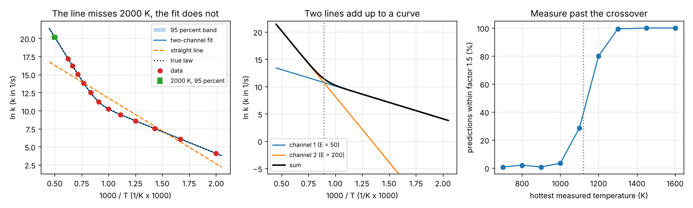

# Session 4: Fit a curved Arrhenius plot

*Level 3 (simulation and validation) · about 90 minutes · openarrhenius*

> This is a simplified educational model. It is not a validated design tool and must not be used for real structures, electrical installations, vehicles, industrial processes or medical decisions.

**Prerequisites**

- Session 1: the Arrhenius plot.
- Session 2: least squares, Sxx and SE(Ea).
- Session 3: the covariance of a fit, the 95 percent band, coverage, and the curved-plot failure.
- Section B explains the Jacobian and the Levenberg-Marquardt step.

**Learning objectives.** After this session you can:

- Write the two-channel model k = k1(T) + k2(T) and explain why it bends the Arrhenius plot.
- Fit it by nonlinear least squares (Levenberg-Marquardt) and say why a start guess matters.
- Report the four parameters with their covariance, and explain why they are poorly known one by one while the prediction at 2000 K is well known.
- Decide between one and two channels with the corrected Akaike criterion (AICc) and the residual pattern.
- Validate the method by repeated experiments and say how hot the data must go.

## A. Real-world problem
Session 3 ended with a warning: for a reaction with two parallel paths the plot of ln k against 1000/T is curved, and a straight line fitted over 800 to 1600 K predicts k at 2000 K nine times too low while its own band looks tight. A model of a hot process still needs k at 2000 K. Can we fit the curve, say how sure we are, and know when the data cannot answer the question at all?

## B. Concept and theory
Two reactions that run side by side add their rates, so k(T) = k1(T) + k2(T) with k1 = A1 exp(-E1/(R T)) and k2 = A2 exp(-E2/(R T)). With x = 1000/T, E in kJ/mol and R = 8.314 J/(mol K) (the 1000 in the units cancels the 1000 in x), ln k = ln( exp(lnA1 - E1 x/R) + exp(lnA2 - E2 x/R) ). Each term alone is a straight line on the Arrhenius plot; their sum follows whichever line is higher. The cool end is the low-Ea channel (shallow line), the hot end is the high-Ea channel (steep line), and the **crossover** is where they are equal, at x = R (lnA1 - lnA2) / (E1 - E2). We fit ln k, so a 3 percent error is a 0.03 error in ln k at every temperature.

There is no formula for the best (lnA1, E1, lnA2, E2). Starting from a guess p, linearise ln k with the Jacobian J (the table of slopes d ln k / d p, one row per temperature; each channel's slopes are weighted by its share of k) and solve for a step. **Levenberg-Marquardt** damps the step with a number lambda: a large lambda is a short careful move downhill, a small one is the full Gauss-Newton step. A step that lowers the residual sum of squares (RSS) is kept and lambda shrinks; otherwise it is rejected and lambda grows. The surface has flat valleys, so we try three start guesses (split the data into a cool and a hot part, fit a straight line to each) and keep the lowest RSS. Channels are labelled so that E1 is not larger than E2.

At the solution the covariance of the four parameters is s^2 (J^T J)^-1 with s^2 = RSS/(n - 4), the same idea as Session 3 with J in place of (1, x). Parameters of the same channel move together (correlation about +0.97 and +0.99): the data fix the combination, not each number. The prediction is one particular combination, so the **delta method** gives its variance as g^T cov g with g the Jacobian row at the target, and the 95 percent interval is ln k plus or minus t sqrt(g^T cov g) with t for n - 4 degrees of freedom. More parameters always lower the RSS, so to ask whether the second channel is justified we use **AICc** = n ln(RSS/n) + 2m + 2m(m+1)/(n-m-1) with m = 2 for the line and 4 for two channels; a difference above about 10 is strong evidence. A straight line fitted to a curve leaves residuals in a few long runs of one sign.

| Symbol | Meaning | Unit |
|---|---|---|
| lnA1, lnA2 | log of the pre-exponential factor of each channel | no unit (A in 1/s) |
| E1, E2 | activation energies, E1 not larger than E2 | kJ/mol |
| x | 1000/T | 1000/K |
| J | Jacobian, d ln k / d (lnA1, E1, lnA2, E2) | mixed |
| lambda | Levenberg-Marquardt damping | no unit |
| s | estimated error of ln k, sqrt(RSS/(n-4)) | no unit |
| AICc | corrected Akaike criterion | no unit |
| T_c | crossover temperature, where k1 = k2 | K |

**Assumptions**

- The truth is exactly two Arrhenius channels in parallel; the pressure dependence, a third channel or a change of mechanism are not modelled.
- Errors of ln k are independent, unbiased and normal, with the same size at every temperature.
- Temperatures are exact.
- The delta-method band treats the model as linear near the solution, which is good when the data are informative and poor when they are not.
- Synthetic data are used so the truth is known; real data need extra care. This is a simplified teaching model, not a validated tool for design decisions.

$$ k(T)=\exp\!\Big(\ln A_1-\frac{E_1x}{R}\Big)+\exp\!\Big(\ln A_2-\frac{E_2x}{R}\Big),\qquad x=\frac{1000}{T} $$

$$ \big(J^{\mathsf T}J+\lambda\,\mathrm{diag}(J^{\mathsf T}J)\big)\,\delta=J^{\mathsf T}r,\qquad r=\ln k_{\text{data}}-\ln k_{\text{model}} $$

$$ \mathrm{Cov}(p)=s^2\,(J^{\mathsf T}J)^{-1},\qquad \mathrm{Var}[\ln k(T)]=g^{\mathsf T}\,\mathrm{Cov}(p)\,g,\qquad g=\frac{\partial\ln k}{\partial p}\Big|_T $$

$$ \mathrm{AICc}=n\ln\frac{\mathrm{RSS}}{n}+2m+\frac{2m(m+1)}{n-m-1} $$

## C. Visual explanation
Left: twelve points from 500 to 1600 K, the straight line (which misses the 2000 K end by a large factor), the two-channel fit with its 95 percent band, the true law (dotted, hidden under the fit) and the prediction at 2000 K with its interval (green; the point at x = 0.5 is the target). Middle: the two true channels and their sum; the dotted line marks the crossover at 1119 K, where the curve bends from the shallow channel to the steep one. Right: how often repeated experiments predict k at 2000 K within a factor 1.5, against the hottest temperature measured. Below the crossover the share is near zero, it climbs steeply between 1100 and 1300 K, and it is 100 percent from about 1400 K.

*Left: data, straight line, two-channel fit and band, with the 2000 K prediction. Middle: the two channels and their sum, crossover at 1119 K. Right: share of repeated experiments within a factor 1.5 against the hottest measured temperature (150 repeats per point).*

## D. Interactive simulation
Run the lesson (`python start.py 4`), then open the live app: [Session 4: fit a curved Arrhenius plot](https://krunalpanchal1995.github.io/pan-iit-oss/openarrhenius/session-04/) (or `app.html` in this folder). It runs the same fit in your browser. Change the noise, the number of points and the hottest temperature, and press a new noise draw. On "Data and fit" compare the straight line with the two-channel fit; on "100 repeats at 2000 K" see where 100 repeated experiments land; on "The two channels" see how far the data window reaches past the crossover.

**Challenge.** With 3 percent error or more and at most 12 points, find the hottest temperature to stop at so that at least 95 of 100 repeated experiments predict k(2000 K) within a factor 1.5, as low as the slider allows.

## E. Worked example and experiment
**Problem.** Twelve temperatures from 500 to 1600 K in steps of 100 K, synthetic data with 3 percent error from the truth lnA1 = 16.118 (A1 = 1e7 per s), E1 = 50 kJ/mol, lnA2 = 32.236 (A2 = 1e14 per s), E2 = 200 kJ/mol (seed 0). Fit one line and two channels, report the parameters with errors, and predict k at 2000 K with a 95 percent interval. Does it hold the truth, which is 5.98e8 per s?

1. The straight line has s = 1.267 and its residuals come in only 3 runs of one sign: a curve. It predicts k(2000 K) = 1.18e7 per s, 51 times too low.
2. The three start guesses all lead to the same minimum, RSS = 0.003756. The fit gives lnA1 = 16.130 +- 0.041, E1 = 50.05 +- 0.228 kJ/mol, lnA2 = 32.099 +- 0.102, E2 = 198.51 +- 1.19 kJ/mol, with s = 0.0217 on 8 degrees of freedom (the true error is 0.03).
3. lnA and E of one channel are correlated: 0.974 for channel 1 and 0.995 for channel 2. The crossover is 1118 K (true 1119 K), and at 2000 K the second channel carries 99.9 percent of k.
4. At 2000 K the standard error of ln k is 0.0317, much smaller than the error of E2 would suggest, because the prediction is one combination of the parameters that the data fix well. With t = 2.306 for 8 degrees of freedom the factor is exp(2.306 x 0.0317) = 1.076 each way: k(2000 K) = 5.70e8 per s, 95 percent interval 5.30e8 to 6.14e8 (upper over lower 1.157).
5. AICc is 8.8 for the line and -83.1 for two channels, a difference of 92 in favour of two channels, and the two-channel residuals come in 7 runs.

**Answer.** Prediction 5.70e8 per s, within a factor 1.5 of (in fact 5 percent below) the true 5.98e8, and the interval 5.30e8 to 6.14e8 contains the truth. The straight line on the same data is 51 times too low (on the 800 to 1600 K data of Session 3 it is 9.2 times too low, and the two-channel fit is within 2 percent). Over 1000 repeated experiments the interval holds the truth 94.5 percent of the time and every prediction is within a factor 1.5.

**Experiment.** Repeat the fit on data that stop at 1100 K (about the crossover) with the same seed: the fit returns E2 = 236 +- 18 kJ/mol (true 200), the correlation of lnA2 and E2 is 1.000, and the prediction at 2000 K is 5.8 times too high with a 95 percent interval spanning a factor 57. The data hardly contain the second channel, so no method can recover it. Stop at 900 K and the AICc says the line is enough (the second channel is invisible), and the prediction is then wrong by orders of magnitude while the band looks reasonable: the data cannot warn you about a channel they never reach.

## Real-world application and mini-project: Predict k at 2000 K from a curved plot
A lab reports ten rate constants at 600, 700, ..., 1500 K for a reaction with two channels. In this exercise the data are synthetic so you can check your answer: build them with `synthetic(np.linspace(600, 1500, 10), 0.04, 9, p)` with `p = np.array([np.log(3e6), 60.0, np.log(2e12), 170.0])` (4 percent multiplicative error; channel 1 has A = 3e6 per s and E = 60 kJ/mol, channel 2 has A = 2e12 per s and E = 170 kJ/mol). Fit the line and the two channels, report the parameters with errors, the crossover temperature, the AICc difference and k(2000 K) with a 95 percent interval from `band` and from `mc_predict`. Then repeat with the window 600 to 1000 K using `trials` and see what happens.

**Deliverable:** A script that prints the line's prediction, the four parameters with standard errors, the crossover, the AICc difference and the interval at 2000 K, repeats the study for the window 600 to 1000 K, and saves a figure with the data, both fits, the band and the true law.

**Success looks like:** For 600 to 1500 K: E1 = 60.04 +- 0.83 and E2 = 167.8 +- 1.57 kJ/mol, crossover 980 K (true 987 K), k(2000 K) = 6.75e7 per s with interval 5.95e7 to 7.67e7, which contains the true 7.27e7; the straight line is 13 times too low and the AICc difference is 59 in favour of two channels. For the window 600 to 1000 K only about 30 percent of repeated predictions fall within a factor 1.5, and the median interval factor is about 200.

## F. Assessment and design challenge
**Question type A: Conceptual.** Why does adding two Arrhenius terms bend the plot of ln k against 1000/T, and why does the hot end follow the channel with the larger Ea?

Hint

At each temperature the larger of the two terms is almost all of k. Which term is larger when T is small, and which when T is large?

Step-by-step solution

Each term is a straight line on the plot, and ln(a + b) is close to the larger of ln a and ln b. At low T the channel with the small Ea is larger, because a small barrier costs little when thermal energy is low; its line is shallow. At high T the channel with the large Ea (and the large A) wins, because it rises faster with T and its steep line climbs past the other one. So the curve follows the shallow line on the cool side, the steep line on the hot side, and bends in between near the crossover where the two terms are equal. At 2000 K the high-Ea channel carries 99.9 percent of k, which is why the prediction depends on the hot channel only.

**Question type B: Numerical.** For the true law (lnA1 = 16.118, E1 = 50 kJ/mol, lnA2 = 32.236, E2 = 200 kJ/mol) find the crossover temperature.

Hint

Set the two exponents equal: lnA1 - E1 x/R = lnA2 - E2 x/R, then T = 1000/x.

Step-by-step solution

x = R (lnA1 - lnA2) / (E1 - E2) = 8.3145 x (16.118 - 32.236) / (50 - 200) = 8.3145 x (-16.118) / (-150) = 0.8934. Then T = 1000 / 0.8934 = 1119 K (the lesson gives 1119.3 K). At this temperature each channel carries half of k, and the data must reach clearly past it, about 200 K more, before the hot channel is determined.

**Question type C: Graph and simulation interpretation.** In the right panel of the figure, the share of correct predictions is about 1 percent when the data stop at 900 K, yet the 95 percent band is narrow there (a factor 1.26). Which number from the fit says that the straight line is enough, and why can that number not rescue the prediction?

Hint

Compare AICc of the line and of two channels for data that stop at 900 K, and ask what the data contain.

Step-by-step solution

For data from 500 to 900 K the median AICc difference (line minus two channels) is -8, so the line is preferred: the data show no sign of curvature. That is true of the data, not of the reaction: the second channel only takes over above 1119 K, where nothing was measured. The band counts noise only, so it stays narrow while the interval holds the truth in only 22 percent of repeated experiments (the figure's 1 percent is the share within a factor 1.5). The same warning as in Session 3 applies: a good fit and a narrow band say nothing about what happens outside the data.

**Question type D: Design and optimisation challenge.** Design: you have 12 points from 500 K at 3 percent error and may choose the hottest temperature. How hot must you go so that at least 95 percent of repeated experiments predict k(2000 K) within a factor 1.5 of the truth? Test the cases in the app.

Hint

Use the slider for the hottest temperature and read the share on "100 repeats at 2000 K", or run `reach_study` in the lesson.

Step-by-step solution

`reach_study` (300 repeats each) gives 53 percent within a factor 1.5 at 1150 K, 81 percent at 1200 K, 94.7 percent at 1250 K (just short of 95) and 99 percent at 1300 K; the app (100 repeats, hottest temperature in steps of 100 K) gives 75 percent at 1200 K and 99 percent at 1300 K. So go to about 1300 K, roughly 180 K past the crossover. The median interval factor falls from 12.9 at 1150 K to 4.6 at 1200 K, 2.0 at 1300 K and 1.2 at 1600 K, so the cost of stopping early shows in the width of the band too. The trade-off is the furnace limit and the risk of a third channel at high temperature.

Score yourself with [RUBRIC.md](../../RUBRIC.md). Print the [activity sheet](activity_sheet.md) to work on paper.

## Common misconceptions
| Common misconception | What is actually true |
|---|---|
| More parameters always give a better model. | They always give a smaller RSS, but not a better prediction. AICc charges for each parameter, and with 5 or 6 points the t factor (12.7 or 4.3) makes the band very wide. |
| If E2 is known to only 1 percent the prediction must be uncertain by about as much. | The prediction is one combination of the four parameters, and the data fix that combination far better than any single parameter: 0.03 in ln k (a 3 percent error) against an error of 1.19 kJ/mol in E2. |
| The fit finds the true channels whatever the data. | Only when the data reach well past the crossover. Stopping at 1100 K gives E2 = 236 +- 18 kJ/mol in the worked example and a band a factor 57 wide; stopping at 900 K the second channel cannot be seen at all. |
| A narrow band means the prediction is right. | The band counts noise, not a missing channel. Data that stop at 900 K give a narrow band and an interval that holds the truth in only 22 percent of repeats. |
| The nonlinear fit always finds the best answer from any start. | A start guess can end in a poor valley (RSS 16 instead of 0.004 from one bad start). The lesson tries three starts and keeps the best; look at the RSS. |

## Glossary
- **channel**: one reaction path with its own Arrhenius term
- **crossover**: the temperature at which two channels contribute equally to k
- **Jacobian**: the table of slopes of the model with respect to each parameter, one row per data point
- **Levenberg-Marquardt**: a nonlinear least-squares method that blends a careful downhill step with the full Gauss-Newton step
- **delta method**: the variance of a function of fitted parameters, g^T cov g, where g is the gradient of the function
- **condition number**: the ratio of the largest to the smallest eigenvalue of J^T J; a large one means a flat valley of nearly equally good parameters
- **AICc**: a model-comparison number that rewards a small RSS and charges for each parameter, with a correction for few points
- **identifiability**: whether the data can tell different parameter values apart

## Finish
1. Do the three coding tasks in [exercises.md](exercises.md).
2. Run `python start.py 4` again after your changes. It ends with the checkpoint; when it prints `PASS`, you are done. (Checkpoint only: `python start.py check 4`.)

Next: the [roadmap](../../promo/roadmap.md). Session 5 is yours to build.
