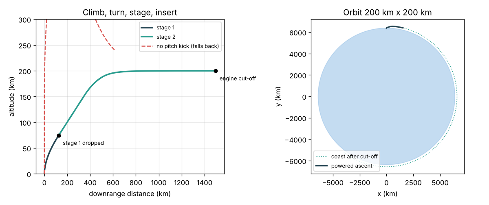

# What you are building toward

A two-stage launcher lifts off from a rotating Earth, throttles through max Q, pitches over on a planned gravity turn, drops its first stage and flies an optimised upper-stage steering law into a 200 km orbit, all animated: the rocket and its trail drawn over a curved Earth, the first stage falling away after separation, and live panels of altitude, speed, dynamic pressure and the delta-v budget filling up as it flies. Your goal over the coming sessions: build that animated flight yourself, add Earth's rotation, altitude-dependent thrust and an optimised pitch program, and find how much more payload they buy.

*Target starting point: the Session 3 two-stage ascent to a 200 km orbit, side view and whole-Earth view*

The full Target comes from a private reference build. Its code is not published; the roadmap shows the path so you can build your own.

Live links:

- [Session 3 app: fly to orbit with staging](https://krunalpanchal1995.github.io/pan-iit-oss/openascent/session-03/)
- [Math Visual Studio](https://krunalpanchal1995.github.io/studio/)
