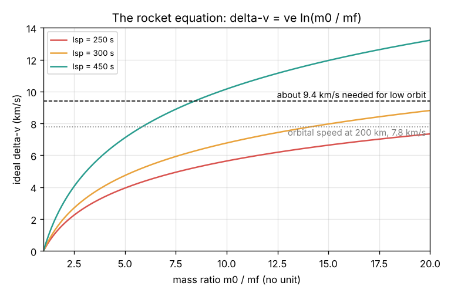
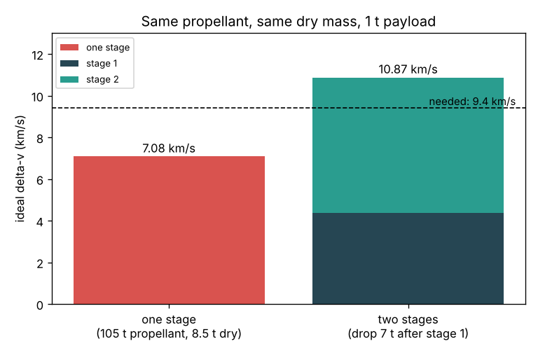

# Session 1: The rocket equation and staging

*Level 1 (conceptual interactive model) · about 60 minutes · openascent*

> This is a simplified educational model. It is not a validated design tool and must not be used for real structures, electrical installations, vehicles, industrial processes or medical decisions.

**Prerequisites**

- School arithmetic, powers and the natural logarithm ln (a calculator button is enough).
- Momentum = mass x velocity, and Newton's third law (action and reaction).
- You have read PRIMER.md and run `python start.py 1` once.

**Learning objectives.** After this session you can:

- Turn a specific impulse Isp into an exhaust speed ve = Isp x g0.
- Use the rocket equation delta-v = ve ln(m0 / mf), and turn it round to find the mass ratio for a given delta-v.
- Compute the speed of a circular orbit, v = sqrt(G M / r), and the delta-v budget to low orbit.
- Explain, with numbers, why a rocket drops empty stages on the way up.

## A. Real-world problem
A launch vehicle like India's PSLV has a lift-off mass of roughly 300 tonnes, yet it places only one or two tonnes into a low orbit. Almost everything else is propellant thrown out of the nozzles during the climb, plus tanks and engines that are thrown away in the sea. Why does a rocket need so much propellant to reach orbit, and why is it built in stages that are dropped on the way up? (General education only: this is a simplified model, not a launch vehicle design method.)

## B. Concept and theory
A rocket moves by throwing mass backwards. When a small mass dm leaves at exhaust speed ve relative to the rocket, momentum conservation says the remaining mass m speeds up by dv = ve dm / m. Adding up these small pieces from the full (lift-off) mass m0 to the empty (burnout) mass mf gives the Tsiolkovsky rocket equation, delta-v = ve ln(m0 / mf). Engines are rated by their specific impulse Isp in seconds; the exhaust speed is ve = Isp x g0 with g0 = 9.80665 m/s2. The logarithm is harsh: each extra ve of speed needs the mass ratio multiplied by e = 2.718 again. A low circular orbit needs a sideways speed v = sqrt(G M / r), about 7.8 km/s at 200 km; gravity and air on the way up add roughly 1.5 to 2 km/s, so a typical budget is about 9.4 km/s. Staging helps because once a stage's propellant is gone, its empty tanks and engines (the dry mass) are dead weight. A two-stage rocket burns stage 1, drops it, and then stage 2 only has to push itself and the payload, so each stage has a good mass ratio and the delta-v values add.

| Symbol | Meaning | Unit |
|---|---|---|
| Isp | specific impulse of the engine | s |
| ve | effective exhaust speed, Isp x g0 | m/s |
| g0 | standard gravity, 9.80665 | m/s2 |
| m0, mf | mass at the start and at the end of a burn | kg |
| delta-v | ideal speed change of a burn (no gravity, no air) | m/s |
| G M (mu) | Earth's gravitational parameter, 3.986 x 10^14 | m3/s2 |
| r, h | distance from Earth's centre, and altitude r - 6371 km | m |

**Assumptions**

- The ideal rocket equation: no gravity and no air during the burn (Session 2 adds them).
- Each stage has a constant Isp.
- A stage's dry mass is dropped the moment its propellant runs out.
- The 9.4 km/s budget to low orbit is a typical textbook value, not a calculation (Session 3 computes it).

$$ v_e = I_{sp}\, g_0 $$

$$ \Delta v = v_e \ln\frac{m_0}{m_f} $$

$$ \frac{m_0}{m_f} = \exp\!\left(\frac{\Delta v}{v_e}\right) $$

$$ v_{\mathrm{circ}} = \sqrt{\frac{\mu}{R_E + h}} $$

$$ \Delta v_{\mathrm{stack}} = \sum_{i} v_{e,i} \ln\frac{m_{0,i}}{m_{f,i}} $$

## C. Visual explanation
The first figure plots the rocket equation for three engines (Isp 250, 300 and 450 s). The curves rise fast at first and then flatten: with Isp 300 s a mass ratio of 4 gives 4.1 km/s, but reaching 9.4 km/s with one stage needs a mass ratio of about 24, so the rocket would have to be 96 percent propellant and could carry almost no tanks or payload. The second figure takes the teaching launcher used in every session (stage 1: 90 t propellant, 7 t dry, Isp 290 s; stage 2: 15 t propellant, 1.5 t dry, Isp 340 s; payload 1 t). As two stages it gives 4385 + 6488 = 10 873 m/s. The same propellant and dry mass flown as a single stage gives only 7079 m/s, short of the 9400 m/s budget.

*The rocket equation: ideal delta-v against mass ratio for three engines.*

*Same propellant and dry mass: two stages give 10.87 km/s, one stage only 7.08 km/s.*

## D. Interactive simulation
Run the lesson (`python start.py 1`), then open the live app: [Session 1: the rocket equation and staging](https://krunalpanchal1995.github.io/pan-iit-oss/openascent/session-01/) (or `app.html` in this folder). Change the propellant and dry mass of each stage, the two Isp values and the payload. The bar view compares two stages with one stage holding the same masses, against the 9.4 km/s line; the mass-stack view shows how small the payload is next to the propellant.

**Challenge.** Carry a payload of at least 3 t with total ideal delta-v of at least 9400 m/s, using no more than 110 t of propellant in total.

## E. Worked example and experiment
**Problem.** (a) An engine has Isp = 300 s. Find ve, and the delta-v of a single stage that goes from 100 t to 25 t. (b) Find the speed of a circular orbit at 200 km. (c) Find the delta-v of the teaching launcher's stage 2 (15 t propellant, 1.5 t dry, Isp 340 s, 1 t payload).

1. ve = 300 x 9.80665 = 2942 m/s.
2. Mass ratio = 100 / 25 = 4, and ln 4 = 1.386, so delta-v = 2942 x 1.386 = 4078 m/s. (Check: 4 = 2 x 2, so delta-v = 2 ve ln 2 = 2 x 2942 x 0.693 = 4078 m/s.)
3. r = 6371 + 200 = 6571 km = 6.571 x 10^6 m; v = sqrt(3.986 x 10^14 / 6.571 x 10^6) = sqrt(6.066 x 10^7) = 7788 m/s.
4. Stage 2 full: 1 + 15 + 1.5 = 17.5 t. Empty: 1 + 1.5 = 2.5 t. Mass ratio 7, ln 7 = 1.946.
5. ve = 340 x 9.80665 = 3334 m/s, so delta-v = 3334 x 1.946 = 6488 m/s.

**Answer.** ve = 2942 m/s and delta-v = 4078 m/s; orbital speed at 200 km is 7788 m/s; stage 2 gives 6488 m/s.

**Experiment.** Blow up a long balloon, thread a string through a straw taped to it, and let it go along the string. Then tape a paper clip (a "payload") to it and repeat: it goes less far. The balloon throws air backwards just like a rocket. The model differs because the balloon's air leaves at a changing speed and the balloon fights air drag and string friction; the rocket equation assumes a constant ve in empty space.

## F. Assessment and design challenge
**Question type A: Conceptual.** Why does staging give more delta-v than one big stage with the same total propellant and the same total dry mass?

Hint

What does the rocket still carry, late in the flight, if it never drops anything?

Step-by-step solution

The rocket equation depends on the mass ratio m0 / mf. A single stage must carry all of its empty tanks and engines to the very end, so mf is large and the ratio is poor. A staged rocket drops stage 1's dry mass when it is empty; stage 2 then starts light and ends very light, so its own mass ratio is large. The ideal delta-v values of the stages add. With the teaching launcher: 10 873 m/s staged against 7079 m/s unstaged.

**Question type B: Numerical.** An upper stage has Isp = 450 s. What mass ratio does it need to give 4000 m/s? If it carries 2 t of payload plus 1 t of dry mass, how much propellant must it hold?

Hint

Turn the rocket equation round: m0 / mf = exp(delta-v / ve).

Step-by-step solution

ve = 450 x 9.80665 = 4413 m/s. m0 / mf = exp(4000 / 4413) = exp(0.906) = 2.475. The empty mass mf = 2 + 1 = 3 t, so m0 = 3 x 2.475 = 7.43 t and the propellant is 7.43 - 3 = 4.43 t. Check: 4413 x ln(7.43 / 3) = 4413 x 0.907 = 4000 m/s.

**Question type C: Graph and simulation interpretation.** On the rocket-equation figure, follow the Isp 300 s curve. How much delta-v do you gain going from a mass ratio of 2 to 4, and from 10 to 20? What does this tell you about adding more propellant?

Hint

Doubling the mass ratio always adds ve ln 2.

Step-by-step solution

Both steps double the mass ratio, so each adds ve ln 2 = 2942 x 0.693 = 2039 m/s. But going from 2 to 4 means adding propellant equal to twice the empty mass, while going from 10 to 20 means adding ten times the empty mass. The same extra speed costs five times more propellant at high mass ratios: the curve flattens. Diminishing returns are why one stage cannot reach orbit.

**Question type D: Design and optimisation challenge.** Design: you have 110 t of propellant to share between two stages (dry mass 8 percent of each stage's propellant, Isp 290 s and 340 s, payload 1 t). Try putting 80, 95 and 105 t in stage 1. Which split gives the most delta-v, and why is there a best split at all?

Hint

Use `stack_delta_v` from the lesson in a loop over the stage-1 propellant, or the Session 1 app with matching dry masses.

Step-by-step solution

With 8 percent dry mass: 80 t in stage 1 gives 3134 + 7618 = 10 752 m/s; 95 t gives 4479 + 6857 = 11 336 m/s; 105 t gives 5947 + 5067 = 11 015 m/s. A loop in steps of 5 t finds the best near 100 t (5119 + 6269 = 11 389 m/s). Too small a stage 1 has a poor mass ratio because it must lift a heavy stage 2; too small a stage 2 has a poor mass ratio because its own dry mass and the payload dominate. The best split balances the two. Trade-off: the ideal delta-v is not the whole story, because a big stage 1 needs a lot of thrust and the losses of Session 2 depend on how long each stage burns.

Score yourself with [RUBRIC.md](../../RUBRIC.md). Print the [activity sheet](activity_sheet.md) to work on paper.

## Common misconceptions
| Common misconception | What is actually true |
|---|---|
| A rocket pushes against the air or the ground. | It pushes against its own exhaust (momentum conservation). It works better in vacuum, where nothing pushes back on the nozzle. |
| Twice the propellant gives twice the speed. | Speed grows with the logarithm of the mass ratio; doubling the mass ratio only adds ve ln 2. |
| Orbit is about getting high. | Orbit is about going sideways fast: about 7.8 km/s at 200 km. Height alone is not enough (Session 2). |
| Staging works because stage 2 has a better engine. | Even with the same Isp, dropping dead weight raises the mass ratio of the next stage and adds delta-v. |

## Glossary
- **specific impulse (Isp)**: impulse per unit weight of propellant, in seconds; ve = Isp x g0
- **delta-v**: the speed change a rocket can produce, used as a "budget"
- **mass ratio**: full mass divided by empty mass for one burn, m0 / mf
- **dry mass**: mass of a stage without its propellant (tanks, engines, structure)
- **staging**: dropping an empty stage so the remaining rocket is lighter

## Finish
1. Do the three coding tasks in [exercises.md](exercises.md).
2. Run `python start.py 1` again after your changes. It ends with the checkpoint; when it prints `PASS`, you are done. (Checkpoint only: `python start.py check 1`.)

Next: [Session 2](../session-02/README.md)
