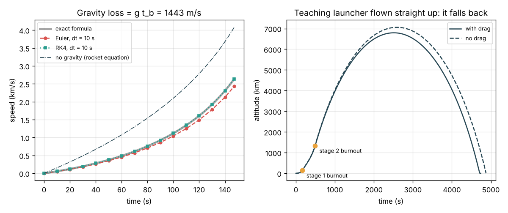
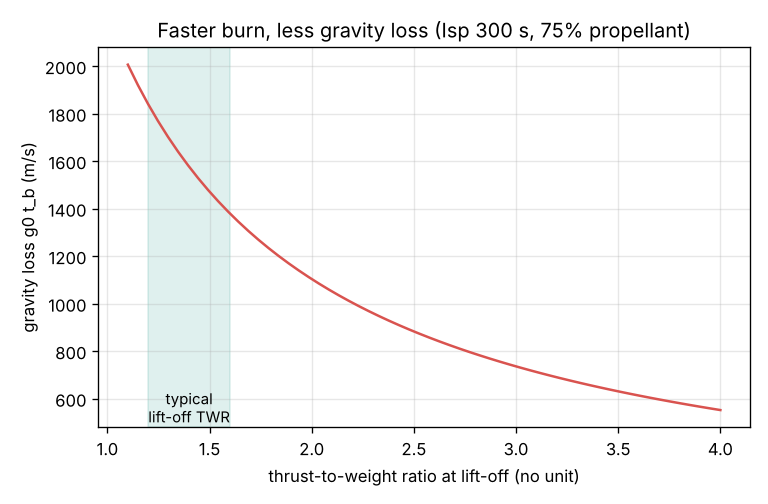

# Session 2: Straight up: gravity and drag losses

*Level 2 (mathematical engineering model) · about 75 minutes · openascent*

> This is a simplified educational model. It is not a validated design tool and must not be used for real structures, electrical installations, vehicles, industrial processes or medical decisions.

**Prerequisites**

- Session 1: the rocket equation and staging.
- Newton's second law F = m a; speed as the rate of change of height.
- The idea of a numerical step (new value = old value + rate x dt); explained in Section B.

**Learning objectives.** After this session you can:

- Compute the thrust-to-weight ratio and the propellant mass flow, and say whether a rocket can lift off.
- Derive the burnout speed of a vertical burn, v = ve ln(m0 / mf) - g t_b, and name g t_b the gravity loss.
- Step a rocket flight forward in time with Euler and with Runge-Kutta 4, and check both against the exact answer.
- Add drag and inverse-square gravity, and explain why flying straight up never gives an orbit.

## A. Real-world problem
Session 1 said our two-stage teaching launcher has about 10.9 km/s of ideal delta-v, more than the 7.8 km/s of orbital speed. But a real rocket starts on a launch pad. Gravity pulls it down every second the engines burn, and the air pushes back while it is low and fast. How much speed do these two really take, why must a rocket's thrust be larger than its weight, and what happens if the rocket simply flies straight up? (A simplified teaching model, not a flight-planning method.)

## B. Concept and theory
On the pad the engine must first hold the rocket up: the thrust-to-weight ratio TWR = F / (m g0) must be above 1, and the net upward acceleration is (TWR - 1) g0. The engine burns propellant at the rate mdot = F / ve, so a stage with propellant m_p burns for t_b = m_p / mdot. Flying straight up with constant gravity and no air, Newton's second law m dv/dt = F - m g integrates to v(t) = ve ln(m0 / m) - g t: the rocket equation minus g t. At burnout the missing speed g t_b is the gravity loss; the longer the burn, the larger it is, so a higher TWR (a faster burn) loses less. After burnout the rocket coasts up a further v_b^2 / (2 g). In general we cannot integrate by hand, so we step in time: with Euler's method each step uses the slope at its start (new v = v + a dt), which is simple but drifts; Runge-Kutta 4 (RK4) takes four slopes across the step and averages them, and is far more accurate for the same dt. Then we can add what the formula left out: gravity that weakens as G M / (R + h)^2, and drag D = 0.5 rho v^2 Cd A with air density rho = rho0 exp(-h / H) falling with height (scale height H = 8.5 km). Drag matters only low down; above about 50 km the air is too thin. Whatever we do, a rocket that only goes up has no sideways speed and must fall back.

| Symbol | Meaning | Unit |
|---|---|---|
| F | engine thrust | N |
| TWR | thrust-to-weight ratio F / (m g0) | no unit |
| mdot | propellant mass flow F / ve | kg/s |
| t_b | burn time m_p / mdot | s |
| g | gravity, g0 or G M / (R + h)^2 | m/s2 |
| D, Cd A | drag force and drag area | N, m2 |
| rho, H | air density and scale height (8500 m) | kg/m3, m |
| dt | time step of the numerical method | s |

**Assumptions**

- Vertical flight only (one dimension); no wind and no Earth rotation.
- Constant thrust and Isp (real engines gain thrust as the outside pressure falls).
- Exponential atmosphere with constant Cd A = 2.5 m2 (illustrative).
- In the worked example: constant gravity and no air, so the exact formula applies.

$$ \mathrm{TWR} = \frac{F}{m g_0},\qquad \dot m = \frac{F}{v_e},\qquad t_b = \frac{m_p}{\dot m} $$

$$ v(t) = v_e \ln\frac{m_0}{m(t)} - g\,t $$

$$ h(t) = v_e t - v_e\frac{m(t)}{\dot m}\ln\frac{m_0}{m(t)} - \tfrac12 g t^2 $$

$$ m\frac{dv}{dt} = F - m\,g(h) - \tfrac12\rho_0 e^{-h/H} v|v|\,C_d A $$

$$ \text{gravity loss} = \int_0^{t_b} g\,dt \;=\; g\,t_b\ \text{(constant } g) $$

## C. Visual explanation
The left panel of the first figure is the worked example: a 100 t single stage (75 t propellant, Isp 300 s, thrust 1.5 MN). The thick grey curve is the exact formula; RK4 with 10 s steps sits right on it, while Euler with the same steps ends 206 m/s too slow. The dash-dot curve is the rocket equation without gravity; the gap at burnout, 1443 m/s, is the gravity loss. The right panel flies the two-stage teaching launcher straight up: it reaches about 6800 km and falls back after about 79 minutes. Drag barely changes the top height because the rocket is through the thick air quickly. The second figure shows the gravity loss of the worked-example stage against the lift-off TWR: doubling TWR halves the loss.

*Left: exact, Euler and RK4 speeds; the gap to the rocket equation is the gravity loss. Right: the launcher flown straight up falls back.*

*Gravity loss g0 t_b against lift-off thrust-to-weight (Isp 300 s, 75 percent propellant).*

## D. Interactive simulation
Run the lesson (`python start.py 2`), then open the live app: [Session 2: straight up against gravity](https://krunalpanchal1995.github.io/pan-iit-oss/openascent/session-02/) (or `app.html` in this folder). Set the thrust, Isp and propellant share of a 100 t rocket. Switch drag and inverse-square gravity on and off. Compare the simulated burnout speed with the rocket equation and read the gravity loss; open the altitude view to see the rocket fall back, and the TWR view to see the trade-off.

**Challenge.** With drag and inverse-square gravity on, keep the gravity loss below 1000 m/s with a lift-off thrust-to-weight of at most 2.5 (thrust at most 2.45 MN).

## E. Worked example and experiment
**Problem.** A single-stage rocket has m0 = 100 t, 75 t of propellant, Isp = 300 s and thrust F = 1.5 MN. It flies straight up with constant g0 and no air. Find the TWR, the burn time, the burnout speed and height, the gravity loss and the highest point.

1. TWR = 1.5 x 10^6 / (100 000 x 9.80665) = 1.53. Above 1, so it lifts off.
2. ve = 300 x 9.80665 = 2942 m/s; mdot = 1.5 x 10^6 / 2942 = 509.9 kg/s; t_b = 75 000 / 509.9 = 147.1 s.
3. Burnout speed: v = 2942 ln(100 / 25) - 9.80665 x 147.1 = 4078 - 1443 = 2636 m/s. The gravity loss is 1443 m/s.
4. Burnout height: h = 2942 x 147.1 - 2942 x (25 000 / 509.9) x 1.386 - 0.5 x 9.80665 x 147.1^2 = 432 755 - 199 980 - 106 094 = 126.7 km.
5. Coast: extra height = 2636^2 / (2 x 9.80665) = 354.2 km, so the top is 126.7 + 354.2 = 481 km. The numerical RK4 flight with dt = 1 s gives the same speed to 0.01 m/s.

**Answer.** TWR 1.53, t_b = 147.1 s, v_b = 2636 m/s at 126.7 km, gravity loss 1443 m/s (35 percent of the ideal 4078 m/s), top of the flight 481 km.

**Experiment.** Watch a video of a launch with a telemetry overlay (most launch broadcasts show speed and altitude). Note the speed at a few times during the first two minutes and compare with what TWR and the rocket equation suggest. The real rocket is slower early on (it lifts off with a low TWR, throttles down through the thickest air, and its Isp is lower at sea level) and it turns over soon after lift-off, so its vertical speed is less than this model's. The model differs from reality because it ignores throttling, the change of Isp with altitude and the turn.

## F. Assessment and design challenge
**Question type A: Conceptual.** Why does a rocket with a thrust-to-weight ratio of 1.1 waste so much propellant, even though it does lift off?

Hint

What is the net upward acceleration at TWR 1.1, and what does gravity do during every second of the burn?

Step-by-step solution

At TWR 1.1 only one tenth of the thrust accelerates the rocket; the rest just holds it up against gravity. The burn takes a long time and gravity removes g0 = 9.8 m/s of speed every second. For the worked-example stage the gravity loss is 1839 m/s at TWR 1.2 against 919 m/s at TWR 2.4. A higher TWR burns faster and loses less, but needs bigger, heavier engines and gives higher loads in the thick air: real rockets lift off at about 1.2 to 1.6 and accelerate harder later.

**Question type B: Numerical.** The same 100 t rocket (75 t propellant, Isp 300 s) now has a 2.0 MN engine. Find the TWR, the burn time, the gravity loss and the burnout speed (constant g, no air).

Hint

mdot = F / ve; t_b = m_p / mdot; v_b = ve ln 4 - g0 t_b.

Step-by-step solution

TWR = 2.0 x 10^6 / 980 665 = 2.04. mdot = 2.0 x 10^6 / 2942 = 679.8 kg/s; t_b = 75 000 / 679.8 = 110.3 s. Gravity loss = 9.80665 x 110.3 = 1082 m/s. v_b = 4078 - 1082 = 2997 m/s. Check: 33 percent more thrust cut the loss by 361 m/s (from 1443 m/s) and the speed rose by the same amount.

**Question type C: Graph and simulation interpretation.** In the left panel, Euler with 10 s steps ends below the exact curve, and the gap grows with time. Why is Euler always low here, and what happens to its error if you halve dt?

Hint

Is the acceleration rising or falling during the burn? Euler uses the value at the start of each step.

Step-by-step solution

The rocket gets lighter, so its acceleration F / m - g keeps rising. Euler uses the acceleration at the start of each step, which is always the smallest in that step, so every step adds too little speed and the errors pile up. Euler is a first-order method: halving dt halves the error (22.5 m/s at dt = 1 s, 11.4 m/s at 0.5 s; the checkpoint tests this). RK4 is fourth order: halving dt divides its error by about 16, so even 10 s steps look exact on the graph.

**Question type D: Design and optimisation challenge.** Design: choose the smallest thrust for the 100 t stage (75 t propellant, Isp 300 s) that keeps the gravity loss below 1000 m/s. Lift-off TWR must also stay at or below 2.5 (load limit). Is there a design that meets both? Then switch on drag in the app: what new cost appears as TWR rises?

Hint

Gravity loss = g0 m_p ve / F, so F = g0 m_p ve / loss.

Step-by-step solution

F = 9.80665 x 75 000 x 2942 / 1000 = 2.164 MN, so TWR = 2.21. Both limits are met for thrusts from 2.164 to 2.45 MN (TWR 2.21 to 2.5); the smallest is 2.164 MN, about 2.17 MN after rounding up. With drag on, a faster rocket reaches high speed while still in thick air, so the drag loss and the dynamic pressure grow with TWR. The design is a trade between gravity loss (wants high TWR) and drag and structural load (want low TWR), plus the mass of bigger engines, which this model does not include.

Score yourself with [RUBRIC.md](../../RUBRIC.md). Print the [activity sheet](activity_sheet.md) to work on paper.

## Common misconceptions
| Common misconception | What is actually true |
|---|---|
| A rocket that reaches 200 km is in orbit. | Straight up, the launcher reaches thousands of kilometres and still falls back. Orbit needs about 7.8 km/s sideways. |
| Gravity only matters at lift-off. | Gravity takes g x (time) all through the burn; for a slow vertical climb it is the largest loss. |
| Drag is the main loss of a launch. | For a big rocket drag usually costs only around 100 m/s, far less than gravity, because it leaves the thick air quickly. |
| A smaller time step always makes Euler as good as RK4. | It helps, but Euler's error only halves when dt halves; RK4's falls 16 times. Accuracy per step matters. |

## Glossary
- **thrust-to-weight ratio (TWR)**: thrust divided by weight; above 1 the rocket can lift off
- **gravity loss**: speed taken by gravity during the burn, g x t_b for a vertical burn
- **drag loss**: speed taken by air resistance during the climb
- **Euler method**: a numerical step using the slope at the start of the step
- **Runge-Kutta 4 (RK4)**: a numerical step that averages four slopes across the step

## Finish
1. Do the three coding tasks in [exercises.md](exercises.md).
2. Run `python start.py 2` again after your changes. It ends with the checkpoint; when it prints `PASS`, you are done. (Checkpoint only: `python start.py check 2`.)

Next: [Session 3](../session-03/README.md)
