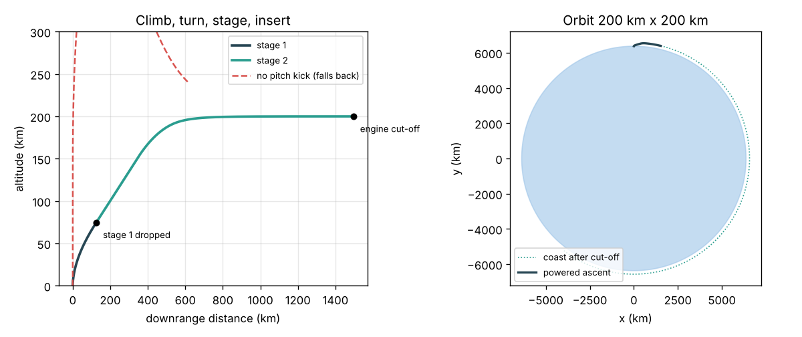
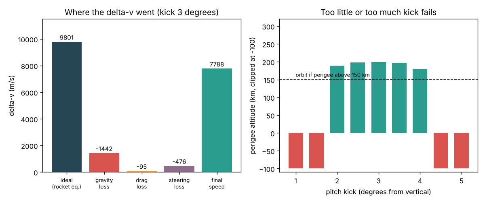
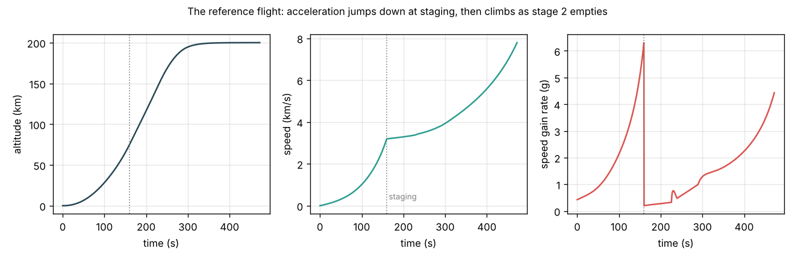

# Session 3: Fly to orbit with a gravity turn and staging

*Level 3 (simulation and validation) · about 90 minutes · openascent*

> This is a simplified educational model. It is not a validated design tool and must not be used for real structures, electrical installations, vehicles, industrial processes or medical decisions.

**Prerequisites**

- Session 1: the rocket equation, orbital speed and staging.
- Session 2: gravity and drag losses, and the RK4 time step.
- Vectors in two dimensions (x and y parts, unit vectors, the dot product); explained where used.

**Learning objectives.** After this session you can:

- Write the 2D equations of motion of a rocket around a round Earth with thrust, gravity and drag.
- Fly a launch with a vertical rise, a pitch kick, a gravity turn, staging and an upper-stage burn to orbit.
- Find the orbit (perigee and apogee) from position and velocity using energy and angular momentum.
- Validate the simulation: the delta-v budget closes, the rocket equation is recovered, energy is conserved in a coast.
- Find the pitch-kick window and the largest payload the launcher can put in orbit.

## A. Real-world problem
Session 2 showed that a rocket flown straight up falls back, however high it goes. To stay up it must end above the air moving sideways at about 7.8 km/s. So the rocket must turn over on the way up. Turn too early and it ploughs through thick air and falls into the sea; turn too late and gravity eats its propellant while it climbs. Can we fly our two-stage teaching launcher to a 200 km orbit, check the simulation against the laws it must obey, and find the largest payload it can carry? (A simplified teaching model, not a mission design tool.)

## B. Concept and theory
Put the Earth's centre at the origin and the launch site at the top of the circle. The rocket is a point with position r = (x, y), velocity v and mass m, and three forces act: thrust F along a pointing direction d chosen by the guidance, gravity -G M m r / |r|^3 that weakens with height, and drag D = 0.5 rho v^2 Cd A against the velocity. Mass falls at F / (Isp g0). The guidance has four phases. A short vertical rise clears the pad. A pitch kick tilts the thrust a few degrees east for 10 s. Then the gravity turn: the thrust points along the velocity, and gravity bends the path over by itself, so there is no sideways push in the thick air. After stage 1 burns out it is dropped, and stage 2 flies mostly sideways, pitching up just enough to hold the altitude near 200 km while it builds speed. Its engine cuts off when the orbital energy v^2 / 2 - G M / r equals that of a 200 km circular orbit. The orbit follows from two conserved quantities: energy fixes the semi-major axis a = -G M / (2 eps), and angular momentum h = |r x v| fixes the eccentricity, so perigee = a (1 - e) and apogee = a (1 + e). To validate, we integrate four rates alongside the motion: the ideal term F / m, the gravity loss g sin(gamma), the drag loss D / m and the steering loss (F / m)(1 - cos(alpha)), where gamma is the flight-path angle and alpha the angle between thrust and velocity. Their combination must equal the final speed, the ideal term must match the Session 1 rocket equation, and a coast after cut-off must keep its energy constant.

| Symbol | Meaning | Unit |
|---|---|---|
| r, v | position from Earth's centre and velocity vectors | m, m/s |
| d | unit vector of the thrust direction | no unit |
| kick | pitch-kick angle from vertical | degrees |
| gamma | flight-path angle above the local horizontal | degrees |
| alpha | angle between thrust and velocity | degrees |
| eps | specific orbital energy v^2 / 2 - mu / r | J/kg |
| a, e | semi-major axis and eccentricity of the orbit | m, no unit |
| q | dynamic pressure 0.5 rho v^2 | Pa |

**Assumptions**

- A point mass in a plane; a spherical, non-rotating Earth (no 0.46 km/s help from Earth's spin at the equator).
- Constant thrust and Isp per stage; no throttling; separation is instant.
- Exponential atmosphere, constant Cd A = 2.5 m2; no wind, no lift.
- The launcher masses are illustrative teaching numbers, not a real vehicle.

$$ m\,\ddot{\mathbf r} = F\,\mathbf d - \frac{\mu m}{|\mathbf r|^3}\,\mathbf r - \tfrac12\rho(h)\,|\mathbf v|\,\mathbf v\,C_d A,\qquad \dot m = -\frac{F}{I_{sp} g_0} $$

$$ \mathbf d = \frac{\mathbf v}{|\mathbf v|}\quad\text{(gravity turn)} $$

$$ \varepsilon = \frac{v^2}{2} - \frac{\mu}{r},\qquad a = -\frac{\mu}{2\varepsilon},\qquad e = \sqrt{1 + \frac{2\varepsilon h^2}{\mu^2}} $$

$$ h_p = a(1-e) - R_E,\qquad h_a = a(1+e) - R_E $$

$$ v_{\mathrm{final}} = \int \frac{F}{m}dt - \int g\sin\gamma\,dt - \int \frac{D}{m}dt - \int \frac{F}{m}(1-\cos\alpha)\,dt $$

## C. Visual explanation
The first figure shows the reference flight (kick 3 degrees, 1 t payload). On the left, the climb seen from the side: stage 1 (dark) rises and arcs over, is dropped at 75 km and 3.2 km/s after 160 s, and stage 2 (green) climbs on to 200 km and then runs flat until cut-off at 472 s, about 1500 km downrange. The dashed red line is the same rocket with no kick: it goes straight up. On the right, the whole Earth: the coast after cut-off goes round the planet at 200 km. The second figure is the delta-v budget: 9801 m/s ideal, minus 1442 m/s gravity loss, 95 m/s drag loss and 476 m/s steering loss, leaves 7788 m/s, exactly the circular speed. Beside it, the pitch-kick window: kicks of 2 to 4 degrees reach orbit; 1.5 degrees or less climbs too steeply and runs out of propellant before it is fast enough, and 4.5 degrees or more turns over in thick air, where drag and gravity bring it down. The third figure gives altitude, speed and the rate of speed gain: the acceleration climbs to 6.3 g as stage 1 empties, then drops to almost nothing at staging.

*Left: the climb, turn, staging and cut-off. Right: the coast after cut-off is a 200 km orbit.*

*Left: the delta-v budget closes. Right: only pitch kicks from 2 to 4 degrees reach orbit.*

*Altitude, speed and rate of speed gain against time for the reference flight.*

## D. Interactive simulation
Run the lesson (`python start.py 3`), then open the live app: [Session 3: fly to orbit with staging](https://krunalpanchal1995.github.io/pan-iit-oss/openascent/session-03/) (or `app.html` in this folder). Change the pitch kick, the payload, and the stage-2 propellant and Isp. The trajectory view colours stage 1 and stage 2; the Earth view shows where the rocket goes after cut-off; the budget view shows where the delta-v went. Try the presets "No pitch kick" and "Too much kick" and explain each failure.

**Challenge.** Put a 2000 kg payload into orbit with the standard stage 2 (15 t, Isp 340 s).

## E. Worked example and experiment
**Problem.** Fly the reference launch: kick 3 degrees, payload 1 t, target 200 km. Hand-check the staging time and the orbital speed, then check the simulation's delta-v budget.

1. Stage 1 burn time: mdot = 1.6 x 10^6 / (290 x 9.80665) = 562.6 kg/s, so t_b = 90 000 / 562.6 = 160.0 s. The simulation stages at t = 160.0 s, at 74.8 km and 3195 m/s.
2. Circular speed at 200 km (Session 1): sqrt(3.986 x 10^14 / 6.571 x 10^6) = 7788 m/s. The simulation cuts off at 7788 m/s, at 200.0 km, after 472 s.
3. The orbit: perigee 199.8 km, apogee 200.2 km, eccentricity below 0.0001. A 3000 s coast keeps its energy to 1 part in 10^14.
4. Budget: ideal 9801 - gravity 1442 - drag 95 - steering 476 = 7788 m/s, equal to the final speed to within 0.1 m/s.
5. Rocket equation for the propellant used (stage 1 all 90 t, stage 2 14.05 t, 949 kg left): 290 g0 ln(114.5 / 24.5) + 340 g0 ln(17.5 / 3.449) = 4385 + 5415 = 9801 m/s, the same as the ideal term.

**Answer.** Orbit 199.8 x 200.2 km at 7788 m/s; losses 2013 m/s in total (gravity 72 percent of them); 949 kg of stage-2 propellant left as margin.

**Experiment.** Throw a ball at different angles on a field and see that the steepest throw goes highest but the 45 degree throw goes furthest. A rocket faces a similar but harder choice: it must gain height to leave the air but must end up almost horizontal. Measure, or find in a published launch timeline, the time of maximum dynamic pressure ("max Q") and of stage separation, and compare with this model (max Q of 34 kPa at 70 s, staging at 160 s). The model differs from reality because real launchers throttle through max Q, use Earth's rotation, have thrust that grows with altitude and fly an optimised pitch program.

## Real-world application and mini-project: How much payload can the teaching launcher put in orbit?
A small-satellite customer asks how heavy a satellite the teaching launcher can carry to a 200 km orbit. Use `launch` and `max_payload` from Session 3 with the standard stages, a pitch kick chosen from 2, 2.5 and 3 degrees, and payloads in steps of 250 kg. Count a flight as successful only if its perigee is above 150 km. Then the customer asks what a hydrogen upper stage (Isp 450 s, same masses) would change. These are illustrative numbers, not a real vehicle's performance.

**Deliverable:** A script that prints, for each payload from 1000 kg upward, which kicks reach orbit and the propellant left, reports the largest payload, does the same for the Isp 450 s upper stage, and saves a figure of perigee altitude against payload.

**Success looks like:** The standard launcher puts 2000 kg into orbit (only with the 2.5 degree kick, with no propellant to spare; perigee 162 km), and 2250 kg fails with every kick. With the Isp 450 s upper stage the largest payload rises to 3750 kg. The report explains that the payload is limited by delta-v, and that the best kick changes with payload because a heavier rocket accelerates more slowly.

## F. Assessment and design challenge
**Question type A: Conceptual.** Why does a gravity turn (thrust along the velocity) waste less propellant than pointing the rocket at a fixed angle from the start?

Hint

Look at the steering-loss term (F / m)(1 - cos alpha), and think about the sideways force on the rocket in thick air.

Step-by-step solution

In a gravity turn the thrust is along the velocity, so alpha = 0 and the steering loss is zero: every newton of thrust adds speed. Gravity does the turning for free by bending the path. A fixed-angle climb pushes partly across the velocity, which changes direction instead of speed, and in thick air the angle between body and airflow causes large sideways loads that can break the rocket. In the reference flight the steering loss (476 m/s) comes almost entirely from the stage-2 altitude hold and the short pitch kick, not from stage 1.

**Question type B: Numerical.** A satellite is in a circular orbit at 400 km instead of 200 km. Find its speed. Then, ignoring losses, how much less sideways speed does it need than at 200 km, and why does it still need more energy to get there?

Hint

v = sqrt(mu / r); compare the energy eps = -mu / (2 r) for the two orbits.

Step-by-step solution

r = 6771 km, so v = sqrt(3.986 x 10^14 / 6.771 x 10^6) = sqrt(5.887 x 10^7) = 7673 m/s, which is 115 m/s less than 7788 m/s. But the energy per kg is eps = -mu / (2 r): -30.33 MJ/kg at 200 km and -29.43 MJ/kg at 400 km, so the higher orbit needs 0.90 MJ/kg more. The rocket must climb higher (potential energy) even though it ends slower. Higher orbits always need more delta-v from the ground.

**Question type C: Graph and simulation interpretation.** In the pitch-kick window, both 1.5 degrees and 4.5 degrees fail. Using the trajectory and budget views of the app, explain the two different ways they fail.

Hint

Compare the gravity and drag losses of the presets "No pitch kick" and "Too much kick" with the reference flight.

Step-by-step solution

With too little kick, stage 1 climbs nearly vertically, so it wastes speed against gravity (gravity loss rises) and stage 2 starts high and steep but slow sideways; it runs out of propellant before reaching 7.8 km/s. With too much kick the rocket turns over while still low, flies fast through thick air (drag loss of thousands of m/s and a dynamic pressure above 300 kPa, which a real rocket would not survive) and falls back before it can climb. The window between them, 2 to 4 degrees in this model, is narrow, which is why real pitch programs are planned carefully.

**Question type D: Design and optimisation challenge.** Design: the customer's satellite is 2000 kg. Using the model, choose the pitch kick, and say how much propellant margin is left. Then propose one change to stage 2 (more propellant, or higher Isp) that gives at least 500 kg of propellant margin, and check it in the app or with `launch`.

Hint

Run `launch(payload=2000, kick=k)` for k = 2, 2.5 and 3 and read `prop_left`; then pass a modified `stages` list.

Step-by-step solution

Only the 2.5 degree kick reaches orbit with 2000 kg, with a perigee of 162 km and 0 kg of propellant left: no margin at all, which no real mission would accept. With an Isp 450 s upper stage the same flight reaches orbit with about 1650 kg left. Trade-offs: more stage-2 propellant makes stage 1 heavier and lowers its TWR, and a hydrogen stage has bulky tanks (more dry mass) than this model assumes. A margin is needed because the real atmosphere, thrust and steering will differ from the model.

Score yourself with [RUBRIC.md](../../RUBRIC.md). Print the [activity sheet](activity_sheet.md) to work on paper.

## Common misconceptions
| Common misconception | What is actually true |
|---|---|
| The simulation is right because the orbit looks round. | It must be validated: the delta-v budget closes, the ideal term equals the rocket equation, and a coast conserves energy. |
| A rocket turns by pointing its nose sideways early. | It turns mostly by gravity bending its path (the gravity turn); a big sideways push in thick air would break it. |
| Orbit is reached by climbing to 200 km first and then speeding up. | Climbing and speeding up happen together; most of the climb happens with stage 1, most of the sideways speed with stage 2. |
| Bigger kick angles always get to orbit faster. | Too much kick sends the rocket through thick air at high speed; it fails just as surely as too little kick. |

## Glossary
- **gravity turn**: a climb where the thrust follows the velocity and gravity bends the path over
- **pitch kick**: a small, short tilt soon after lift-off that starts the gravity turn
- **perigee, apogee**: lowest and highest points of an orbit (given here as altitudes)
- **steering loss**: thrust spent turning the velocity instead of speeding it up
- **max Q**: the moment of highest dynamic pressure 0.5 rho v^2, the hardest load on the structure

## Finish
1. Do the three coding tasks in [exercises.md](exercises.md).
2. Run `python start.py 3` again after your changes. It ends with the checkpoint; when it prints `PASS`, you are done. (Checkpoint only: `python start.py check 3`.)

Next: the [roadmap](../../promo/roadmap.md). Session 4 is yours to build.
