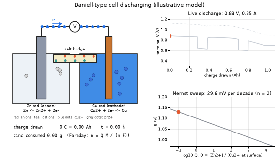
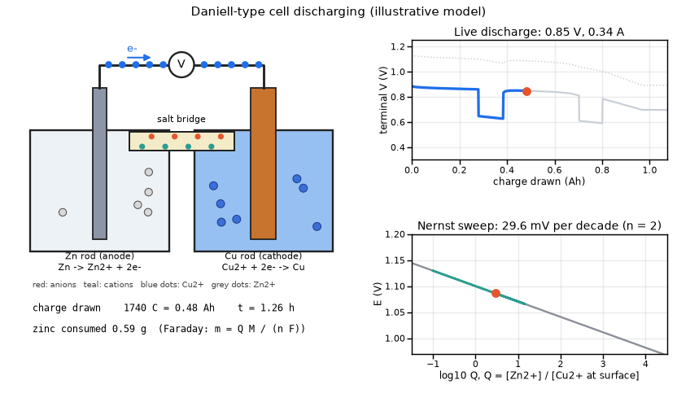
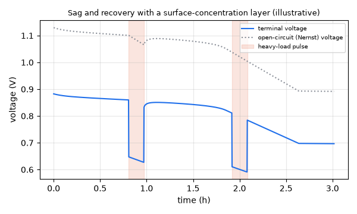
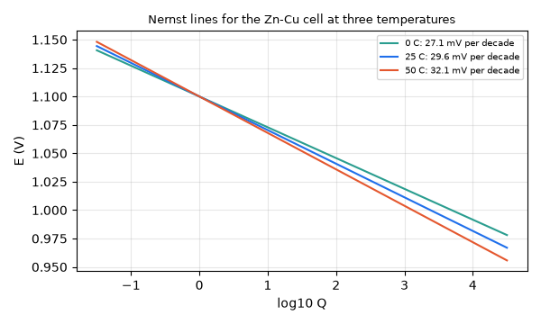
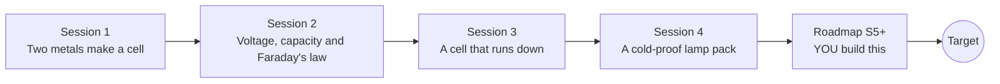

# openbatterycell

[](https://github.com/KrunalPanchal1995/pan-iit-oss/actions/workflows/tests.yml)   [](https://colab.research.google.com/github/KrunalPanchal1995/pan-iit-oss/blob/main/openbatterycell/sessions/session-01/lesson.ipynb) [](https://krunalpanchal1995.github.io/pan-iit-oss/openbatterycell/)

**Build and size an electrochemical cell for a target voltage, in four sessions.**

openbatterycell teaches the cell itself: how two metals make a voltage, how cells are wired and sized with Faraday's law, and how a real cell runs down, using only Python and a browser.

- **Start from zero.** Session 1 needs only subtraction and a picture of electrons and ions; every symbol is explained.
- **See it move.** Every session ships a slider app that runs in the browser, with labelled graphs.
- **Know you got it right.** Each session ends with a checkpoint that prints PASS or FAIL against hand calculations, Faraday's law and Nernst limits.
- **Build the missing half.** The repo stops at Session 4 on purpose; the roadmap shows the path to the Target.

[Target](#the-target) · [Who is this for](#who-is-this-for) · [Quick start](#quick-start) · [Sessions](#sessions) · [Roadmap](#roadmap) · [Contribute](#contribute) · [Explainer PDF](docs/explainer.pdf)

> **This repo is incomplete on purpose.** Sessions 1 to 4 are here and fully working. The finished Target below is a preview of what the community can build next. We show you the path, not the code. Sessions 5 and up are yours.

## The Target

A Daniell-type cell discharges while you watch: electrons stream through the wire, zinc dissolves, copper plates out and ions drift through the salt bridge. At the top right a live discharge curve is drawn, with two heavy-load pulses where the voltage sags and then recovers. At the bottom right the operating point slides along the Nernst line as the zinc and copper concentrations change. Your goal over the coming sessions: build this live cell yourself, including the pulse and recovery behaviour. All parameters are illustrative.



*Target: a discharging Zn-Cu cell with electrons and ions moving, a live discharge curve and a Nernst sweep (illustrative model)*



*A frame of the Target: charge drawn and zinc consumed from Faraday's law shown under the cell*



*Target model: terminal voltage sags during two heavy-load pulses and recovers (illustrative)*



*Nernst lines for the Zn-Cu cell at 0, 25 and 50 C: the slope grows with temperature*

Try it live:

- [Math Visual Studio: ordinary differential equations, the maths of a discharge (Atlas S16)](https://krunalpanchal1995.github.io/studio/#atlas?ch=S16&ex=1)
- [Math Visual Studio: functions and their transformations, the log curve in Nernst (Atlas S03)](https://krunalpanchal1995.github.io/studio/#atlas?ch=S03&ex=1)

How the Target was made is shown only as a path in [promo/roadmap.md](promo/roadmap.md).

## Who is this for
**secondary school to diploma / undergraduate (levels 3-5).** Topic area: Chemistry and Materials Science.

Prerequisites:

- Basic arithmetic and the idea of a logarithm (Session 3 explains how to use it).
- Python 3.10 or newer; if `python --version` works, you are ready. PRIMER.md explains the rest.
- No prior chemistry, GitHub or electronics experience is needed.

New to Python? Read [PRIMER.md](PRIMER.md) first (10 minutes).

## Quick start

No installation knowledge needed. You need [Git](https://git-scm.com/downloads) and [Python 3.10+](https://www.python.org/downloads/) (Windows: tick "Add Python to PATH"). On Mac and Linux type `python3` wherever this page says `python`.

```bash
git clone https://github.com/KrunalPanchal1995/pan-iit-oss.git
cd pan-iit-oss/openbatterycell
python start.py 1
```

`start.py` creates a private environment, installs what is needed and runs Session 1 with its checkpoint. Next: `python start.py 2`, `python start.py 3`, or `python start.py test` to check everything. Only a checkpoint: `python start.py check 1`.

<!-- friendly-help -->
<details>
<summary><b>Not working? Common fixes (no Git, "python not found", no internet)</b></summary>

- **No Git?** You do not need it. On the main page of this collection click the green **Code** button, then **Download ZIP**, unzip it, open a terminal inside the folder `pan-iit-oss-main/openbatterycell` and run `python start.py 1`. The ZIP holds every project, so it is large; the live apps need no download at all.
- **"python is not recognized" or "command not found".** On Windows try `py start.py 1`. On Mac and Linux try `python3 start.py 1`. If neither works, install Python from [python.org](https://www.python.org/downloads/) and tick "Add Python to PATH".
- **Needs internet once.** The first run downloads NumPy and Matplotlib into a private folder (`.venv`); after that it works offline.
- **Rather not install anything?** Open the [live apps](https://krunalpanchal1995.github.io/pan-iit-oss/openbatterycell/) in your browser, or use the Colab badge at the top of this page.
- **Still stuck?** [Open an issue](https://github.com/KrunalPanchal1995/pan-iit-oss/issues/new?title=%5Bopenbatterycell%5D%20) with your operating system and the message you see. Questions from beginners are welcome.

</details>

Five lines turn the ideas of Sessions 1 and 3 into numbers (they work as they are): Save it as `try.py` and run it with `python start.py run try.py` (this uses the private environment, where NumPy is installed):

```python
import numpy as np
F, R, T = 96485.0, 8.314, 298.15                # Faraday constant, gas constant, 25 C
print(round(0.34 - (-0.76), 2), 'V')              # Daniell cell: E(cathode) - E(anode)
print(round(1.10 - R * T / (2 * F) * np.log(0.1), 4), 'V')   # Nernst: [Zn2+]/[Cu2+] = 0.1
print(round(3600 * 65.38 / (2 * F), 4), 'g of zinc per ampere-hour')  # Faraday's law
```

Every session also opens in your browser with sliders (no install): [live apps](https://krunalpanchal1995.github.io/pan-iit-oss/openbatterycell/). Or use the Colab badge above for the notebook.

## Sessions

| # | Session | Model level | Time | Live app |
|---|---|---|---|---|
| 1 | [Two metals make a cell](sessions/session-01/README.md) | Level 1: conceptual interactive model | 60 min | [open](https://krunalpanchal1995.github.io/pan-iit-oss/openbatterycell/session-01/) |
| 2 | [Voltage, capacity and Faraday's law](sessions/session-02/README.md) | Level 2: mathematical engineering model | 75 min | [open](https://krunalpanchal1995.github.io/pan-iit-oss/openbatterycell/session-02/) |
| 3 | [A cell that runs down](sessions/session-03/README.md) | Level 3: simulation and validation | 90 min | [open](https://krunalpanchal1995.github.io/pan-iit-oss/openbatterycell/session-03/) |
| 4 | [A cold-proof lamp pack](sessions/session-04/README.md) | Level 3: simulation and validation | 90 min | [open](https://krunalpanchal1995.github.io/pan-iit-oss/openbatterycell/session-04/) |

Each session follows the same six steps: A real-world problem, B concept and theory, C visual explanation, D interactive simulation, E worked example and experiment, F assessment and design challenge. Each ends with `checkpoint.py`, which prints `PASS` or `FAIL` against reference numbers. Session 3 also contains the real-world mini-project: **Design a battery pack for a small light with a runtime requirement**, and Session 4 the mini-project **Design a lamp pack that works in the cold**.

## Architecture



| Folder or file | What is inside |
|---|---|
| `sessions/` | four sessions: README (A-F), `lesson.py`, notebook, live app, exercises, activity sheet, checkpoint |
| `promo/` | the Target: media, live links, and the roadmap (path only) |
| `docs/` | `explainer.tex` and the built `explainer.pdf` |
| `tests/` | runs every lesson and checkpoint headless |
| `start.py` | one command to set up and run anything |
| `QUALITY.md`, `RUBRIC.md` | the quality checklist and the scoring rubric |
| `.github/` | CI, PDF build, Pages deploy, issue and PR templates |

## Roadmap

| Milestone | What you will build | Difficulty |
|---|---|---|
| Session 5: Pulse loads and recovery | A surface-concentration state with a relaxation time that feeds the Nernst term, driven by a load that has pulses. | advanced |
| Session 6: Rechargeable cell and cycle life | A charge-discharge cycle simulation with a small loss of capacity per cycle. | intermediate |
| Session 7: Heat feeds back on resistance | A discharge simulation where the temperature changes in time instead of being fixed. | advanced |
| Session 8: Fit a real cell | A fitting script that reads a measured voltage-time table taken with a resistor load and adjusts r and the capacity. | advanced |

Full detail with a checkpoint per milestone: [promo/roadmap.md](promo/roadmap.md).

## Contribute
New to GitHub? Read [CONTRIBUTING.md](CONTRIBUTING.md); it starts from zero. Pick an issue labelled `good first issue`. Translations into Hindi, Telugu, Tamil and Malayalam are welcome.

<details>
<summary>Development</summary>

```bash
python start.py test        # runs every lesson and checkpoint
```
Lessons use `# %%` cell markers so they open as notebooks in VS Code. See [QUALITY.md](QUALITY.md) for the standard every session meets.
</details>

## License
MIT. See [LICENSE](LICENSE). Media in `promo/media` is (c) Krunal Panchal, CC BY 4.0.

## Acknowledgments
Part of the [PAN IIT OSS](https://hellofoss.tech-iitb.org/projects) open-source teaching collection, modelled on the structure of [openspline](https://github.com/openspline/openspline). Built on ideas from the Math Visual Studio at https://krunalpanchal1995.github.io/studio/.
