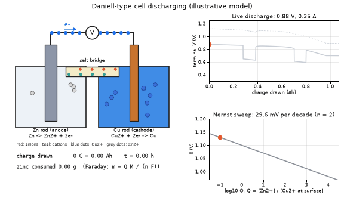
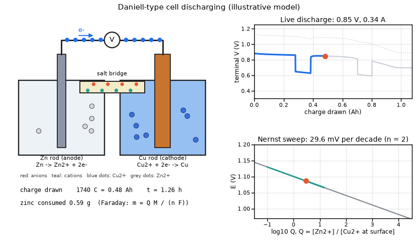
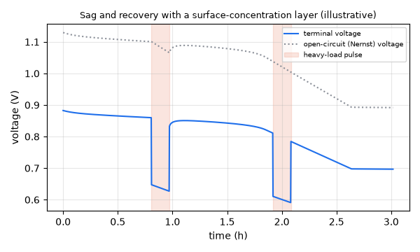
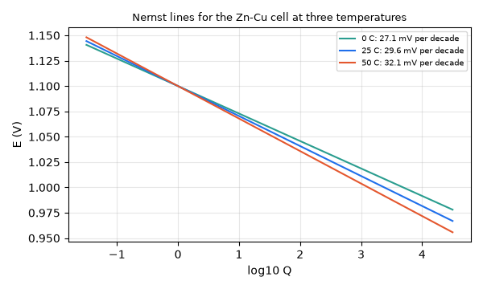

# What you are building toward

A Daniell-type cell discharges while you watch: electrons stream through the wire, zinc dissolves, copper plates out and ions drift through the salt bridge. At the top right a live discharge curve is drawn, with two heavy-load pulses where the voltage sags and then recovers. At the bottom right the operating point slides along the Nernst line as the zinc and copper concentrations change. Your goal over the coming sessions: build this live cell yourself, including the pulse and recovery behaviour. All parameters are illustrative.

*Target: a discharging Zn-Cu cell with electrons and ions moving, a live discharge curve and a Nernst sweep (illustrative model)*

*A frame of the Target: charge drawn and zinc consumed from Faraday's law shown under the cell*

*Target model: terminal voltage sags during two heavy-load pulses and recovers (illustrative)*

*Nernst lines for the Zn-Cu cell at 0, 25 and 50 C: the slope grows with temperature*

These results come from a private reference build. The code is not published; the roadmap shows the path so you can build your own.

Live links:

- [Math Visual Studio: ordinary differential equations, the maths of a discharge (Atlas S16)](https://krunalpanchal1995.github.io/studio/#atlas?ch=S16&ex=1)
- [Math Visual Studio: functions and their transformations, the log curve in Nernst (Atlas S03)](https://krunalpanchal1995.github.io/studio/#atlas?ch=S03&ex=1)
