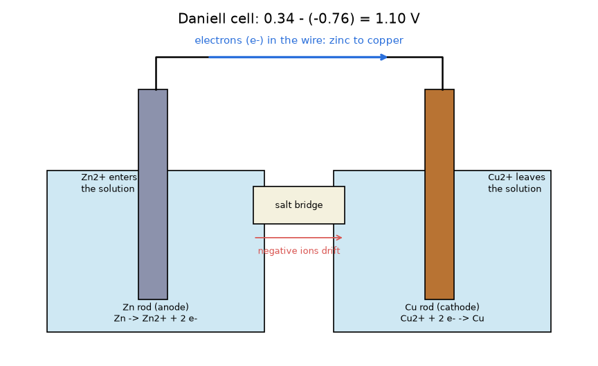
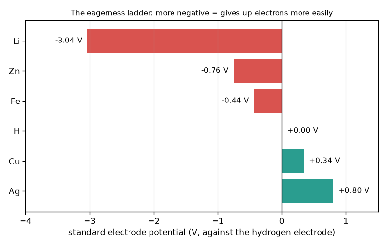

# सत्र 1: दो धातुएँ मिलकर एक सेल बनाती हैं

*स्तर 1 (वैचारिक इंटरैक्टिव मॉडल) · लगभग 60 मिनट · openbatterycell*

> यह एक सरलीकृत शैक्षिक मॉडल है। यह कोई प्रमाणित डिज़ाइन उपकरण नहीं है और इसका उपयोग वास्तविक संरचनाओं, बिजली की स्थापनाओं, वाहनों, औद्योगिक प्रक्रियाओं या चिकित्सा निर्णयों के लिए नहीं किया जाना चाहिए।

**पूर्वापेक्षाएँ (Prerequisites)**

- घटाना, और ऋणात्मक संख्याओं वाली संख्या रेखा।
- आपने PRIMER.md पढ़ लिया है और `python start.py 1` एक बार चला लिया है।

**सीखने के उद्देश्य।** इस सत्र के बाद आप:

- एक चित्र की मदद से समझा सकेंगे कि तार और लवण सेतु (salt bridge) से जुड़ी दो अलग-अलग धातुएँ वोल्टेज क्यों देती हैं।
- दो मानक इलेक्ट्रोड विभवों (standard electrode potentials) से सेल वोल्टेज की गणना कर सकेंगे, E = E(cathode) - E(anode)।
- बता सकेंगे कि कौन-सी धातु ऐनोड (anode) है और इलेक्ट्रॉन तथा आयन (ions) किस दिशा में चलते हैं।
- किसी लक्ष्य वोल्टेज के लिए श्रेणी (series) में कितने सेल चाहिए, यह ज्ञात कर सकेंगे।

## A. वास्तविक दुनिया की समस्या
एक नींबू में जस्ते (zinc) की कील और ताँबे (copper) का सिक्का घुसाइए और उन्हें एक छोटे मीटर से जोड़िए: मीटर वोल्टेज दिखाता है, जबकि कुछ भी प्लग में नहीं लगाया गया। टॉर्च की बैटरी भी यही विचार है, बस एक साफ़-सुथरे डिब्बे में। यह वोल्टेज कहाँ से आता है, इलेक्ट्रॉन किस ओर जाते हैं, और किसी उपकरण को जितना वोल्टेज चाहिए उतना पाने के लिए कई सेलों को कैसे जोड़ें? (असली लिथियम और लेड-एसिड बैटरियाँ ख़तरनाक हो सकती हैं; यह repo एक शैक्षिक मॉडल है, उन्हें बनाने की विधि नहीं।)

## B. अवधारणा और सिद्धांत
कुछ धातुएँ दूसरों की तुलना में अधिक आसानी से इलेक्ट्रॉन छोड़ देती हैं। रसायनज्ञ उन्हें मानक इलेक्ट्रोड विभव E0 (वोल्ट में) से क्रमबद्ध करते हैं, जिसे मानक हाइड्रोजन इलेक्ट्रोड (standard hydrogen electrode) के सापेक्ष मापा जाता है, और उसे 0 V परिभाषित किया गया है। संख्या जितनी अधिक ऋणात्मक, धातु उतनी ही उत्सुकता से इलेक्ट्रॉन छोड़ती है। जब दो धातुओं को तार और लवण सेतु से जोड़ा जाता है, तो सीढ़ी पर नीचे वाली धातु ऐनोड होती है और इलेक्ट्रॉनों को तार में धकेलती है; सीढ़ी पर ऊपर वाली धातु कैथोड (cathode) होती है और उन्हें ग्रहण करती है। सेल वोल्टेज ऊँचाई का अंतर है, E = E(cathode) - E(anode)। विलयन (solution) में ऐनोड की धातु धनात्मक आयनों के रूप में घुलती है और कैथोड पर धनात्मक आयन इलेक्ट्रॉन लेकर धातु बन जाते हैं; लवण सेतु आवेशित आयनों को बहने देता है ताकि किसी भी बीकर में आवेश जमा न हो। श्रेणी में जुड़े सेलों के वोल्टेज जुड़ जाते हैं।

| प्रतीक | अर्थ | इकाई |
|---|---|---|
| E0 | किसी धातु का मानक इलेक्ट्रोड विभव (अपचयन, 25 C, 1 mol/L) | V |
| E_cell | सेल वोल्टेज = E0(cathode) - E0(anode) | V |
| n | श्रेणी में जुड़े समान सेलों की संख्या | कोई इकाई नहीं |
| V_total | स्टैक का वोल्टेज, n गुणा E_cell | V |

**मान्यताएँ (Assumptions)**

- आदर्श पाठ्यपुस्तक परिस्थितियाँ: 25 C और 1 mol/L विलयन।
- कोई धारा (current) नहीं ली जाती (वास्तविक सेल धारा देते समय कम वोल्टेज देता है; सत्र 3)।
- मान पाठ्यपुस्तक की पूर्णांकित संख्याएँ हैं: Li -3.04, Zn -0.76, Fe -0.44, हाइड्रोजन 0.00, Cu +0.34, Ag +0.80 V।

$$ E_{cell}=E^{0}_{cathode}-E^{0}_{anode} $$

$$ \text{Zn/Cu (Daniell): } E_{cell}=0.34-(-0.76)=1.10\ \mathrm{V} $$

$$ V_{total}=n\,E_{cell},\qquad n=\left\lceil \frac{V_{target}}{E_{cell}}\right\rceil $$

## C. दृश्य व्याख्या
पहला चित्र "उत्सुकता की सीढ़ी" है: लिथियम (-3.04 V) से लेकर चाँदी (+0.80 V) तक मानक इलेक्ट्रोड विभवों की पट्टियाँ। कोई भी दो पट्टियाँ एक सेल हैं, और उसका वोल्टेज उन दोनों के बीच की क्षैतिज दूरी है। दूसरा चित्र डेनियल सेल (Daniell cell) दिखाता है: दो बीकरों में एक जस्ते की छड़ और एक ताँबे की छड़, तार के साथ जस्ते से ताँबे की ओर चलते इलेक्ट्रॉन, बाएँ विलयन में प्रवेश करते जस्ता आयन, दाएँ विलयन से निकलते ताँबा आयन, और बीच में लवण सेतु।

*एक डेनियल सेल: तार में जस्ते से ताँबे की ओर इलेक्ट्रॉन, विलयन और लवण सेतु में आयन, 1.10 V।*

*उत्सुकता की सीढ़ी: लिथियम (-3.04 V) से चाँदी (+0.80 V) तक मानक इलेक्ट्रोड विभव।*

## D. इंटरैक्टिव सिमुलेशन
पाठ चलाइए (`python start.py 1`), फिर लाइव ऐप खोलिए: [सत्र 1: दो धातुएँ चुनिए](https://krunalpanchal1995.github.io/pan-iit-oss/openbatterycell/session-01/) (या इसी फ़ोल्डर में `app.html`)। दोनों विभव स्लाइडरों से हर ओर की धातु चुनिए और वोल्टेज, इलेक्ट्रॉन बिंदुओं की दिशा तथा स्टैक ग्राफ़ को देखिए। फिर श्रेणी में सेलों की संख्या बदलिए।

**चुनौती।** श्रेणी में अधिकतम 3 सेल लगाकर कम से कम 3 V प्राप्त कीजिए।

## E. हल किया गया उदाहरण और प्रयोग
**समस्या।** एक खिलौने को कम से कम 4.5 V चाहिए। श्रेणी में कितने जस्ता-ताँबा सेल चाहिए, और वे कितना वोल्टेज देंगे?

1. एक जस्ता-ताँबा सेल: E = 0.34 - (-0.76) = 1.10 V।
2. आवश्यक सेल: 4.5 / 1.10 = 4.09, और हम सेल का 0.09 भाग नहीं बना सकते, इसलिए ऊपर की ओर 5 तक पूर्णांकित करें।
3. कुल: 5 x 1.10 = 5.50 V, जो कम से कम 4.5 V है।
4. जाँच: 4 सेल केवल 4.40 V देंगे, जो बहुत कम है।

**उत्तर।** श्रेणी में 5 सेल, 5.50 V।

**प्रयोग।** एक जस्ता-लेपित (galvanised) कील और एक ताँबे का सिक्का या तार नींबू में घुसाइए, वोल्ट पर सेट किया गया मल्टीमीटर जोड़िए और पाठ्यांक नोट कीजिए; फिर तीन नींबुओं को श्रेणी में जोड़कर दोबारा नोट कीजिए। प्रति नींबू आदर्श 1.10 V से स्पष्ट रूप से कम वोल्टेज और बहुत कम धारा की अपेक्षा कीजिए, इसलिए बल्ब नहीं जलेगा। मॉडल मानक 1 mol/L विलयन और शून्य धारा मानता है; नींबू में कमज़ोर, अम्लीय रस, अधिक प्रतिरोध (resistance) और अज्ञात सांद्रताएँ होती हैं। इसके लिए मेन्स से चलने वाली या बड़ी बैटरियों का उपयोग न करें।

## F. मूल्यांकन और डिज़ाइन चुनौती
**प्रश्न प्रकार A: वैचारिक।** जस्ता-ताँबा सेल में इलेक्ट्रॉन जस्ते से ताँबे की ओर क्यों जाते हैं, और यदि आप लवण सेतु हटा दें तो धारा को क्या रोकता है?

संकेत

उत्सुकता की सीढ़ी पर कौन-सी धातु नीचे है? सेतु के बिना हर बीकर के आवेश का क्या होगा?

चरण-दर-चरण हल

जस्ता (-0.76 V) सीढ़ी पर ताँबे (+0.34 V) से नीचे है, इसलिए यह अधिक आसानी से इलेक्ट्रॉन छोड़ता है: यह ऐनोड है और इलेक्ट्रॉनों को तार में धकेलता है, और ताँबा, जो कैथोड है, उन्हें खींच लेता है। लवण सेतु के बिना जस्ते वाले बीकर में धनात्मक Zn2+ आयन बढ़ते जाएँगे और ताँबे वाले बीकर से धनात्मक Cu2+ आयन घटते जाएँगे, इसलिए हर बीकर में आवेश जमा होगा और पल भर में इलेक्ट्रॉनों के प्रवाह का विरोध करेगा। सेतु आयनों को बहने देता है ताकि दोनों बीकर उदासीन रहें, इसलिए परिपथ (circuit) तभी पूरा होता है जब तार और सेतु दोनों हों।

**प्रश्न प्रकार B: संख्यात्मक।** एक लोहा-चाँदी सेल बनाया गया है (लोहा ऐनोड, चाँदी कैथोड)। सेल वोल्टेज और 5 V के लिए श्रेणी में आवश्यक सेलों की संख्या ज्ञात कीजिए।

संकेत

E = 0.80 - (-0.44)। 5 को एक सेल के वोल्टेज से भाग दीजिए और ऊपर की ओर पूर्णांकित कीजिए।

चरण-दर-चरण हल

E = 0.80 - (-0.44) = 1.24 V। सेल: 5 / 1.24 = 4.03, ऊपर की ओर 5 तक पूर्णांकित करें। कुल = 5 x 1.24 = 6.20 V। समझदारी जाँच: 4 सेल केवल 4.96 V देते हैं, जो 5 V से ज़रा कम है, इसलिए 5 सेल चाहिए। इकाई: वोल्ट।

**प्रश्न प्रकार C: ग्राफ़ और सिमुलेशन की व्याख्या।** स्टैक ग्राफ़ में जस्ता-ताँबा सेल की रेखा और लोहा-ताँबा सेल (0.34 - (-0.44) = 0.78 V) की रेखा दोनों शून्य से शुरू होती हैं। कौन-सी रेखा अधिक खड़ी है और ढाल (slope) का क्या अर्थ है? कौन-सा स्टैक कम सेलों में 3 V तक पहुँचता है?

संकेत

ढाल प्रति सेल वोल्ट है। 3 को हर सेल वोल्टेज से भाग दीजिए और ऊपर की ओर पूर्णांकित कीजिए।

चरण-दर-चरण हल

जस्ता-ताँबा रेखा अधिक खड़ी है: इसकी ढाल 1.10 V प्रति सेल है, जबकि दूसरी की 0.78 V प्रति सेल। जस्ता-ताँबा को ceil(3 / 1.10) = 3 सेल (3.30 V) चाहिए; लोहा-ताँबा को ceil(3 / 0.78) = 4 सेल (3.12 V) चाहिए। सीढ़ी पर अधिक अंतर का अर्थ है कम सेल।

**प्रश्न प्रकार D: डिज़ाइन और अनुकूलन (optimisation) चुनौती।** डिज़ाइन: एक छोटे रेडियो को जस्ता, लोहा, ताँबा और चाँदी धातुओं से बने जल-आधारित सेलों से कम से कम 6 V चाहिए। वह जोड़ी चुनिए जिसे सबसे कम सेल चाहिए, और वह जोड़ी जो आप चुनेंगे यदि चाँदी बहुत महँगी हो। यहाँ लिथियम विकल्प क्यों नहीं है?

संकेत

अनुमत धातुओं में सबसे बड़ा अंतर खोजिए (जस्ता ऐनोड, चाँदी कैथोड), फिर चाँदी के बिना सबसे बड़ा अंतर।

चरण-दर-चरण हल

चाँदी के साथ: Zn/Ag = 0.80 - (-0.76) = 1.56 V, इसलिए ceil(6 / 1.56) = 4 सेल 6.24 V देते हैं। चाँदी के बिना सबसे बड़ा अंतर Zn/Cu = 1.10 V है, इसलिए ceil(6 / 1.10) = 6 सेल 6.60 V देते हैं। समझौता (trade-off): दो सेल अधिक, पर धातु बहुत सस्ती। लिथियम पानी के साथ तीव्र अभिक्रिया करता है, इसलिए उसे पानी-रहित विशेष विद्युत-अपघट्य (electrolyte) और सीलबंद, सुरक्षित डिज़ाइन चाहिए; यह घर पर बनाने की चीज़ नहीं है, और सरल बीकर मॉडल यहाँ लागू नहीं होता।

[RUBRIC.md](../../RUBRIC.md) से स्वयं को अंक दीजिए। काग़ज़ पर काम करने के लिए [गतिविधि पत्रक](activity_sheet.md) प्रिंट कीजिए।

## सामान्य भ्रांतियाँ
| सामान्य भ्रांति | वास्तव में क्या सच है |
|---|---|
| नींबू (अम्ल) विद्युत ऊर्जा का स्रोत है। | ऊर्जा दोनों धातुओं के रासायनिक अंतर से आती है; रस केवल आयनों को ले जाता है। जस्ता धीरे-धीरे ख़र्च होता है। |
| इलेक्ट्रॉन लवण सेतु से होकर बहते हैं। | इलेक्ट्रॉन तार में बहते हैं; आयन लवण सेतु और विलयनों में बहते हैं। दोनों रास्ते आवश्यक हैं। |
| किसी भी उपकरण में ऐनोड हमेशा ऋणात्मक दिखने वाला टर्मिनल होता है। | ऐनोड का अर्थ है वह इलेक्ट्रोड जहाँ धातु इलेक्ट्रॉन छोड़ती है। धारा दे रहे सेल में यह ऋणात्मक टर्मिनल होता है; बैटरी चार्ज होते समय नाम आपस में बदल जाते हैं। |
| सेलों को श्रेणी में जोड़ने से वे अधिक समय तक चलते हैं। | श्रेणी केवल वोल्टेज जोड़ती है; पूरी लड़ी की क्षमता (capacity) एक सेल जितनी ही रहती है (सत्र 2)। |

## शब्दावली
- **इलेक्ट्रोड (electrode)**: विलयन में डूबी धातु की छड़ जहाँ इलेक्ट्रॉनों का आदान-प्रदान होता है
- **ऐनोड (anode)**: वह इलेक्ट्रोड जो इलेक्ट्रॉन छोड़ता है (विभव सीढ़ी पर नीचे)
- **कैथोड (cathode)**: वह इलेक्ट्रोड जो इलेक्ट्रॉन ग्रहण करता है (सीढ़ी पर ऊपर)
- **मानक इलेक्ट्रोड विभव (standard electrode potential)**: हाइड्रोजन इलेक्ट्रोड के सापेक्ष वोल्ट में एक माप, कि कोई धातु अपने इलेक्ट्रॉनों को कितनी तत्परता से अपने पास रखती है
- **लवण सेतु (salt bridge)**: दो बीकरों के बीच आयनों का एक रास्ता जो हर बीकर को विद्युत रूप से उदासीन रखता है
- **श्रेणी संयोजन (series connection)**: सेलों को सिरे से सिरा जोड़ना ताकि वोल्टेज जुड़ जाएँ

## समापन
1. [exercises.md](exercises.md) में दिए तीन कोडिंग कार्य कीजिए।
2. अपने बदलावों के बाद `python start.py 1` फिर से चलाइए। यह चेकपॉइंट (checkpoint) पर समाप्त होता है; जब यह `PASS` छापे, तो आपका काम पूरा है। (केवल चेकपॉइंट: `python start.py check 1`।)

अगला: [सत्र 2](../session-02/README.md)
