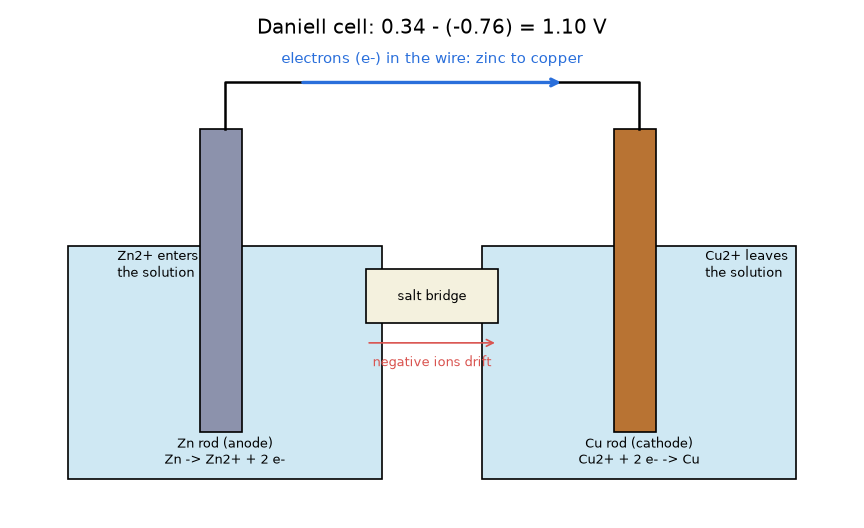
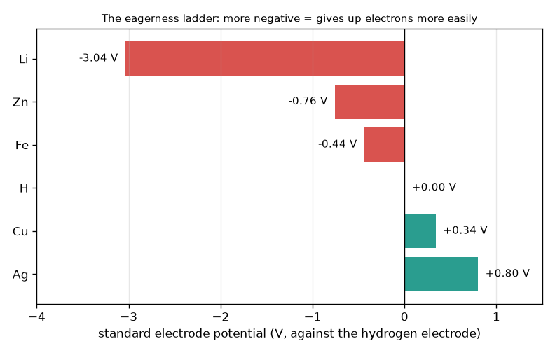

# Session 1: Two metals make a cell

[Session 1 — हिन्दी](README.hi.md) · [Session 1 — മലയാളം](README.ml.md) · [Session 1 — தமிழ்](README.ta.md) · [Session 1 — తెలుగు](README.te.md)

*Level 1 (conceptual interactive model) · about 60 minutes · openbatterycell*

> This is a simplified educational model. It is not a validated design tool and must not be used for real structures, electrical installations, vehicles, industrial processes or medical decisions.

**Prerequisites**

- Subtraction and a number line with negative numbers.
- You have read PRIMER.md and run `python start.py 1` once.

**Learning objectives.** After this session you can:

- Explain, with a picture, why two different metals joined by a wire and a salt bridge give a voltage.
- Compute a cell voltage from two standard electrode potentials, E = E(cathode) - E(anode).
- Say which metal is the anode and which direction the electrons and the ions move.
- Find how many cells in series are needed for a target voltage.

## A. Real-world problem
Push a zinc nail and a copper coin into a lemon and connect them to a small meter: it shows a voltage, although nothing was plugged in. A torch battery is the same idea in a tidier box. Where does the voltage come from, which way do the electrons go, and how do you stack several cells to reach the voltage a device needs? (Real lithium and lead-acid batteries can be dangerous; this repo is an educational model, not a how-to for building them.)

## B. Concept and theory
Some metals give up electrons more easily than others. Chemists rank them with the standard electrode potential E0 in volts, measured against the standard hydrogen electrode, which is defined as 0 V. The more negative the number, the more eagerly the metal gives up electrons. When two metals are joined by a wire and a salt bridge, the metal lower on the ladder is the anode and pushes electrons into the wire; the metal higher on the ladder is the cathode and receives them. The cell voltage is the height difference E = E(cathode) - E(anode). In the solutions, the anode metal dissolves as positive ions, while positive ions at the cathode take electrons from the wire and are deposited as metal; the salt bridge lets charged ions drift so neither beaker builds up charge. Cells connected in series add their voltages.

| Symbol | Meaning | Unit |
|---|---|---|
| E0 | standard electrode potential of a metal (reduction, 25 C, 1 mol/L) | V |
| E_cell | cell voltage = E0(cathode) - E0(anode) | V |
| n | number of identical cells in series | no unit |
| V_total | voltage of the stack, n times E_cell | V |

**Assumptions**

- Ideal textbook conditions: 25 C and 1 mol/L solutions.
- No current is drawn (a real cell gives a smaller voltage when it delivers current; Session 3).
- Values are rounded textbook numbers: Li -3.04, Zn -0.76, Fe -0.44, hydrogen 0.00, Cu +0.34, Ag +0.80 V.

$$ E_{cell}=E^{0}_{cathode}-E^{0}_{anode} $$

$$ \text{Zn/Cu (Daniell): } E_{cell}=0.34-(-0.76)=1.10\ \mathrm{V} $$

$$ V_{total}=n\,E_{cell},\qquad n=\left\lceil \frac{V_{target}}{E_{cell}}\right\rceil $$

## C. Visual explanation
The first figure is the eagerness ladder: bars of the standard electrode potentials from lithium (-3.04 V) up to silver (+0.80 V). A cell is any two bars, and its voltage is the horizontal distance between them. The second figure draws the Daniell cell: a zinc rod and a copper rod in two beakers, electrons moving along the wire from zinc to copper, zinc ions entering the left solution, copper ions leaving the right solution, and the salt bridge in between.

*A Daniell cell: electrons in the wire from zinc to copper, ions in the solution and salt bridge, 1.10 V.*

*The eagerness ladder: standard electrode potentials from lithium (-3.04 V) to silver (+0.80 V).*

## D. Interactive simulation
Run the lesson (`python start.py 1`), then open the live app: [Session 1: pick two metals](https://krunalpanchal1995.github.io/pan-iit-oss/openbatterycell/session-01/) (or `app.html` in this folder). Choose the metal on each side with the two potential sliders and watch the voltage, the direction of the electron dots and the stack graph. Then change the number of cells in series.

**Challenge.** Reach at least 3 V using at most 3 cells in series.

## E. Worked example and experiment
**Problem.** A toy needs at least 4.5 V. How many zinc-copper cells in series are needed, and what voltage do they give?

1. One zinc-copper cell: E = 0.34 - (-0.76) = 1.10 V.
2. Cells needed: 4.5 / 1.10 = 4.09, and we cannot build 0.09 of a cell, so round up to 5.
3. Total: 5 x 1.10 = 5.50 V, which is at least 4.5 V.
4. Check: 4 cells would give only 4.40 V, which is too low.

**Answer.** 5 cells in series, 5.50 V.

**Experiment.** Push a zinc-coated (galvanised) nail and a copper coin or wire into a lemon, connect a multimeter set to volts, and note the reading; then join three lemons in series and note it again. Expect clearly less than the ideal 1.10 V per lemon and very little current, so a bulb will not light. The model assumes standard 1 mol/L solutions and no current; a lemon has weak, acidic juice, large resistance and unknown concentrations. Do not use mains-powered or large batteries for this.

## F. Assessment and design challenge
**Question type A: Conceptual.** In a zinc-copper cell, why do the electrons travel from the zinc to the copper, and what stops the current if you remove the salt bridge?

Hint

Which metal is lower on the eagerness ladder? What would happen to the charge in each beaker without the bridge?

Step-by-step solution

Zinc (-0.76 V) is lower on the ladder than copper (+0.34 V), so it gives up electrons more easily: it is the anode and pushes electrons into the wire, and copper, the cathode, pulls them in. Without a salt bridge the zinc beaker would gain positive Zn2+ ions and the copper beaker would lose positive Cu2+ ions, so charge would pile up in each beaker and oppose the flow of electrons within an instant. The bridge lets ions drift to keep both beakers neutral, so the circuit is complete only with wire and bridge together.

**Question type B: Numerical.** An iron-silver cell is built (iron anode, silver cathode). Find the cell voltage and the number of cells in series needed for 5 V.

Hint

E = 0.80 - (-0.44). Divide 5 by one cell and round up.

Step-by-step solution

E = 0.80 - (-0.44) = 1.24 V. Cells: 5 / 1.24 = 4.03, round up to 5. Total = 5 x 1.24 = 6.20 V. Sanity check: 4 cells give only 4.96 V, just below 5 V, so 5 cells are needed. Units: volts.

**Question type C: Graph and simulation interpretation.** In the stack graph, the line for a zinc-copper cell and the line for an iron-copper cell (0.34 - (-0.44) = 0.78 V) both start at zero. Which line is steeper and what does the slope mean? Which stack reaches 3 V with fewer cells?

Hint

The slope is volts per cell. Divide 3 by each cell voltage and round up.

Step-by-step solution

The zinc-copper line is steeper: its slope is 1.10 V per cell against 0.78 V per cell. Zinc-copper needs ceil(3 / 1.10) = 3 cells (3.30 V); iron-copper needs ceil(3 / 0.78) = 4 cells (3.12 V). A larger gap on the ladder means fewer cells.

**Question type D: Design and optimisation challenge.** Design: a small radio needs at least 6 V from water-based cells made from the metals zinc, iron, copper and silver. Choose the pair that needs the fewest cells and the pair you would choose if silver is too expensive. Why is lithium not an option here?

Hint

Find the largest gap among the allowed metals (zinc anode, silver cathode), then the largest without silver.

Step-by-step solution

With silver: Zn/Ag = 0.80 - (-0.76) = 1.56 V, so ceil(6 / 1.56) = 4 cells give 6.24 V. Without silver the largest gap is Zn/Cu = 1.10 V, so ceil(6 / 1.10) = 6 cells give 6.60 V. Trade-off: two more cells but much cheaper metal. Lithium reacts violently with water, so it needs a special non-water electrolyte and a sealed, protected design; that is not something to build at home, and the simple beaker model does not apply.

Score yourself with [RUBRIC.md](../../RUBRIC.md). Print the [activity sheet](activity_sheet.md) to work on paper.

## Common misconceptions
| Common misconception | What is actually true |
|---|---|
| The lemon (the acid) is the source of the electrical energy. | The energy comes from the chemical difference between the two metals; the juice only carries ions. Zinc is slowly used up. |
| Electrons flow through the salt bridge. | Electrons flow in the wire; ions flow in the salt bridge and solutions. Both paths are needed. |
| The anode is always the negative terminal. | Anode means the electrode where the metal gives up electrons. In a cell that is delivering current it is the negative terminal; while a rechargeable battery is being charged, the same electrode takes electrons instead and is called the cathode. |
| Connecting cells in series makes them last longer. | Series adds voltage only; the capacity of the string stays that of one cell (Session 2). |

## Glossary
- **electrode**: a metal rod dipped in a solution where electrons are exchanged
- **anode**: the electrode that gives up electrons (lower on the potential ladder)
- **cathode**: the electrode that receives electrons (higher on the ladder)
- **standard electrode potential**: a measure, in volts against the hydrogen electrode, of how eagerly a metal gives up its electrons (the more negative, the more eagerly)
- **salt bridge**: a path for ions between two beakers that keeps each one electrically neutral
- **series connection**: cells joined end to end so that voltages add

## Finish
1. Do the three coding tasks in [exercises.md](exercises.md).
2. Run `python start.py 1` again after your changes. It ends with the checkpoint; when it prints `PASS`, you are done. (Checkpoint only: `python start.py check 1`.)

Next: [Session 2](../session-02/README.md)
