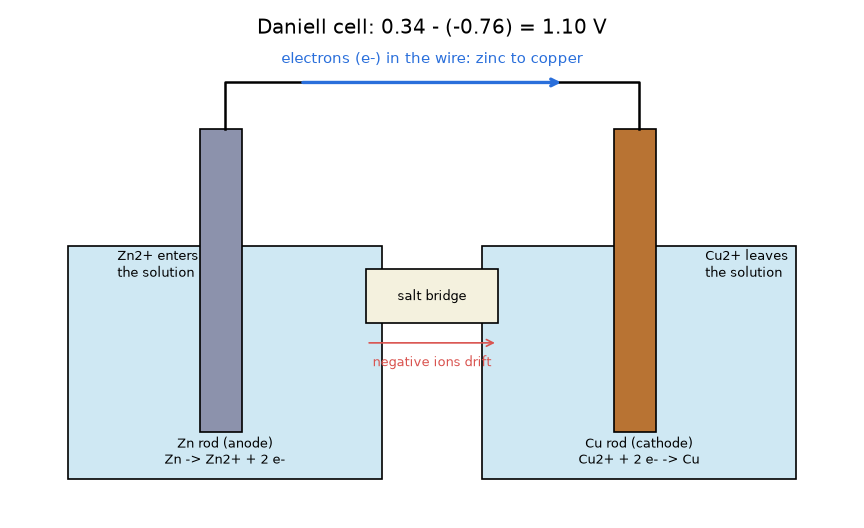
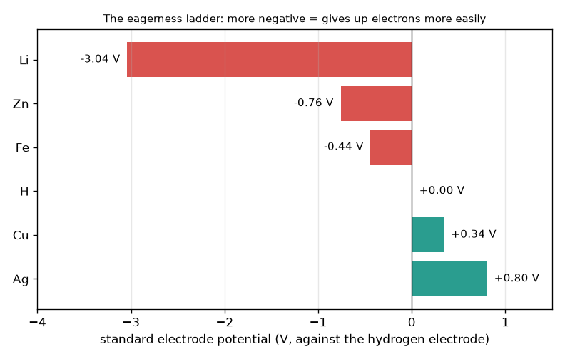

# സെഷൻ 1: രണ്ട് ലോഹങ്ങൾ ചേർന്ന് ഒരു സെൽ ഉണ്ടാകുന്നു

[Session 1 — हिन्दी](README.hi.md)

*ലെവൽ 1 (ആശയപരമായ ഇന്ററാക്ടീവ് മോഡൽ) · ഏകദേശം 60 മിനിറ്റ് · openbatterycell*

> ഇത് ലളിതമാക്കിയ ഒരു വിദ്യാഭ്യാസ മോഡൽ ആണ്. ഇത് സാധൂകരിച്ച (validated) ഡിസൈൻ ഉപകരണമല്ല; യഥാർത്ഥ നിർമിതികൾ, വൈദ്യുത ഇൻസ്റ്റലേഷനുകൾ, വാഹനങ്ങൾ, വ്യാവസായിക പ്രക്രിയകൾ അല്ലെങ്കിൽ വൈദ്യശാസ്ത്ര തീരുമാനങ്ങൾ എന്നിവയ്ക്ക് ഇത് ഉപയോഗിക്കരുത്.

**മുൻകൂട്ടി അറിയേണ്ടവ (Prerequisites)**

- കുറയ്ക്കൽ (subtraction), നെഗറ്റീവ് സംഖ്യകളുള്ള സംഖ്യാരേഖ (number line).
- നിങ്ങൾ PRIMER.md വായിച്ചിട്ടുണ്ട്, `python start.py 1` ഒരിക്കൽ റൺ ചെയ്തിട്ടുണ്ട്.

**പഠന ലക്ഷ്യങ്ങൾ (Learning objectives).** ഈ സെഷനു ശേഷം നിങ്ങൾക്ക്:

- ഒരു വയറും ഒരു സാൾട്ട് ബ്രിഡ്ജും (salt bridge) കൊണ്ട് ബന്ധിപ്പിച്ച രണ്ട് വ്യത്യസ്ത ലോഹങ്ങൾ എന്തുകൊണ്ട് ഒരു വോൾട്ടേജ് (voltage) നൽകുന്നു എന്ന് ഒരു ചിത്രത്തിന്റെ സഹായത്തോടെ വിശദീകരിക്കാം.
- രണ്ട് സ്റ്റാൻഡേർഡ് ഇലക്ട്രോഡ് പൊട്ടൻഷ്യലുകളിൽ (standard electrode potential) നിന്ന് സെൽ വോൾട്ടേജ് കണക്കാക്കാം, E = E(cathode) - E(anode).
- ഏത് ലോഹമാണ് ആനോഡ് (anode) എന്നും ഇലക്ട്രോണുകളും അയോണുകളും (ions) ഏത് ദിശയിൽ നീങ്ങുന്നു എന്നും പറയാം.
- ഒരു ലക്ഷ്യ വോൾട്ടേജിന് ശ്രേണിയിൽ (in series) എത്ര സെല്ലുകൾ വേണമെന്ന് കണ്ടെത്താം.

## A. യഥാർത്ഥ ലോക പ്രശ്നം
ഒരു നാരങ്ങയിൽ ഒരു സിങ്ക് ആണിയും ഒരു ചെമ്പ് നാണയവും കുത്തിയിറക്കി അവയെ ഒരു ചെറിയ മീറ്ററുമായി ബന്ധിപ്പിക്കുക: ഒന്നും പ്ലഗ് ചെയ്തിട്ടില്ലെങ്കിലും അത് ഒരു വോൾട്ടേജ് കാണിക്കുന്നു. ഒരു ടോർച്ച് ബാറ്ററിയും ഇതേ ആശയം തന്നെയാണ്, കൂടുതൽ വൃത്തിയുള്ള ഒരു പെട്ടിയിൽ. വോൾട്ടേജ് എവിടെ നിന്നാണ് വരുന്നത്, ഇലക്ട്രോണുകൾ ഏത് വഴിക്കാണ് പോകുന്നത്, ഒരു ഉപകരണത്തിന് ആവശ്യമായ വോൾട്ടേജിലെത്താൻ നിരവധി സെല്ലുകൾ എങ്ങനെ അടുക്കാം? (യഥാർത്ഥ ലിഥിയം, ലെഡ്-ആസിഡ് ബാറ്ററികൾ അപകടകരമാകാം; ഈ റിപ്പോ ഒരു വിദ്യാഭ്യാസ മോഡൽ ആണ്, അവ നിർമ്മിക്കാനുള്ള വഴികാട്ടിയല്ല.)

## B. ആശയവും സിദ്ധാന്തവും
ചില ലോഹങ്ങൾ മറ്റുള്ളവയേക്കാൾ എളുപ്പത്തിൽ ഇലക്ട്രോണുകൾ വിട്ടുകൊടുക്കുന്നു. രസതന്ത്രജ്ഞർ അവയെ വോൾട്ടിലുള്ള സ്റ്റാൻഡേർഡ് ഇലക്ട്രോഡ് പൊട്ടൻഷ്യൽ E0 ഉപയോഗിച്ച് റാങ്ക് ചെയ്യുന്നു; ഇത് 0 V എന്ന് നിർവചിച്ചിരിക്കുന്ന സ്റ്റാൻഡേർഡ് ഹൈഡ്രജൻ ഇലക്ട്രോഡിനെതിരെ (standard hydrogen electrode) അളക്കുന്നു. സംഖ്യ എത്രത്തോളം നെഗറ്റീവ് ആണോ, ലോഹം അത്രത്തോളം ആവേശത്തോടെ ഇലക്ട്രോണുകൾ വിട്ടുകൊടുക്കുന്നു. രണ്ട് ലോഹങ്ങളെ ഒരു വയറും ഒരു സാൾട്ട് ബ്രിഡ്ജും കൊണ്ട് ബന്ധിപ്പിക്കുമ്പോൾ, ഏണിയിൽ (ladder) താഴെയുള്ള ലോഹം ആനോഡ് ആകുകയും ഇലക്ട്രോണുകളെ വയറിലേക്ക് തള്ളുകയും ചെയ്യുന്നു; ഏണിയിൽ മുകളിലുള്ള ലോഹം കാഥോഡ് (cathode) ആകുകയും അവയെ സ്വീകരിക്കുകയും ചെയ്യുന്നു. സെൽ വോൾട്ടേജ് ഈ ഉയര വ്യത്യാസമാണ് E = E(cathode) - E(anode). ലായനിയിൽ, ആനോഡ് ലോഹം പോസിറ്റീവ് അയോണുകളായി ലയിക്കുന്നു, കാഥോഡിലെ പോസിറ്റീവ് അയോണുകൾ ഇലക്ട്രോണുകൾ സ്വീകരിച്ച് ലോഹമായി മാറുന്നു; സാൾട്ട് ബ്രിഡ്ജ് ചാർജുള്ള അയോണുകളെ ഒഴുകി നീങ്ങാൻ അനുവദിക്കുന്നതിനാൽ ഒരു ബീക്കറിലും ചാർജ് കുമിഞ്ഞുകൂടുന്നില്ല. ശ്രേണിയിൽ ബന്ധിപ്പിച്ച സെല്ലുകളുടെ വോൾട്ടേജുകൾ കൂടിച്ചേരുന്നു.

| ചിഹ്നം | അർത്ഥം | യൂണിറ്റ് |
|---|---|---|
| E0 | ഒരു ലോഹത്തിന്റെ സ്റ്റാൻഡേർഡ് ഇലക്ട്രോഡ് പൊട്ടൻഷ്യൽ (റിഡക്ഷൻ, 25 C, 1 mol/L) | V |
| E_cell | സെൽ വോൾട്ടേജ് = E0(cathode) - E0(anode) | V |
| n | ശ്രേണിയിലുള്ള ഒരേപോലുള്ള സെല്ലുകളുടെ എണ്ണം | യൂണിറ്റ് ഇല്ല |
| V_total | സ്റ്റാക്കിന്റെ വോൾട്ടേജ്, n മടങ്ങ് E_cell | V |

**അനുമാനങ്ങൾ (Assumptions)**

- പാഠപുസ്തകത്തിലെ ആദർശ സാഹചര്യങ്ങൾ: 25 C, 1 mol/L ലായനികൾ.
- കറന്റ് എടുക്കുന്നില്ല (കറന്റ് നൽകുമ്പോൾ ഒരു യഥാർത്ഥ സെൽ കുറഞ്ഞ വോൾട്ടേജ് നൽകുന്നു; സെഷൻ 3).
- മൂല്യങ്ങൾ റൗണ്ട് ചെയ്ത പാഠപുസ്തക സംഖ്യകളാണ്: Li -3.04, Zn -0.76, Fe -0.44, ഹൈഡ്രജൻ 0.00, Cu +0.34, Ag +0.80 V.

$$ E_{cell}=E^{0}_{cathode}-E^{0}_{anode} $$

$$ \text{Zn/Cu (Daniell): } E_{cell}=0.34-(-0.76)=1.10\ \mathrm{V} $$

$$ V_{total}=n\,E_{cell},\qquad n=\left\lceil \frac{V_{target}}{E_{cell}}\right\rceil $$

## C. ദൃശ്യ വിശദീകരണം
ആദ്യ ചിത്രം ആവേശ ഏണിയാണ് (eagerness ladder): ലിഥിയം (-3.04 V) മുതൽ വെള്ളി (+0.80 V) വരെയുള്ള സ്റ്റാൻഡേർഡ് ഇലക്ട്രോഡ് പൊട്ടൻഷ്യലുകളുടെ ബാറുകൾ. ഏതെങ്കിലും രണ്ട് ബാറുകൾ ഒരു സെൽ ആണ്, അതിന്റെ വോൾട്ടേജ് അവയ്ക്കിടയിലുള്ള തിരശ്ചീന ദൂരമാണ്. രണ്ടാമത്തെ ചിത്രം ഡാനിയൽ സെൽ (Daniell cell) വരയ്ക്കുന്നു: രണ്ട് ബീക്കറുകളിൽ ഒരു സിങ്ക് ദണ്ഡും ഒരു ചെമ്പ് ദണ്ഡും, വയറിലൂടെ സിങ്കിൽ നിന്ന് ചെമ്പിലേക്ക് നീങ്ങുന്ന ഇലക്ട്രോണുകൾ, ഇടത് ലായനിയിലേക്ക് പ്രവേശിക്കുന്ന സിങ്ക് അയോണുകൾ, വലത് ലായനിയിൽ നിന്ന് പുറത്തുപോകുന്ന ചെമ്പ് അയോണുകൾ, ഇടയിൽ സാൾട്ട് ബ്രിഡ്ജ്.

*ഒരു ഡാനിയൽ സെൽ: വയറിൽ സിങ്കിൽ നിന്ന് ചെമ്പിലേക്ക് ഇലക്ട്രോണുകൾ, ലായനിയിലും സാൾട്ട് ബ്രിഡ്ജിലും അയോണുകൾ, 1.10 V.*

*ആവേശ ഏണി: ലിഥിയം (-3.04 V) മുതൽ വെള്ളി (+0.80 V) വരെയുള്ള സ്റ്റാൻഡേർഡ് ഇലക്ട്രോഡ് പൊട്ടൻഷ്യലുകൾ.*

## D. ഇന്ററാക്ടീവ് സിമുലേഷൻ
പാഠം റൺ ചെയ്യുക (`python start.py 1`), തുടർന്ന് ലൈവ് ആപ്പ് തുറക്കുക: [സെഷൻ 1: രണ്ട് ലോഹങ്ങൾ തിരഞ്ഞെടുക്കുക](https://krunalpanchal1995.github.io/pan-iit-oss/openbatterycell/session-01/) (അല്ലെങ്കിൽ ഈ ഫോൾഡറിലെ `app.html`). രണ്ട് പൊട്ടൻഷ്യൽ സ്ലൈഡറുകൾ ഉപയോഗിച്ച് ഓരോ വശത്തെയും ലോഹം തിരഞ്ഞെടുക്കുക, വോൾട്ടേജ്, ഇലക്ട്രോൺ കുത്തുകളുടെ ദിശ, സ്റ്റാക്ക് ഗ്രാഫ് എന്നിവ നിരീക്ഷിക്കുക. തുടർന്ന് ശ്രേണിയിലുള്ള സെല്ലുകളുടെ എണ്ണം മാറ്റുക.

**വെല്ലുവിളി.** പരമാവധി 3 സെല്ലുകൾ ശ്രേണിയിൽ ഉപയോഗിച്ച് കുറഞ്ഞത് 3 V എത്തുക.

## E. ഉദാഹരണവും പരീക്ഷണവും
**പ്രശ്നം.** ഒരു കളിപ്പാട്ടത്തിന് കുറഞ്ഞത് 4.5 V വേണം. ശ്രേണിയിൽ എത്ര സിങ്ക്-ചെമ്പ് സെല്ലുകൾ വേണം, അവ എത്ര വോൾട്ടേജ് നൽകും?

1. ഒരു സിങ്ക്-ചെമ്പ് സെൽ: E = 0.34 - (-0.76) = 1.10 V.
2. ആവശ്യമായ സെല്ലുകൾ: 4.5 / 1.10 = 4.09, ഒരു സെല്ലിന്റെ 0.09 ഭാഗം നിർമ്മിക്കാനാവില്ല, അതിനാൽ 5 ആയി മുകളിലേക്ക് റൗണ്ട് ചെയ്യുക.
3. ആകെ: 5 x 1.10 = 5.50 V, ഇത് കുറഞ്ഞത് 4.5 V ആണ്.
4. പരിശോധന: 4 സെല്ലുകൾ 4.40 V മാത്രമേ നൽകൂ, അത് വളരെ കുറവാണ്.

**ഉത്തരം.** ശ്രേണിയിൽ 5 സെല്ലുകൾ, 5.50 V.

**പരീക്ഷണം.** സിങ്ക് പൂശിയ (ഗാൽവനൈസ്ഡ്, galvanised) ഒരു ആണിയും ഒരു ചെമ്പ് നാണയമോ വയറോ ഒരു നാരങ്ങയിൽ കുത്തിയിറക്കുക, വോൾട്ടിൽ സെറ്റ് ചെയ്ത ഒരു മൾട്ടിമീറ്റർ (multimeter) ബന്ധിപ്പിച്ച് റീഡിംഗ് കുറിക്കുക; തുടർന്ന് മൂന്ന് നാരങ്ങകൾ ശ്രേണിയിൽ ബന്ധിപ്പിച്ച് വീണ്ടും കുറിക്കുക. ഓരോ നാരങ്ങയ്ക്കും ആദർശ 1.10 V-നേക്കാൾ വ്യക്തമായി കുറവും വളരെ കുറഞ്ഞ കറന്റും പ്രതീക്ഷിക്കുക, അതിനാൽ ബൾബ് കത്തില്ല. മോഡൽ സ്റ്റാൻഡേർഡ് 1 mol/L ലായനികളും കറന്റ് ഇല്ലാത്ത അവസ്ഥയും അനുമാനിക്കുന്നു; നാരങ്ങയിൽ ദുർബലമായ, അമ്ലഗുണമുള്ള നീരും വലിയ പ്രതിരോധവും (resistance) അറിയാത്ത ഗാഢതകളും (concentrations) ആണുള്ളത്. ഇതിനായി മെയിൻസ് വൈദ്യുതിയിൽ പ്രവർത്തിക്കുന്നവയോ വലിയ ബാറ്ററികളോ ഉപയോഗിക്കരുത്.

## F. വിലയിരുത്തലും ഡിസൈൻ വെല്ലുവിളിയും
**ചോദ്യ തരം A: ആശയപരം.** ഒരു സിങ്ക്-ചെമ്പ് സെല്ലിൽ ഇലക്ട്രോണുകൾ എന്തുകൊണ്ട് സിങ്കിൽ നിന്ന് ചെമ്പിലേക്ക് സഞ്ചരിക്കുന്നു, സാൾട്ട് ബ്രിഡ്ജ് നീക്കം ചെയ്താൽ കറന്റ് നിലയ്ക്കുന്നത് എന്തുകൊണ്ട്?

സൂചന

ആവേശ ഏണിയിൽ ഏത് ലോഹമാണ് താഴെ? ബ്രിഡ്ജ് ഇല്ലാതെ ഓരോ ബീക്കറിലെയും ചാർജിന് എന്ത് സംഭവിക്കും?

ഘട്ടം ഘട്ടമായുള്ള പരിഹാരം

സിങ്ക് (-0.76 V) ഏണിയിൽ ചെമ്പിനേക്കാൾ (+0.34 V) താഴെയാണ്, അതിനാൽ അത് കൂടുതൽ എളുപ്പത്തിൽ ഇലക്ട്രോണുകൾ വിട്ടുകൊടുക്കുന്നു: അത് ആനോഡ് ആണ്, ഇലക്ട്രോണുകളെ വയറിലേക്ക് തള്ളുന്നു, കാഥോഡായ ചെമ്പ് അവയെ വലിച്ചെടുക്കുന്നു. സാൾട്ട് ബ്രിഡ്ജ് ഇല്ലെങ്കിൽ സിങ്ക് ബീക്കറിൽ പോസിറ്റീവ് Zn2+ അയോണുകൾ കൂടുകയും ചെമ്പ് ബീക്കറിൽ നിന്ന് പോസിറ്റീവ് Cu2+ അയോണുകൾ കുറയുകയും ചെയ്യും, അതിനാൽ ഓരോ ബീക്കറിലും ചാർജ് കുമിഞ്ഞുകൂടി ഒരു നിമിഷത്തിനുള്ളിൽ ഇലക്ട്രോണുകളുടെ ഒഴുക്കിനെ എതിർക്കും. രണ്ട് ബീക്കറുകളും ന്യൂട്രൽ ആയി നിലനിർത്താൻ ബ്രിഡ്ജ് അയോണുകളെ ഒഴുകി നീങ്ങാൻ അനുവദിക്കുന്നു, അതിനാൽ വയറും ബ്രിഡ്ജും ഒരുമിച്ചുള്ളപ്പോൾ മാത്രമേ സർക്യൂട്ട് പൂർണ്ണമാകൂ.

**ചോദ്യ തരം B: സംഖ്യാപരം.** ഒരു ഇരുമ്പ്-വെള്ളി സെൽ നിർമ്മിക്കുന്നു (ഇരുമ്പ് ആനോഡ്, വെള്ളി കാഥോഡ്). സെൽ വോൾട്ടേജും 5 V-ന് ശ്രേണിയിൽ ആവശ്യമായ സെല്ലുകളുടെ എണ്ണവും കണ്ടെത്തുക.

സൂചന

E = 0.80 - (-0.44). 5-നെ ഒരു സെല്ലിന്റെ വോൾട്ടേജ് കൊണ്ട് ഹരിച്ച് മുകളിലേക്ക് റൗണ്ട് ചെയ്യുക.

ഘട്ടം ഘട്ടമായുള്ള പരിഹാരം

E = 0.80 - (-0.44) = 1.24 V. സെല്ലുകൾ: 5 / 1.24 = 4.03, 5 ആയി മുകളിലേക്ക് റൗണ്ട് ചെയ്യുക. ആകെ = 5 x 1.24 = 6.20 V. യുക്തി പരിശോധന: 4 സെല്ലുകൾ 4.96 V മാത്രം നൽകുന്നു, 5 V-ന് തൊട്ടുതാഴെ, അതിനാൽ 5 സെല്ലുകൾ വേണം. യൂണിറ്റ്: വോൾട്ട്.

**ചോദ്യ തരം C: ഗ്രാഫും സിമുലേഷനും വ്യാഖ്യാനിക്കൽ.** സ്റ്റാക്ക് ഗ്രാഫിൽ, സിങ്ക്-ചെമ്പ് സെല്ലിന്റെ രേഖയും ഇരുമ്പ്-ചെമ്പ് സെല്ലിന്റെ രേഖയും (0.34 - (-0.44) = 0.78 V) പൂജ്യത്തിൽ നിന്ന് തുടങ്ങുന്നു. ഏത് രേഖയാണ് കൂടുതൽ ചരിവുള്ളത്, ചരിവ് (slope) എന്താണ് അർത്ഥമാക്കുന്നത്? ഏത് സ്റ്റാക്കാണ് കുറഞ്ഞ സെല്ലുകൾ കൊണ്ട് 3 V എത്തുന്നത്?

സൂചന

ചരിവ് ഓരോ സെല്ലിനുമുള്ള വോൾട്ട് ആണ്. 3-നെ ഓരോ സെൽ വോൾട്ടേജ് കൊണ്ടും ഹരിച്ച് മുകളിലേക്ക് റൗണ്ട് ചെയ്യുക.

ഘട്ടം ഘട്ടമായുള്ള പരിഹാരം

സിങ്ക്-ചെമ്പ് രേഖയാണ് കൂടുതൽ ചരിവുള്ളത്: അതിന്റെ ചരിവ് ഒരു സെല്ലിന് 1.10 V, മറ്റേതിന് ഒരു സെല്ലിന് 0.78 V. സിങ്ക്-ചെമ്പിന് ceil(3 / 1.10) = 3 സെല്ലുകൾ (3.30 V) വേണം; ഇരുമ്പ്-ചെമ്പിന് ceil(3 / 0.78) = 4 സെല്ലുകൾ (3.12 V) വേണം. ഏണിയിൽ വലിയ വിടവ് എന്നാൽ കുറഞ്ഞ സെല്ലുകൾ.

**ചോദ്യ തരം D: ഡിസൈനും ഒപ്റ്റിമൈസേഷനും വെല്ലുവിളി.** ഡിസൈൻ: ഒരു ചെറിയ റേഡിയോയ്ക്ക് സിങ്ക്, ഇരുമ്പ്, ചെമ്പ്, വെള്ളി എന്നീ ലോഹങ്ങൾ കൊണ്ട് നിർമ്മിച്ച ജലാധിഷ്ഠിത സെല്ലുകളിൽ നിന്ന് കുറഞ്ഞത് 6 V വേണം. ഏറ്റവും കുറഞ്ഞ സെല്ലുകൾ വേണ്ട ജോഡിയും, വെള്ളി വളരെ വിലയേറിയതാണെങ്കിൽ നിങ്ങൾ തിരഞ്ഞെടുക്കുന്ന ജോഡിയും തിരഞ്ഞെടുക്കുക. ലിഥിയം ഇവിടെ ഒരു ഓപ്ഷൻ അല്ലാത്തത് എന്തുകൊണ്ട്?

സൂചന

അനുവദനീയമായ ലോഹങ്ങളിൽ ഏറ്റവും വലിയ വിടവ് കണ്ടെത്തുക (സിങ്ക് ആനോഡ്, വെള്ളി കാഥോഡ്), തുടർന്ന് വെള്ളി ഇല്ലാതെയുള്ള ഏറ്റവും വലിയ വിടവ്.

ഘട്ടം ഘട്ടമായുള്ള പരിഹാരം

വെള്ളിയോടൊപ്പം: Zn/Ag = 0.80 - (-0.76) = 1.56 V, അതിനാൽ ceil(6 / 1.56) = 4 സെല്ലുകൾ 6.24 V നൽകുന്നു. വെള്ളി ഇല്ലാതെ ഏറ്റവും വലിയ വിടവ് Zn/Cu = 1.10 V ആണ്, അതിനാൽ ceil(6 / 1.10) = 6 സെല്ലുകൾ 6.60 V നൽകുന്നു. വിട്ടുവീഴ്ച (trade-off): രണ്ട് സെല്ലുകൾ കൂടുതൽ, എന്നാൽ വളരെ വിലകുറഞ്ഞ ലോഹം. ലിഥിയം വെള്ളവുമായി ശക്തമായി പ്രതിപ്രവർത്തിക്കുന്നു, അതിനാൽ അതിന് പ്രത്യേക ജലരഹിത ഇലക്ട്രോലൈറ്റും (electrolyte) അടച്ചുറപ്പുള്ള, സംരക്ഷിത ഡിസൈനും വേണം; അത് വീട്ടിൽ നിർമ്മിക്കാവുന്ന ഒന്നല്ല, ലളിതമായ ബീക്കർ മോഡൽ അതിന് ബാധകവുമല്ല.

[RUBRIC.md](../../RUBRIC.md) ഉപയോഗിച്ച് സ്വയം സ്കോർ ചെയ്യുക. പേപ്പറിൽ ചെയ്യാൻ [ആക്ടിവിറ്റി ഷീറ്റ്](activity_sheet.md) പ്രിന്റ് ചെയ്യുക.

## സാധാരണ തെറ്റിദ്ധാരണകൾ
| സാധാരണ തെറ്റിദ്ധാരണ | യഥാർത്ഥത്തിൽ ശരിയായത് |
|---|---|
| നാരങ്ങ (ആസിഡ്) ആണ് വൈദ്യുതോർജ്ജത്തിന്റെ ഉറവിടം. | ഊർജ്ജം വരുന്നത് രണ്ട് ലോഹങ്ങൾ തമ്മിലുള്ള രാസ വ്യത്യാസത്തിൽ നിന്നാണ്; നീര് അയോണുകളെ വഹിക്കുക മാത്രം ചെയ്യുന്നു. സിങ്ക് പതുക്കെ ഉപയോഗിക്കപ്പെട്ട് തീരുന്നു. |
| ഇലക്ട്രോണുകൾ സാൾട്ട് ബ്രിഡ്ജിലൂടെ ഒഴുകുന്നു. | ഇലക്ട്രോണുകൾ വയറിലൂടെ ഒഴുകുന്നു; അയോണുകൾ സാൾട്ട് ബ്രിഡ്ജിലൂടെയും ലായനികളിലൂടെയും ഒഴുകുന്നു. രണ്ട് പാതകളും ആവശ്യമാണ്. |
| ഏത് ഉപകരണത്തിലും ആനോഡ് എപ്പോഴും നെഗറ്റീവ് പോലെ തോന്നുന്ന ടെർമിനൽ ആണ്. | ലോഹം ഇലക്ട്രോണുകൾ വിട്ടുകൊടുക്കുന്ന ഇലക്ട്രോഡ് ആണ് ആനോഡ്. കറന്റ് നൽകിക്കൊണ്ടിരിക്കുന്ന ഒരു സെല്ലിൽ അത് നെഗറ്റീവ് ടെർമിനൽ ആണ്; ബാറ്ററി ചാർജ് ചെയ്യുമ്പോൾ ലേബലുകൾ പരസ്പരം മാറുന്നു. |
| സെല്ലുകൾ ശ്രേണിയിൽ ബന്ധിപ്പിക്കുന്നത് അവയെ കൂടുതൽ കാലം നിലനിൽക്കാൻ സഹായിക്കുന്നു. | ശ്രേണി വോൾട്ടേജ് മാത്രം കൂട്ടുന്നു; ചരടിന്റെ ശേഷി (capacity) ഒരു സെല്ലിന്റേത് തന്നെ (സെഷൻ 2). |

## പദാവലി (Glossary)
- **ഇലക്ട്രോഡ് (electrode)**: ഇലക്ട്രോണുകൾ കൈമാറ്റം ചെയ്യപ്പെടുന്ന, ഒരു ലായനിയിൽ മുക്കിയ ലോഹ ദണ്ഡ്
- **ആനോഡ് (anode)**: ഇലക്ട്രോണുകൾ വിട്ടുകൊടുക്കുന്ന ഇലക്ട്രോഡ് (പൊട്ടൻഷ്യൽ ഏണിയിൽ താഴെ)
- **കാഥോഡ് (cathode)**: ഇലക്ട്രോണുകൾ സ്വീകരിക്കുന്ന ഇലക്ട്രോഡ് (ഏണിയിൽ മുകളിൽ)
- **സ്റ്റാൻഡേർഡ് ഇലക്ട്രോഡ് പൊട്ടൻഷ്യൽ (standard electrode potential)**: ഒരു ലോഹം അതിന്റെ ഇലക്ട്രോണുകളെ എത്ര എളുപ്പത്തിൽ നിലനിർത്തുന്നു എന്നതിന്റെ, ഹൈഡ്രജൻ ഇലക്ട്രോഡിനെതിരെ വോൾട്ടിലുള്ള അളവ്
- **സാൾട്ട് ബ്രിഡ്ജ് (salt bridge)**: രണ്ട് ബീക്കറുകൾക്കിടയിൽ അയോണുകൾക്കുള്ള ഒരു പാത, ഓരോന്നിനെയും വൈദ്യുതപരമായി ന്യൂട്രൽ ആയി നിലനിർത്തുന്നു
- **ശ്രേണി ബന്ധനം (series connection)**: വോൾട്ടേജുകൾ കൂടിച്ചേരുന്ന വിധത്തിൽ ഒന്നിനു പിറകെ ഒന്നായി ബന്ധിപ്പിച്ച സെല്ലുകൾ

## പൂർത്തിയാക്കുക
1. [exercises.md](exercises.md)-ലെ മൂന്ന് കോഡിംഗ് ടാസ്കുകൾ ചെയ്യുക.
2. നിങ്ങളുടെ മാറ്റങ്ങൾക്ക് ശേഷം `python start.py 1` വീണ്ടും റൺ ചെയ്യുക. അത് ചെക്ക്‌പോയിന്റോടെ അവസാനിക്കുന്നു; അത് `PASS` പ്രിന്റ് ചെയ്യുമ്പോൾ നിങ്ങൾ പൂർത്തിയാക്കി. (ചെക്ക്‌പോയിന്റ് മാത്രം: `python start.py check 1`.)

അടുത്തത്: [സെഷൻ 2](../session-02/README.md)
