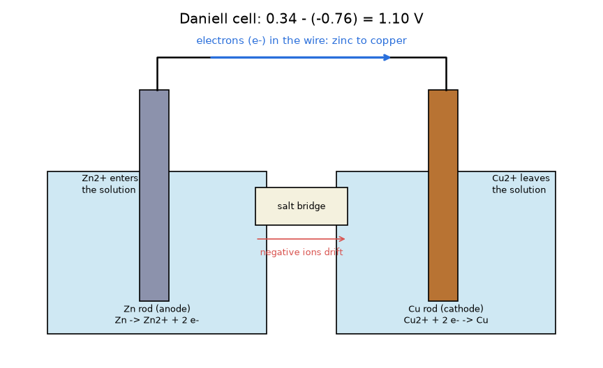
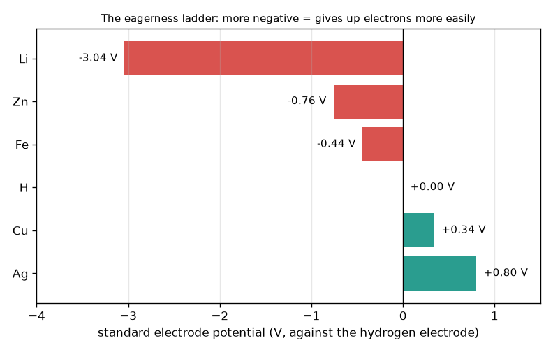

# அமர்வு 1: இரண்டு உலோகங்கள் ஒரு மின்கலத்தை உருவாக்குகின்றன

[Session 1 — हिन्दी](README.hi.md)

*நிலை 1 (கருத்தியல் ஊடாடும் மாதிரி) · சுமார் 60 நிமிடங்கள் · openbatterycell*

> இது எளிமைப்படுத்தப்பட்ட ஒரு கல்வி மாதிரி. இது சரிபார்க்கப்பட்ட (validated) வடிவமைப்புக் கருவி அல்ல; உண்மையான கட்டமைப்புகள், மின் நிறுவல்கள், வாகனங்கள், தொழிற்சாலை செயல்முறைகள் அல்லது மருத்துவ முடிவுகளுக்கு இதைப் பயன்படுத்தக் கூடாது.

**முன்தேவைகள் (Prerequisites)**

- கழித்தல் (subtraction) மற்றும் எதிர்மறை எண்களுடன் கூடிய எண் கோடு (number line).
- நீங்கள் PRIMER.md படித்து, `python start.py 1` ஒருமுறை இயக்கியுள்ளீர்கள்.

**கற்றல் நோக்கங்கள் (Learning objectives).** இந்த அமர்வுக்குப் பிறகு நீங்கள்:

- ஒரு கம்பி மற்றும் ஒரு உப்புப் பாலம் (salt bridge) மூலம் இணைக்கப்பட்ட இரண்டு வெவ்வேறு உலோகங்கள் ஏன் மின்னழுத்தம் (voltage) தருகின்றன என்பதை ஒரு படத்துடன் விளக்கலாம்.
- இரண்டு திட்ட மின்முனை மின்னழுத்தங்களிலிருந்து (standard electrode potential) மின்கல மின்னழுத்தத்தைக் கணக்கிடலாம், E = E(cathode) - E(anode).
- எந்த உலோகம் நேர்மின்முனை (anode) என்பதையும், எலக்ட்ரான்களும் அயனிகளும் (ions) எந்தத் திசையில் நகர்கின்றன என்பதையும் கூறலாம்.
- ஓர் இலக்கு மின்னழுத்தத்திற்குத் தொடரில் (in series) எத்தனை மின்கலங்கள் தேவை என்று கண்டறியலாம்.

## A. நிஜ உலகப் பிரச்சினை
ஓர் எலுமிச்சம்பழத்தில் ஒரு துத்தநாக (zinc) ஆணியையும் ஒரு செம்பு நாணயத்தையும் செருகி, அவற்றை ஒரு சிறிய மீட்டருடன் இணைக்கவும்: எதுவும் பிளக் செய்யப்படாவிட்டாலும் அது ஒரு மின்னழுத்தத்தைக் காட்டுகிறது. ஒரு டார்ச் பேட்டரியும் இதே யோசனைதான், ஒரு நேர்த்தியான பெட்டியில். மின்னழுத்தம் எங்கிருந்து வருகிறது, எலக்ட்ரான்கள் எந்த வழியில் செல்கின்றன, ஒரு சாதனத்திற்குத் தேவையான மின்னழுத்தத்தை அடையப் பல மின்கலங்களை எவ்வாறு அடுக்குவது? (உண்மையான லித்தியம் மற்றும் ஈய-அமில (lead-acid) பேட்டரிகள் ஆபத்தானவையாக இருக்கலாம்; இந்த ரெப்போ ஒரு கல்வி மாதிரி, அவற்றை உருவாக்குவதற்கான வழிகாட்டி அல்ல.)

## B. கருத்தும் கோட்பாடும்
சில உலோகங்கள் மற்றவற்றை விட எளிதாக எலக்ட்ரான்களை விட்டுக்கொடுக்கின்றன. வேதியியலாளர்கள் அவற்றை வோல்ட்டில் உள்ள திட்ட மின்முனை மின்னழுத்தம் E0 மூலம் வரிசைப்படுத்துகின்றனர்; இது 0 V என வரையறுக்கப்பட்ட திட்ட ஹைட்ரஜன் மின்முனைக்கு (standard hydrogen electrode) எதிராக அளக்கப்படுகிறது. எண் எவ்வளவு எதிர்மறையாக உள்ளதோ, உலோகம் அவ்வளவு ஆர்வத்துடன் எலக்ட்ரான்களை விட்டுக்கொடுக்கிறது. இரண்டு உலோகங்கள் ஒரு கம்பி மற்றும் உப்புப் பாலம் மூலம் இணைக்கப்படும்போது, ஏணியில் (ladder) கீழே உள்ள உலோகம் நேர்மின்முனையாகி எலக்ட்ரான்களைக் கம்பிக்குள் தள்ளுகிறது; ஏணியில் மேலே உள்ள உலோகம் எதிர்மின்முனையாகி (cathode) அவற்றைப் பெறுகிறது. மின்கல மின்னழுத்தம் இந்த உயர வேறுபாடு E = E(cathode) - E(anode). கரைசலில், நேர்மின்முனை உலோகம் நேர் அயனிகளாகக் கரைகிறது; எதிர்மின்முனையிலுள்ள நேர் அயனிகள் எலக்ட்ரான்களைப் பெற்று உலோகமாகின்றன; உப்புப் பாலம் மின்னூட்டம் கொண்ட அயனிகளை நகர அனுமதிப்பதால் எந்தக் குடுவையிலும் (beaker) மின்னூட்டம் சேர்வதில்லை. தொடரில் இணைக்கப்பட்ட மின்கலங்களின் மின்னழுத்தங்கள் கூடுகின்றன.

| குறியீடு | பொருள் | அலகு |
|---|---|---|
| E0 | ஓர் உலோகத்தின் திட்ட மின்முனை மின்னழுத்தம் (ஒடுக்கம், 25 C, 1 mol/L) | V |
| E_cell | மின்கல மின்னழுத்தம் = E0(cathode) - E0(anode) | V |
| n | தொடரில் உள்ள ஒத்த மின்கலங்களின் எண்ணிக்கை | அலகு இல்லை |
| V_total | அடுக்கின் மின்னழுத்தம், n மடங்கு E_cell | V |

**அனுமானங்கள் (Assumptions)**

- பாடநூல் இலட்சிய நிலைகள்: 25 C மற்றும் 1 mol/L கரைசல்கள்.
- மின்னோட்டம் எடுக்கப்படவில்லை (மின்னோட்டம் வழங்கும்போது உண்மையான மின்கலம் குறைந்த மின்னழுத்தம் தருகிறது; அமர்வு 3).
- மதிப்புகள் முழுமையாக்கப்பட்ட பாடநூல் எண்கள்: Li -3.04, Zn -0.76, Fe -0.44, ஹைட்ரஜன் 0.00, Cu +0.34, Ag +0.80 V.

$$ E_{cell}=E^{0}_{cathode}-E^{0}_{anode} $$

$$ \text{Zn/Cu (Daniell): } E_{cell}=0.34-(-0.76)=1.10\ \mathrm{V} $$

$$ V_{total}=n\,E_{cell},\qquad n=\left\lceil \frac{V_{target}}{E_{cell}}\right\rceil $$

## C. காட்சி விளக்கம்
முதல் படம் ஆர்வ ஏணி (eagerness ladder): லித்தியம் (-3.04 V) முதல் வெள்ளி (+0.80 V) வரையிலான திட்ட மின்முனை மின்னழுத்தங்களின் பட்டைகள். ஏதேனும் இரண்டு பட்டைகள் ஒரு மின்கலம், அதன் மின்னழுத்தம் அவற்றுக்கிடையேயான கிடைமட்டத் தூரம். இரண்டாவது படம் டேனியல் மின்கலத்தை (Daniell cell) வரைகிறது: இரண்டு குடுவைகளில் ஒரு துத்தநாகக் கம்பியும் ஒரு செம்புக் கம்பியும், கம்பி வழியாகத் துத்தநாகத்திலிருந்து செம்புக்கு நகரும் எலக்ட்ரான்கள், இடது கரைசலுக்குள் நுழையும் துத்தநாக அயனிகள், வலது கரைசலை விட்டு வெளியேறும் செம்பு அயனிகள், இடையில் உப்புப் பாலம்.

*ஒரு டேனியல் மின்கலம்: கம்பியில் துத்தநாகத்திலிருந்து செம்புக்கு எலக்ட்ரான்கள், கரைசலிலும் உப்புப் பாலத்திலும் அயனிகள், 1.10 V.*

*ஆர்வ ஏணி: லித்தியம் (-3.04 V) முதல் வெள்ளி (+0.80 V) வரையிலான திட்ட மின்முனை மின்னழுத்தங்கள்.*

## D. ஊடாடும் உருவகப்படுத்தல் (Interactive simulation)
பாடத்தை இயக்கவும் (`python start.py 1`), பின்னர் நேரடிச் செயலியைத் திறக்கவும்: [அமர்வு 1: இரண்டு உலோகங்களைத் தேர்ந்தெடுக்கவும்](https://krunalpanchal1995.github.io/pan-iit-oss/openbatterycell/session-01/) (அல்லது இந்தக் கோப்புறையிலுள்ள `app.html`). இரண்டு மின்னழுத்த ஸ்லைடர்கள் மூலம் ஒவ்வொரு பக்கத்திலும் உலோகத்தைத் தேர்ந்தெடுத்து, மின்னழுத்தம், எலக்ட்ரான் புள்ளிகளின் திசை மற்றும் அடுக்கு வரைபடத்தைக் கவனிக்கவும். பின்னர் தொடரில் உள்ள மின்கலங்களின் எண்ணிக்கையை மாற்றவும்.

**சவால்.** அதிகபட்சம் 3 மின்கலங்களைத் தொடரில் பயன்படுத்திக் குறைந்தது 3 V-ஐ அடையவும்.

## E. தீர்க்கப்பட்ட எடுத்துக்காட்டும் சோதனையும்
**பிரச்சினை.** ஒரு பொம்மைக்குக் குறைந்தது 4.5 V தேவை. தொடரில் எத்தனை துத்தநாக-செம்பு மின்கலங்கள் தேவை, அவை என்ன மின்னழுத்தம் தருகின்றன?

1. ஒரு துத்தநாக-செம்பு மின்கலம்: E = 0.34 - (-0.76) = 1.10 V.
2. தேவையான மின்கலங்கள்: 4.5 / 1.10 = 4.09; ஒரு மின்கலத்தின் 0.09 பகுதியை உருவாக்க முடியாது, எனவே 5 ஆக மேல்நோக்கி முழுமையாக்கவும்.
3. மொத்தம்: 5 x 1.10 = 5.50 V, இது குறைந்தது 4.5 V.
4. சரிபார்ப்பு: 4 மின்கலங்கள் 4.40 V மட்டுமே தரும், அது மிகக் குறைவு.

**விடை.** தொடரில் 5 மின்கலங்கள், 5.50 V.

**சோதனை.** துத்தநாகம் பூசப்பட்ட (galvanised) ஓர் ஆணியையும் ஒரு செம்பு நாணயம் அல்லது கம்பியையும் ஓர் எலுமிச்சம்பழத்தில் செருகி, வோல்ட்டில் அமைக்கப்பட்ட ஒரு மல்டிமீட்டரை (multimeter) இணைத்து அளவீட்டைக் குறிக்கவும்; பின்னர் மூன்று எலுமிச்சம்பழங்களைத் தொடரில் இணைத்து மீண்டும் குறிக்கவும். ஒவ்வொரு எலுமிச்சம்பழத்திற்கும் இலட்சிய 1.10 V-ஐ விடத் தெளிவாகக் குறைவாகவும், மிகக் குறைந்த மின்னோட்டமும் எதிர்பாருங்கள், எனவே பல்பு எரியாது. மாதிரி திட்ட 1 mol/L கரைசல்களையும் மின்னோட்டம் இல்லாததையும் அனுமானிக்கிறது; எலுமிச்சம்பழத்தில் பலவீனமான, அமிலத்தன்மை கொண்ட சாறு, பெரிய மின்தடை (resistance) மற்றும் அறியப்படாத செறிவுகள் (concentrations) உள்ளன. இதற்கு மின்வழங்கல் (mains) மின்சாரத்தில் இயங்குபவற்றையோ பெரிய பேட்டரிகளையோ பயன்படுத்த வேண்டாம்.

## F. மதிப்பீடும் வடிவமைப்புச் சவாலும்
**கேள்வி வகை A: கருத்தியல்.** ஒரு துத்தநாக-செம்பு மின்கலத்தில் எலக்ட்ரான்கள் ஏன் துத்தநாகத்திலிருந்து செம்புக்குப் பயணிக்கின்றன, உப்புப் பாலத்தை அகற்றினால் மின்னோட்டத்தை நிறுத்துவது எது?

குறிப்பு

ஆர்வ ஏணியில் எந்த உலோகம் கீழே உள்ளது? பாலம் இல்லாமல் ஒவ்வொரு குடுவையிலும் உள்ள மின்னூட்டத்திற்கு என்ன நடக்கும்?

படிப்படியான தீர்வு

துத்தநாகம் (-0.76 V) ஏணியில் செம்பை (+0.34 V) விடக் கீழே உள்ளது, எனவே அது எளிதாக எலக்ட்ரான்களை விட்டுக்கொடுக்கிறது: அது நேர்மின்முனை, எலக்ட்ரான்களைக் கம்பிக்குள் தள்ளுகிறது, எதிர்மின்முனையான செம்பு அவற்றை இழுக்கிறது. உப்புப் பாலம் இல்லாவிட்டால் துத்தநாகக் குடுவையில் நேர் Zn2+ அயனிகள் கூடும், செம்புக் குடுவையில் நேர் Cu2+ அயனிகள் குறையும்; எனவே ஒவ்வொரு குடுவையிலும் மின்னூட்டம் குவிந்து, ஒரு கணத்திற்குள் எலக்ட்ரான் ஓட்டத்தை எதிர்க்கும். இரண்டு குடுவைகளையும் நடுநிலையாக வைக்கப் பாலம் அயனிகளை நகர அனுமதிக்கிறது, எனவே கம்பியும் பாலமும் சேர்ந்திருக்கும்போது மட்டுமே சுற்று முழுமையடைகிறது.

**கேள்வி வகை B: எண்ணியல்.** ஓர் இரும்பு-வெள்ளி மின்கலம் உருவாக்கப்படுகிறது (இரும்பு நேர்மின்முனை, வெள்ளி எதிர்மின்முனை). மின்கல மின்னழுத்தத்தையும், 5 V-க்குத் தொடரில் தேவையான மின்கலங்களின் எண்ணிக்கையையும் கண்டறியவும்.

குறிப்பு

E = 0.80 - (-0.44). 5-ஐ ஒரு மின்கலத்தின் மின்னழுத்தத்தால் வகுத்து மேல்நோக்கி முழுமையாக்கவும்.

படிப்படியான தீர்வு

E = 0.80 - (-0.44) = 1.24 V. மின்கலங்கள்: 5 / 1.24 = 4.03, 5 ஆக மேல்நோக்கி முழுமையாக்கவும். மொத்தம் = 5 x 1.24 = 6.20 V. நியாயச் சரிபார்ப்பு: 4 மின்கலங்கள் 4.96 V மட்டுமே தரும், 5 V-க்குச் சற்றுக் கீழே, எனவே 5 மின்கலங்கள் தேவை. அலகுகள்: வோல்ட்.

**கேள்வி வகை C: வரைபடம் மற்றும் உருவகப்படுத்தல் விளக்கம்.** அடுக்கு வரைபடத்தில், துத்தநாக-செம்பு மின்கலத்தின் கோடும் இரும்பு-செம்பு மின்கலத்தின் கோடும் (0.34 - (-0.44) = 0.78 V) பூஜ்ஜியத்திலிருந்து தொடங்குகின்றன. எந்தக் கோடு அதிகச் சரிவானது, சரிவு (slope) எதைக் குறிக்கிறது? எந்த அடுக்கு குறைவான மின்கலங்களுடன் 3 V-ஐ அடைகிறது?

குறிப்பு

சரிவு என்பது ஒரு மின்கலத்திற்கான வோல்ட். 3-ஐ ஒவ்வொரு மின்கல மின்னழுத்தத்தாலும் வகுத்து மேல்நோக்கி முழுமையாக்கவும்.

படிப்படியான தீர்வு

துத்தநாக-செம்பு கோடு அதிகச் சரிவானது: அதன் சரிவு ஒரு மின்கலத்திற்கு 1.10 V, மற்றதற்கு ஒரு மின்கலத்திற்கு 0.78 V. துத்தநாக-செம்புக்கு ceil(3 / 1.10) = 3 மின்கலங்கள் (3.30 V) தேவை; இரும்பு-செம்புக்கு ceil(3 / 0.78) = 4 மின்கலங்கள் (3.12 V) தேவை. ஏணியில் பெரிய இடைவெளி என்றால் குறைவான மின்கலங்கள்.

**கேள்வி வகை D: வடிவமைப்பு மற்றும் உகப்பாக்கச் (optimisation) சவால்.** வடிவமைப்பு: ஒரு சிறிய வானொலிக்குத் துத்தநாகம், இரும்பு, செம்பு மற்றும் வெள்ளி ஆகிய உலோகங்களால் ஆன நீர் அடிப்படையிலான மின்கலங்களிலிருந்து குறைந்தது 6 V தேவை. குறைந்த மின்கலங்கள் தேவைப்படும் ஜோடியையும், வெள்ளி மிக விலை உயர்ந்ததாக இருந்தால் நீங்கள் தேர்ந்தெடுக்கும் ஜோடியையும் தேர்வு செய்யவும். லித்தியம் ஏன் இங்கு ஒரு தேர்வாக இல்லை?

குறிப்பு

அனுமதிக்கப்பட்ட உலோகங்களில் மிகப்பெரிய இடைவெளியைக் கண்டறியவும் (துத்தநாக நேர்மின்முனை, வெள்ளி எதிர்மின்முனை), பின்னர் வெள்ளி இல்லாமல் மிகப்பெரிய இடைவெளியை.

படிப்படியான தீர்வு

வெள்ளியுடன்: Zn/Ag = 0.80 - (-0.76) = 1.56 V, எனவே ceil(6 / 1.56) = 4 மின்கலங்கள் 6.24 V தருகின்றன. வெள்ளி இல்லாமல் மிகப்பெரிய இடைவெளி Zn/Cu = 1.10 V, எனவே ceil(6 / 1.10) = 6 மின்கலங்கள் 6.60 V தருகின்றன. சமரசம் (trade-off): இரண்டு மின்கலங்கள் கூடுதல், ஆனால் மிக மலிவான உலோகம். லித்தியம் நீருடன் தீவிரமாக வினைபுரிகிறது, எனவே அதற்குச் சிறப்பு நீரற்ற மின்பகுளியும் (electrolyte) மூடப்பட்ட, பாதுகாக்கப்பட்ட வடிவமைப்பும் தேவை; அது வீட்டில் உருவாக்கக் கூடியதல்ல, எளிய குடுவை மாதிரி அதற்குப் பொருந்தாது.

[RUBRIC.md](../../RUBRIC.md) மூலம் உங்களை நீங்களே மதிப்பிடுங்கள். தாளில் செய்ய [செயல்பாட்டுத் தாளை](activity_sheet.md) அச்சிடவும்.

## பொதுவான தவறான கருத்துகள்
| பொதுவான தவறான கருத்து | உண்மையில் சரியானது |
|---|---|
| எலுமிச்சம்பழம் (அமிலம்) தான் மின் ஆற்றலின் மூலம். | ஆற்றல் இரண்டு உலோகங்களுக்கு இடையேயான வேதியியல் வேறுபாட்டிலிருந்து வருகிறது; சாறு அயனிகளை மட்டுமே கடத்துகிறது. துத்தநாகம் மெதுவாகச் செலவாகிறது. |
| எலக்ட்ரான்கள் உப்புப் பாலம் வழியாகப் பாய்கின்றன. | எலக்ட்ரான்கள் கம்பியில் பாய்கின்றன; அயனிகள் உப்புப் பாலத்திலும் கரைசல்களிலும் பாய்கின்றன. இரண்டு பாதைகளும் தேவை. |
| எந்தச் சாதனத்திலும் நேர்மின்முனை எப்போதும் எதிர்மறையாகத் தோன்றும் முனையம். | உலோகம் எலக்ட்ரான்களை விட்டுக்கொடுக்கும் மின்முனையே நேர்மின்முனை (anode). மின்னோட்டம் வழங்கும் மின்கலத்தில் அது எதிர்மறை முனையம்; பேட்டரி மின்னேற்றப்படும்போது பெயர்கள் இடம் மாறுகின்றன. |
| மின்கலங்களைத் தொடரில் இணைப்பது அவற்றை நீண்ட காலம் நீடிக்கச் செய்கிறது. | தொடர் மின்னழுத்தத்தை மட்டுமே கூட்டுகிறது; சரத்தின் கொள்ளளவு (capacity) ஒரு மின்கலத்தினுடையதே (அமர்வு 2). |

## சொற்களஞ்சியம் (Glossary)
- **மின்முனை (electrode)**: எலக்ட்ரான்கள் பரிமாறப்படும், ஒரு கரைசலில் அமிழ்த்தப்பட்ட உலோகக் கம்பி
- **நேர்மின்முனை (anode)**: எலக்ட்ரான்களை விட்டுக்கொடுக்கும் மின்முனை (மின்னழுத்த ஏணியில் கீழே)
- **எதிர்மின்முனை (cathode)**: எலக்ட்ரான்களைப் பெறும் மின்முனை (ஏணியில் மேலே)
- **திட்ட மின்முனை மின்னழுத்தம் (standard electrode potential)**: ஓர் உலோகம் தன் எலக்ட்ரான்களை எவ்வளவு எளிதாகத் தக்கவைக்கிறது என்பதன், ஹைட்ரஜன் மின்முனைக்கு எதிராக வோல்ட்டில் உள்ள அளவு
- **உப்புப் பாலம் (salt bridge)**: இரண்டு குடுவைகளுக்கு இடையே அயனிகளுக்கான ஒரு பாதை, ஒவ்வொன்றையும் மின்னியல் ரீதியாக நடுநிலையாக வைக்கிறது
- **தொடர் இணைப்பு (series connection)**: மின்னழுத்தங்கள் கூடும் வகையில் ஒன்றன்பின் ஒன்றாக இணைக்கப்பட்ட மின்கலங்கள்

## நிறைவு
1. [exercises.md](exercises.md)-இல் உள்ள மூன்று நிரலாக்கப் பணிகளைச் செய்யவும்.
2. உங்கள் மாற்றங்களுக்குப் பிறகு `python start.py 1` மீண்டும் இயக்கவும். அது சோதனைச் சாவடியுடன் (checkpoint) முடிகிறது; அது `PASS` அச்சிடும்போது நீங்கள் முடித்துவிட்டீர்கள். (சோதனைச் சாவடி மட்டும்: `python start.py check 1`.)

அடுத்து: [அமர்வு 2](../session-02/README.md)
