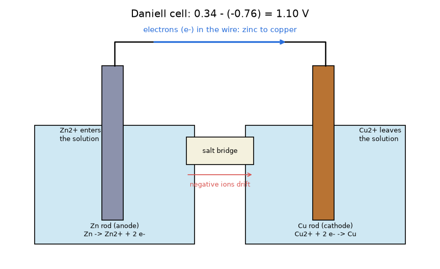
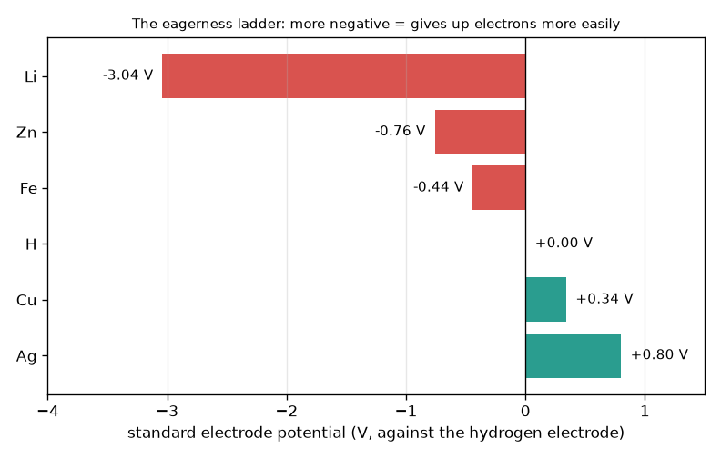

# సెషన్ 1: రెండు లోహాలు కలిసి ఒక ఘటాన్ని తయారు చేస్తాయి

[Session 1 — हिन्दी](README.hi.md)

*స్థాయి 1 (భావనాత్మక ఇంటరాక్టివ్ నమూనా) · సుమారు 60 నిమిషాలు · openbatterycell*

> ఇది సరళీకరించిన విద్యా నమూనా. ఇది ధృవీకరించబడిన (validated) డిజైన్ సాధనం కాదు; నిజమైన నిర్మాణాలు, విద్యుత్ ఇన్‌స్టలేషన్లు, వాహనాలు, పారిశ్రామిక ప్రక్రియలు లేదా వైద్య నిర్ణయాల కోసం దీనిని ఉపయోగించకూడదు.

**ముందస్తు అవసరాలు (Prerequisites)**

- తీసివేత (subtraction) మరియు రుణ సంఖ్యలతో కూడిన సంఖ్యా రేఖ (number line).
- మీరు PRIMER.md చదివి, `python start.py 1` ఒకసారి రన్ చేశారు.

**అభ్యసన లక్ష్యాలు (Learning objectives).** ఈ సెషన్ తర్వాత మీరు:

- ఒక తీగ మరియు ఒక లవణ వారధి (salt bridge) ద్వారా కలిపిన రెండు వేర్వేరు లోహాలు ఎందుకు వోల్టేజ్ (voltage) ఇస్తాయో ఒక చిత్రంతో వివరించగలరు.
- రెండు ప్రామాణిక ఎలక్ట్రోడ్ పొటెన్షియల్స్ (standard electrode potential) నుండి ఘట వోల్టేజ్‌ను లెక్కించగలరు, E = E(cathode) - E(anode).
- ఏ లోహం ఆనోడ్ (anode) అనీ, ఎలక్ట్రాన్లు మరియు అయాన్లు (ions) ఏ దిశలో కదులుతాయనీ చెప్పగలరు.
- ఒక లక్ష్య వోల్టేజ్ కోసం శ్రేణిలో (in series) ఎన్ని ఘటాలు అవసరమో కనుగొనగలరు.

## A. వాస్తవ ప్రపంచ సమస్య
ఒక నిమ్మకాయలో ఒక జింక్ మేకును, ఒక రాగి నాణేన్ని గుచ్చి, వాటిని ఒక చిన్న మీటర్‌కు కలపండి: ఏదీ ప్లగ్ చేయకపోయినా అది ఒక వోల్టేజ్‌ను చూపిస్తుంది. టార్చ్ బ్యాటరీ కూడా ఇదే ఆలోచన, మరింత చక్కని పెట్టెలో. వోల్టేజ్ ఎక్కడి నుండి వస్తుంది, ఎలక్ట్రాన్లు ఏ వైపు వెళ్తాయి, ఒక పరికరానికి అవసరమైన వోల్టేజ్‌ను చేరుకోవడానికి అనేక ఘటాలను ఎలా పేర్చాలి? (నిజమైన లిథియం మరియు లెడ్-యాసిడ్ బ్యాటరీలు ప్రమాదకరం కావచ్చు; ఈ రెపో ఒక విద్యా నమూనా, వాటిని తయారు చేయడానికి మార్గదర్శిని కాదు.)

## B. భావన మరియు సిద్ధాంతం
కొన్ని లోహాలు ఇతరుల కంటే సులభంగా ఎలక్ట్రాన్లను వదులుకుంటాయి. రసాయన శాస్త్రవేత్తలు వాటిని వోల్ట్‌లలో ప్రామాణిక ఎలక్ట్రోడ్ పొటెన్షియల్ E0 తో ర్యాంక్ చేస్తారు; దీనిని 0 V గా నిర్వచించిన ప్రామాణిక హైడ్రోజన్ ఎలక్ట్రోడ్ (standard hydrogen electrode) కు వ్యతిరేకంగా కొలుస్తారు. సంఖ్య ఎంత రుణాత్మకంగా ఉంటే, లోహం అంత ఆత్రుతగా ఎలక్ట్రాన్లను వదులుకుంటుంది. రెండు లోహాలను ఒక తీగ మరియు లవణ వారధితో కలిపినప్పుడు, నిచ్చెనలో (ladder) కింద ఉన్న లోహం ఆనోడ్ అవుతుంది మరియు ఎలక్ట్రాన్లను తీగలోకి నెడుతుంది; నిచ్చెనలో పైన ఉన్న లోహం కాథోడ్ (cathode) అవుతుంది మరియు వాటిని స్వీకరిస్తుంది. ఘట వోల్టేజ్ ఈ ఎత్తు తేడా E = E(cathode) - E(anode). ద్రావణంలో, ఆనోడ్ లోహం ధన అయాన్లుగా కరుగుతుంది మరియు కాథోడ్ వద్ద ధన అయాన్లు ఎలక్ట్రాన్లను తీసుకుని లోహంగా మారతాయి; లవణ వారధి ఆవేశిత అయాన్లను కదలనిస్తుంది కాబట్టి ఏ బీకర్‌లోనూ ఆవేశం పేరుకుపోదు. శ్రేణిలో కలిపిన ఘటాల వోల్టేజ్‌లు కలుస్తాయి.

| గుర్తు | అర్థం | ప్రమాణం |
|---|---|---|
| E0 | ఒక లోహం యొక్క ప్రామాణిక ఎలక్ట్రోడ్ పొటెన్షియల్ (క్షయకరణం, 25 C, 1 mol/L) | V |
| E_cell | ఘట వోల్టేజ్ = E0(cathode) - E0(anode) | V |
| n | శ్రేణిలో ఉన్న ఒకేలాంటి ఘటాల సంఖ్య | ప్రమాణం లేదు |
| V_total | స్టాక్ వోల్టేజ్, n రెట్లు E_cell | V |

**ఊహలు (Assumptions)**

- పాఠ్యపుస్తక ఆదర్శ పరిస్థితులు: 25 C మరియు 1 mol/L ద్రావణాలు.
- కరెంట్ తీసుకోవడం లేదు (కరెంట్ అందిస్తున్నప్పుడు నిజమైన ఘటం తక్కువ వోల్టేజ్ ఇస్తుంది; సెషన్ 3).
- విలువలు గుండ్రంగా చేసిన పాఠ్యపుస్తక సంఖ్యలు: Li -3.04, Zn -0.76, Fe -0.44, హైడ్రోజన్ 0.00, Cu +0.34, Ag +0.80 V.

$$ E_{cell}=E^{0}_{cathode}-E^{0}_{anode} $$

$$ \text{Zn/Cu (Daniell): } E_{cell}=0.34-(-0.76)=1.10\ \mathrm{V} $$

$$ V_{total}=n\,E_{cell},\qquad n=\left\lceil \frac{V_{target}}{E_{cell}}\right\rceil $$

## C. దృశ్య వివరణ
మొదటి చిత్రం ఆత్రుత నిచ్చెన (eagerness ladder): లిథియం (-3.04 V) నుండి వెండి (+0.80 V) వరకు ప్రామాణిక ఎలక్ట్రోడ్ పొటెన్షియల్స్ బార్‌లు. ఏవైనా రెండు బార్‌లు ఒక ఘటం, దాని వోల్టేజ్ వాటి మధ్య క్షితిజ సమాంతర దూరం. రెండవ చిత్రం డేనియల్ ఘటాన్ని (Daniell cell) చూపిస్తుంది: రెండు బీకర్లలో ఒక జింక్ కడ్డీ మరియు ఒక రాగి కడ్డీ, తీగ వెంట జింక్ నుండి రాగికి కదిలే ఎలక్ట్రాన్లు, ఎడమ ద్రావణంలోకి ప్రవేశించే జింక్ అయాన్లు, కుడి ద్రావణం నుండి వెళ్లిపోయే రాగి అయాన్లు, మధ్యలో లవణ వారధి.

*ఒక డేనియల్ ఘటం: తీగలో జింక్ నుండి రాగికి ఎలక్ట్రాన్లు, ద్రావణంలో మరియు లవణ వారధిలో అయాన్లు, 1.10 V.*

*ఆత్రుత నిచ్చెన: లిథియం (-3.04 V) నుండి వెండి (+0.80 V) వరకు ప్రామాణిక ఎలక్ట్రోడ్ పొటెన్షియల్స్.*

## D. ఇంటరాక్టివ్ సిమ్యులేషన్
పాఠాన్ని రన్ చేయండి (`python start.py 1`), తర్వాత లైవ్ యాప్‌ను తెరవండి: [సెషన్ 1: రెండు లోహాలను ఎంచుకోండి](https://krunalpanchal1995.github.io/pan-iit-oss/openbatterycell/session-01/) (లేదా ఈ ఫోల్డర్‌లోని `app.html`). రెండు పొటెన్షియల్ స్లైడర్లతో ప్రతి వైపు లోహాన్ని ఎంచుకుని, వోల్టేజ్, ఎలక్ట్రాన్ చుక్కల దిశ మరియు స్టాక్ గ్రాఫ్‌ను గమనించండి. తర్వాత శ్రేణిలోని ఘటాల సంఖ్యను మార్చండి.

**సవాలు.** గరిష్టంగా 3 ఘటాలను శ్రేణిలో ఉపయోగించి కనీసం 3 V చేరుకోండి.

## E. సాధించిన ఉదాహరణ మరియు ప్రయోగం
**సమస్య.** ఒక బొమ్మకు కనీసం 4.5 V అవసరం. శ్రేణిలో ఎన్ని జింక్-రాగి ఘటాలు అవసరం, అవి ఎంత వోల్టేజ్ ఇస్తాయి?

1. ఒక జింక్-రాగి ఘటం: E = 0.34 - (-0.76) = 1.10 V.
2. అవసరమైన ఘటాలు: 4.5 / 1.10 = 4.09; ఒక ఘటంలో 0.09 భాగాన్ని తయారు చేయలేము, కాబట్టి 5 కి పైకి గుండ్రంగా చేయండి.
3. మొత్తం: 5 x 1.10 = 5.50 V, ఇది కనీసం 4.5 V.
4. తనిఖీ: 4 ఘటాలు 4.40 V మాత్రమే ఇస్తాయి, అది చాలా తక్కువ.

**సమాధానం.** శ్రేణిలో 5 ఘటాలు, 5.50 V.

**ప్రయోగం.** జింక్ పూత పూసిన (గాల్వనైజ్డ్, galvanised) మేకును మరియు ఒక రాగి నాణెం లేదా తీగను ఒక నిమ్మకాయలో గుచ్చి, వోల్ట్‌లకు సెట్ చేసిన మల్టీమీటర్‌ను (multimeter) కలిపి రీడింగ్‌ను నమోదు చేయండి; తర్వాత మూడు నిమ్మకాయలను శ్రేణిలో కలిపి మళ్ళీ నమోదు చేయండి. ప్రతి నిమ్మకాయకు ఆదర్శ 1.10 V కంటే స్పష్టంగా తక్కువ మరియు చాలా తక్కువ కరెంట్ ఆశించండి, కాబట్టి బల్బు వెలగదు. నమూనా ప్రామాణిక 1 mol/L ద్రావణాలను మరియు కరెంట్ లేకపోవడాన్ని ఊహిస్తుంది; నిమ్మకాయలో బలహీనమైన, ఆమ్ల రసం, పెద్ద నిరోధం (resistance) మరియు తెలియని గాఢతలు (concentrations) ఉంటాయి. దీని కోసం మెయిన్స్ విద్యుత్‌తో నడిచేవి లేదా పెద్ద బ్యాటరీలను ఉపయోగించవద్దు.

## F. మూల్యాంకనం మరియు డిజైన్ సవాలు
**ప్రశ్న రకం A: భావనాత్మక.** జింక్-రాగి ఘటంలో ఎలక్ట్రాన్లు ఎందుకు జింక్ నుండి రాగికి ప్రయాణిస్తాయి, లవణ వారధిని తీసివేస్తే కరెంట్‌ను ఏది ఆపుతుంది?

సూచన

ఆత్రుత నిచ్చెనలో ఏ లోహం కింద ఉంది? వారధి లేకుండా ప్రతి బీకర్‌లోని ఆవేశానికి ఏమి జరుగుతుంది?

దశలవారీ పరిష్కారం

జింక్ (-0.76 V) నిచ్చెనలో రాగి (+0.34 V) కంటే కింద ఉంది, కాబట్టి అది సులభంగా ఎలక్ట్రాన్లను వదులుకుంటుంది: అది ఆనోడ్, ఎలక్ట్రాన్లను తీగలోకి నెడుతుంది, కాథోడ్ అయిన రాగి వాటిని లాగుతుంది. లవణ వారధి లేకుంటే జింక్ బీకర్‌లో ధన Zn2+ అయాన్లు పెరుగుతాయి మరియు రాగి బీకర్ ధన Cu2+ అయాన్లను కోల్పోతుంది, కాబట్టి ప్రతి బీకర్‌లో ఆవేశం పేరుకుపోయి క్షణంలోనే ఎలక్ట్రాన్ల ప్రవాహాన్ని వ్యతిరేకిస్తుంది. రెండు బీకర్లనూ తటస్థంగా ఉంచడానికి వారధి అయాన్లను కదలనిస్తుంది, కాబట్టి తీగ మరియు వారధి కలిసి ఉన్నప్పుడే వలయం పూర్తవుతుంది.

**ప్రశ్న రకం B: సంఖ్యాత్మక.** ఒక ఇనుము-వెండి ఘటం నిర్మించబడింది (ఇనుము ఆనోడ్, వెండి కాథోడ్). ఘట వోల్టేజ్‌ను మరియు 5 V కోసం శ్రేణిలో అవసరమైన ఘటాల సంఖ్యను కనుగొనండి.

సూచన

E = 0.80 - (-0.44). 5 ను ఒక ఘటం వోల్టేజ్‌తో భాగించి పైకి గుండ్రంగా చేయండి.

దశలవారీ పరిష్కారం

E = 0.80 - (-0.44) = 1.24 V. ఘటాలు: 5 / 1.24 = 4.03, 5 కి పైకి గుండ్రంగా చేయండి. మొత్తం = 5 x 1.24 = 6.20 V. సహేతుకత తనిఖీ: 4 ఘటాలు 4.96 V మాత్రమే ఇస్తాయి, 5 V కి కొంచెం తక్కువ, కాబట్టి 5 ఘటాలు అవసరం. ప్రమాణాలు: వోల్ట్‌లు.

**ప్రశ్న రకం C: గ్రాఫ్ మరియు సిమ్యులేషన్ వ్యాఖ్యానం.** స్టాక్ గ్రాఫ్‌లో, జింక్-రాగి ఘటం రేఖ మరియు ఇనుము-రాగి ఘటం రేఖ (0.34 - (-0.44) = 0.78 V) రెండూ సున్నా నుండి మొదలవుతాయి. ఏ రేఖ ఎక్కువ వాలుగా ఉంది, వాలు (slope) దేనిని సూచిస్తుంది? ఏ స్టాక్ తక్కువ ఘటాలతో 3 V చేరుకుంటుంది?

సూచన

వాలు అంటే ఒక్కో ఘటానికి వోల్ట్‌లు. 3 ను ప్రతి ఘట వోల్టేజ్‌తో భాగించి పైకి గుండ్రంగా చేయండి.

దశలవారీ పరిష్కారం

జింక్-రాగి రేఖ ఎక్కువ వాలుగా ఉంది: దాని వాలు ఒక్కో ఘటానికి 1.10 V, మరొకదానిది ఒక్కో ఘటానికి 0.78 V. జింక్-రాగికి ceil(3 / 1.10) = 3 ఘటాలు (3.30 V) అవసరం; ఇనుము-రాగికి ceil(3 / 0.78) = 4 ఘటాలు (3.12 V) అవసరం. నిచ్చెనపై పెద్ద అంతరం అంటే తక్కువ ఘటాలు.

**ప్రశ్న రకం D: డిజైన్ మరియు ఆప్టిమైజేషన్ (optimisation) సవాలు.** డిజైన్: ఒక చిన్న రేడియోకు జింక్, ఇనుము, రాగి మరియు వెండి లోహాలతో చేసిన నీటి ఆధారిత ఘటాల నుండి కనీసం 6 V అవసరం. అతి తక్కువ ఘటాలు అవసరమయ్యే జతను, మరియు వెండి చాలా ఖరీదైనదైతే మీరు ఎంచుకునే జతను ఎంచుకోండి. లిథియం ఇక్కడ ఎందుకు ఎంపిక కాదు?

సూచన

అనుమతించిన లోహాలలో అతిపెద్ద అంతరాన్ని కనుగొనండి (జింక్ ఆనోడ్, వెండి కాథోడ్), తర్వాత వెండి లేకుండా అతిపెద్ద అంతరాన్ని.

దశలవారీ పరిష్కారం

వెండితో: Zn/Ag = 0.80 - (-0.76) = 1.56 V, కాబట్టి ceil(6 / 1.56) = 4 ఘటాలు 6.24 V ఇస్తాయి. వెండి లేకుండా అతిపెద్ద అంతరం Zn/Cu = 1.10 V, కాబట్టి ceil(6 / 1.10) = 6 ఘటాలు 6.60 V ఇస్తాయి. రాజీ (trade-off): రెండు ఘటాలు ఎక్కువ, కానీ చాలా చౌకైన లోహం. లిథియం నీటితో తీవ్రంగా చర్య జరుపుతుంది, కాబట్టి దానికి ప్రత్యేక నీరులేని ఎలక్ట్రోలైట్ (electrolyte) మరియు మూసివేసిన, రక్షిత డిజైన్ అవసరం; అది ఇంట్లో తయారు చేయదగినది కాదు, మరియు సాధారణ బీకర్ నమూనా దానికి వర్తించదు.

[RUBRIC.md](../../RUBRIC.md) తో మిమ్మల్ని మీరు స్కోర్ చేసుకోండి. కాగితంపై చేయడానికి [కార్యాచరణ పత్రాన్ని](activity_sheet.md) ప్రింట్ చేయండి.

## సాధారణ అపోహలు
| సాధారణ అపోహ | వాస్తవంగా నిజమైనది |
|---|---|
| నిమ్మకాయ (ఆమ్లం) విద్యుత్ శక్తికి మూలం. | శక్తి రెండు లోహాల మధ్య రసాయన తేడా నుండి వస్తుంది; రసం అయాన్లను మాత్రమే మోస్తుంది. జింక్ నెమ్మదిగా ఖర్చవుతుంది. |
| ఎలక్ట్రాన్లు లవణ వారధి ద్వారా ప్రవహిస్తాయి. | ఎలక్ట్రాన్లు తీగలో ప్రవహిస్తాయి; అయాన్లు లవణ వారధిలో మరియు ద్రావణాలలో ప్రవహిస్తాయి. రెండు మార్గాలూ అవసరం. |
| ఏ పరికరంలోనైనా ఆనోడ్ ఎల్లప్పుడూ రుణాత్మకంగా కనిపించే టెర్మినల్. | లోహం ఎలక్ట్రాన్లను వదులుకునే ఎలక్ట్రోడ్‌నే ఆనోడ్ అంటారు. కరెంట్ అందిస్తున్న ఘటంలో అది రుణ టెర్మినల్; బ్యాటరీని ఛార్జ్ చేసినప్పుడు పేర్లు తారుమారవుతాయి. |
| ఘటాలను శ్రేణిలో కలపడం వల్ల అవి ఎక్కువ కాలం పనిచేస్తాయి. | శ్రేణి వోల్టేజ్‌ను మాత్రమే కలుపుతుంది; వరుస సామర్థ్యం (capacity) ఒక ఘటానిదే ఉంటుంది (సెషన్ 2). |

## పదకోశం (Glossary)
- **ఎలక్ట్రోడ్ (electrode)**: ఎలక్ట్రాన్లు మార్పిడి అయ్యే, ఒక ద్రావణంలో ముంచిన లోహపు కడ్డీ
- **ఆనోడ్ (anode)**: ఎలక్ట్రాన్లను వదులుకునే ఎలక్ట్రోడ్ (పొటెన్షియల్ నిచ్చెనలో కింద)
- **కాథోడ్ (cathode)**: ఎలక్ట్రాన్లను స్వీకరించే ఎలక్ట్రోడ్ (నిచ్చెనలో పైన)
- **ప్రామాణిక ఎలక్ట్రోడ్ పొటెన్షియల్ (standard electrode potential)**: ఒక లోహం తన ఎలక్ట్రాన్లను ఎంత సులభంగా ఉంచుకుంటుందో, హైడ్రోజన్ ఎలక్ట్రోడ్‌కు వ్యతిరేకంగా వోల్ట్‌లలో కొలత
- **లవణ వారధి (salt bridge)**: రెండు బీకర్ల మధ్య అయాన్లకు ఒక మార్గం, ప్రతిదాన్నీ విద్యుత్‌పరంగా తటస్థంగా ఉంచుతుంది
- **శ్రేణి సంధానం (series connection)**: వోల్టేజ్‌లు కలిసేలా ఒకదాని తర్వాత ఒకటి కలిపిన ఘటాలు

## ముగింపు
1. [exercises.md](exercises.md) లోని మూడు కోడింగ్ పనులను చేయండి.
2. మీ మార్పుల తర్వాత `python start.py 1` మళ్ళీ రన్ చేయండి. అది చెక్‌పాయింట్‌తో ముగుస్తుంది; అది `PASS` ప్రింట్ చేసినప్పుడు మీరు పూర్తి చేశారు. (చెక్‌పాయింట్ మాత్రమే: `python start.py check 1`.)

తర్వాత: [సెషన్ 2](../session-02/README.md)
