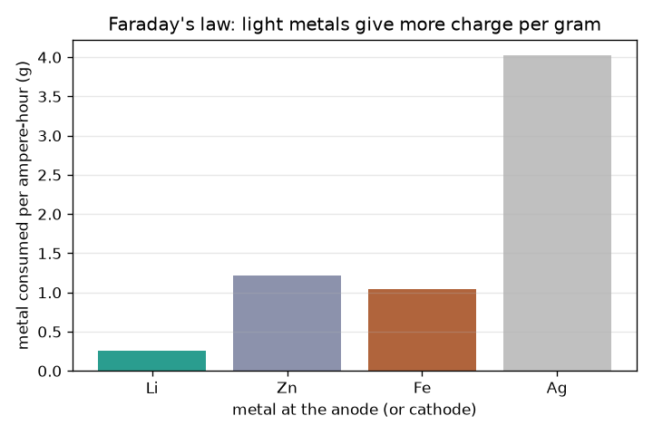
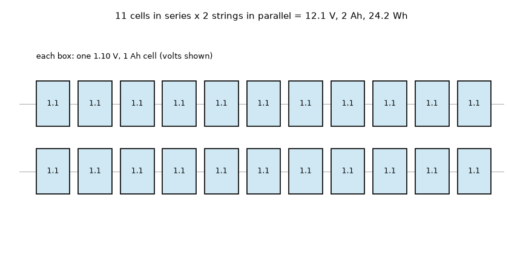

# Session 2: Voltage, capacity and Faraday's law

*Level 2 (mathematical engineering model) · about 75 minutes · openbatterycell*

> This is a simplified educational model. It is not a validated design tool and must not be used for real structures, electrical installations, vehicles, industrial processes or medical decisions.

**Prerequisites**

- Session 1: cell voltage from two potentials.
- Multiplying and dividing with units; the idea of a mole (explained in Section B).

**Learning objectives.** After this session you can:

- Connect cells in series and parallel to reach a target voltage and capacity.
- Compute capacity in ampere-hours and energy in watt-hours, Wh = V x Ah.
- Use the charge of a mole of electrons, F = 96485 C/mol, to get the metal mass consumed (Faraday's law).
- Solve a design problem: cells in series and parallel for 12 V and 2 Ah and the zinc mass needed.

## A. Real-world problem
You want a 12 V, 2 Ah supply for a small light and you have only 1.10 V cells that each hold 1 Ah. How many cells, connected how? And how many grams of zinc must be inside, at the very least? A designer answers these before building anything, and the same arithmetic scales from a torch to a battery pack. (Educational model of ideal cells: real lithium and lead-acid packs can burn if shorted, overheated or overcharged.)

## B. Concept and theory
Series connection: voltages add and the capacity is that of one cell. Parallel connection: voltage stays and capacities add. A pack with ns cells in each string and npar strings has V = ns V_cell, capacity Q = npar Ah_cell, and stores energy W = V x Q in watt-hours. Charge: one ampere-hour is 3600 coulombs. One mole of electrons carries F = 96485 coulombs, and each zinc atom gives up n = 2 electrons, so Q coulombs dissolve Q / (n F) moles of zinc, i.e. a mass m = Q M / (n F) with M = 65.38 g/mol. For one ampere-hour that is 1.2197 g of zinc. Because every series cell passes the same charge, the total zinc in a pack is (series cells) x (pack Ah) x 1.2197 g per Ah.

| Symbol | Meaning | Unit |
|---|---|---|
| V_cell | voltage of one cell (Zn/Cu, ideal) | V |
| ns, npar | cells in series per string, number of strings in parallel | no unit |
| Ah_cell | capacity of one cell | Ah |
| Q | charge that flows | C (1 Ah = 3600 C) |
| F | Faraday constant, charge of one mole of electrons | 96485 C/mol |
| n | electrons per metal ion (2 for Zn2+) | no unit |
| M | molar mass of the metal (65.38 for zinc) | g/mol |
| m | mass of metal consumed | g |
| W | energy W = V x Ah | Wh |

**Assumptions**

- Ideal cells: constant 1.10 V, the full capacity is usable (Session 3 relaxes this).
- All cells in a pack are identical and share current equally.
- Zinc is the limiting chemical; the copper side has enough Cu2+.
- The 1 Ah per cell is an assumed design value for the exercise.

$$ V_{pack}=n_s V_{cell},\quad Q_{pack}=n_p\,Ah_{cell},\quad W=V_{pack}Q_{pack}\ \ (\mathrm{Wh}) $$

$$ Q\,[\mathrm{C}]=3600\times Ah,\qquad \text{moles of electrons}=Q/F $$

$$ m=\frac{Q\,M}{n\,F}\qquad\Rightarrow\qquad m_{Zn}=\frac{3600\times 65.38}{2\times 96485}=1.2197\ \mathrm{g\ per\ Ah} $$

$$ n_s=\left\lceil \frac{V_{target}}{V_{cell}}\right\rceil,\qquad n_p=\left\lceil \frac{Ah_{target}}{Ah_{cell}}\right\rceil $$

## C. Visual explanation
The first figure draws the design as a grid: 11 boxes across (cells in series, each 1.10 V) and 2 rows (strings in parallel); it gives 12.1 V, 2 Ah and 24.2 Wh. The second figure is a bar chart of the grams of metal that react per ampere-hour for lithium (0.259 g), zinc (1.220 g), iron (1.042 g) and silver (4.025 g): light metals carry more charge per gram, which is why lithium cells store so much energy for their weight.

*Grams of metal consumed per ampere-hour from Faraday's law: lithium 0.259, zinc 1.220, iron 1.042, silver 4.025.*

*The 12 V, 2 Ah design: 11 cells in series by 2 strings in parallel gives 12.1 V, 2 Ah and 24.2 Wh.*

## D. Interactive simulation
Run the lesson (`python start.py 2`), then open the live app: [Session 2: size a pack](https://krunalpanchal1995.github.io/pan-iit-oss/openbatterycell/session-02/) (or `app.html` in this folder). Change the number of cells in series and strings in parallel and the capacity of one cell. Watch the pack voltage, capacity, energy and zinc mass, then open the voltage and zinc graphs.

**Challenge.** Reach 12 V or more and 2 Ah or more using at most 14 cells.

## E. Worked example and experiment
**Problem.** Design a pack of at least 12 V and at least 2 Ah from 1.10 V, 1 Ah zinc-copper cells. Give the cell count, the energy and the minimum zinc mass.

1. Series: 12 / 1.10 = 10.9, round up: ns = 11 cells, V = 11 x 1.10 = 12.1 V.
2. Parallel: 2 / 1 = 2 strings, so the capacity is 2 x 1 = 2 Ah.
3. Total cells = 11 x 2 = 22. Energy W = 12.1 V x 2 Ah = 24.2 Wh (check: 22 cells x 1.10 V x 1 Ah = 24.2 Wh).
4. Zinc per cell for 1 Ah: Q = 3600 C, m = 3600 x 65.38 / (2 x 96485) = 1.2197 g.
5. Zinc in the pack: 22 x 1.2197 = 26.8 g (at least; real cells need extra for losses).

**Answer.** 11 cells in series x 2 strings = 22 cells, 12.1 V, 2 Ah, 24.2 Wh, at least 26.8 g of zinc.

**Experiment.** Weigh a zinc strip (or galvanised nail), use it as the anode in a simple Zn/Cu cell with a resistor of about 100 ohm for a few hours, dry and weigh it again, and compare the mass lost with Q M / (n F) where Q is the measured current times the time. Expect the real mass loss to be larger than the prediction because zinc also reacts directly with the solution without producing current, and a small mass is hard to weigh. The model assumes every zinc atom that dissolves gives its two electrons to the circuit.

## F. Assessment and design challenge
**Question type A: Conceptual.** Why does connecting cells in parallel not raise the voltage, and why does connecting cells in series not increase how long a light runs?

Hint

In parallel, each cell is connected across the same two points. In series, the same current passes through every cell.

Step-by-step solution

In parallel every cell is connected across the same two nodes, so the voltage between them is the voltage of one cell, but each cell supplies only part of the current, so the capacities add and the light runs longer. In series the same current flows through each cell, so each loses charge at the full rate: the voltages add, but the charge available is still that of a single cell, so the runtime for a given current does not change.

**Question type B: Numerical.** How much zinc is consumed by a 0.5 A current flowing for 4 hours? How many ampere-hours is that?

Hint

Q = I t in coulombs, then m = Q M / (n F) with M = 65.38 g/mol and n = 2.

Step-by-step solution

Q = 0.5 A x 4 h x 3600 s/h = 7200 C, which is 2.0 Ah. m = 7200 x 65.38 / (2 x 96485) = 2.439 g. Check: 2 Ah x 1.2197 g/Ah = 2.439 g. Units: grams.

**Question type C: Graph and simulation interpretation.** On the zinc graph for 11 cells in series, read the zinc mass for a pack capacity of 2 Ah. How would the line change if you used 5 series cells instead, and why is the line straight?

Hint

The slope is series cells x 1.2197 g per Ah.

Step-by-step solution

The slope is 11 x 1.2197 = 13.4 g per Ah, so at 2 Ah the pack contains 26.8 g of zinc. With 5 series cells the slope falls to 5 x 1.2197 = 6.10 g per Ah (12.2 g at 2 Ah). The line is straight because Faraday's law is linear: twice the charge dissolves twice the zinc.

**Question type D: Design and optimisation challenge.** Design: a pack must give at least 6 V and 3 Ah from 1.10 V cells that each hold only 0.8 Ah. Find ns and np, the energy, and the zinc mass. State one reason you might accept a pack with more cells.

Hint

ns = ceil(6 / 1.10), np = ceil(3 / 0.8). Zinc per cell is 0.8 Ah x 1.2197 g/Ah.

Step-by-step solution

ns = ceil(5.45) = 6 cells (6.6 V). np = ceil(3.75) = 4 strings, giving 3.2 Ah. Cells = 24. Energy = 6.6 V x 3.2 Ah = 21.1 Wh. Zinc = 24 x 0.8 x 1.2197 = 23.4 g. A pack with more cells could be accepted for margin against the real capacity being below the nominal value or for lower current per cell (Session 3), at the cost of more connections, weight and money. Assumption: ideal cells.

Score yourself with [RUBRIC.md](../../RUBRIC.md). Print the [activity sheet](activity_sheet.md) to work on paper.

## Common misconceptions
| Common misconception | What is actually true |
|---|---|
| Putting cells in parallel gives more voltage. | Parallel keeps the voltage and adds capacity; series adds voltage. |
| Wh and Ah are the same thing. | Ah counts charge; Wh counts energy = volts x Ah. A 12 V, 2 Ah pack stores 24 Wh, a 1.1 V, 2 Ah cell only 2.2 Wh. |
| Only the capacity decides how much zinc a pack needs. | The zinc is ns x pack Ah x 1.2197 g: it also grows with the number of series cells, because each one passes the full charge of the pack. |
| A metal's mass determines the voltage of the cell. | Voltage comes from the electrode potentials; mass only sets how much charge (capacity) is available. |

## Glossary
- **ampere-hour (Ah)**: a unit of charge: 1 Ah = 3600 coulombs
- **watt-hour (Wh)**: a unit of energy: volts times ampere-hours
- **Faraday constant**: the charge of one mole of electrons, 96485 coulombs per mole
- **mole**: a fixed large number of particles (6.022e23); the molar mass is the mass of one mole
- **parallel connection**: cells joined side by side so capacities add and voltage stays
- **capacity**: how much charge a cell can deliver, in ampere-hours

## Finish
1. Do the three coding tasks in [exercises.md](exercises.md).
2. Run `python start.py 2` again after your changes. It ends with the checkpoint; when it prints `PASS`, you are done. (Checkpoint only: `python start.py check 2`.)

Next: [Session 3](../session-03/README.md)
