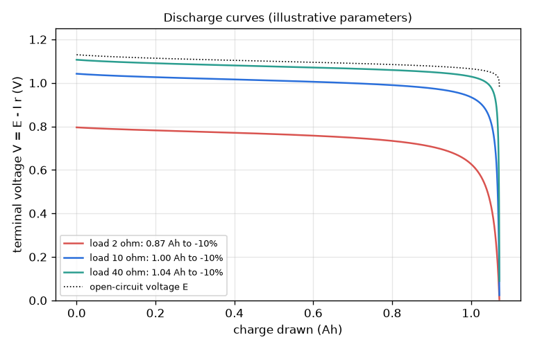
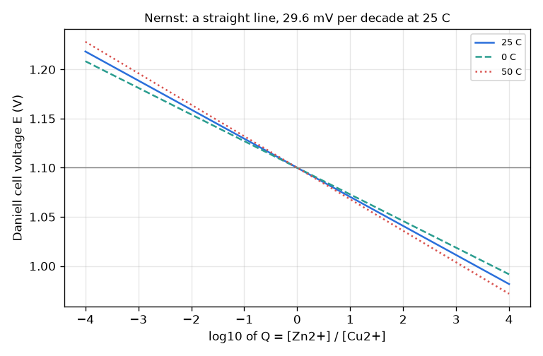
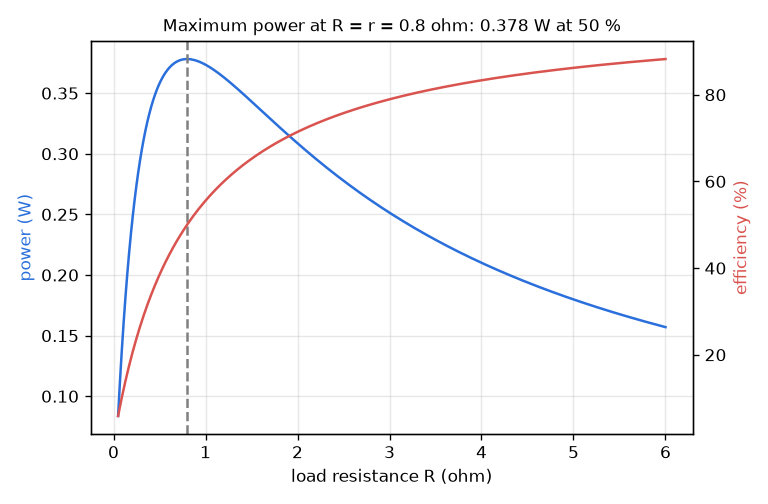
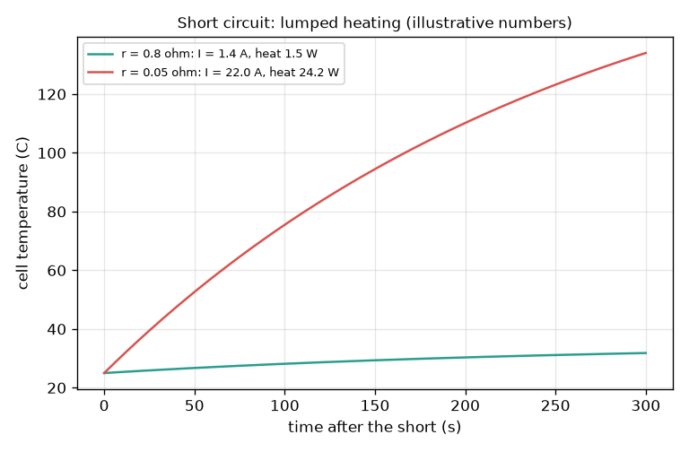
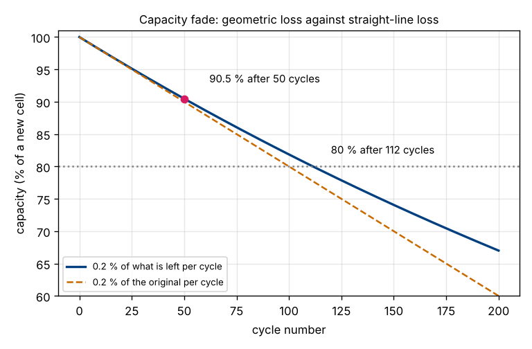

# Session 3: A cell that runs down

*Level 3 (simulation and validation) · about 90 minutes · openbatterycell*

> This is a simplified educational model. It is not a validated design tool and must not be used for real structures, electrical installations, vehicles, industrial processes or medical decisions.

**Prerequisites**

- Session 1: cell voltage.
- Session 2: charge, Faraday's law, ampere-hours.
- The natural logarithm (ln): ln 10 = 2.303 is all you need to remember.

**Learning objectives.** After this session you can:

- Use the Nernst equation to find how the voltage depends on the concentration ratio, and check it numerically.
- Simulate a discharge with internal resistance and read the terminal voltage curve against charge drawn.
- Show that power to a load is largest when R_load equals the internal resistance, with 50 percent efficiency.
- Validate the simulation against Faraday's law, an energy balance and a time-step test, and study temperature and a short circuit.

## A. Real-world problem
A torch cell does not stay at its printed voltage: it sags when the torch is bright, recovers when it is dimmed, fades when cold and, if shorted, gets hot fast. Why? Three effects explain it: the chemicals are used up (Nernst), the cell has an internal resistance, and heat is made wherever current flows through that resistance. Can you simulate them with one small model and check it against Faraday's law? (Real lithium and lead-acid batteries can be dangerous; every parameter here is illustrative and the model is educational only.)

## B. Concept and theory
Nernst equation: for Zn + Cu2+ -> Zn2+ + Cu with reaction quotient Q = [Zn2+] / [Cu2+], E = E0 - (R T / (n F)) ln Q, with n = 2. At 25 C, R T / F = 25.69 mV, so each factor e in Q changes E by 25.69 mV / n; each decade (factor 10) changes E by 2.303 R T / (n F), i.e. 59.16 mV for n = 1 and 29.58 mV for the Daniell cell. Discharge: drawing charge q reacts q / (n F) moles, which lowers [Cu2+] and raises [Zn2+] in a solution of volume V_sol. With internal resistance r and load R, I = E / (R + r) and the terminal voltage is V = E - I r. Delivered power is P = I^2 R = E^2 R / (R + r)^2, maximal at R = r where P_max = E^2 / (4 r) and efficiency R / (R + r) is 50 percent. A short circuit (R near 0) gives I = E / r and heat I^2 r, warming the cell by the lumped model C_th dT/dt = I^2 r - hA (T - T_amb). Illustrative extras: r rises as Cu2+ runs out and falls as temperature rises.

| Symbol | Meaning | Unit |
|---|---|---|
| E0 | standard cell voltage (1.10 V for Zn/Cu) | V |
| Q | reaction quotient [Zn2+] / [Cu2+] | no unit |
| R, T | gas constant 8.314 J/(mol K), absolute temperature | J/(mol K), K |
| n, F | electrons transferred (2), Faraday constant | no unit, C/mol |
| q | charge drawn so far | C |
| r | internal resistance of the cell (0.8 ohm at 25 C, illustrative) | ohm |
| R_load | resistance of the load | ohm |
| I, V | current and terminal voltage | A, V |
| C_th, hA | heat capacity of the cell (40 J/K) and heat loss coefficient (0.15 W/K), illustrative | J/K, W/K |

**Assumptions**

- Activities are taken equal to concentrations (ideal dilute solutions).
- Solution volume 20 mL per side, 1.0 mol/L Cu2+ and 0.10 mol/L Zn2+ at the start: all illustrative, chosen to give about 1 Ah.
- E0 does not change with temperature (a simplification); r follows an Arrhenius-type factor with 20 kJ/mol (illustrative).
- r rises by 0.05 x [Cu2+]_start / [Cu2+] as the copper runs out (illustrative; real cells depend on chemistry).
- Heating uses one lumped temperature; no thermal runaway, venting or fire is modelled.

$$ E=E^{0}-\frac{RT}{nF}\ln Q,\qquad Q=\frac{[\mathrm{Zn^{2+}}]}{[\mathrm{Cu^{2+}}]} $$

$$ \Delta E_{\text{decade}}=\frac{2.303\,RT}{nF}=29.58\ \mathrm{mV}\ (n=2),\ 59.16\ \mathrm{mV}\ (n=1)\ \text{at 25 C} $$

$$ I=\frac{E}{R_{load}+r},\qquad V=E-Ir,\qquad \frac{dq}{dt}=I(q) $$

$$ P=\frac{E^{2}R_{load}}{(R_{load}+r)^{2}},\quad P_{max}=\frac{E^{2}}{4r}\ \text{at}\ R_{load}=r,\quad \eta=\frac{R_{load}}{R_{load}+r} $$

$$ C_{th}\frac{dT}{dt}=I^{2}r-hA\,(T-T_{amb}),\qquad I=\frac{E}{r}\ \text{for a short} $$

## C. Visual explanation
Figure 1 is the Nernst sweep: the Daniell voltage against log10 of Q is a straight line falling 29.6 mV per decade at 25 C, steeper when warm and flatter when cold. Figure 2 shows the discharge curves for loads of 2, 10 and 40 ohm: almost flat, then a knee near the end as the copper runs out and the internal resistance rises; a heavy load starts lower (0.795 V against 1.106 V) and gives less usable capacity (0.873 against 1.043 Ah before a 10 percent voltage drop). Figure 3 plots power and efficiency against load resistance: the power peaks at 0.378 W where R equals r = 0.8 ohm, exactly where the efficiency passes through 50 percent. Figure 4 shows the temperature after a short circuit for two internal resistances.

*Discharge curves for 2, 10 and 40 ohm loads (illustrative parameters), with the open-circuit voltage dotted.*

*The Nernst sweep of the Daniell cell: a straight line of 29.6 mV per decade of Q at 25 C, with 0 C and 50 C lines.*

*Power and efficiency against load: the maximum power of 0.378 W is at R = r = 0.8 ohm where the efficiency is 50 percent.*

*Lumped heating after a short circuit for r = 0.8 ohm and r = 0.05 ohm (illustrative thermal numbers).*

**Many cycles.** A rechargeable cell is discharged, recharged to full and discharged again, and each cycle permanently loses a small fraction `loss` of the capacity that is left. Because the bite is a fraction of what remains, the capacity after n cycles is geometric, f(n) = (1 - loss)^n. For a loss of 0.2 percent per cycle, f(50) = 0.998^50 = 0.9047, so the cell holds 90.5 percent of its new capacity after 50 cycles, and it falls to 80 percent (the usual end of life) after 112 cycles. Taking 0.2 percent of the *original* capacity each cycle would give exactly 90.0 percent after 50 cycles and 80 percent after 100; the two curves in the figure differ because the geometric bite shrinks as the cell shrinks. An aged cell behaves like a smaller cell (the same voltage curve, shorter along the charge axis), so its usable capacity and its energy per discharge scale with f: a 10 ohm load gets 0.996 Ah and 1.00 Wh from the new cell and 0.90 Ah and 0.91 Wh after 50 cycles, and about 100 Wh over the whole life to 80 percent. `capacity_fraction`, `cycles_to_fraction` and `cycle_life` in `lesson.py` do this, and the checkpoint compares the aged-cell capacity with an independent calculation of a cell with a smaller solution volume. Real fade is not constant (it is faster at first and again near the end), so treat 0.2 percent as an illustrative number.

*Capacity against cycle number: geometric loss (blue) and a straight-line loss (orange); 90.5 percent after 50 cycles, 80 percent after 112.*

## D. Interactive simulation
Run the lesson (`python start.py 3`), then open the live app: [Session 3: discharge a cell](https://krunalpanchal1995.github.io/pan-iit-oss/openbatterycell/session-03/) (or `app.html` in this folder). Use the load, internal resistance, temperature and starting zinc concentration sliders. The fourth view, **Capacity over cycles**, uses the cycle-loss and cycle-count sliders: set 0.2 percent and 50 cycles and read 90.5 percent. Watch the terminal voltage curve, then the power graph (move the load to the peak) and the Nernst line with the start and end points. In the app the peak is at the effective starting resistance 0.84 ohm (0.380 W), because the depletion term adds 5 percent to r at the start; Figure 3 uses the plain r = 0.8 ohm.

**Challenge.** Choose the load resistance that draws the maximum power from the fresh cell, within 0.1 ohm (at 25 C that is the effective internal resistance, 1.05 x r).

## E. Worked example and experiment
**Problem.** A Daniell cell starts with [Zn2+] = 0.10 mol/L and [Cu2+] = 1.0 mol/L at 25 C. Find its voltage, then the current, terminal voltage and powers when it drives a 10 ohm load (internal resistance 0.8 ohm, plus 0.05 x 0.8 from the depletion term at the start).

1. Q = 0.10 / 1.0 = 0.10, ln Q = -2.3026. R T / (n F) = 8.3145 x 298.15 / (2 x 96485) = 0.012847 V.
2. E = 1.10 - 0.012847 x (-2.3026) = 1.10 + 0.02958 = 1.1296 V (slightly above 1.10 V because Q is below 1).
3. Internal resistance at the start: r = 0.8 x (1 + 0.05 x 1.0 / 1.0) = 0.84 ohm.
4. Current I = 1.1296 / (10 + 0.84) = 0.1042 A. Terminal voltage V = 1.1296 - 0.1042 x 0.84 = 1.0420 V.
5. Power in the load = I^2 R = 0.1042^2 x 10 = 0.1086 W; heat in the cell = I^2 r = 0.0091 W.

**Answer.** E = 1.1296 V, I = 0.1042 A, V = 1.0420 V, load power 0.1086 W, heat in the cell 0.0091 W.

**Experiment.** With a fresh AA alkaline cell (do not short it) measure the open-circuit voltage E with a multimeter, then connect a 10 ohm resistor of at least 0.5 W and read the voltage V across it quickly. The internal resistance is r = R (E / V - 1). Compare with the typical simulation shape: a flat curve then a knee. Real cells differ because their chemistry, diffusion limits, temperature and ageing are not in this model, and alkaline cells are not zinc-copper cells.

## Real-world application and mini-project: Design a battery pack for a small light with a runtime requirement
A small lamp behaves like a 30 ohm resistor and needs at least 9.0 V across it for at least 5 hours. Your cells are the Session 3 zinc-copper cell (1.072 Ah each, illustrative parameters). A pack has ns cells in series per string and npar identical strings in parallel. Use `pack_runtime_hours(ns, npar, 30.0, 9.0)` from Session 3 and find the pack with the fewest cells that meets the requirement. Then repeat at 0 C (set T = 273.15) and say what changes. This is an educational model: never build a pack of real lithium or lead-acid cells from a simulation.

**Deliverable:** A script that prints a table of runtime in hours for ns from 8 to 14 and npar from 1 to 4, names the smallest passing pack, repeats the search at 0 C, and saves a plot of lamp voltage against time for the chosen pack.

**Success looks like:** At 25 C the smallest passing pack is 10 in series x 2 in parallel = 20 cells (5.95 h, lamp 9.91 V at the start); 9 x 2 fails after 0.20 h. At 0 C the smallest passing pack grows to 12 x 2 = 24 cells (5.60 h), because the cold cell has a larger internal resistance.

## F. Assessment and design challenge
**Question type A: Conceptual.** Why is the power to the load greatest when R equals the internal resistance, yet the efficiency is then only 50 percent? What would you choose for a torch you want to run a long time?

Hint

Compare the voltage drop across r and across R, and think about what happens to P = I^2 R when R is very small or very large.

Step-by-step solution

For very small R the current is large but the voltage across R is tiny (almost all of the voltage drops inside the cell), so P = I^2 R is small. For very large R the current is tiny, so P is small. In between there is a maximum, found at R = r, where the voltage divides equally between r and R, so half the power is lost as heat in r: efficiency 50 percent. For a long running time you choose a much larger R than r (efficiency R / (R + r) close to 1), accepting lower power.

**Question type B: Numerical.** For E = 1.10 V and r = 0.8 ohm find the load for maximum power, the current, the load power, and the heat made inside the cell at that point.

Hint

R = r. I = E / (R + r). P = I^2 R.

Step-by-step solution

R = 0.8 ohm. I = 1.10 / 1.6 = 0.6875 A. P = 0.6875^2 x 0.8 = 0.378 W (= E^2 / (4 r) = 1.21 / 3.2 = 0.378 W). Heat in the cell = I^2 r = 0.378 W too, so the efficiency is 50 percent. Units: ohm, ampere, watt.

**Question type C: Graph and simulation interpretation.** In the discharge curves for loads of 2, 10 and 40 ohm, which curve starts highest and which gives the most usable capacity (to a 10 percent drop in terminal voltage)? Explain the difference using V = E - I r.

Hint

Compare the starting terminal voltages 0.795, 1.042 and 1.106 V and the capacities 0.873, 0.996 and 1.043 Ah.

Step-by-step solution

The 40 ohm load starts highest (1.106 V) and gives the most usable capacity (1.043 Ah) because it draws only 0.028 A, so the drop I r inside the cell is small. The 2 ohm load draws 0.398 A, so about 0.33 V is lost inside the cell and it starts at 0.795 V. Its resistance rises as the copper runs out, and the large current makes the knee arrive earlier, so only 0.873 Ah is available before a 10 percent drop. A heavier load always gives less usable capacity in this model.

**Question type D: Design and optimisation challenge.** Design a short-circuit safety limit: a cell has E = 1.10 V and r = 0.05 ohm. A short gives I = 22 A and 24.2 W. Find the series resistance that limits the heat made inside the cell to 2 W, and say why this is not a substitute for a proper fuse.

Hint

Heat in the cell is I^2 r, so I_max = sqrt(2 / r). Then r + R_s = E / I_max.

Step-by-step solution

I_max = sqrt(2 / 0.05) = 6.32 A. The total resistance must be at least E / I_max = 1.10 / 6.32 = 0.174 ohm, so R_s = 0.174 - 0.05 = 0.124 ohm. The resistor itself would then dissipate I^2 R_s = 4.96 W and also wastes power in normal use. Assumptions: constant E and r, no heating feedback, no thermal runaway. A real design needs a rated fuse or protection circuit, a tested cell and professional advice; this model is for understanding only.

Score yourself with [RUBRIC.md](../../RUBRIC.md). Print the [activity sheet](activity_sheet.md) to work on paper.

## Common misconceptions
| Common misconception | What is actually true |
|---|---|
| A cell has a fixed voltage until it is suddenly empty. | The open-circuit voltage changes slowly with concentration (Nernst) and the terminal voltage also drops by I r, which grows with current and as the cell wears out. |
| The Nernst equation says the voltage falls linearly with concentration. | It falls linearly with the logarithm of Q: a tenfold change in the ratio gives the same 29.58 mV step (n = 2) at any level. |
| Maximum power means maximum efficiency. | At maximum power the efficiency is only 50 percent; efficiency approaches 100 percent when the load is much larger than r, but the power is then small. |
| A short circuit is safe because the voltage of one cell is low. | A short has almost no resistance, so the current can be huge and the heat I^2 r grows with the square of the current. Real lithium cells can ignite; never short a battery. |

## Glossary
- **Nernst equation**: relates a cell voltage to the concentrations (the reaction quotient Q) and the temperature
- **reaction quotient Q**: the ratio of product to reactant concentrations at one moment
- **internal resistance**: the resistance inside the cell that makes the terminal voltage lower than E when current flows
- **terminal voltage**: the voltage you can actually use across the cell's terminals, V = E - I r
- **open-circuit voltage**: the voltage with no current flowing, E
- **lumped model**: a model that treats the whole body as one temperature
- **Runge-Kutta (RK4)**: a more accurate step-by-step method for solving a differential equation

## Finish
1. Do the three coding tasks in [exercises.md](exercises.md).
2. Run `python start.py 3` again after your changes. It ends with the checkpoint; when it prints `PASS`, you are done. (Checkpoint only: `python start.py check 3`.)

Next: [Session 4: A cold-proof lamp pack](../session-04/README.md).
