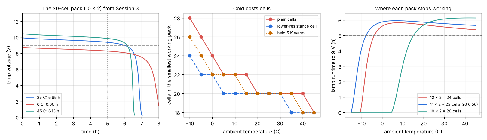

# Session 4: A cold-proof lamp pack

*Level 3 (simulation and validation) · about 90 minutes · openbatterycell*

> This is a simplified educational model. It is not a validated design tool and must not be used for real structures, electrical installations, vehicles, industrial processes or medical decisions. Real lithium and lead-acid batteries can be dangerous.

**Prerequisites**

- Session 1: a cell makes a voltage from two half reactions.
- Session 3: the discharge of one cell, internal resistance and its temperature factor, and `pack_runtime_hours`.
- Section B shows the pack as one equivalent cell.

**Learning objectives.** After this session you can:

- Compute how much a cell's internal resistance rises when it is cold, and what that does to the voltage at a load.
- Treat a series-parallel pack as one equivalent cell and compute the lamp voltage and runtime.
- Tell a pack that fails at the start from one that runs out early, and say what cures each.
- Search for the smallest pack that works at 0, 25 and 45 C, and validate the pack model with an independent solver.
- Compare design levers (a lower-resistance cell, a pack held warm) and say what each one costs.

## A. Real-world problem
A small lamp behaves like a 30 ohm resistor and needs at least 9 V across it for at least 5 hours. In Session 3 the smallest pack of our zinc-copper cells that does the job at 25 C has 20 cells (10 in series in each string, 2 strings in parallel). Carry that pack outside at 0 C and the lamp never reaches 9 V: it runs for 0 hours. Why, how big must the pack be to work on a cold day, and what can a designer do so that it does not have to be that big?

## B. Concept and theory
Cold slows the ions in the solution, so the internal resistance of a cell rises. Session 3 uses an Arrhenius-type factor (the same idea as the openarrhenius repo): r(T) = r(25 C) exp( (EA/R)(1/T - 1/T0) ), with the illustrative EA = 20 kJ/mol. The factor is 2.09 at 0 C (more than double), 2.92 at -10 C and 0.60 at 45 C, so a fresh cell has 1.758 ohm at 0 C, 0.840 ohm at 25 C and 0.506 ohm at 45 C (the 0.8 ohm of the model times the factor times 1.05 for the fresh solution). The open-circuit voltage hardly changes (1.1271 V at 0 C against 1.1296 V at 25 C, from the Nernst term), so the lamp dims because of the resistance, not because of the voltage. The most power a cell can give, E squared over 4r, falls from 0.380 W at 25 C to 0.181 W at 0 C.

A pack has ns cells in series in each string and npar identical strings in parallel. With lamp resistance R the current in each string is i = ns E / (R + ns r/npar) / npar, which simplifies to **i = E / (R npar/ns + r)**. This is one cell feeding a load R_eq = R npar/ns. The lamp voltage is v = ns i R_eq, so the lamp stays above v_min exactly while the single cell's terminal voltage stays above v_min/ns. Everything from Session 3 about one cell therefore carries over to the whole pack: the time to the cutoff is the integral of dq/i.

A pack can fail in two ways: **at the start** (the first lamp voltage is already below 9 V, which more series cells or a lower resistance cures, and more time cannot) or **early** (the lamp starts well but the cell voltage falls and the resistance rises as Cu2+ is used up, which more strings in parallel or a lower resistance delays). A design **works** if the lamp stays at or above 9 V for at least 5 h at every ambient temperature on the list, and the design search returns the working pack with the fewest cells, or says that none works in the range. A designer's levers are more cells, a cell with lower resistance, and a pack held warmer than the ambient (for example in an insulated box); the last two are held fixed for the whole run in this model.

| Symbol | Meaning | Unit |
|---|---|---|
| r(T) | internal resistance of one cell | ohm |
| EA | activation energy of the resistance (illustrative, 20 kJ/mol) | J/mol |
| ns, npar | cells in series per string, strings in parallel | no unit |
| R | lamp resistance (30 ohm) | ohm |
| R_eq | R npar / ns, the load one cell sees | ohm |
| v_min | lowest acceptable lamp voltage (9 V) | V |
| dT | how much warmer the cells are held than the ambient | K |

**Assumptions**

- The cell parameters are illustrative (volume, 0.8 ohm at 25 C, the rise as Cu2+ runs out, EA), as in Session 3; the 0.56 ohm cell is an assumption, not a measured value.
- The lamp is an ideal 30 ohm resistor at every voltage and temperature (a real filament lamp is not).
- All cells are identical and share the current equally; no mismatch, wiring resistance or protection.
- Temperature changes only the resistance and the Nernst term; real cold cells also lose capacity.
- The warm-pack lever holds the cells at ambient + dT for the entire run. A real pack takes time to warm up and a heater costs energy; that transient is not modelled here.
- A simplified teaching model, not a validated tool for design decisions.

$$ \frac{r(T)}{r(25\,^\circ\mathrm{C})}=\exp\!\Big[\frac{E_A}{R}\Big(\frac1T-\frac1{T_0}\Big)\Big] $$

$$ i=\frac{E}{R_{\text{eq}}+r},\qquad R_{\text{eq}}=\frac{R\,n_{\text{par}}}{n_{\text{s}}},\qquad v_{\text{lamp}}=n_{\text{s}}\,i\,R_{\text{eq}} $$

$$ t=\int_0^{q_{\text{cut}}}\frac{dq}{i(q)},\qquad v_{\text{lamp}}\ge v_{\min}\iff v_{\text{cell}}\ge \frac{v_{\min}}{n_{\text{s}}} $$

## C. Visual explanation
Left: the lamp voltage of the 20-cell pack (10 x 2) from Session 3 at 25, 0 and 45 C. At 25 C it starts at 9.91 V and crosses 9 V after 5.95 h; at 45 C it starts higher (10.44 V) and lasts 6.13 h; at 0 C it starts at 8.72 V, already below the dashed 9 V line, so the lamp never works. Middle: the number of cells in the smallest pack that works at each ambient temperature, for plain cells, for a cell with 30 percent lower resistance, and for a pack held 5 K warm. The staircase rises towards the cold: 18 cells at 45 C, 20 at 25 C, 24 at 0 C, 28 at -10 C, because a larger pack shares the current and each cell loses less to its own resistance. Right: the lamp runtime against the ambient temperature for three packs. Each curve climbs from 0 hours in the cold, where the pack fails at the start, and crosses the 5 h line at a different temperature: -7.8 C for 11 x 2 with the lower-resistance cell, -3.8 C for the plain 12 x 2, and only 15.1 C for the 20-cell pack.

*Left: lamp voltage of the 10 x 2 pack at 25, 0 and 45 C. Middle: cells in the smallest working pack against ambient temperature, plain and with two levers. Right: runtime against ambient temperature for three packs; the dashed line is the 5 h requirement.*

## D. Interactive simulation
Run the lesson (`python start.py 4`), then open the live app: [Session 4: a cold-proof lamp pack](https://krunalpanchal1995.github.io/pan-iit-oss/openbatterycell/session-04/) (or `app.html` in this folder). Set the ambient temperature, the cells in series, the strings in parallel, the cell resistance at 25 C and how many kelvin the pack is held above the ambient. On "Lamp voltage" see whether the pack starts above 9 V; on "Runtime against temperature" see where it stops working; on "Design map" see all 78 packs at once, your pack in the blue frame and the smallest working pack in the dashed frame.

**Challenge.** At an ambient temperature of 0 C find a pack of fewer than 24 cells that keeps the 30 ohm lamp at 9 V or more for at least 5 hours.

## E. Worked example and experiment
**Problem.** The 10 x 2 pack of Session 3 feeds the 30 ohm lamp (cutoff 9 V). At 25 C it runs 5.95 h. What happens at 0 C, and what is the smallest pack that works at 0, 25 and 45 C?

1. The resistance factor at 0 C is exp(20000/8.3145 x (1/273.15 - 1/298.15)) = exp(0.738) = 2.093, so a fresh cell is 0.8 x 2.093 x 1.05 = 1.758 ohm (0.840 ohm at 25 C).
2. The pack is one cell feeding R_eq = 30 x 2 / 10 = 6 ohm, and the lamp voltage is 10 times that cell's terminal voltage. At 25 C: 10 x 1.1296 x 6 / (6 + 0.840) = 9.91 V.
3. At 0 C: E = 1.1271 V, so the lamp voltage is 10 x 1.1271 x 6 / (6 + 1.758) = 8.72 V. The lamp starts below 9 V: runtime 0 h, a failure at the start. More time cannot help; more series cells can.
4. With 12 cells in series: R_eq = 30 x 2 / 12 = 5 ohm and v = 12 x 1.1271 x 5 / (5 + 1.758) = 10.01 V, which starts well; the 12 x 2 = 24-cell pack runs 5.60 h at 0 C, 5.62 h at 25 C and 5.37 h at 45 C. The search of 78 packs (6 to 18 in series, 1 to 6 strings) finds no working pack with fewer than 24 cells; 39 packs work and the smallest are 24, 26 and 30 cells.
5. The coldest day sets the size: alone, 45 C needs 18 cells (9 x 2), 25 C needs 20 cells (10 x 2), 0 C needs 24 cells (12 x 2).

**Answer.** At 0 C the 20-cell pack gives 0 h because the lamp starts at 8.72 V. The smallest pack that works at 0, 25 and 45 C is 12 x 2 = 24 cells (5.60, 5.62 and 5.37 h). With a cell of 0.56 ohm (30 percent lower resistance) 11 x 2 = 22 cells work everywhere (5.88, 5.81 and 5.65 h) and keep the lamp at 10.12 V at the start at 0 C, which meets the challenge; a pack held 5 K warm also needs only 22 cells (5.37, 5.89 and 5.72 h); both levers together need 20 cells (5.36, 6.14 and 6.08 h). The pack model agrees with an independent solver (fourth-order Runge-Kutta in time) and with the single-cell equivalent to better than 0.002 h on eight designs.

**Experiment.** With a real low-voltage cell (a lemon or Daniell cell, not a lithium or lead-acid cell), measure the open-circuit voltage E and the voltage V across a known resistor R at room temperature, then repeat after the cell has spent time in a refrigerator. The internal resistance is r = R (E - V) / V; E hardly changes while r rises, which is the whole story of this session. Never short-circuit a cell or cool and heat a battery in a way that could damage it.

## Real-world application and mini-project: Design a lamp pack that works in the cold
The lamp is 30 ohm and needs at least 9.0 V for at least 5 hours at ambient temperatures of 0, 25 and 45 C. The cells are the Session 3 cells (1.072 Ah each, illustrative parameters). Use `design_search` to find the smallest working pack, then repeat with a lower-resistance cell (`r0=0.56`), with the pack held 5 K warm (`dT=5`) and with both. Use `coldest_ok` to find the lowest ambient temperature at which the 10 x 2, 12 x 2 and 11 x 2 (lower-resistance cell) packs still meet the requirement. This is an educational model: never build a pack of real lithium or lead-acid cells from a simulation.

**Deliverable:** A script that prints a table of runtime at 0 C for 8 to 14 cells in series and 1 to 4 strings, names the smallest working pack for the four cases (plain, lower resistance, warm, both), prints the coldest working ambient temperature of the three packs, and saves a plot of lamp voltage against time for the chosen pack at 0, 25 and 45 C.

**Success looks like:** Plain cells: 12 x 2 = 24 cells (5.60 h at 0 C, 5.62 h at 25 C, 5.37 h at 45 C). Lower-resistance cell: 11 x 2 = 22 cells (5.88, 5.81, 5.65 h). Pack held 5 K warm: 11 x 2 = 22 cells (5.37, 5.89, 5.72 h). Both: 10 x 2 = 20 cells (5.36, 6.14, 6.08 h). The coldest working ambient is 15.1 C for 10 x 2, -3.8 C for 12 x 2 and -7.8 C for 11 x 2 with the lower-resistance cell.

## F. Assessment and design challenge
**Question type A: Conceptual.** A cold cell has almost the same open-circuit voltage as a warm one (1.127 V against 1.130 V), yet the 20-cell pack lights the lamp at 25 C and not at 0 C. What changes, which kind of failure is it, and what cures it?

Hint

Compare the change in E with the change in the internal resistance r, and ask whether the lamp ever reaches 9 V.

Step-by-step solution

E changes by only 2 mV, but r rises from 0.840 to 1.758 ohm (a factor 2.09). Part of the cell voltage is lost across r, so the lamp voltage falls from 9.91 V to 8.72 V, below the 9 V needed from the very first moment. That is a failure at the start, so waiting or adding strings in parallel is not the first remedy: more cells in series raise the voltage (12 in series gives 10.01 V at 0 C), or a cell with a lower resistance lowers the loss. Parallel strings do reduce the sag by sharing the current, which is why they also help.

**Question type B: Numerical.** Find the internal resistance of a fresh cell at 0 C and the lamp voltage at the start of the 10 x 2 pack at 0 C (E = 1.1271 V at 0 C).

Hint

r = 0.8 x factor x 1.05 with factor = exp((20000/8.3145)(1/273.15 - 1/298.15)); then treat the pack as one cell feeding R_eq = R npar/ns.

Step-by-step solution

(1/273.15 - 1/298.15) = 3.0697e-4 per K and 20000/8.3145 = 2405.4 K, so the exponent is 0.7384 and the factor 2.093. Then r = 0.8 x 2.093 x 1.05 = 1.758 ohm. The load seen by one cell is 30 x 2 / 10 = 6 ohm, so the lamp voltage is 10 x 1.1271 x 6 / (6 + 1.758) = 8.72 V, below 9 V: the pack fails at the start (the lesson gives 8.717 V).

**Question type C: Graph and simulation interpretation.** In the right panel of the figure the 10 x 2 curve stays at 0 h up to about 5 C and then rises steeply, while the 12 x 2 curve rises earlier and then slowly falls above about 8 C. What limits each curve in those regions?

Hint

Use `pack_report` to see whether the limit is "start" or "cutoff" at 0, 10 and 40 C.

Step-by-step solution

Below 4.6 C the 10 x 2 pack starts under 9 V (a start failure), so the runtime is 0 whatever else happens; just above, the lamp starts fine but crosses 9 V soon, so the curve rises steeply until the cutoff is again set by the cells running out (5.95 h at 25 C). The 12 x 2 pack starts above 9 V from -10.6 C; between -10.6 and -3.8 C it starts but runs short, and from -3.8 C it meets 5 h. Above about 8 C its runtime falls slowly, from 5.82 h to 5.37 h at 45 C: a warmer cell has a lower resistance, so the same lamp receives more voltage and current from 12 cells in series and drains them faster. More series cells shorten the run once the voltage is comfortably above 9 V.

**Question type D: Design and optimisation challenge.** Design: choose one of (a) 24 plain cells, (b) 22 cells with a cell 30 percent lower in resistance, (c) 22 plain cells in an insulated box that holds them 5 K warm. Compare them at 0, 25 and 45 C, say which you would choose for a lamp used outdoors in winter, and say what the model leaves out for each.

Hint

Use `levers_table()` and `coldest_ok` for each design.

Step-by-step solution

At 0 C, 25 C and 45 C (a) runs 5.60, 5.62 and 5.37 h and works down to -3.8 C; (b) runs 5.88, 5.81 and 5.65 h and works down to -7.8 C; (c) runs 5.37, 5.89 and 5.72 h and works down to -1.9 C ambient. For a winter lamp (b) has the most margin in the cold, and (c) the least at 0 C but the best at 25 C. What is missing: (a) is simply heavier and dearer; (b) needs a better cell and the model does not know what 0.56 ohm costs or whether it is possible with these chemicals; (c) assumes the box holds the temperature for the entire run, but a real pack takes time to warm up and may need a heater that uses energy. The chosen design must also be checked against a limit on the highest temperature, which this session does not model.

Score yourself with [RUBRIC.md](../../RUBRIC.md). Print the [activity sheet](activity_sheet.md) to work on paper.

## Common misconceptions
| Common misconception | What is actually true |
|---|---|
| A cold cell has a lower voltage, so the lamp dims. | The open-circuit voltage hardly changes (1.1271 V at 0 C, 1.1296 V at 25 C). The resistance more than doubles, and the voltage lost across it is what dims the lamp. |
| A pack that works at 25 C works a bit less well at 0 C. | It falls off a cliff: the lamp starts below 9 V and the runtime is 0 h. The 20-cell pack works only from 15.1 C upwards. |
| More cells in series always means a longer run. | With the strings fixed, more series cells can shorten it (5.95, 5.93, 5.62 and 5.31 h for 10, 11, 12 and 13 cells at 25 C), because the lamp then draws more current. The smallest series count that holds 9 V for the whole run lasts longest. |
| Keeping the pack warm is a free fix. | The model holds the temperature fixed. A real pack needs insulation or a heater, takes time to warm up, and a heater uses energy. |
| The pack with the fewest cells is the best design. | Cell count is one cost. A lower-resistance cell may cost more, and a warm pack needs a box; the best design depends on what you count as cost. |

## Glossary
- **internal resistance**: the resistance inside a cell that makes its terminal voltage fall when current flows
- **temperature factor**: the number r(T)/r(25 C) by which the resistance changes with temperature
- **series and parallel**: cells in series add their voltages; strings in parallel share the current
- **equivalent cell**: one cell feeding the load R npar / ns that behaves like the whole pack
- **cutoff**: the lowest lamp voltage that still counts as working (9 V)
- **ambient temperature**: the temperature of the surroundings
- **design search**: trying every pack in a range and keeping the smallest one that meets the requirement everywhere
- **design lever**: a choice a designer can change (number of cells, cell resistance, pack temperature) to meet a requirement

## Finish
1. Do the three coding tasks in [exercises.md](exercises.md).
2. Run `python start.py 4` again after your changes. It ends with the checkpoint; when it prints `PASS`, you are done. (Checkpoint only: `python start.py check 4`.)

Next: the [roadmap](../../promo/roadmap.md). Session 5 is yours to build.
