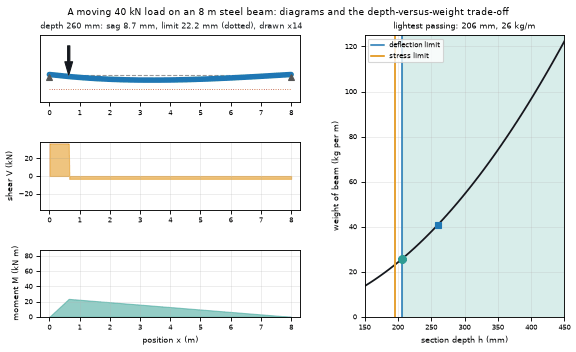
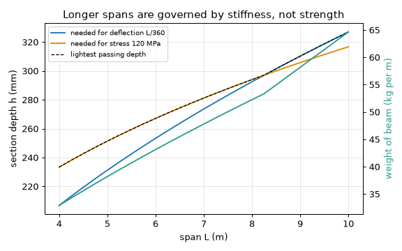
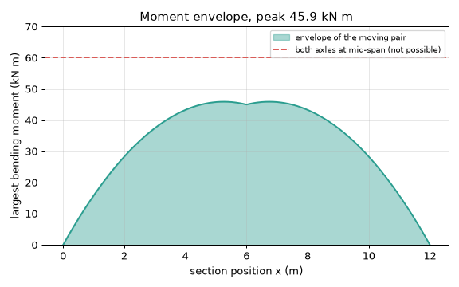

# What you are building toward

A load rolls across a steel-like beam. The beam sags under it (drawn enlarged), while the shear, moment and deflection diagrams below it move with the load. On the right, a depth-versus-weight chart shows the trade-off: a deeper beam is stiffer, but heavier, and the lightest beam that meets the deflection limit and the stress limit sits right where the two limit curves cross. Your goal over the coming sessions: build this explorer yourself, starting from the Session 4 envelope and adding an I-section.

*Target: a load crossing a beam, with moving shear, moment and deflection diagrams and the depth-versus-weight trade-off*

*Target chart: lightest beam depth that meets the deflection and stress limits*

*Target chart: moment envelope of a moving two-axle load against one fixed load*

These results come from a private reference build. The code is not published; the roadmap shows the path so you can build your own.

Live links:

- [Math Visual Studio: 1D finite elements (Atlas S86)](https://krunalpanchal1995.github.io/studio/#atlas?ch=S86&ex=1)
- [Math Visual Studio: open playground](https://krunalpanchal1995.github.io/studio/)
