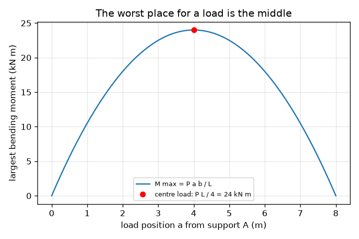
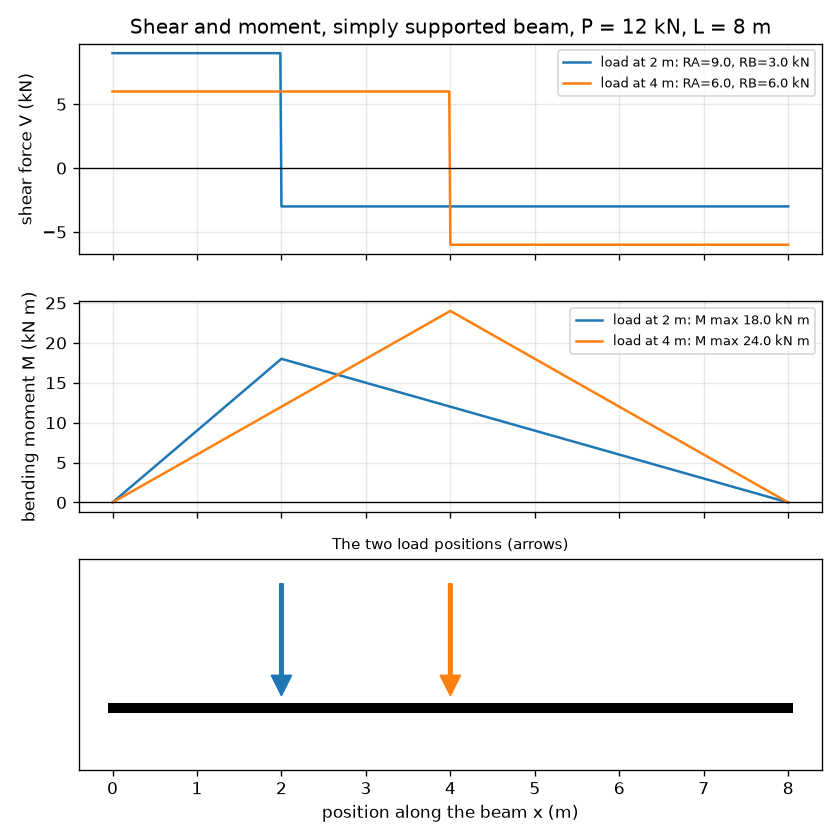

# सत्र 1: प्रतिक्रियाएँ, अपरूपण और आघूर्ण: भार पड़ने पर बीम क्या करती है

*स्तर 1 (अवधारणात्मक इंटरैक्टिव मॉडल) · लगभग 60 मिनट · openbeam*

> यह एक सरलीकृत शैक्षिक मॉडल है। यह कोई प्रमाणित डिज़ाइन उपकरण नहीं है और इसका उपयोग वास्तविक संरचनाओं, विद्युत संस्थापनों, वाहनों, औद्योगिक प्रक्रियाओं या चिकित्सा निर्णयों के लिए नहीं किया जाना चाहिए।

**पूर्वापेक्षाएँ (Prerequisites)**

- स्कूल स्तर का बीजगणित।
- आघूर्ण (moment) का विचार: बल गुणा धुरी (pivot) से दूरी।
- आपने PRIMER.md पढ़ लिया है और `python start.py 1` एक बार चला लिया है।

**सीखने के उद्देश्य (Learning objectives)।** इस सत्र के बाद आप:

- बल और आघूर्ण संतुलन से, बिंदु भार (point load) वाली सरल आलंबित बीम (simply supported beam) की आलंब प्रतिक्रियाएँ (support reactions) ज्ञात कर सकेंगे।
- अपरूपण बल (shear force) और बंकन आघूर्ण (bending moment) आरेख बना सकेंगे और बता सकेंगे कि वे आपस में कैसे संबंधित हैं।
- सबसे बड़े बंकन आघूर्ण का स्थान ज्ञात कर सकेंगे और समझा सकेंगे कि बीच में रखा भार सबसे बुरी स्थिति क्यों है।
- इकाइयों सहित ग्राफ़ पर अपरूपण या आघूर्ण आरेख पढ़ सकेंगे।

## A. वास्तविक दुनिया की समस्या
जब आप किसी नाले के ऊपर रखे तख़्ते पर खड़े होते हैं तो वह झुक जाता है। उसे दो चीज़ें थामे रखती हैं: दोनों किनारे। आपके भार का कितना हिस्सा हर किनारा उठाता है? तख़्ते के भीतर झुकाव सबसे ज़्यादा कहाँ है? इंजीनियर इसका उत्तर तीन चित्रों से देते हैं: आलंबों पर प्रतिक्रियाएँ, अपरूपण बल आरेख और बंकन आघूर्ण आरेख। यह रिपॉज़िटरी एक कक्षा मॉडल है: यह विचार सिखाती है, और किसी वास्तविक संरचना को डिज़ाइन करने का उपकरण कभी नहीं है।

## B. अवधारणा और सिद्धांत
L विस्तार (span) की एक सरल आलंबित बीम x = 0 (A) और x = L (B) पर आलंबों पर टिकी है। एक नीचे की ओर बिंदु भार P, A से a दूरी पर और B से b = L - a दूरी पर लगता है। बीम स्थिर रहती है, इसलिए बल संतुलित होते हैं (RA + RB = P) और A के परितः घुमाव प्रभाव संतुलित होते हैं (RB L = P a)। बीम को x पर काटकर बायाँ टुकड़ा रखने से पता चलता है कि बीम के भीतरी भाग को क्या देना पड़ता है: एक ऊर्ध्वाधर अपरूपण बल V और एक बंकन आघूर्ण M। M वहाँ सबसे बड़ा होता है जहाँ V का चिह्न बदलता है। आघूर्ण आरेख का ढाल (slope) अपरूपण बल के बराबर होता है।

| प्रतीक | अर्थ | इकाई |
|---|---|---|
| P | बिंदु भार (नीचे की ओर) | kN |
| L | आलंबों के बीच विस्तार | m |
| a, b | आलंब A और B से भार की दूरियाँ (b = L - a) | m |
| RA, RB | आलंब प्रतिक्रियाएँ (ऊपर की ओर) | kN |
| V(x) | स्थिति x पर अपरूपण बल | kN |
| M(x) | स्थिति x पर बंकन आघूर्ण (झोल (sagging) धनात्मक) | kN m |

**मान्यताएँ (Assumptions)**

- बीम सीधी है, इतनी दृढ़ है कि उसका झुकना बलों को नहीं बदलता, और उसका अपना भार नगण्य माना गया है।
- आलंब सरल हैं: वे बीम को थामे रखते हैं पर उसे घूमने देते हैं।
- भार एक बिंदु भार है जो सीधे नीचे की ओर लगता है।

$$ R_A=\frac{P\,b}{L},\qquad R_B=\frac{P\,a}{L},\qquad R_A+R_B=P $$

$$ V(x)=R_A\ (x<a),\qquad V(x)=R_A-P\ (x>a) $$

$$ M(x)=R_A\,x\ (x\le a),\qquad M(x)=R_A\,x-P\,(x-a)\ (x\ge a),\qquad M_{\max}=\frac{P\,a\,b}{L} $$

## C. दृश्य व्याख्या
पहला चित्र 8 m की बीम पर दो स्थितियों में रखे एक ही 12 kN भार के लिए अपरूपण बल और बंकन आघूर्ण आरेख दिखाता है। अपरूपण आरेख दो समतल सीढ़ियाँ हैं जिनका चिह्न भार पर बदलता है; आघूर्ण आरेख एक तंबू जैसा है जिसका शिखर भार के ठीक नीचे होता है। भार को बीच की ओर ले जाने से तंबू ऊँचा हो जाता है। दूसरा चित्र भार की स्थिति के सापेक्ष सबसे बड़ा आघूर्ण दिखाता है: एक परवलय (parabola) जिसका शीर्ष केंद्र पर है, जहाँ यह P L / 4 = 24 kN m के बराबर है।

*भार की स्थिति के सापेक्ष सबसे बड़ा आघूर्ण: केंद्र पर सबसे अधिक, P L / 4 = 24 kN m।*

*8 m की बीम पर 2 m और 4 m पर रखे एक ही 12 kN भार के लिए अपरूपण और आघूर्ण आरेख।*

## D. इंटरैक्टिव सिमुलेशन
पाठ चलाएँ (`python start.py 1`), फिर लाइव ऐप खोलें: [सत्र 1: प्रतिक्रियाएँ, अपरूपण और आघूर्ण](https://krunalpanchal1995.github.io/pan-iit-oss/openbeam/session-01/) (या इस फ़ोल्डर में `app.html`)। भार की स्थिति खिसकाएँ और देखें कि दोनों प्रतिक्रियाएँ कैसे जगह बदलती हैं, फिर अपरूपण और आघूर्ण दृश्यों पर जाएँ और तंबू के शिखर को भार के साथ खिसकते देखें।

**चुनौती।** कम से कम 10 kN का भार उठाएँ जबकि दायाँ आलंब 2.5 kN से अधिक न उठाए।

## E. हल किया गया उदाहरण और प्रयोग
**समस्या।** एक बीम का विस्तार L = 8 m है। एक भार P = 12 kN बाएँ आलंब से a = 2 m पर लगता है। प्रतिक्रियाएँ, भार के दोनों ओर अपरूपण बल और सबसे बड़ा बंकन आघूर्ण ज्ञात कीजिए।

1. b = L - a = 8 - 2 = 6 m।
2. A के परितः घुमाव: RB x 8 = 12 x 2, अतः RB = 24 / 8 = 3 kN।
3. बल: RA = 12 - 3 = 9 kN। RA = P b / L = 12 x 6 / 8 = 9 kN से जाँचें।
4. अपरूपण: x = 0 से 2 m तक V = +9 kN, फिर 2 m से 8 m तक 9 - 12 = -3 kN।
5. सबसे बड़ा आघूर्ण भार के नीचे है: M = RA x a = 9 x 2 = 18 kN m। दाईं ओर से जाँचें: RB x b = 3 x 6 = 18 kN m। दोनों मेल खाते हैं और P a b / L = 12 x 2 x 6 / 8 = 18 kN m के बराबर हैं।

**उत्तर।** RA = 9 kN, RB = 3 kN; अपरूपण +9 kN फिर -3 kN; सबसे बड़ा आघूर्ण x = 2 m पर 18 kN m।

**प्रयोग।** एक मीटर पैमाने (ruler) को दो रसोई तराज़ुओं पर रखें, हर सिरे के नीचे एक, और एक चुने हुए बिंदु पर एक फंदे से ज्ञात भार लटकाएँ। दोनों तराज़ू पढ़ें: उनका योग भार के बराबर होना चाहिए और वे तराज़ू की सटीकता के भीतर P b / L और P a / L से मेल खाने चाहिए। अंतर पैमाने के अपने भार से आते हैं, जिसे मॉडल नगण्य मानता है, और तराज़ू के पाठ्यांकों से: मॉडल में भार बिल्कुल बिंदु जैसा है और आलंब आदर्श हैं।

## F. मूल्यांकन और डिज़ाइन चुनौती
**प्रश्न प्रकार A: अवधारणात्मक।** भार के अधिक निकट वाला आलंब उसका अधिक हिस्सा क्यों उठाता है? जब भार ठीक बीच में खिसक जाता है तो दोनों प्रतिक्रियाओं का क्या होता है?

संकेत

एक सी-सॉ (see-saw) के बारे में सोचें: उसे घूमने से रोकने के लिए किस सिरे को ज़्यादा ज़ोर से धकेलना होगा?

चरण-दर-चरण हल

दूर वाले आलंब के परितः घुमाव प्रभावों का संतुलन दिखाता है कि निकट वाले आलंब को बड़ा हिस्सा देना होगा (RA = P b / L तब बड़ा होता है जब b, यानी दूर वाले आलंब की दूरी, बड़ी हो)। बीच में a = b = L / 2, अतः दोनों प्रतिक्रियाएँ P / 2 के बराबर हैं।

**प्रश्न प्रकार B: संख्यात्मक।** 5 m की बीम के बाएँ आलंब से 1.5 m पर 20 kN का भार लगता है। इकाइयों सहित RA, RB और सबसे बड़ा बंकन आघूर्ण ज्ञात कीजिए, और जाँचिए कि उत्तर तर्कसंगत हैं।

संकेत

b = 3.5 m। RA = P b / L और M = RA a का उपयोग करें।

चरण-दर-चरण हल

RA = 20 x 3.5 / 5 = 14 kN, RB = 20 x 1.5 / 5 = 6 kN। जाँच: 14 + 6 = 20 kN। M max = 14 x 1.5 = 21 kN m (6 x 3.5 = 21 kN m भी)। बड़ी प्रतिक्रिया भार के निकट वाली ओर है, जैसी अपेक्षा थी।

**प्रश्न प्रकार C: ग्राफ़ और सिमुलेशन की व्याख्या।** आघूर्ण ग्राफ़ पर शिखर कहाँ है, उसके बाईं ओर की रेखा का ढाल क्या है, और अपरूपण ग्राफ़ पर वह ढाल किसके बराबर है?

संकेत

x के सापेक्ष M का ढाल अपरूपण बल V है।

चरण-दर-चरण हल

शिखर भार के ठीक नीचे है। उसके बाईं ओर M एक सीधी रेखा में बढ़ता है जिसका ढाल RA है (kN m प्रति m में, जो kN है); यह अपरूपण ग्राफ़ पर धनात्मक अपरूपण सीढ़ी के बराबर है। दाईं ओर M, -RB ढाल से घटता है, जो ऋणात्मक अपरूपण सीढ़ी है। शिखर वहाँ है जहाँ V का चिह्न बदलता है।

**प्रश्न प्रकार D: डिज़ाइन और इष्टतमीकरण (optimisation) चुनौती।** एक शेल्फ़ का तख़्ता अधिकतम 15 kN m बंकन आघूर्ण सह सकता है। 6 m विस्तार पर भार 10 kN है। विस्तार के किन स्थानों पर भार रखा जा सकता है, यदि कोई हो?

संकेत

P a (L - a) / L <= 15 को a के लिए हल करें, या केंद्र मान P L / 4 से तुलना करें।

चरण-दर-चरण हल

केंद्र सबसे बुरी स्थिति है: P L / 4 = 10 x 6 / 4 = 15 kN m, ठीक सीमा पर। अतः तख़्ता हर जगह पास होता है (बीच में वह ठीक अपनी सीमा पर है)। समझौता (trade-off): कोई भी अतिरिक्त भार, या लंबा विस्तार, केंद्र पर सीमा तोड़ देगा। मान्यता: अपना भार नगण्य माना गया है।

[RUBRIC.md](../../RUBRIC.md) से स्वयं को अंक दें। काग़ज़ पर काम करने के लिए [गतिविधि पत्रक](activity_sheet.md) प्रिंट करें।

## आम भ्रांतियाँ (Common misconceptions)
| आम भ्रांति | वास्तव में क्या सही है |
|---|---|
| हर आलंब हमेशा आधा भार उठाता है। | केवल तब जब भार केंद्र पर हो। निकट वाला आलंब अधिक उठाता है: RA = P b / L। |
| अपरूपण बल और बंकन आघूर्ण एक ही चीज़ हैं। | अपरूपण कटान के आर-पार एक सरकाने वाला बल है (kN); आघूर्ण एक घुमाव प्रभाव है (kN m)। आघूर्ण आरेख का ढाल अपरूपण है। |
| बीम आलंबों पर सबसे ज़्यादा झुकती है। | सरल आलंबों पर आघूर्ण शून्य होता है और भार के नीचे सबसे बड़ा। |

## शब्दावली (Glossary)
- **प्रतिक्रिया (reaction)**: वह ऊपर की ओर बल जो आलंब बीम को थामे रखने के लिए देता है
- **अपरूपण बल (shear force)**: बीम के कटान के आर-पार सरकाने वाला बल
- **बंकन आघूर्ण (bending moment)**: कटान के आर-पार घुमाव प्रभाव; बड़े आघूर्ण का अर्थ है तीव्र झुकाव
- **सरल आलंबित (simply supported)**: दो आलंबों पर टिकी हुई जो बीम को थामे रखते हैं पर उसे घूमने देते हैं
- **झोल (sagging)**: ऐसा झुकना जिससे बीम मुस्कान जैसी वक्र हो जाए; धनात्मक आघूर्ण माना जाता है

## समापन
1. [exercises.md](exercises.md) में दिए तीन कोडिंग कार्य करें।
2. अपने बदलावों के बाद `python start.py 1` फिर से चलाएँ। यह चेकपॉइंट के साथ समाप्त होता है; जब यह `PASS` छापे, तो आपका काम पूरा है। (केवल चेकपॉइंट: `python start.py check 1`।)

आगे: [सत्र 2](../session-02/README.md)
