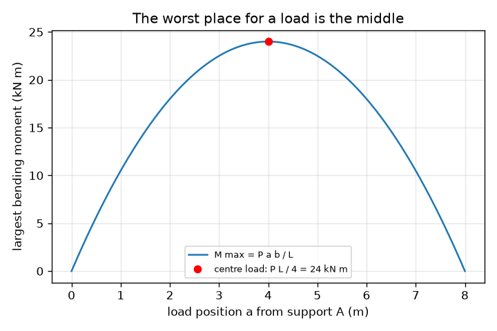
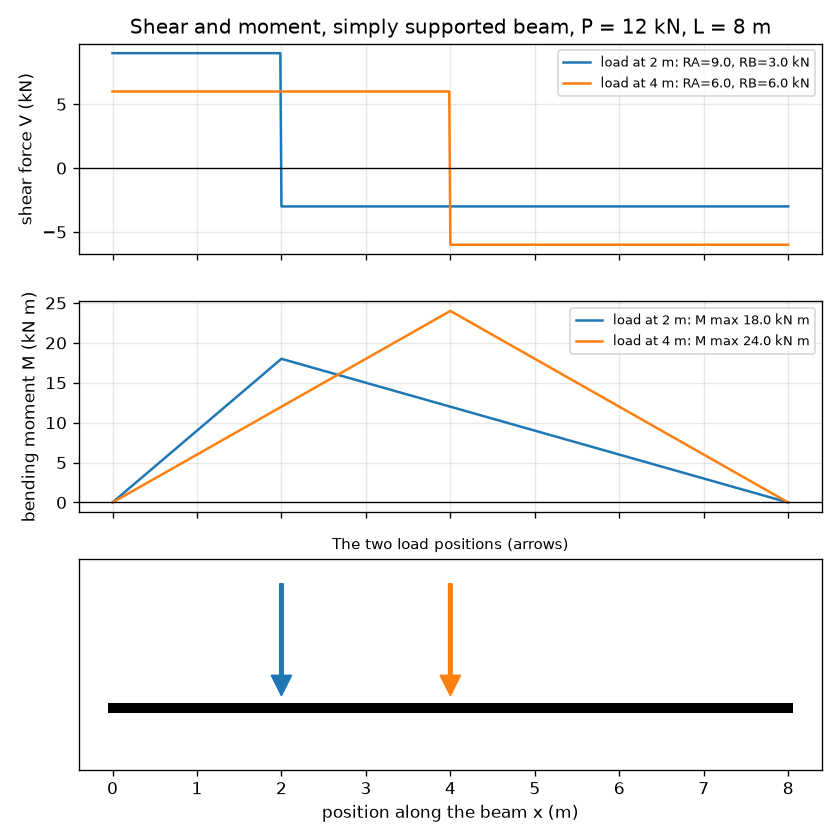

# സെഷൻ 1: പ്രതിപ്രവർത്തനങ്ങൾ, ഷിയർ, മൊമെന്റ്: ഒരു ബീം ഭാരത്തോട് എന്ത് ചെയ്യുന്നു

[Session 1 — हिन्दी](README.hi.md)

*ലെവൽ 1 (ആശയപരമായ ഇന്ററാക്ടീവ് മോഡൽ) · ഏകദേശം 60 മിനിറ്റ് · openbeam*

> ഇത് ഒരു ലളിതമാക്കിയ വിദ്യാഭ്യാസ മോഡൽ ആണ്. ഇത് സാധൂകരിക്കപ്പെട്ട ഒരു ഡിസൈൻ ഉപകരണമല്ല; യഥാർത്ഥ നിർമ്മിതികൾ (structures), വൈദ്യുത ഇൻസ്റ്റലേഷനുകൾ, വാഹനങ്ങൾ, വ്യാവസായിക പ്രക്രിയകൾ അല്ലെങ്കിൽ വൈദ്യപരമായ തീരുമാനങ്ങൾ എന്നിവയ്ക്ക് ഇത് ഉപയോഗിക്കരുത്.

**മുൻ അറിവ് (Prerequisites)**

- സ്കൂൾ ബീജഗണിതം (algebra).
- മൊമെന്റ് (moment) എന്ന ആശയം: ബലം ഗുണം ഒരു പിവറ്റിൽ (pivot) നിന്നുള്ള ദൂരം.
- നിങ്ങൾ PRIMER.md വായിക്കുകയും `python start.py 1` ഒരു തവണ റൺ ചെയ്യുകയും ചെയ്തിട്ടുണ്ട്.

**പഠന ലക്ഷ്യങ്ങൾ (Learning objectives).** ഈ സെഷനു ശേഷം നിങ്ങൾക്ക് കഴിയും:

- ഒരു ബിന്ദു ഭാരമുള്ള (point load) ലളിതമായി താങ്ങിനിർത്തിയ ബീമിന്റെ (simply supported beam) താങ്ങ് പ്രതിപ്രവർത്തനങ്ങൾ (support reactions) ബല സന്തുലനത്തിൽ നിന്നും മൊമെന്റ് സന്തുലനത്തിൽ നിന്നും കണ്ടെത്താൻ.
- ഷിയർ ഫോഴ്സ് (shear force), ബെൻഡിംഗ് മൊമെന്റ് (bending moment) ഡയഗ്രങ്ങൾ വരയ്ക്കാനും അവ തമ്മിലുള്ള ബന്ധം പറയാനും.
- ഏറ്റവും വലിയ ബെൻഡിംഗ് മൊമെന്റ് എവിടെയാണെന്ന് കണ്ടെത്താനും നടുവിലുള്ള ഭാരം ഏറ്റവും മോശം സ്ഥാനമാകുന്നത് എന്തുകൊണ്ടെന്ന് വിശദീകരിക്കാനും.
- യൂണിറ്റുകളുള്ള ഒരു ഗ്രാഫിൽ ഷിയർ അല്ലെങ്കിൽ മൊമെന്റ് ഡയഗ്രം വായിക്കാൻ.

## A. യഥാർത്ഥ ലോക പ്രശ്നം
ഒരു തോടിനു കുറുകെ വച്ച പലകയിൽ നിങ്ങൾ നിൽക്കുമ്പോൾ അത് വളയുന്നു. രണ്ട് കാര്യങ്ങളാണ് അതിനെ താങ്ങുന്നത്: രണ്ട് കരകൾ. നിങ്ങളുടെ ഭാരത്തിന്റെ എത്ര ഭാഗം ഓരോ കരയും വഹിക്കുന്നു? പലകയ്ക്കുള്ളിൽ വളവ് ഏറ്റവും കൂടുതൽ എവിടെയാണ്? എഞ്ചിനീയർമാർ മൂന്ന് ചിത്രങ്ങൾ കൊണ്ട് ഉത്തരം നൽകുന്നു: താങ്ങുകളിലെ പ്രതിപ്രവർത്തനങ്ങൾ, ഷിയർ ഫോഴ്സ് ഡയഗ്രം, ബെൻഡിംഗ് മൊമെന്റ് ഡയഗ്രം. ഈ റിപ്പോ ഒരു ക്ലാസ്‌റൂം മോഡൽ ആണ്: ഇത് ആശയങ്ങൾ പഠിപ്പിക്കുന്നു, ഒരിക്കലും ഒരു യഥാർത്ഥ നിർമ്മിതി ഡിസൈൻ ചെയ്യാനുള്ള ഉപകരണമല്ല.

## B. ആശയവും സിദ്ധാന്തവും
L സ്പാൻ (span) ഉള്ള ഒരു ലളിതമായി താങ്ങിനിർത്തിയ ബീം x = 0 (A) യിലും x = L (B) യിലുമുള്ള താങ്ങുകളിൽ ഇരിക്കുന്നു. താഴേക്കുള്ള ഒരു ബിന്ദു ഭാരം P, A യിൽ നിന്ന് a ദൂരത്തിലും B യിൽ നിന്ന് b = L - a ദൂരത്തിലും പ്രവർത്തിക്കുന്നു. ബീം അനങ്ങാതെ നിൽക്കുന്നു, അതിനാൽ ബലങ്ങൾ സന്തുലിതമാണ് (RA + RB = P), A യെ ആസ്പദമാക്കിയുള്ള തിരിക്കൽ ഫലങ്ങളും സന്തുലിതമാണ് (RB L = P a). ബീമിനെ x ൽ മുറിച്ച് ഇടതുഭാഗം മാത്രം എടുത്താൽ ബീമിന്റെ ഉൾഭാഗം നൽകേണ്ടത് എന്താണെന്ന് കാണാം: ഒരു ലംബ ഷിയർ ഫോഴ്സ് V, ഒരു ബെൻഡിംഗ് മൊമെന്റ് M. V യുടെ ചിഹ്നം മാറുന്നിടത്ത് M ഏറ്റവും വലുതാണ്. മൊമെന്റ് ഡയഗ്രത്തിന്റെ ചരിവ് (slope) ഷിയർ ഫോഴ്സിന് തുല്യമാണ്.

| ചിഹ്നം | അർത്ഥം | യൂണിറ്റ് |
|---|---|---|
| P | ബിന്ദു ഭാരം (താഴേക്ക്) | kN |
| L | താങ്ങുകൾക്കിടയിലുള്ള സ്പാൻ | m |
| a, b | താങ്ങ് A യിൽ നിന്നും B യിൽ നിന്നുമുള്ള ഭാരത്തിന്റെ ദൂരങ്ങൾ (b = L - a) | m |
| RA, RB | താങ്ങ് പ്രതിപ്രവർത്തനങ്ങൾ (മുകളിലേക്ക്) | kN |
| V(x) | x സ്ഥാനത്തെ ഷിയർ ഫോഴ്സ് | kN |
| M(x) | x സ്ഥാനത്തെ ബെൻഡിംഗ് മൊമെന്റ് (സാഗിംഗ് പോസിറ്റീവ്) | kN m |

**അനുമാനങ്ങൾ (Assumptions)**

- ബീം നേരെയുള്ളതും, അതിന്റെ വളവ് ബലങ്ങളെ മാറ്റാത്തത്ര ദൃഢവുമാണ്; അതിന്റെ സ്വന്തം ഭാരം അവഗണിക്കുന്നു.
- താങ്ങുകൾ ലളിതമാണ്: അവ ബീമിനെ താങ്ങിനിർത്തുന്നു, പക്ഷേ തിരിയാൻ അനുവദിക്കുന്നു.
- ഭാരം നേരെ താഴേക്ക് പ്രവർത്തിക്കുന്ന ഒരു ബിന്ദു ഭാരമാണ്.

$$ R_A=\frac{P\,b}{L},\qquad R_B=\frac{P\,a}{L},\qquad R_A+R_B=P $$

$$ V(x)=R_A\ (x<a),\qquad V(x)=R_A-P\ (x>a) $$

$$ M(x)=R_A\,x\ (x\le a),\qquad M(x)=R_A\,x-P\,(x-a)\ (x\ge a),\qquad M_{\max}=\frac{P\,a\,b}{L} $$

## C. ദൃശ്യ വിശദീകരണം
ഒരു 8 m ബീമിൽ രണ്ട് സ്ഥാനങ്ങളിൽ വച്ച അതേ 12 kN ഭാരത്തിനുള്ള ഷിയർ ഫോഴ്സ്, ബെൻഡിംഗ് മൊമെന്റ് ഡയഗ്രങ്ങൾ ആദ്യ ചിത്രം കാണിക്കുന്നു. ഷിയർ ഡയഗ്രം ഭാരത്തിനടുത്ത് ചിഹ്നം മാറുന്ന രണ്ട് പരന്ന പടികളാണ്; മൊമെന്റ് ഡയഗ്രം ഭാരത്തിനു നേരെ താഴെ അഗ്രമുള്ള ഒരു കൂടാരം (tent) പോലെയാണ്. ഭാരം നടുവിലേക്ക് നീക്കുമ്പോൾ കൂടാരം ഉയരം കൂടുന്നു. രണ്ടാമത്തെ ചിത്രം ഏറ്റവും വലിയ മൊമെന്റിനെ ഭാരത്തിന്റെ സ്ഥാനത്തിനെതിരെ പ്ലോട്ട് ചെയ്യുന്നു: നടുവിൽ മുകൾഭാഗമുള്ള ഒരു പരാബോള (parabola), അവിടെ അത് P L / 4 = 24 kN m ന് തുല്യമാണ്.

*ഭാരത്തിന്റെ സ്ഥാനത്തിനെതിരെ ഏറ്റവും വലിയ മൊമെന്റ്: നടുവിൽ ഏറ്റവും ഉയർന്നത്, P L / 4 = 24 kN m.*

*ഒരു 8 m ബീമിൽ 2 m ലും 4 m ലും വച്ച അതേ 12 kN ഭാരത്തിനുള്ള ഷിയർ, മൊമെന്റ് ഡയഗ്രങ്ങൾ.*

## D. ഇന്ററാക്ടീവ് സിമുലേഷൻ
പാഠം റൺ ചെയ്യുക (`python start.py 1`), തുടർന്ന് ലൈവ് ആപ്പ് തുറക്കുക: [സെഷൻ 1: പ്രതിപ്രവർത്തനങ്ങൾ, ഷിയർ, മൊമെന്റ്](https://krunalpanchal1995.github.io/pan-iit-oss/openbeam/session-01/) (അല്ലെങ്കിൽ ഈ ഫോൾഡറിലെ `app.html`). ഭാരത്തിന്റെ സ്ഥാനം വലിച്ചുനീക്കി രണ്ട് പ്രതിപ്രവർത്തനങ്ങൾ സ്ഥാനം മാറുന്നത് നോക്കുക, തുടർന്ന് ഷിയർ, മൊമെന്റ് കാഴ്ചകളിലേക്ക് മാറി കൂടാരത്തിന്റെ അഗ്രം ഭാരത്തോടൊപ്പം നീങ്ങുന്നത് കാണുക.

**വെല്ലുവിളി (Challenge).** വലത് താങ്ങ് 2.5 kN ൽ കൂടുതൽ വഹിക്കാതെ കുറഞ്ഞത് 10 kN ഭാരം വഹിക്കുക.

## E. ഉദാഹരണ പ്രശ്നവും പരീക്ഷണവും
**പ്രശ്നം.** ഒരു ബീമിന്റെ സ്പാൻ L = 8 m. ഇടത് താങ്ങിൽ നിന്ന് a = 2 m ദൂരത്തിൽ P = 12 kN ഭാരം പ്രവർത്തിക്കുന്നു. പ്രതിപ്രവർത്തനങ്ങൾ, ഭാരത്തിന്റെ ഇരുവശത്തുമുള്ള ഷിയർ ഫോഴ്സ്, ഏറ്റവും വലിയ ബെൻഡിംഗ് മൊമെന്റ് എന്നിവ കണ്ടെത്തുക.

1. b = L - a = 8 - 2 = 6 m.
2. A യെ ആസ്പദമാക്കി തിരിക്കൽ: RB x 8 = 12 x 2, അതിനാൽ RB = 24 / 8 = 3 kN.
3. ബലങ്ങൾ: RA = 12 - 3 = 9 kN. RA = P b / L = 12 x 6 / 8 = 9 kN ഉപയോഗിച്ച് പരിശോധിക്കുക.
4. ഷിയർ: x = 0 മുതൽ 2 m വരെ V = +9 kN, തുടർന്ന് 2 m മുതൽ 8 m വരെ 9 - 12 = -3 kN.
5. ഏറ്റവും വലിയ മൊമെന്റ് ഭാരത്തിനു താഴെയാണ്: M = RA x a = 9 x 2 = 18 kN m. വലതുവശത്തു നിന്ന് പരിശോധിക്കുക: RB x b = 3 x 6 = 18 kN m. രണ്ടും യോജിക്കുന്നു, P a b / L = 12 x 2 x 6 / 8 = 18 kN m ന് തുല്യവുമാണ്.

**ഉത്തരം.** RA = 9 kN, RB = 3 kN; ഷിയർ +9 kN തുടർന്ന് -3 kN; ഏറ്റവും വലിയ മൊമെന്റ് x = 2 m ൽ 18 kN m.

**പരീക്ഷണം.** ഒരു മീറ്റർ സ്കെയിൽ രണ്ട് അടുക്കള തുലാസുകളിൽ, ഓരോ അറ്റത്തിനും താഴെ ഒന്ന് എന്ന രീതിയിൽ വയ്ക്കുക, തിരഞ്ഞെടുത്ത ഒരു ബിന്ദുവിലെ ഒരു വളയത്തിൽ അറിയാവുന്ന ഒരു ഭാരം തൂക്കിയിടുക. രണ്ട് തുലാസുകളും വായിക്കുക: അവയുടെ തുക ഭാരത്തിന് തുല്യമായിരിക്കണം, തുലാസിന്റെ കൃത്യതയ്ക്കുള്ളിൽ P b / L, P a / L എന്നിവയുമായി യോജിക്കുകയും വേണം. വ്യത്യാസങ്ങൾ സ്കെയിലിന്റെ സ്വന്തം ഭാരത്തിൽ നിന്നും (മോഡൽ ഇത് അവഗണിക്കുന്നു) തുലാസ് റീഡിംഗുകളിൽ നിന്നുമാണ് വരുന്നത്: മോഡലിൽ തികച്ചും ബിന്ദുപോലുള്ള ഭാരവും തികഞ്ഞ താങ്ങുകളുമാണ്.

## F. വിലയിരുത്തലും ഡിസൈൻ വെല്ലുവിളിയും
**ചോദ്യ തരം A: ആശയപരം.** ഭാരത്തിനോട് അടുത്തുള്ള താങ്ങ് അതിന്റെ കൂടുതൽ ഭാഗം വഹിക്കുന്നത് എന്തുകൊണ്ട്? ഭാരം കൃത്യം നടുവിലേക്ക് നീങ്ങുമ്പോൾ രണ്ട് പ്രതിപ്രവർത്തനങ്ങൾക്കും എന്ത് സംഭവിക്കുന്നു?

സൂചന

ഒരു സീ-സോ (see-saw) ആലോചിക്കുക: അത് തിരിയാതിരിക്കാൻ ഏത് അറ്റമാണ് കൂടുതൽ ശക്തിയായി തള്ളേണ്ടത്?

ഘട്ടം ഘട്ടമായുള്ള പരിഹാരം

ദൂരെയുള്ള താങ്ങിനെ ആസ്പദമാക്കിയുള്ള തിരിക്കൽ ഫലങ്ങളുടെ സന്തുലനം കാണിക്കുന്നത് അടുത്തുള്ള താങ്ങ് വലിയ പങ്ക് നൽകണം എന്നാണ് (b, അതായത് ദൂരെയുള്ള താങ്ങിലേക്കുള്ള ദൂരം, വലുതാകുമ്പോൾ RA = P b / L വലുതാകുന്നു). നടുവിൽ a = b = L / 2, അതിനാൽ രണ്ട് പ്രതിപ്രവർത്തനങ്ങളും P / 2 ന് തുല്യമാണ്.

**ചോദ്യ തരം B: സംഖ്യാപരം.** ഒരു 5 m ബീമിന്റെ ഇടത് താങ്ങിൽ നിന്ന് 1.5 m അകലെ 20 kN ഭാരം പ്രവർത്തിക്കുന്നു. RA, RB, ഏറ്റവും വലിയ ബെൻഡിംഗ് മൊമെന്റ് എന്നിവ യൂണിറ്റുകളോടെ കണ്ടെത്തുക, ഉത്തരങ്ങൾ യുക്തിസഹമാണോ എന്ന് പരിശോധിക്കുക.

സൂചന

b = 3.5 m. RA = P b / L, M = RA a എന്നിവ ഉപയോഗിക്കുക.

ഘട്ടം ഘട്ടമായുള്ള പരിഹാരം

RA = 20 x 3.5 / 5 = 14 kN, RB = 20 x 1.5 / 5 = 6 kN. പരിശോധന: 14 + 6 = 20 kN. M max = 14 x 1.5 = 21 kN m (6 x 3.5 = 21 kN m ഉം). പ്രതീക്ഷിച്ചതുപോലെ, വലിയ പ്രതിപ്രവർത്തനം ഭാരത്തിനോട് അടുത്ത വശത്താണ്.

**ചോദ്യ തരം C: ഗ്രാഫ്, സിമുലേഷൻ വ്യാഖ്യാനം.** മൊമെന്റ് ഗ്രാഫിൽ, അഗ്രം എവിടെയാണ്, അതിന്റെ ഇടതുവശത്തുള്ള രേഖയുടെ ചരിവ് എന്താണ്, ആ ചരിവ് ഷിയർ ഗ്രാഫിൽ എന്തിന് തുല്യമാണ്?

സൂചന

x നെതിരെയുള്ള M ന്റെ ചരിവ് ഷിയർ ഫോഴ്സ് V ആണ്.

ഘട്ടം ഘട്ടമായുള്ള പരിഹാരം

അഗ്രം ഭാരത്തിനു നേരെ താഴെയാണ്. അതിന്റെ ഇടതുവശത്ത് M ഒരു നേർരേഖയിൽ ഉയരുന്നു, അതിന്റെ ചരിവ് RA ആണ് (kN m per m ൽ, അതായത് kN); അത് ഷിയർ ഗ്രാഫിലെ പോസിറ്റീവ് ഷിയർ പടിക്ക് തുല്യമാണ്. വലതുവശത്ത് M -RB ചരിവോടെ താഴുന്നു, അത് നെഗറ്റീവ് ഷിയർ പടിയാണ്. V യുടെ ചിഹ്നം മാറുന്നിടത്താണ് അഗ്രം.

**ചോദ്യ തരം D: ഡിസൈൻ, ഒപ്റ്റിമൈസേഷൻ വെല്ലുവിളി.** ഒരു ഷെൽഫ് പലകയ്ക്ക് പരമാവധി 15 kN m ബെൻഡിംഗ് മൊമെന്റ് താങ്ങാൻ കഴിയും. ഒരു 6 m സ്പാനിൽ ഭാരം 10 kN ആണ്. സ്പാനിൽ ഏതൊക്കെ സ്ഥാനങ്ങളിൽ ഭാരം വയ്ക്കാം, ഏതെങ്കിലും ഉണ്ടെങ്കിൽ?

സൂചന

a യ്ക്കായി P a (L - a) / L <= 15 പരിഹരിക്കുക, അല്ലെങ്കിൽ നടുവിലെ മൂല്യം P L / 4 മായി താരതമ്യം ചെയ്യുക.

ഘട്ടം ഘട്ടമായുള്ള പരിഹാരം

നടുവാണ് ഏറ്റവും മോശം സാഹചര്യം: P L / 4 = 10 x 6 / 4 = 15 kN m, കൃത്യം പരിധിയിൽ. അതിനാൽ പലക എല്ലായിടത്തും വിജയിക്കുന്നു (നടുവിൽ അത് കൃത്യം പരിധിയിലാണ്). ട്രേഡ്-ഓഫ് (Trade-off): ഏതെങ്കിലും അധിക ഭാരം, അല്ലെങ്കിൽ കൂടുതൽ നീളമുള്ള സ്പാൻ, നടുവിൽ പരിധി ലംഘിക്കും. അനുമാനം: സ്വന്തം ഭാരം അവഗണിക്കുന്നു.

[RUBRIC.md](../../RUBRIC.md) ഉപയോഗിച്ച് സ്വയം സ്കോർ ചെയ്യുക. പേപ്പറിൽ ചെയ്യാൻ [ആക്ടിവിറ്റി ഷീറ്റ്](activity_sheet.md) പ്രിന്റ് ചെയ്യുക.

## സാധാരണ തെറ്റിദ്ധാരണകൾ
| സാധാരണ തെറ്റിദ്ധാരണ | യഥാർത്ഥത്തിൽ ശരിയായത് |
|---|---|
| ഓരോ താങ്ങും എപ്പോഴും ഭാരത്തിന്റെ പകുതി വഹിക്കുന്നു. | ഭാരം നടുവിലായിരിക്കുമ്പോൾ മാത്രം. അടുത്തുള്ള താങ്ങ് കൂടുതൽ വഹിക്കുന്നു: RA = P b / L. |
| ഷിയർ ഫോഴ്സും ബെൻഡിംഗ് മൊമെന്റും ഒന്നുതന്നെയാണ്. | ഷിയർ മുറിവിനു കുറുകെയുള്ള ഒരു തെന്നൽ ബലമാണ് (kN); മൊമെന്റ് ഒരു തിരിക്കൽ ഫലമാണ് (kN m). മൊമെന്റ് ഡയഗ്രത്തിന്റെ ചരിവാണ് ഷിയർ. |
| താങ്ങുകൾ ഉള്ളിടത്താണ് ബീം ഏറ്റവും കൂടുതൽ വളയുന്നത്. | ലളിതമായ താങ്ങുകളിൽ മൊമെന്റ് പൂജ്യമാണ്, ഭാരത്തിനു താഴെ ഏറ്റവും വലുതും. |

## പദാവലി (Glossary)
- **പ്രതിപ്രവർത്തനം (reaction)**: ബീമിനെ താങ്ങിനിർത്താൻ ഒരു താങ്ങ് നൽകുന്ന മുകളിലേക്കുള്ള ബലം
- **ഷിയർ ഫോഴ്സ് (shear force)**: ബീമിലൂടെയുള്ള ഒരു മുറിവിനു കുറുകെയുള്ള തെന്നൽ ബലം
- **ബെൻഡിംഗ് മൊമെന്റ് (bending moment)**: ഒരു മുറിവിനു കുറുകെയുള്ള തിരിക്കൽ ഫലം; വലിയ മൊമെന്റ് എന്നാൽ ശക്തമായ വളവ്
- **ലളിതമായി താങ്ങിനിർത്തിയ (simply supported)**: ബീമിനെ താങ്ങിനിർത്തുകയും എന്നാൽ തിരിയാൻ അനുവദിക്കുകയും ചെയ്യുന്ന രണ്ട് താങ്ങുകളിൽ ഇരിക്കുന്നത്
- **സാഗിംഗ് (sagging)**: ബീം ഒരു പുഞ്ചിരി പോലെ വളയുന്ന രീതിയിലുള്ള വളവ്; പോസിറ്റീവ് മൊമെന്റായി കണക്കാക്കുന്നു

## പൂർത്തിയാക്കുക
1. [exercises.md](exercises.md) ലെ മൂന്ന് കോഡിംഗ് ടാസ്കുകൾ ചെയ്യുക.
2. നിങ്ങളുടെ മാറ്റങ്ങൾക്കു ശേഷം `python start.py 1` വീണ്ടും റൺ ചെയ്യുക. ഇത് ചെക്ക്‌പോയിന്റോടെ അവസാനിക്കുന്നു; അത് `PASS` എന്ന് പ്രിന്റ് ചെയ്യുമ്പോൾ നിങ്ങൾ പൂർത്തിയാക്കി. (ചെക്ക്‌പോയിന്റ് മാത്രം: `python start.py check 1`.)

അടുത്തത്: [സെഷൻ 2](../session-02/README.md)
