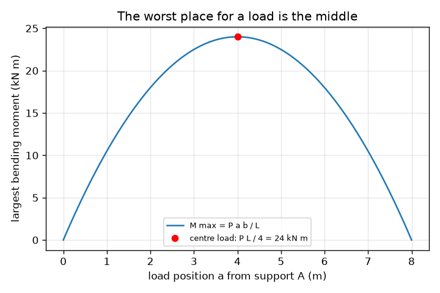
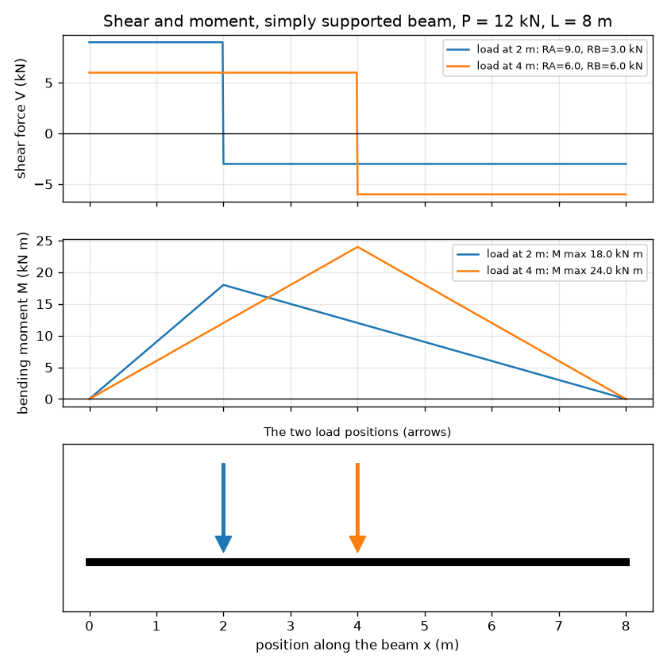

# அமர்வு 1: எதிர்வினைகள், வெட்டு மற்றும் திருப்புத்திறன்: ஒரு உத்திரம் சுமையை என்ன செய்கிறது

[Session 1 — हिन्दी](README.hi.md) · [Session 1 — മലയാളം](README.ml.md)

*நிலை 1 (கருத்தியல் ஊடாடும் மாதிரி) · சுமார் 60 நிமிடங்கள் · openbeam*

> இது ஒரு எளிமைப்படுத்தப்பட்ட கல்வி மாதிரி. இது சரிபார்க்கப்பட்ட வடிவமைப்புக் கருவி அல்ல; உண்மையான கட்டமைப்புகள் (structures), மின் நிறுவல்கள், வாகனங்கள், தொழில்துறை செயல்முறைகள் அல்லது மருத்துவ முடிவுகளுக்கு இதைப் பயன்படுத்தக் கூடாது.

**முன்தேவைகள் (Prerequisites)**

- பள்ளி இயற்கணிதம் (algebra).
- திருப்புத்திறன் (moment) என்ற கருத்து: விசை பெருக்கல் ஒரு சுழல்மையத்திலிருந்து (pivot) உள்ள தூரம்.
- நீங்கள் PRIMER.md ஐப் படித்து, `python start.py 1` ஐ ஒரு முறை இயக்கியிருக்கிறீர்கள்.

**கற்றல் நோக்கங்கள் (Learning objectives).** இந்த அமர்வுக்குப் பிறகு உங்களால் முடியும்:

- ஒரு புள்ளிச் சுமையுடன் (point load) கூடிய எளிமையாகத் தாங்கப்பட்ட உத்திரத்தின் (simply supported beam) தாங்கு எதிர்வினைகளை (support reactions) விசைச் சமநிலை மற்றும் திருப்புத்திறன் சமநிலையிலிருந்து கண்டறிய.
- வெட்டு விசை (shear force) மற்றும் வளைவுத் திருப்புத்திறன் (bending moment) வரைபடங்களை வரைந்து, அவை எவ்வாறு தொடர்புடையவை என்று கூற.
- மிகப்பெரிய வளைவுத் திருப்புத்திறன் எங்குள்ளது என்று கண்டறிந்து, நடுவில் உள்ள சுமை ஏன் மிக மோசமான நிலை என்று விளக்க.
- அலகுகளுடன் கூடிய வரைபடத்தில் வெட்டு அல்லது திருப்புத்திறன் வரைபடத்தைப் படிக்க.

## A. நிஜ உலகப் பிரச்சினை
ஓடையின் குறுக்கே வைக்கப்பட்ட பலகையின் மீது நீங்கள் நிற்கும்போது அது வளைகிறது. இரண்டு பொருட்கள் அதைத் தாங்குகின்றன: இரண்டு கரைகள். உங்கள் எடையில் எவ்வளவை ஒவ்வொரு கரையும் தாங்குகிறது? பலகைக்குள் வளைவு எங்கு மிக மோசமாக உள்ளது? பொறியாளர்கள் மூன்று படங்கள் மூலம் பதிலளிக்கின்றனர்: தாங்கிகளில் உள்ள எதிர்வினைகள், வெட்டு விசை வரைபடம் மற்றும் வளைவுத் திருப்புத்திறன் வரைபடம். இந்த ரெப்போ ஒரு வகுப்பறை மாதிரி: இது கருத்துகளைக் கற்பிக்கிறது, ஒருபோதும் உண்மையான கட்டமைப்பை வடிவமைக்கும் கருவி அல்ல.

## B. கருத்தும் கோட்பாடும்
L இடைவெளி (span) கொண்ட எளிமையாகத் தாங்கப்பட்ட உத்திரம் x = 0 (A) மற்றும் x = L (B) இல் உள்ள தாங்கிகளின் மீது உள்ளது. கீழ்நோக்கிய புள்ளிச் சுமை P, A இலிருந்து a தூரத்திலும், B இலிருந்து b = L - a தூரத்திலும் செயல்படுகிறது. உத்திரம் அசையாமல் இருக்கிறது, எனவே விசைகள் சமநிலையில் உள்ளன (RA + RB = P), A ஐப் பொறுத்த திருப்பு விளைவுகளும் சமநிலையில் உள்ளன (RB L = P a). உத்திரத்தை x இல் வெட்டி இடது பகுதியை மட்டும் வைத்துக்கொண்டால், உத்திரத்தின் உட்பகுதி என்ன வழங்க வேண்டும் என்பது தெரிகிறது: ஒரு செங்குத்து வெட்டு விசை V மற்றும் ஒரு வளைவுத் திருப்புத்திறன் M. V தன் குறியை மாற்றும் இடத்தில் M மிகப்பெரியது. திருப்புத்திறன் வரைபடத்தின் சரிவு (slope) வெட்டு விசைக்குச் சமம்.

| குறியீடு | பொருள் | அலகு |
|---|---|---|
| P | புள்ளிச் சுமை (கீழ்நோக்கி) | kN |
| L | தாங்கிகளுக்கு இடையிலான இடைவெளி | m |
| a, b | தாங்கி A மற்றும் B இலிருந்து சுமையின் தூரங்கள் (b = L - a) | m |
| RA, RB | தாங்கு எதிர்வினைகள் (மேல்நோக்கி) | kN |
| V(x) | x நிலையில் வெட்டு விசை | kN |
| M(x) | x நிலையில் வளைவுத் திருப்புத்திறன் (தொய்வு நேர்மறை) | kN m |

**அனுமானங்கள் (Assumptions)**

- உத்திரம் நேராக உள்ளது, அதன் வளைவு விசைகளை மாற்றாத அளவுக்கு உறுதியானது, அதன் சொந்த எடை புறக்கணிக்கப்படுகிறது.
- தாங்கிகள் எளிமையானவை: அவை உத்திரத்தைத் தாங்குகின்றன, ஆனால் சுழல அனுமதிக்கின்றன.
- சுமை நேராகக் கீழ்நோக்கிச் செயல்படும் புள்ளிச் சுமை.

$$ R_A=\frac{P\,b}{L},\qquad R_B=\frac{P\,a}{L},\qquad R_A+R_B=P $$

$$ V(x)=R_A\ (x<a),\qquad V(x)=R_A-P\ (x>a) $$

$$ M(x)=R_A\,x\ (x\le a),\qquad M(x)=R_A\,x-P\,(x-a)\ (x\ge a),\qquad M_{\max}=\frac{P\,a\,b}{L} $$

## C. காட்சி விளக்கம்
முதல் படம் 8 m உத்திரத்தில் இரண்டு நிலைகளில் வைக்கப்பட்ட அதே 12 kN சுமைக்கான வெட்டு விசை மற்றும் வளைவுத் திருப்புத்திறன் வரைபடங்களைக் காட்டுகிறது. வெட்டு வரைபடம் சுமையில் குறி மாறும் இரண்டு தட்டையான படிகள்; திருப்புத்திறன் வரைபடம் சுமைக்குக் கீழே உச்சியைக் கொண்ட ஒரு கூடாரம் (tent). சுமையை நடுவை நோக்கி நகர்த்தும்போது கூடாரம் உயரமாகிறது. இரண்டாவது படம் மிகப்பெரிய திருப்புத்திறனைச் சுமையின் நிலைக்கு எதிராக வரைகிறது: நடுவில் உச்சியைக் கொண்ட ஒரு பரவளையம் (parabola), அங்கு அது P L / 4 = 24 kN m க்குச் சமம்.

*சுமையின் நிலைக்கு எதிராக மிகப்பெரிய திருப்புத்திறன்: நடுவில் மிக உயர்ந்தது, P L / 4 = 24 kN m.*

*8 m உத்திரத்தில் 2 m மற்றும் 4 m இல் உள்ள அதே 12 kN சுமைக்கான வெட்டு மற்றும் திருப்புத்திறன் வரைபடங்கள்.*

## D. ஊடாடும் உருவகப்படுத்துதல்
பாடத்தை இயக்கவும் (`python start.py 1`), பின்னர் நேரடிச் செயலியைத் திறக்கவும்: [அமர்வு 1: எதிர்வினைகள், வெட்டு மற்றும் திருப்புத்திறன்](https://krunalpanchal1995.github.io/pan-iit-oss/openbeam/session-01/) (அல்லது இந்தக் கோப்புறையில் உள்ள `app.html`). சுமையின் நிலையை இழுத்து இரண்டு எதிர்வினைகளும் இடம் மாறுவதைப் பாருங்கள், பின்னர் வெட்டு மற்றும் திருப்புத்திறன் காட்சிகளுக்கு மாறி கூடாரத்தின் உச்சி சுமையுடன் நகர்வதைப் பாருங்கள்.

**சவால் (Challenge).** வலது தாங்கி 2.5 kN க்கு மேல் தாங்காமல், குறைந்தது 10 kN சுமையைத் தாங்குங்கள்.

## E. தீர்க்கப்பட்ட எடுத்துக்காட்டும் சோதனையும்
**பிரச்சினை.** ஒரு உத்திரத்தின் இடைவெளி L = 8 m. இடது தாங்கியிலிருந்து a = 2 m இல் P = 12 kN சுமை செயல்படுகிறது. எதிர்வினைகள், சுமையின் ஒவ்வொரு பக்கத்திலும் உள்ள வெட்டு விசை மற்றும் மிகப்பெரிய வளைவுத் திருப்புத்திறனைக் கண்டறியுங்கள்.

1. b = L - a = 8 - 2 = 6 m.
2. A ஐப் பொறுத்துத் திருப்புதல்: RB x 8 = 12 x 2, எனவே RB = 24 / 8 = 3 kN.
3. விசைகள்: RA = 12 - 3 = 9 kN. RA = P b / L = 12 x 6 / 8 = 9 kN மூலம் சரிபார்க்கவும்.
4. வெட்டு: x = 0 முதல் 2 m வரை V = +9 kN, பின்னர் 2 m முதல் 8 m வரை 9 - 12 = -3 kN.
5. மிகப்பெரிய திருப்புத்திறன் சுமைக்குக் கீழே உள்ளது: M = RA x a = 9 x 2 = 18 kN m. வலது பக்கத்திலிருந்து சரிபார்க்கவும்: RB x b = 3 x 6 = 18 kN m. இரண்டும் ஒத்துப்போகின்றன, மேலும் P a b / L = 12 x 2 x 6 / 8 = 18 kN m க்குச் சமம்.

**விடை.** RA = 9 kN, RB = 3 kN; வெட்டு +9 kN பின்னர் -3 kN; மிகப்பெரிய திருப்புத்திறன் x = 2 m இல் 18 kN m.

**சோதனை.** ஒரு மீட்டர் அளவுகோலை இரண்டு சமையலறைத் தராசுகளின் மீது, ஒவ்வொரு முனைக்கும் கீழே ஒன்றாக வைத்து, தேர்ந்தெடுத்த ஒரு புள்ளியில் உள்ள வளையத்திலிருந்து தெரிந்த எடையைத் தொங்கவிடுங்கள். இரண்டு தராசுகளையும் படியுங்கள்: அவற்றின் கூட்டுத்தொகை எடைக்குச் சமமாக இருக்க வேண்டும், மேலும் தராசின் துல்லியத்துக்குள் P b / L மற்றும் P a / L உடன் பொருந்த வேண்டும். வேறுபாடுகள் அளவுகோலின் சொந்த எடையிலிருந்தும் (மாதிரி இதைப் புறக்கணிக்கிறது) தராசு அளவீடுகளிலிருந்தும் வருகின்றன: மாதிரியில் முழுமையான புள்ளி போன்ற சுமையும் முழுமையான தாங்கிகளும் உள்ளன.

## F. மதிப்பீடும் வடிவமைப்புச் சவாலும்
**கேள்வி வகை A: கருத்தியல்.** சுமைக்கு அருகில் உள்ள தாங்கி ஏன் அதில் அதிகப் பங்கைத் தாங்குகிறது? சுமை சரியாக நடுவுக்கு நகரும்போது இரண்டு எதிர்வினைகளுக்கும் என்ன ஆகிறது?

குறிப்பு

ஒரு ஏற்றப்பலகையை (see-saw) நினைத்துப் பாருங்கள்: அது சுழலாமல் தடுக்க எந்த முனை அதிகமாகத் தள்ள வேண்டும்?

படிப்படியான தீர்வு

தொலைவில் உள்ள தாங்கியைப் பொறுத்த திருப்பு விளைவுகளின் சமநிலை, அருகில் உள்ள தாங்கி பெரிய பங்கை வழங்க வேண்டும் என்று காட்டுகிறது (b, அதாவது தொலைவுத் தாங்கிக்கான தூரம், பெரிதாகும்போது RA = P b / L பெரிதாகிறது). நடுவில் a = b = L / 2, எனவே இரண்டு எதிர்வினைகளும் P / 2 க்குச் சமம்.

**கேள்வி வகை B: எண்ணியல்.** 5 m உத்திரத்தின் இடது தாங்கியிலிருந்து 1.5 m இல் 20 kN சுமை செயல்படுகிறது. RA, RB மற்றும் மிகப்பெரிய வளைவுத் திருப்புத்திறனை அலகுகளுடன் கண்டறிந்து, விடைகள் பொருத்தமானவையா என்று சரிபார்க்கவும்.

குறிப்பு

b = 3.5 m. RA = P b / L மற்றும் M = RA a ஐப் பயன்படுத்தவும்.

படிப்படியான தீர்வு

RA = 20 x 3.5 / 5 = 14 kN, RB = 20 x 1.5 / 5 = 6 kN. சரிபார்ப்பு: 14 + 6 = 20 kN. M max = 14 x 1.5 = 21 kN m (6 x 3.5 = 21 kN m உம்). எதிர்பார்த்தபடி, பெரிய எதிர்வினை சுமைக்கு அருகில் உள்ள பக்கத்தில் உள்ளது.

**கேள்வி வகை C: வரைபடம் மற்றும் உருவகப்படுத்துதல் விளக்கம்.** திருப்புத்திறன் வரைபடத்தில், உச்சி எங்கே உள்ளது, அதன் இடதுபுறம் உள்ள கோட்டின் சரிவு என்ன, அந்தச் சரிவு வெட்டு வரைபடத்தில் எதற்குச் சமம்?

குறிப்பு

x க்கு எதிரான M இன் சரிவு வெட்டு விசை V ஆகும்.

படிப்படியான தீர்வு

உச்சி சுமைக்கு நேர் கீழே உள்ளது. அதன் இடதுபுறம் M ஒரு நேர்கோட்டில் உயர்கிறது, அதன் சரிவு RA (kN m per m இல், அதாவது kN); அது வெட்டு வரைபடத்தில் உள்ள நேர்மறை வெட்டுப் படிக்குச் சமம். வலதுபுறம் M, -RB சரிவுடன் இறங்குகிறது, அது எதிர்மறை வெட்டுப் படி. V குறி மாறும் இடத்தில்தான் உச்சி உள்ளது.

**கேள்வி வகை D: வடிவமைப்பு மற்றும் உகப்பாக்கச் சவால்.** ஒரு அலமாரிப் பலகை அதிகபட்சம் 15 kN m வளைவுத் திருப்புத்திறனைத் தாங்கும். 6 m இடைவெளியில் சுமை 10 kN. இடைவெளியில் எந்த நிலைகளில் சுமையை வைக்கலாம், ஏதேனும் இருந்தால்?

குறிப்பு

a க்கு P a (L - a) / L <= 15 ஐத் தீர்க்கவும், அல்லது நடு மதிப்பு P L / 4 உடன் ஒப்பிடவும்.

படிப்படியான தீர்வு

நடுவே மிக மோசமான நிலை: P L / 4 = 10 x 6 / 4 = 15 kN m, சரியாக வரம்பில். எனவே பலகை எல்லா இடத்திலும் தேறுகிறது (நடுவில் அது சரியாக வரம்பில் உள்ளது). பரிமாற்றம் (Trade-off): கூடுதல் சுமை எதுவும், அல்லது நீளமான இடைவெளி, நடுவில் வரம்பை மீறும். அனுமானம்: சொந்த எடை புறக்கணிக்கப்படுகிறது.

[RUBRIC.md](../../RUBRIC.md) மூலம் உங்களை நீங்களே மதிப்பிடுங்கள். காகிதத்தில் செய்ய [செயல்பாட்டுத் தாளை](activity_sheet.md) அச்சிடுங்கள்.

## பொதுவான தவறான கருத்துகள்
| பொதுவான தவறான கருத்து | உண்மையில் சரியானது |
|---|---|
| ஒவ்வொரு தாங்கியும் எப்போதும் சுமையில் பாதியைத் தாங்குகிறது. | சுமை நடுவில் இருக்கும்போது மட்டுமே. அருகில் உள்ள தாங்கி அதிகம் தாங்குகிறது: RA = P b / L. |
| வெட்டு விசையும் வளைவுத் திருப்புத்திறனும் ஒன்றே. | வெட்டு என்பது வெட்டின் குறுக்கே உள்ள சறுக்கு விசை (kN); திருப்புத்திறன் என்பது திருப்பு விளைவு (kN m). திருப்புத்திறன் வரைபடத்தின் சரிவுதான் வெட்டு. |
| தாங்கிகள் உள்ள இடத்தில்தான் உத்திரம் அதிகம் வளைகிறது. | எளிய தாங்கிகளில் திருப்புத்திறன் பூஜ்ஜியம், சுமைக்குக் கீழே மிகப்பெரியது. |

## சொற்களஞ்சியம் (Glossary)
- **எதிர்வினை (reaction)**: உத்திரத்தைத் தாங்க ஒரு தாங்கி வழங்கும் மேல்நோக்கிய விசை
- **வெட்டு விசை (shear force)**: உத்திரத்தின் வழியே உள்ள ஒரு வெட்டின் குறுக்கே உள்ள சறுக்கு விசை
- **வளைவுத் திருப்புத்திறன் (bending moment)**: ஒரு வெட்டின் குறுக்கே உள்ள திருப்பு விளைவு; பெரிய திருப்புத்திறன் என்றால் வலுவான வளைவு
- **எளிமையாகத் தாங்கப்பட்ட (simply supported)**: உத்திரத்தைத் தாங்கி ஆனால் சுழல அனுமதிக்கும் இரண்டு தாங்கிகளின் மீது இருப்பது
- **தொய்வு (sagging)**: உத்திரம் புன்னகை போல வளையும் வளைவு; நேர்மறைத் திருப்புத்திறனாக எடுத்துக்கொள்ளப்படுகிறது

## முடிக்கவும்
1. [exercises.md](exercises.md) இல் உள்ள மூன்று நிரலாக்கப் பணிகளைச் செய்யுங்கள்.
2. உங்கள் மாற்றங்களுக்குப் பிறகு `python start.py 1` ஐ மீண்டும் இயக்குங்கள். இது சோதனைச்சாவடியுடன் (checkpoint) முடிகிறது; அது `PASS` என்று அச்சிடும்போது நீங்கள் முடித்துவிட்டீர்கள். (சோதனைச்சாவடி மட்டும்: `python start.py check 1`.)

அடுத்து: [அமர்வு 2](../session-02/README.md)
