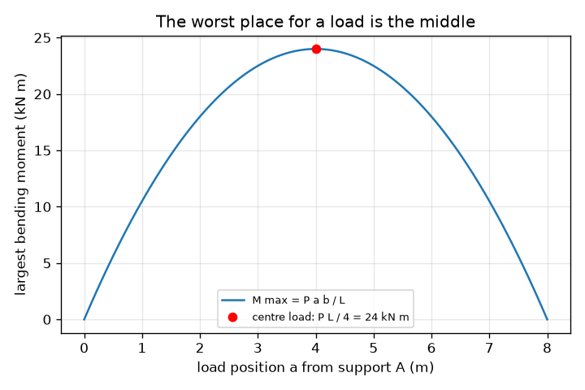
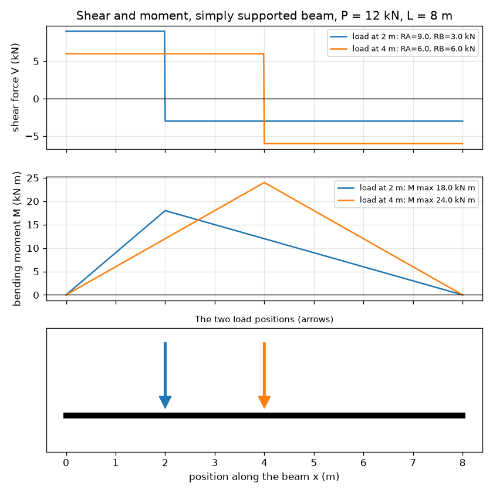

# సెషన్ 1: ప్రతిచర్యలు, షియర్ మరియు మోమెంట్: ఒక దూలం భారంతో ఏమి చేస్తుంది

[Session 1 — हिन्दी](README.hi.md) · [Session 1 — മലയാളം](README.ml.md) · [Session 1 — தமிழ்](README.ta.md)

*స్థాయి 1 (భావనాత్మక ఇంటరాక్టివ్ నమూనా) · సుమారు 60 నిమిషాలు · openbeam*

> ఇది ఒక సరళీకృత విద్యా నమూనా. ఇది ధృవీకరించబడిన డిజైన్ సాధనం కాదు; నిజమైన నిర్మాణాలు (structures), విద్యుత్ ఇన్‌స్టలేషన్లు, వాహనాలు, పారిశ్రామిక ప్రక్రియలు లేదా వైద్య నిర్ణయాల కోసం దీనిని ఉపయోగించకూడదు.

**ముందస్తు అవసరాలు (Prerequisites)**

- పాఠశాల బీజగణితం (algebra).
- మోమెంట్ (moment) అనే భావన: బలం గుణకారం ఒక పివట్ (pivot) నుండి దూరం.
- మీరు PRIMER.md చదివి, `python start.py 1` ను ఒకసారి రన్ చేశారు.

**అభ్యసన లక్ష్యాలు (Learning objectives).** ఈ సెషన్ తర్వాత మీరు చేయగలరు:

- బిందు భారం (point load) ఉన్న సరళంగా ఆధారపడిన దూలం (simply supported beam) యొక్క ఆధార ప్రతిచర్యలను (support reactions) బల సమతుల్యత మరియు మోమెంట్ సమతుల్యత నుండి కనుగొనడం.
- షియర్ ఫోర్స్ (shear force) మరియు బెండింగ్ మోమెంట్ (bending moment) రేఖాచిత్రాలను గీసి, అవి ఎలా సంబంధం కలిగి ఉన్నాయో చెప్పడం.
- అతిపెద్ద బెండింగ్ మోమెంట్ ఎక్కడ ఉందో గుర్తించి, మధ్యలో ఉన్న భారం ఎందుకు అత్యంత చెడ్డ స్థానమో వివరించడం.
- యూనిట్లతో ఉన్న గ్రాఫ్‌పై షియర్ లేదా మోమెంట్ రేఖాచిత్రాన్ని చదవడం.

## A. వాస్తవ ప్రపంచ సమస్య
ఒక వాగుకు అడ్డంగా వేసిన పలకపై మీరు నిలబడినప్పుడు అది వంగుతుంది. రెండు వస్తువులు దానిని నిలబెడతాయి: రెండు ఒడ్లు. మీ బరువులో ఎంత భాగాన్ని ప్రతి ఒడ్డు మోస్తుంది? పలక లోపల వంపు ఎక్కడ అత్యంత ఎక్కువగా ఉంటుంది? ఇంజనీర్లు మూడు చిత్రాలతో సమాధానం ఇస్తారు: ఆధారాల వద్ద ప్రతిచర్యలు, షియర్ ఫోర్స్ రేఖాచిత్రం మరియు బెండింగ్ మోమెంట్ రేఖాచిత్రం. ఈ రిపో ఒక తరగతి గది నమూనా: ఇది భావనలను బోధిస్తుంది, ఎప్పుడూ నిజమైన నిర్మాణాన్ని డిజైన్ చేసే సాధనం కాదు.

## B. భావన మరియు సిద్ధాంతం
L స్పాన్ (span) ఉన్న సరళంగా ఆధారపడిన దూలం x = 0 (A) మరియు x = L (B) వద్ద ఉన్న ఆధారాలపై ఉంటుంది. కిందికి పనిచేసే బిందు భారం P, A నుండి a దూరంలో మరియు B నుండి b = L - a దూరంలో పనిచేస్తుంది. దూలం కదలకుండా ఉంటుంది, కాబట్టి బలాలు సమతుల్యంగా ఉంటాయి (RA + RB = P) మరియు A చుట్టూ తిప్పే ప్రభావాలు సమతుల్యంగా ఉంటాయి (RB L = P a). దూలాన్ని x వద్ద కోసి ఎడమ ముక్కను మాత్రమే ఉంచితే, దూలం లోపలి భాగం ఏమి అందించాలో తెలుస్తుంది: ఒక నిలువు షియర్ ఫోర్స్ V మరియు ఒక బెండింగ్ మోమెంట్ M. V తన గుర్తును మార్చే చోట M అతిపెద్దది. మోమెంట్ రేఖాచిత్రం యొక్క వాలు (slope) షియర్ ఫోర్స్‌కు సమానం.

| గుర్తు | అర్థం | యూనిట్ |
|---|---|---|
| P | బిందు భారం (కిందికి) | kN |
| L | ఆధారాల మధ్య స్పాన్ | m |
| a, b | ఆధారం A మరియు B నుండి భారం యొక్క దూరాలు (b = L - a) | m |
| RA, RB | ఆధార ప్రతిచర్యలు (పైకి) | kN |
| V(x) | x స్థానం వద్ద షియర్ ఫోర్స్ | kN |
| M(x) | x స్థానం వద్ద బెండింగ్ మోమెంట్ (సాగింగ్ ధనాత్మకం) | kN m |

**ఊహలు (Assumptions)**

- దూలం నిటారుగా ఉంటుంది, దాని వంపు బలాలను మార్చనంత దృఢంగా ఉంటుంది, మరియు దాని సొంత బరువు విస్మరించబడుతుంది.
- ఆధారాలు సరళమైనవి: అవి దూలాన్ని నిలబెడతాయి కానీ తిరగడానికి అనుమతిస్తాయి.
- భారం నేరుగా కిందికి పనిచేసే బిందు భారం.

$$ R_A=\frac{P\,b}{L},\qquad R_B=\frac{P\,a}{L},\qquad R_A+R_B=P $$

$$ V(x)=R_A\ (x<a),\qquad V(x)=R_A-P\ (x>a) $$

$$ M(x)=R_A\,x\ (x\le a),\qquad M(x)=R_A\,x-P\,(x-a)\ (x\ge a),\qquad M_{\max}=\frac{P\,a\,b}{L} $$

## C. దృశ్య వివరణ
మొదటి చిత్రం 8 m దూలంపై రెండు స్థానాలలో ఉంచిన అదే 12 kN భారానికి షియర్ ఫోర్స్ మరియు బెండింగ్ మోమెంట్ రేఖాచిత్రాలను చూపిస్తుంది. షియర్ రేఖాచిత్రం భారం వద్ద గుర్తు మారే రెండు చదునైన మెట్లు; మోమెంట్ రేఖాచిత్రం భారం కింద శిఖరం ఉన్న ఒక గుడారం (tent). భారాన్ని మధ్య వైపు కదిలిస్తే గుడారం ఎత్తు పెరుగుతుంది. రెండవ చిత్రం అతిపెద్ద మోమెంట్‌ను భారం స్థానానికి వ్యతిరేకంగా ప్లాట్ చేస్తుంది: మధ్యలో శిఖరం ఉన్న ఒక పరావలయం (parabola), అక్కడ అది P L / 4 = 24 kN m కు సమానం.

*భారం స్థానానికి వ్యతిరేకంగా అతిపెద్ద మోమెంట్: మధ్యలో అత్యధికం, P L / 4 = 24 kN m.*

*8 m దూలంపై 2 m మరియు 4 m వద్ద ఉన్న అదే 12 kN భారానికి షియర్ మరియు మోమెంట్ రేఖాచిత్రాలు.*

## D. ఇంటరాక్టివ్ సిమ్యులేషన్
పాఠాన్ని రన్ చేయండి (`python start.py 1`), తర్వాత లైవ్ యాప్‌ను తెరవండి: [సెషన్ 1: ప్రతిచర్యలు, షియర్ మరియు మోమెంట్](https://krunalpanchal1995.github.io/pan-iit-oss/openbeam/session-01/) (లేదా ఈ ఫోల్డర్‌లోని `app.html`). భారం స్థానాన్ని లాగి రెండు ప్రతిచర్యలు స్థానాలు మార్చుకోవడం చూడండి, తర్వాత షియర్ మరియు మోమెంట్ వీక్షణలకు మారి గుడారం శిఖరం భారంతో పాటు కదలడం చూడండి.

**సవాలు (Challenge).** కుడి ఆధారం 2.5 kN కంటే ఎక్కువ మోయకుండా, కనీసం 10 kN భారాన్ని మోయండి.

## E. సాధించిన ఉదాహరణ మరియు ప్రయోగం
**సమస్య.** ఒక దూలం స్పాన్ L = 8 m. ఎడమ ఆధారం నుండి a = 2 m వద్ద P = 12 kN భారం పనిచేస్తుంది. ప్రతిచర్యలు, భారం యొక్క ప్రతి వైపు షియర్ ఫోర్స్ మరియు అతిపెద్ద బెండింగ్ మోమెంట్‌ను కనుగొనండి.

1. b = L - a = 8 - 2 = 6 m.
2. A చుట్టూ తిప్పడం: RB x 8 = 12 x 2, కాబట్టి RB = 24 / 8 = 3 kN.
3. బలాలు: RA = 12 - 3 = 9 kN. RA = P b / L = 12 x 6 / 8 = 9 kN తో సరిచూడండి.
4. షియర్: x = 0 నుండి 2 m వరకు V = +9 kN, తర్వాత 2 m నుండి 8 m వరకు 9 - 12 = -3 kN.
5. అతిపెద్ద మోమెంట్ భారం కింద ఉంటుంది: M = RA x a = 9 x 2 = 18 kN m. కుడి వైపు నుండి సరిచూడండి: RB x b = 3 x 6 = 18 kN m. రెండూ సరిపోతాయి మరియు P a b / L = 12 x 2 x 6 / 8 = 18 kN m కు సమానం.

**సమాధానం.** RA = 9 kN, RB = 3 kN; షియర్ +9 kN తర్వాత -3 kN; అతిపెద్ద మోమెంట్ x = 2 m వద్ద 18 kN m.

**ప్రయోగం.** ఒక మీటర్ స్కేల్‌ను రెండు వంటగది త్రాసులపై, ప్రతి చివర కింద ఒకటి చొప్పున ఉంచి, ఎంచుకున్న ఒక బిందువు వద్ద ఉన్న ఉచ్చు నుండి తెలిసిన బరువును వేలాడదీయండి. రెండు త్రాసులను చదవండి: వాటి మొత్తం బరువుకు సమానం కావాలి మరియు త్రాసు ఖచ్చితత్వంలోపు P b / L మరియు P a / L తో సరిపోలాలి. తేడాలు స్కేల్ సొంత బరువు నుండి (నమూనా దీనిని విస్మరిస్తుంది) మరియు త్రాసు రీడింగుల నుండి వస్తాయి: నమూనాలో పూర్తిగా బిందువు లాంటి భారం మరియు పరిపూర్ణ ఆధారాలు ఉంటాయి.

## F. మూల్యాంకనం మరియు డిజైన్ సవాలు
**ప్రశ్న రకం A: భావనాత్మక.** భారానికి దగ్గరగా ఉన్న ఆధారం దానిలో ఎక్కువ భాగాన్ని ఎందుకు మోస్తుంది? భారం సరిగ్గా మధ్యకు జారినప్పుడు రెండు ప్రతిచర్యలకు ఏమి జరుగుతుంది?

సూచన

ఒక సీ-సా (see-saw) గురించి ఆలోచించండి: అది తిరగకుండా ఆపడానికి ఏ చివర ఎక్కువగా నెట్టాలి?

దశలవారీ పరిష్కారం

దూరపు ఆధారం చుట్టూ తిప్పే ప్రభావాల సమతుల్యత, దగ్గరి ఆధారం పెద్ద వాటాను అందించాలని చూపిస్తుంది (b, అంటే దూరపు ఆధారానికి దూరం, పెద్దదైనప్పుడు RA = P b / L పెద్దదవుతుంది). మధ్యలో a = b = L / 2, కాబట్టి రెండు ప్రతిచర్యలు P / 2 కు సమానం.

**ప్రశ్న రకం B: సంఖ్యాత్మక.** 5 m దూలం యొక్క ఎడమ ఆధారం నుండి 1.5 m వద్ద 20 kN భారం పనిచేస్తుంది. RA, RB మరియు అతిపెద్ద బెండింగ్ మోమెంట్‌ను యూనిట్లతో కనుగొని, సమాధానాలు సహేతుకంగా ఉన్నాయో లేదో సరిచూడండి.

సూచన

b = 3.5 m. RA = P b / L మరియు M = RA a ఉపయోగించండి.

దశలవారీ పరిష్కారం

RA = 20 x 3.5 / 5 = 14 kN, RB = 20 x 1.5 / 5 = 6 kN. సరిచూపు: 14 + 6 = 20 kN. M max = 14 x 1.5 = 21 kN m (6 x 3.5 = 21 kN m కూడా). ఊహించినట్లే, పెద్ద ప్రతిచర్య భారానికి దగ్గరగా ఉన్న వైపు ఉంది.

**ప్రశ్న రకం C: గ్రాఫ్ మరియు సిమ్యులేషన్ వ్యాఖ్యానం.** మోమెంట్ గ్రాఫ్‌పై, శిఖరం ఎక్కడ ఉంది, దాని ఎడమ వైపు రేఖ వాలు ఏమిటి, మరియు ఆ వాలు షియర్ గ్రాఫ్‌పై దేనికి సమానం?

సూచన

x కు వ్యతిరేకంగా M యొక్క వాలు షియర్ ఫోర్స్ V.

దశలవారీ పరిష్కారం

శిఖరం భారానికి నేరుగా కింద ఉంటుంది. దాని ఎడమ వైపు M ఒక సరళ రేఖలో పెరుగుతుంది, దాని వాలు RA (kN m per m లో, అంటే kN); అది షియర్ గ్రాఫ్‌పై ధనాత్మక షియర్ మెట్టుకు సమానం. కుడి వైపు M, -RB వాలుతో తగ్గుతుంది, అది ఋణాత్మక షియర్ మెట్టు. V గుర్తు మారే చోటే శిఖరం ఉంటుంది.

**ప్రశ్న రకం D: డిజైన్ మరియు ఆప్టిమైజేషన్ సవాలు.** ఒక అల్మారా పలక గరిష్ఠంగా 15 kN m బెండింగ్ మోమెంట్‌ను తట్టుకోగలదు. 6 m స్పాన్‌పై భారం 10 kN. స్పాన్‌లో ఏ స్థానాలలో భారం ఉండవచ్చు, ఏవైనా ఉంటే?

సూచన

a కోసం P a (L - a) / L <= 15 ను సాధించండి, లేదా మధ్య విలువ P L / 4 తో పోల్చండి.

దశలవారీ పరిష్కారం

మధ్యే అత్యంత చెడ్డ సందర్భం: P L / 4 = 10 x 6 / 4 = 15 kN m, సరిగ్గా పరిమితి వద్ద. కాబట్టి పలక అన్ని చోట్లా నెగ్గుతుంది (మధ్యలో అది సరిగ్గా పరిమితి వద్ద ఉంది). ట్రేడ్-ఆఫ్ (Trade-off): ఏదైనా అదనపు భారం, లేదా పొడవైన స్పాన్, మధ్యలో పరిమితిని దాటుతుంది. ఊహ: సొంత బరువు విస్మరించబడింది.

[RUBRIC.md](../../RUBRIC.md) తో మిమ్మల్ని మీరు స్కోర్ చేసుకోండి. కాగితంపై పని చేయడానికి [కార్యాచరణ పత్రాన్ని](activity_sheet.md) ప్రింట్ చేయండి.

## సాధారణ అపోహలు
| సాధారణ అపోహ | నిజానికి సరైనది |
|---|---|
| ప్రతి ఆధారం ఎల్లప్పుడూ భారంలో సగం మోస్తుంది. | భారం మధ్యలో ఉన్నప్పుడు మాత్రమే. దగ్గరి ఆధారం ఎక్కువ మోస్తుంది: RA = P b / L. |
| షియర్ ఫోర్స్ మరియు బెండింగ్ మోమెంట్ ఒకటే. | షియర్ అనేది కోత అడ్డంగా ఉండే జారుడు బలం (kN); మోమెంట్ అనేది తిప్పే ప్రభావం (kN m). మోమెంట్ రేఖాచిత్రం యొక్క వాలే షియర్. |
| ఆధారాలు ఉన్న చోటే దూలం ఎక్కువగా వంగుతుంది. | సరళ ఆధారాల వద్ద మోమెంట్ సున్నా, భారం కింద అతిపెద్దది. |

## పదకోశం (Glossary)
- **ప్రతిచర్య (reaction)**: దూలాన్ని నిలబెట్టడానికి ఆధారం అందించే పైకి బలం
- **షియర్ ఫోర్స్ (shear force)**: దూలం గుండా ఉన్న కోత అడ్డంగా ఉండే జారుడు బలం
- **బెండింగ్ మోమెంట్ (bending moment)**: కోత అడ్డంగా తిప్పే ప్రభావం; పెద్ద మోమెంట్ అంటే బలమైన వంపు
- **సరళంగా ఆధారపడిన (simply supported)**: దూలాన్ని నిలబెట్టి కానీ తిరగనిచ్చే రెండు ఆధారాలపై ఉండటం
- **సాగింగ్ (sagging)**: దూలం చిరునవ్వు లాగా వంగే వంపు; ధనాత్మక మోమెంట్‌గా తీసుకోబడుతుంది

## ముగించండి
1. [exercises.md](exercises.md) లోని మూడు కోడింగ్ పనులను చేయండి.
2. మీ మార్పుల తర్వాత `python start.py 1` ను మళ్ళీ రన్ చేయండి. ఇది చెక్‌పాయింట్‌తో ముగుస్తుంది; అది `PASS` అని ప్రింట్ చేసినప్పుడు మీరు పూర్తి చేశారు. (చెక్‌పాయింట్ మాత్రమే: `python start.py check 1`.)

తదుపరి: [సెషన్ 2](../session-02/README.md)
