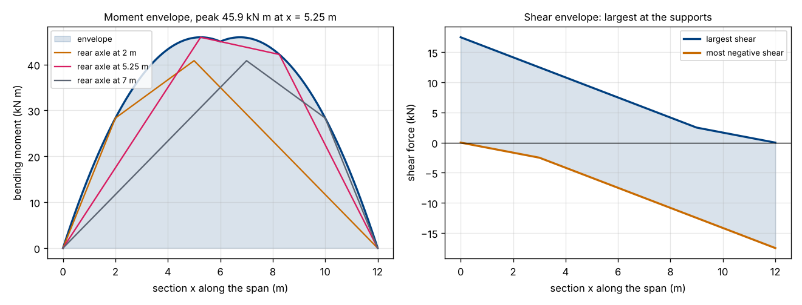
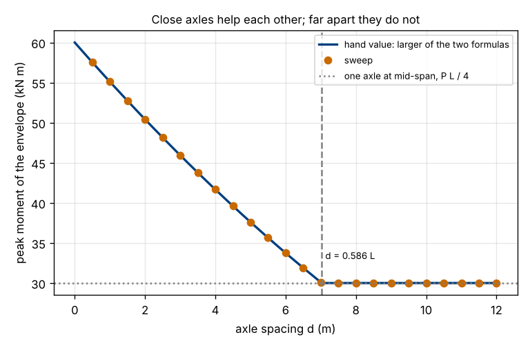

# Session 4: A load that moves: the envelope of shear and moment

*Level 3 (simulation and validation) · about 90 minutes · openbeam*

> This is a simplified educational model. It is not a validated design tool and must not be used for real structures, electrical installations, vehicles, industrial processes or medical decisions.

**Prerequisites**

- Session 1: reactions and bending moment of a simply supported beam.
- Session 2: second moment of area, deflection and stress.
- Session 3: the girder check (stress, deflection limit, factor of safety).

**Learning objectives.** After this session you can:

- Compute reactions, shear and bending moment for a group of point loads at any position on a simply supported span.
- Build the envelope (the worst shear and moment at every section) by sweeping the group across the span.
- Check the sweep against two independent routes: influence lines, and the "equal distance from mid-span" rule for the worst position.
- Explain why designing for one axle, or for all axles at mid-span, gives the wrong answer.
- Use the envelope to choose the lightest girder that passes a stress and a deflection limit.

## A. Real-world problem
A lorry crosses a bridge. The bending moment at mid-span is not one number: it changes as the axles roll along, and every section of the beam has its own worst moment at its own worst position. Designing for one fixed position goes wrong in two ways. Put all the axles at mid-span and the beam is too heavy, because the axles cannot all be there at once. Put only one axle there and the beam is too light, because the second axle also loads the span. The curve of the worst value at every section is called the *envelope*. This is a classroom model of the idea of an envelope; it is never a design tool for a real bridge.

## B. Concept and theory
Treat each axle as a point load P_i (N, downward) at distance x_i from the left support. Only axles on the span (0 <= x_i <= L) load it. For a simply supported span the reactions follow from moments about each support, and the shear and moment at a section are what is left of the loads on one side of it. The group is described by the position s of its rear axle, so axle i is at x_i = s + offset_i, and the envelope is the largest value over all s, section by section.

An independent route uses *influence lines*: the bending moment at section x caused by a unit load at position xi is a triangle, eta_M(x, xi) = xi (L - x) / L for xi <= x and x (L - xi) / L otherwise. The moment under a group is the sum of P_i eta_M(x, x_i). It gives the same answer as statics, built from a different picture.

A third route finds the worst position without any sweep. The largest moment under an axle occurs when that axle and the resultant of all the loads on the span sit at equal distances on either side of mid-span. For two equal axles P a distance d apart this gives

M_peak = P (L - d/2)^2 / (2 L), valid while d is at most 2 L (1 - 1/sqrt 2), about 0.586 L.

For larger d the second axle helps too little: the peak is one axle at mid-span, P L / 4.

| Symbol | Meaning | Unit |
|---|---|---|
| L | span between the supports | m |
| P, P_i | axle load (downward) | N |
| d | spacing between neighbouring axles | m |
| s | position of the rear axle from the left support | m |
| R_A, R_B | reactions at the left and right support | N |
| V(x), M(x) | shear and bending moment at section x | N, N m |
| eta_M(x, xi) | influence line: moment at x per unit load at xi | m |
| I, c | second moment of area, distance to the outer fibre | m^4, m |
| fos | factor of safety on yield | none |

**Assumptions**

- Simply supported, straight, elastic beam, small deflections.
- Point axle loads that roll with no impact, no braking and no sideways effects.
- The vehicle moves slowly enough that the loading is static at every position.
- Steel has E = 200 GPa, density 7850 kg/m^3, yield 250 MPa (teaching values). No lane loading, no load sharing between girders, no fatigue.

$$ R_A=\sum_i P_i\,\frac{L-x_i}{L},\qquad M(x)=R_A\,x-\sum_{x_i<x}P_i\,(x-x_i) $$

$$ \eta_M(x,\xi)=\begin{cases}\xi\,(L-x)/L & \xi\le x\\ x\,(L-\xi)/L & \xi>x\end{cases},\qquad M(x)=\sum_i P_i\,\eta_M(x,x_i) $$

$$ M_\mathrm{peak}=\frac{P\,(L-d/2)^{2}}{2L}\quad(d\le 0.586\,L),\qquad V_\mathrm{support}=\frac{P\,(2L-d)}{L} $$

## C. Visual explanation
The left figure shows the moment envelope for two 10 kN axles 3 m apart on a 12 m span. The three thin lines are snapshots of the moment diagram with the rear axle at 2 m, 5.25 m and 7 m: each snapshot is a polygon with a corner under each axle, and the envelope is the outline that just touches every possible snapshot. The peak is 45.9 kN m at x = 5.25 m (and, by symmetry, at 6.75 m). The right plot shows the shear envelope: the largest shear, 17.5 kN, is at the supports and the envelope falls steadily towards the other end of the span, where only the nearer axle can still matter. The second figure sweeps the axle spacing from 0 to 12 m. The dots from the full sweep sit on the hand formula, the peak falls from 60 kN m (the two loads touching) as the axles separate, and it levels off at 30 kN m once the spacing passes 0.586 L = 7.03 m.

*Left: moment envelope of two 10 kN axles 3 m apart on a 12 m span, with three snapshots. Right: shear envelope.*

*Peak moment against axle spacing: sweep (dots), hand formula (line) and the crossover at 0.586 L.*

## D. Interactive simulation
Run the lesson (`python start.py 4`), then open the live app: [Session 4: a load that crosses the beam](https://krunalpanchal1995.github.io/pan-iit-oss/openbeam/session-04/) (or `app.html` in this folder). Drag the vehicle position slider and watch the blue moment diagram move inside the grey envelope in the moment view. Change the number of axles and the spacing, then open the spacing view and see where your choice sits on the curve between "all axles at mid-span" and "one axle at mid-span".

**Challenge.** With two 10 kN axles on a 12 m span, space the axles so that the peak of the moment envelope is at most 40 kN m (the closest spacing that works is d = 4.4 m).

## E. Worked example and experiment
**Problem.** Two axles of 10 kN, 3 m apart, cross a simply supported span of L = 12 m. Find the largest bending moment and where it happens, then compare it with the two shortcuts (both axles at mid-span, one axle at mid-span).

1. The resultant is 20 kN, halfway between the axles, 1.5 m from each.
2. Worst position: an axle and the resultant at equal distances from mid-span. The resultant is d/2 = 1.5 m ahead of the rear axle, so the rear axle sits d/4 = 0.75 m to the left of mid-span: x = 6 - 0.75 = 5.25 m, and the front axle is at 8.25 m.
3. Reactions: R_A = 10 x (12 - 5.25)/12 + 10 x (12 - 8.25)/12 = 5.625 + 3.125 = 8.75 kN, so R_B = 20 - 8.75 = 11.25 kN.
4. Moment under the rear axle: M = R_A x 5.25 = 8.75 x 5.25 = 45.94 kN m. Under the front axle it is R_B x (12 - 8.25) = 11.25 x 3.75 = 42.19 kN m, smaller.
5. Same answer from the formula: P (L - d/2)^2 / (2 L) = 10 x 10.5^2 / 24 = 45.94 kN m.
6. Shortcuts: both axles at mid-span would give 2 x 10 x 12 / 4 = 60 kN m (31% too large, impossible), and one axle at mid-span gives 30 kN m (35% too small). The sweep in `lesson.py` gives 45.937 kN m at x = 5.25 m, the same to four digits.
7. Largest shear: rear axle at the left support gives R_A = P (2L - d)/L = 10 x 21/12 = 17.5 kN.

**Answer.** The envelope peaks at 45.9 kN m at x = 5.25 m (and 6.75 m), between the two shortcuts of 30 and 60 kN m; the largest shear is 17.5 kN at a support.

**Experiment.** Lay a metre ruler flat across two books 80 cm apart (the span). Put a small mass (a bag of coins, 200 g, say) on it and measure the sag at the middle against a second ruler held upright beside it, or from a phone photo. Do three runs: (a) one mass at mid-span, (b) two identical masses together at mid-span, (c) two masses 20 cm apart, centred. The mid-span deflection formula predicts that (b) sags twice as much as (a), and that (c) sags 1.83 times as much as (a): two loads spread apart load the middle less than two loads on top of each other, the same effect as in the moment envelope. A real ruler differs from the model because the books are not perfect knife edges, the ruler's own weight bends it, and a sag of a millimetre or two is hard to read: the model has ideal supports, point loads and a weightless beam.

## Real-world application and mini-project: Choose a girder for a crossing vehicle (classroom exercise only)
A 12 m span carries a vehicle with two 10 kN axles 3 m apart, a deck and girder dead load handled as 3 kN/m of deck on top of the girder's own weight, steel with E = 200 GPa and yield 250 MPa. Required: a factor of safety of 1.5 on yield (using the largest moment over all sections, envelope plus dead load) and a mid-span deflection of at most L/360 with the vehicle in its worst position. Use I-sections with flanges 150 mm x 10 mm and a web 6 mm thick, depths from 150 mm to 800 mm in 10 mm steps, with `lightest_depth` from `lesson.py`. Compare three designs: using the true envelope, using both axles at mid-span (the cautious shortcut) and using one axle at mid-span (the cheap shortcut), and check each against the true envelope. This is a teaching exercise: real bridges need codes, impact factors, lane loads, fatigue, buckling and a qualified engineer, and nothing here may be used to design or assess a real structure.

**Deliverable:** A script that prints, for depths 150 to 800 mm, the moment (kN m), the bending stress (MPa), the mid-span deflection (mm) and PASS or FAIL, then the lightest passing depth for each of the three designs with its mass per metre, and whether each one passes when checked against the true envelope.

**Success looks like:** The envelope design needs 370 mm (40.0 kg/m, stress 166.1 MPa, design moment 106.5 kN m). The both-axles-at-mid-span design needs 410 mm (41.9 kg/m), heavier for no reason. The one-axle design picks 350 mm (39.1 kg/m) but fails the true check at 177.8 MPa (x 1.5 = 267 MPa, over the 250 MPa yield). You can say which limit governs the 370 mm answer (stress; the 360 mm section fails on stress and passes on deflection).

## F. Assessment and design challenge
**Question type A: Conceptual.** Why does the envelope of bending moment under two moving axles lie below the moment you get with both axles at mid-span, and above the moment with just one axle at mid-span?

Hint

Ask whether both axles can stand at mid-span at the same time, and whether the second axle can be on the span without adding any load to it.

Step-by-step solution

Two axles a distance d apart cannot both be at mid-span, so "both at mid-span" (2 P L / 4) is a value the beam never meets: it is an upper bound that is too large. A single axle at mid-span gives P L / 4, but with a second axle on the span the reactions are larger and the moment under the nearer axle is larger than that, so one axle is a lower bound that is too small. The true envelope peak lies between them, and as the axles move apart it slides from the upper bound towards the lower one, reaching it at d = 0.586 L.

**Question type B: Numerical.** Two axles of 20 kN, 4 m apart, cross a simply supported span of L = 10 m. Find the largest bending moment, the rear axle position at which it happens, and the largest shear. Check with the hand formula.

Hint

Use M = P (L - d/2)^2 / (2 L) (check that d is below 0.586 L = 5.86 m), the rear axle at L/2 - d/4, and V = P (2L - d) / L.

Step-by-step solution

d = 4 m is below 5.86 m, so both axles matter. M = 20 x (10 - 2)^2 / (2 x 10) = 20 x 64 / 20 = 64 kN m. The rear axle is at 5 - 1 = 4 m (front axle at 8 m): check R_A = 20 x 6/10 + 20 x 2/10 = 16 kN and M = 16 x 4 = 64 kN m. Largest shear V = 20 x (20 - 4) / 10 = 32 kN with the rear axle at the support. Sanity: the shortcuts give 100 kN m (both at mid-span) and 50 kN m (one axle) and the answer is between them.

**Question type C: Graph and simulation interpretation.** In the spacing figure for two 10 kN axles on a 12 m span, read the peak moment at d = 2 m, and say where the curve becomes flat and why.

Hint

Evaluate P (L - d/2)^2 / (2 L) at d = 2, and find the d at which it falls to P L / 4.

Step-by-step solution

At d = 2 m: 10 x (12 - 1)^2 / 24 = 50.4 kN m, which matches the plot. The curve is flat at 30 kN m for d of about 7.03 m and above: setting (L - d/2)^2 / (2 L) = L / 4 gives L - d/2 = L / sqrt 2, so d = 2 L (1 - 1 / sqrt 2) = 0.586 L. Beyond that, putting the second axle on the span adds less moment than it costs by moving the first axle away from mid-span, so the worst case is a single axle at mid-span, P L / 4.

**Question type D: Design and optimisation challenge.** Design: the 12 m girder of the mini-project (flanges 150 x 10 mm, web 6 mm, deck 3 kN/m, factor of safety 1.5, deflection limit L/360). What is the lightest passing depth when you use the true envelope, and what does the "both axles at mid-span" shortcut cost in mass? Does the "one axle" shortcut produce a safe girder?

Hint

Use `lightest_depth(group, 12.0, 0.15, 0.010, 0.006, depths, deck_w=3000, fos=1.5)`; pass `fixed_moment` for the shortcuts, then check each answer with `check_girder` against the true envelope.

Step-by-step solution

Envelope: 370 mm, 40.0 kg/m, stress 166.1 MPa (x 1.5 = 249.2 MPa, just under 250). Both axles at mid-span: 410 mm, 41.9 kg/m, 1.9 kg/m (about 5%) heavier along the whole span for a load case that cannot occur. One axle: 350 mm, 39.1 kg/m, but the true stress is 177.8 MPa, which times 1.5 is 267 MPa, over the yield: not safe. The design changes little in mass but a lot in safety, which is the point: the saving from the unsafe shortcut is under 1 kg/m, the cost is a failed check.

Score yourself with [RUBRIC.md](../../RUBRIC.md). Print the [activity sheet](activity_sheet.md) to work on paper.

## Common misconceptions
| Common misconception | What is actually true |
|---|---|
| The worst moment happens with the heaviest axle at mid-span. | The worst moment is under an axle placed so that the axle and the resultant of all loads are the same distance either side of mid-span, which is not mid-span itself. |
| Designing for all the axles at mid-span is the safe way and costs nothing. | It is an impossible load case: it overstates the moment (60 against 45.9 kN m here) and makes every metre of the girder heavier. |
| One envelope number is enough for the whole beam. | Every section has its own worst position; the envelope is a curve, and shear and moment peak at different places (shear at the supports, moment near mid-span). |
| The worst deflection and the worst moment come at the same vehicle position. | Moment peaks with the pair slightly off-centre; mid-span deflection peaks with the pair centred. |

## Glossary
- **envelope**: the curve of the largest (and smallest) shear or moment at every section as the loads move
- **influence line**: the effect at one section of a unit load placed at each position along the beam
- **axle group**: the set of point loads of a vehicle with fixed spacings
- **resultant**: the single force equal to the sum of the loads, acting at their centre of load
- **dead load**: the load that stays put, such as the deck and the girder's own weight
- **live load**: the load that moves, such as a vehicle

## Finish
1. Do the three coding tasks in [exercises.md](exercises.md).
2. Run `python start.py 4` again after your changes. It ends with the checkpoint; when it prints `PASS`, you are done. (Checkpoint only: `python start.py check 4`.)

Next: the [roadmap](../../promo/roadmap.md). Session 5 is yours to build.
