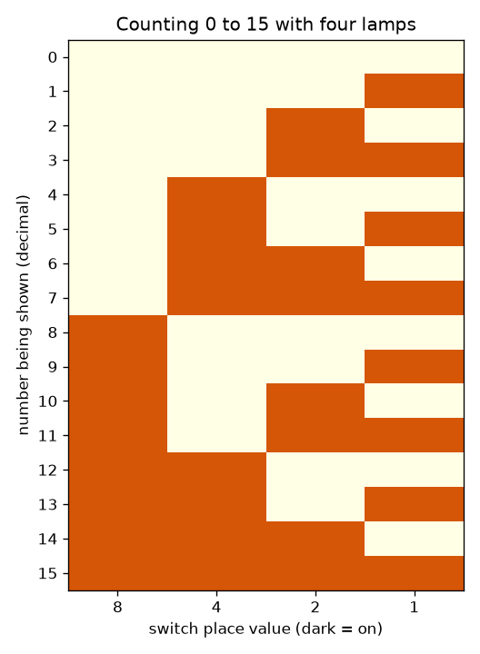
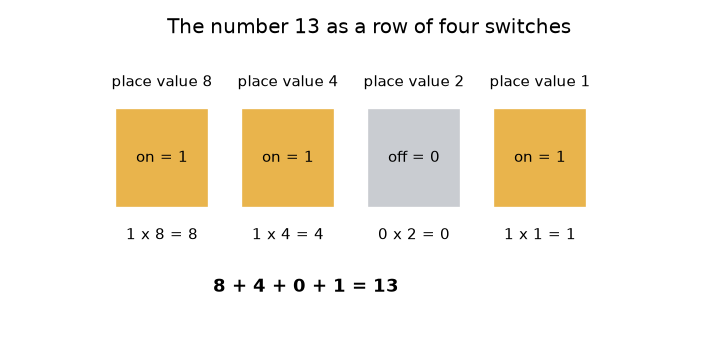

# सत्र 1: स्विच, लैंप और बाइनरी में गिनती

*स्तर 1 (वैचारिक इंटरैक्टिव मॉडल) · लगभग 60 मिनट · openbinary*

> यह एक सरलीकृत शैक्षिक मॉडल है। यह कोई प्रमाणित डिज़ाइन टूल नहीं है और इसका उपयोग वास्तविक संरचनाओं, बिजली की वायरिंग (electrical installations), वाहनों, औद्योगिक प्रक्रियाओं या चिकित्सा निर्णयों के लिए नहीं किया जाना चाहिए।

**पूर्व-आवश्यकताएँ (Prerequisites)**

- दशमलव (decimal) में पूर्ण संख्याएँ और स्थानीय मान (place value) (इकाई, दहाई, सैकड़ा)।
- आपने PRIMER.md पढ़ लिया है और एक बार `python start.py 1` चलाया है।

**सीखने के उद्देश्य (Learning objectives).** इस सत्र के बाद आप:

- समझा सकेंगे कि चालू/बंद (on/off) स्विचों की एक पंक्ति किसी संख्या को कैसे संग्रहीत कर सकती है।
- स्थानीय मानों का उपयोग करके स्विचों के किसी पैटर्न को दशमलव संख्या में बदल सकेंगे, और वापस भी।
- चार स्विचों पर 0 से 15 तक गिन सकेंगे और उस पैटर्न का वर्णन कर सकेंगे।
- बता सकेंगे कि n स्विच कितनी संख्याएँ रख सकते हैं, और जब गिनती सबसे बड़ी संख्या से आगे जाती है तो क्या होता है।

## A. वास्तविक दुनिया की समस्या
लाइट का स्विच या तो चालू होता है या बंद, बीच में कुछ नहीं। कंप्यूटर ऐसे बेहद अधिक स्विचों से बना होता है, फिर भी वह फ़ोटो, गाने और बैंक बैलेंस संग्रहीत करता है। जो चीज़ केवल 'चालू' और 'बंद' जानती है, वह 13 जैसी संख्या कैसे रख सकती है? यह सत्र चार लैंप और चार स्विचों से इसका उत्तर देता है। यह इस बात का एक सरलीकृत शैक्षिक मॉडल है कि पूर्ण संख्याएँ कैसे संग्रहीत होती हैं; वास्तविक कंप्यूटर यही विचार बहुत अधिक बिटों के साथ उपयोग करते हैं।

## B. अवधारणा और सिद्धांत
दशमलव संख्या 345 में हर अंक अपने दाईं ओर वाले अंक से दस गुना मूल्य का होता है: 3 सैकड़े, 4 दहाई, 5 इकाई। बाइनरी (binary) यही काम संख्या 2 के साथ करती है। एक *बिट (bit)* एक अंक है जो 0 (स्विच बंद) या 1 (स्विच चालू) होता है। चार बिटों के साथ स्थानों के मान बाएँ से दाएँ 8, 4, 2 और 1 होते हैं। संख्या उन स्विचों के स्थानीय मानों का योग है जो चालू हैं। इसलिए 1101 का अर्थ है 8 + 4 + 0 + 1 = 13। आप जो भी स्विच जोड़ते हैं वह पैटर्नों की संख्या को दोगुना कर देता है, क्योंकि हर पुराना पैटर्न अब नए स्विच के बंद या चालू होने के साथ आ सकता है। चार स्विच 16 पैटर्न बनाते हैं, जो 0 (सब बंद) से 15 (सब चालू) तक गिनते हैं। 15 में एक जोड़ने के लिए पाँचवें स्विच की ज़रूरत होगी; केवल चार के साथ, गिनती घूमकर 0 पर लौट आती है (wrap around)।

| प्रतीक | अर्थ | इकाई |
|---|---|---|
| b_k | स्विच संख्या k की स्थिति: 0 (बंद) या 1 (चालू) | कोई इकाई नहीं (एक बिट) |
| 2^k | स्विच k का स्थानीय मान | कोई इकाई नहीं |
| n | स्विचों (बिटों) की संख्या | गिनती |
| N | स्विचों द्वारा दिखाई गई पूर्ण संख्या | कोई इकाई नहीं |

**मान्यताएँ (Assumptions)**

- स्विच आदर्श हैं: हमेशा पूरी तरह चालू या पूरी तरह बंद।
- हम केवल 0 और उससे ऊपर की पूर्ण संख्याएँ संग्रहीत करते हैं (ऋणात्मक संख्याएँ सत्र 3 में आएँगी)।
- सबसे बाईं ओर का स्विच सबसे बड़ा स्थानीय मान है।

$$ N=\sum_{k=0}^{n-1} b_k\,2^{k} $$

$$ \text{number of patterns}=2^{n},\qquad \text{largest number}=2^{n}-1 $$

$$ 1101_2 = 1\cdot 8+1\cdot 4+0\cdot 2+1\cdot 1=13 $$

## C. दृश्य व्याख्या
पहला चित्र संख्या 13 को चार स्विचों के रूप में उनके स्थानीय मानों 8, 4, 2 और 1 के साथ दिखाता है: पहले, दूसरे और चौथे स्विच के ऊपर के लैंप चालू हैं, और नीचे योग 8 + 4 + 0 + 1 = 13 लिखा है। दूसरा चित्र 0 से 15 तक की पूरी गिनती तालिका है, हर संख्या के लिए एक पंक्ति और हर स्विच के लिए एक स्तंभ। दाईं ओर के स्तंभ को नीचे तक देखिए: यह हर पंक्ति में पलटता है। अगला स्तंभ हर दो पंक्तियों में पलटता है, फिर हर चार में, फिर हर आठ में, ठीक ओडोमीटर (odometer) के उन पहियों की तरह जिन पर केवल 0 और 1 अंक हों।

*0 से 15 तक गिनती: हर संख्या के लिए एक पंक्ति, गहरे वर्ग वे लैंप हैं जो चालू हैं।*

*संख्या 13 चार स्विचों के रूप में, स्थानीय मान 8, 4, 2, 1 के साथ।*

## D. इंटरैक्टिव सिमुलेशन
पाठ चलाइए (`python start.py 1`), फिर लाइव ऐप खोलिए: [सत्र 1: चार स्विच और चार लैंप](https://krunalpanchal1995.github.io/pan-iit-oss/openbinary/session-01/) (या इसी फ़ोल्डर में `app.html`)। चारों स्विच स्लाइडरों को पलटिए और लैंपों तथा योग को देखिए। फिर ग्राफ़ व्यू खोलिए और देखिए कि 0 से 15 तक की हर संख्या के लिए कितने लैंप चालू हैं।

**चुनौती।** लैंपों पर संख्या 13 दिखाइए (पैटर्न 1101)।

## E. हल किया गया उदाहरण और प्रयोग
**समस्या।** स्विच 1101 कौन-सी संख्या दिखाते हैं? फिर संख्या 12 को स्विचों के रूप में दिखाइए।

1. स्विचों के ऊपर स्थानीय मान लिखिए: 8, 4, 2, 1।
2. चालू स्विच पहला, दूसरा और चौथा हैं, इसलिए 8 + 4 + 1 जोड़िए और तीसरे के लिए 0 जोड़िए: 8 + 4 + 0 + 1 = 13।
3. 12 के लिए सबसे बड़ा स्थानीय मान लीजिए जो उसमें समा जाए: 8 समाता है (12 - 8 = 4), 4 समाता है (4 - 4 = 0), 2 और 1 नहीं।
4. इसलिए 12 है 8 + 4 = 1100 (पहला और दूसरा स्विच चालू)।
5. जाँच: 8 + 4 + 0 + 0 = 12।

**उत्तर।** 1101 संख्या 13 दिखाता है, और 12 को 1100 लिखा जाता है।

**प्रयोग।** चार छोटी वस्तुएँ लीजिए (उदाहरण के लिए चार सिक्के) और तय कीजिए कि चित (heads) का अर्थ चालू है। 1101 बिछाइए और किसी मित्र से संख्या पढ़ने को कहिए; फिर उनसे 9 दिखाने को कहिए। वास्तविक स्विच पूर्ण नहीं होते: एक यांत्रिक स्विच स्थिर होने से पहले टिमटिमा सकता है (इसे बाउंस (bounce) कहते हैं), और एक वास्तविक लैंप को जलने में समय लगता है। मॉडल मानता है कि हर स्विच तुरंत और साफ़-साफ़ 0 या 1 होता है।

## F. मूल्यांकन और डिज़ाइन चुनौती
**प्रश्न प्रकार A: वैचारिक।** एक और स्विच जोड़ने से अलग-अलग पैटर्नों की संख्या ठीक दोगुनी क्यों हो जाती है?

संकेत

हर वह पैटर्न लीजिए जो आपके पास पहले से था और पूछिए कि नया स्विच कितने तरीक़ों से सेट किया जा सकता है।

चरण-दर-चरण हल

हर पुराने पैटर्न को नए स्विच के बंद या चालू होने के साथ जोड़ा जा सकता है, जिससे हर पुराने पैटर्न के लिए दो नए पैटर्न मिलते हैं। चार स्विच 16 पैटर्न बनाते हैं, पाँच 32। इसलिए n स्विच 2^n पैटर्न बनाते हैं, और सबसे बड़ी संख्या 2^n - 1 है क्योंकि गिनती 0 से शुरू होती है।

**प्रश्न प्रकार B: संख्यात्मक।** स्विच 1011 को दशमलव संख्या के रूप में पढ़िए, और 12 को स्विचों के रूप में लिखिए। हर परिणाम की समझदारी से जाँच (sanity check) कीजिए।

संकेत

स्थानीय मान 8, 4, 2, 1 का उपयोग कीजिए।

चरण-दर-चरण हल

1011 = 8 + 0 + 2 + 1 = 11। 12 के लिए: 8 + 4 = 12, इसलिए पैटर्न 1100 है। समझदारी जाँच: 11, 15 (4 स्विचों पर सबसे बड़ी संख्या) से कम है और 1100 का योग वापस 12 आता है।

**प्रश्न प्रकार C: ग्राफ़ और सिमुलेशन की व्याख्या।** संख्या के सापेक्ष चालू लैंपों के ग्राफ़ में, 0 और 15 के बीच कितनी संख्याओं में ठीक दो लैंप चालू हैं? ग्राफ़ का सबसे ऊँचा बिंदु क्या है और वह कहाँ आता है?

संकेत

ऊँचाई 2 पर बिंदु गिनिए, और वह संख्या ढूँढिए जिसमें हर स्विच चालू हो।

चरण-दर-चरण हल

छह संख्याओं में ठीक दो लैंप चालू हैं: 3, 5, 6, 9, 10 और 12। ग्राफ़ 15 पर सबसे ऊँचा (4 लैंप) है, जहाँ हर स्विच चालू है, और 0 पर सबसे नीचा (0 लैंप)। ऊँचाई 0 से 4 पर गिनतियाँ 1, 4, 6, 4, 1 हैं।

**प्रश्न प्रकार D: डिज़ाइन और अनुकूलन (optimisation) चुनौती।** डिज़ाइन: एक हॉल में 0 से 99 तक क्रमांकित 100 सीटें हैं। एक संकेत-पट्ट (sign) को सीट संख्या लैंपों पर दिखानी है। लैंपों की सबसे छोटी संख्या क्या है? उससे अधिक लैंप उपयोग करने का एक समझौता (trade-off) बताइए।

संकेत

सबसे छोटा n ढूँढिए जिसके लिए 2^n कम से कम 100 हो।

चरण-दर-चरण हल

6 लैंप केवल 64 पैटर्न देते हैं, जो पर्याप्त नहीं है। 7 लैंप 128 पैटर्न देते हैं, जो 0 से 99 तक को ढक लेते हैं, इसलिए 7 लैंप पर्याप्त हैं और 7 सबसे छोटी संख्या है। 8 या अधिक लैंप उपयोग करने में अधिक पुर्ज़े और अधिक वायरिंग लगेगी जबकि केवल पैटर्न बर्बाद होंगे; कम उपयोग करना असंभव है। मान्यता: हर बिट के लिए एक लैंप और एक निश्चित, ज्ञात अधिकतम सीट संख्या।

[RUBRIC.md](../../RUBRIC.md) से स्वयं को अंक दीजिए। काग़ज़ पर काम करने के लिए [गतिविधि पत्रक (activity sheet)](activity_sheet.md) प्रिंट कीजिए।

## आम भ्रांतियाँ (Common misconceptions)
| आम भ्रांति | वास्तव में क्या सही है |
|---|---|
| बाइनरी एक अलग तरह की संख्या है। | यह वही संख्या है जो दूसरे तरीक़े से लिखी गई है। बाइनरी में 1101 और दशमलव में 13 एक ही मात्रा हैं। |
| बाइनरी में अंक 2 होता है। | बाइनरी अंक केवल 0 और 1 हैं; जब किसी स्थान पर 2 पहुँचने वाला हो तो आप अगले स्थान में हासिल (carry) ले जाते हैं, ठीक वैसे ही जैसे दशमलव में 9 + 1 पर हासिल जाता है। |
| सबसे बाईं ओर का स्विच 1 के बराबर है। | सबसे बायाँ सबसे बड़ा स्थान है (चार स्विचों पर 8); सबसे दायाँ 1 के बराबर है। |
| सबसे बड़ी संख्या से आगे गिनने पर एक बड़ी संख्या बनती है। | चार स्विच 16 नहीं दिखा सकते; गिनती घूमकर 0000 पर आ जाती है, ठीक कार के ओडोमीटर के पलट जाने की तरह। |

## शब्दावली (Glossary)
- **बिट (bit)**: एक बाइनरी अंक: 0 (बंद) या 1 (चालू)
- **बाइनरी (binary)**: केवल दो अंकों, 0 और 1, वाली संख्या पद्धति, जिसके स्थानीय मान 1, 2, 4, 8, ... हैं
- **स्थानीय मान (place value)**: कोई अंक अपनी जगह के कारण कितने मूल्य का है
- **पैटर्न (pattern)**: सभी स्विचों की एक विशेष सेटिंग
- **घूमकर लौटना (wrap around)**: सबसे बड़ी संख्या से आगे जाकर वापस 0 पर आ जाना

## समापन
1. [exercises.md](exercises.md) में दिए गए तीन कोडिंग कार्य कीजिए।
2. अपने बदलावों के बाद `python start.py 1` फिर से चलाइए। यह चेकपॉइंट (checkpoint) के साथ समाप्त होता है; जब यह `PASS` प्रिंट करे, तो आपका काम पूरा हुआ। (केवल चेकपॉइंट: `python start.py check 1`।)

आगे: [सत्र 2](../session-02/README.md)
