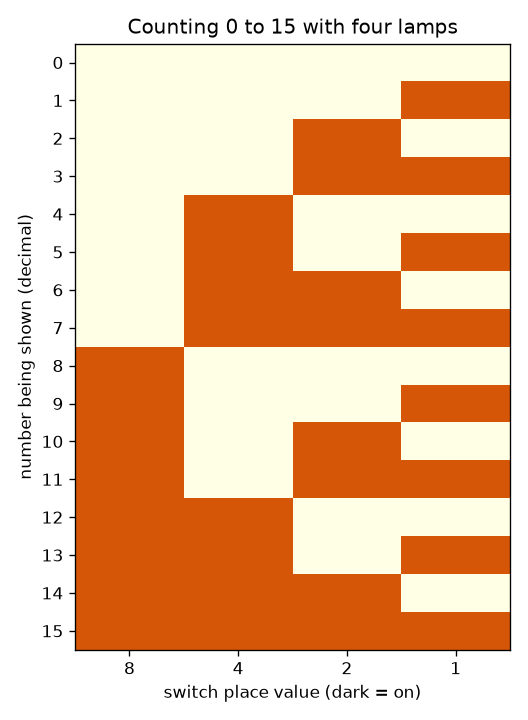
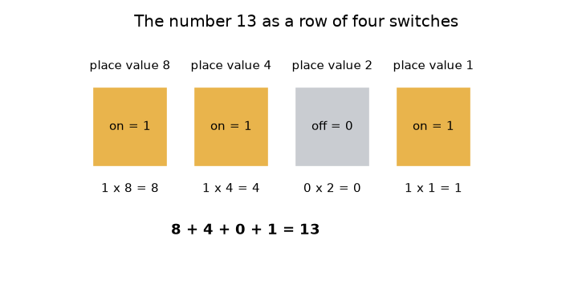

# സെഷൻ 1: സ്വിച്ചുകൾ, വിളക്കുകൾ, ബൈനറിയിൽ എണ്ണൽ

[Session 1 — हिन्दी](README.hi.md)

*ലെവൽ 1 (ആശയപരമായ ഇന്ററാക്ടീവ് മോഡൽ) · ഏകദേശം 60 മിനിറ്റ് · openbinary*

> ഇത് ലളിതമാക്കിയ ഒരു വിദ്യാഭ്യാസ മോഡൽ (educational model) ആണ്. ഇത് സാധൂകരിക്കപ്പെട്ട ഒരു ഡിസൈൻ ഉപകരണമല്ല; യഥാർത്ഥ നിർമ്മിതികൾ, വൈദ്യുത ഇൻസ്റ്റലേഷനുകൾ, വാഹനങ്ങൾ, വ്യാവസായിക പ്രക്രിയകൾ അല്ലെങ്കിൽ വൈദ്യശാസ്ത്ര തീരുമാനങ്ങൾ എന്നിവയ്ക്ക് ഇത് ഉപയോഗിക്കരുത്.

**മുൻ‌അറിവ് (Prerequisites)**

- പൂർണ്ണസംഖ്യകളും ദശാംശ രീതിയിലെ സ്ഥാനവിലയും (place value) (ഒന്നുകൾ, പത്തുകൾ, നൂറുകൾ).
- നിങ്ങൾ PRIMER.md വായിക്കുകയും `python start.py 1` ഒരിക്കൽ റൺ ചെയ്യുകയും ചെയ്തിട്ടുണ്ട്.

**പഠന ലക്ഷ്യങ്ങൾ (Learning objectives).** ഈ സെഷനു ശേഷം നിങ്ങൾക്ക് കഴിയും:

- ഓൺ/ഓഫ് സ്വിച്ചുകളുടെ ഒരു നിരയ്ക്ക് എങ്ങനെ ഒരു സംഖ്യ സൂക്ഷിക്കാം എന്ന് വിശദീകരിക്കാൻ.
- സ്ഥാനവിലകൾ ഉപയോഗിച്ച് സ്വിച്ചുകളുടെ ഒരു പാറ്റേണിനെ ദശാംശ സംഖ്യയാക്കാനും തിരിച്ചും മാറ്റാനും.
- നാല് സ്വിച്ചുകളിൽ 0 മുതൽ 15 വരെ എണ്ണാനും അതിലെ പാറ്റേൺ വിവരിക്കാനും.
- n സ്വിച്ചുകൾക്ക് എത്ര സംഖ്യകൾ സൂക്ഷിക്കാം എന്നും, എണ്ണം ഏറ്റവും വലിയ സംഖ്യ കടന്നാൽ എന്തു സംഭവിക്കും എന്നും പറയാൻ.

## A. യഥാർത്ഥ ജീവിതത്തിലെ പ്രശ്നം
ഒരു ലൈറ്റ് സ്വിച്ച് ഓൺ ആണ്, അല്ലെങ്കിൽ ഓഫ് ആണ്; ഇടയിൽ ഒന്നുമില്ല. ഒരു കമ്പ്യൂട്ടർ ഇത്തരം അനേകം സ്വിച്ചുകൾ കൊണ്ട് നിർമ്മിച്ചതാണ്, എന്നിട്ടും അത് ഫോട്ടോകളും പാട്ടുകളും ബാങ്ക് ബാലൻസുകളും സൂക്ഷിക്കുന്നു. 'ഓൺ', 'ഓഫ്' എന്നു മാത്രം അറിയാവുന്ന ഒന്നിന് 13 പോലൊരു സംഖ്യ എങ്ങനെ സൂക്ഷിക്കാൻ കഴിയും? നാല് വിളക്കുകളും നാല് സ്വിച്ചുകളും ഉപയോഗിച്ച് ഈ സെഷൻ അതിന് ഉത്തരം നൽകുന്നു. പൂർണ്ണസംഖ്യകൾ എങ്ങനെ സൂക്ഷിക്കപ്പെടുന്നു എന്നതിന്റെ ലളിതമാക്കിയ ഒരു വിദ്യാഭ്യാസ മോഡലാണിത്; യഥാർത്ഥ കമ്പ്യൂട്ടറുകൾ ഇതേ ആശയം വളരെയധികം ബിറ്റുകളോടെ ഉപയോഗിക്കുന്നു.

## B. ആശയവും സിദ്ധാന്തവും
ദശാംശ സംഖ്യ 345-ൽ ഓരോ അക്കത്തിനും അതിന്റെ വലതുവശത്തുള്ള അക്കത്തിന്റെ പത്തിരട്ടി വിലയുണ്ട്: 3 നൂറുകൾ, 4 പത്തുകൾ, 5 ഒന്നുകൾ. ബൈനറി (binary) ഇതുതന്നെ 2 എന്ന സംഖ്യ ഉപയോഗിച്ച് ചെയ്യുന്നു. ഒരു *ബിറ്റ് (bit)* എന്നത് 0 (സ്വിച്ച് ഓഫ്) അല്ലെങ്കിൽ 1 (സ്വിച്ച് ഓൺ) ആയ ഒരു അക്കമാണ്. നാല് ബിറ്റുകളിൽ ഇടത്തുനിന്ന് വലത്തോട്ട് സ്ഥാനങ്ങളുടെ വില 8, 4, 2, 1 ആണ്. ഓൺ ആയ സ്വിച്ചുകളുടെ സ്ഥാനവിലകളുടെ തുകയാണ് സംഖ്യ. അതിനാൽ 1101 എന്നാൽ 8 + 4 + 0 + 1 = 13. നിങ്ങൾ ചേർക്കുന്ന ഓരോ സ്വിച്ചും പാറ്റേണുകളുടെ എണ്ണം ഇരട്ടിയാക്കുന്നു, കാരണം ഓരോ പഴയ പാറ്റേണും ഇപ്പോൾ പുതിയ സ്വിച്ച് ഓഫ് ആയോ ഓൺ ആയോ വരാം. നാല് സ്വിച്ചുകൾ 16 പാറ്റേണുകൾ ഉണ്ടാക്കുന്നു, അവ 0 (എല്ലാം ഓഫ്) മുതൽ 15 (എല്ലാം ഓൺ) വരെ എണ്ണുന്നു. 15-നോട് ഒന്ന് കൂട്ടാൻ അഞ്ചാമതൊരു സ്വിച്ച് വേണം; നാലെണ്ണം മാത്രമുള്ളപ്പോൾ എണ്ണം ചുറ്റിത്തിരിഞ്ഞ് (wrap around) 0-ലേക്ക് തിരിച്ചെത്തുന്നു.

| ചിഹ്നം | അർത്ഥം | യൂണിറ്റ് |
|---|---|---|
| b_k | k-ാം നമ്പർ സ്വിച്ചിന്റെ അവസ്ഥ: 0 (ഓഫ്) അല്ലെങ്കിൽ 1 (ഓൺ) | യൂണിറ്റ് ഇല്ല (ഒരു ബിറ്റ്) |
| 2^k | സ്വിച്ച് k-യുടെ സ്ഥാനവില | യൂണിറ്റ് ഇല്ല |
| n | സ്വിച്ചുകളുടെ (ബിറ്റുകളുടെ) എണ്ണം | എണ്ണം |
| N | സ്വിച്ചുകൾ കാണിക്കുന്ന പൂർണ്ണസംഖ്യ | യൂണിറ്റ് ഇല്ല |

**അനുമാനങ്ങൾ (Assumptions)**

- സ്വിച്ചുകൾ ആദർശപരമാണ് (ideal): എപ്പോഴും പൂർണ്ണമായി ഓൺ അല്ലെങ്കിൽ പൂർണ്ണമായി ഓഫ്.
- 0 മുതൽ മുകളിലേക്കുള്ള പൂർണ്ണസംഖ്യകൾ മാത്രമേ നാം സൂക്ഷിക്കുന്നുള്ളൂ (നെഗറ്റീവ് സംഖ്യകൾ സെഷൻ 3-ൽ വരും).
- ഏറ്റവും ഇടത്തുള്ള സ്വിച്ചിനാണ് ഏറ്റവും വലിയ സ്ഥാനവില.

$$ N=\sum_{k=0}^{n-1} b_k\,2^{k} $$

$$ \text{number of patterns}=2^{n},\qquad \text{largest number}=2^{n}-1 $$

$$ 1101_2 = 1\cdot 8+1\cdot 4+0\cdot 2+1\cdot 1=13 $$

## C. ദൃശ്യ വിശദീകരണം
ആദ്യ ചിത്രം 13 എന്ന സംഖ്യയെ 8, 4, 2, 1 എന്ന സ്ഥാനവിലകളുള്ള നാല് സ്വിച്ചുകളായി കാണിക്കുന്നു: ഒന്നും രണ്ടും നാലും സ്വിച്ചുകൾക്കു മുകളിലുള്ള വിളക്കുകൾ ഓൺ ആണ്, താഴെ 8 + 4 + 0 + 1 = 13 എന്ന തുക എഴുതിയിരിക്കുന്നു. രണ്ടാമത്തെ ചിത്രം 0 മുതൽ 15 വരെയുള്ള മുഴുവൻ എണ്ണൽ പട്ടികയാണ്, ഓരോ സംഖ്യയ്ക്കും ഒരു വരി, ഓരോ സ്വിച്ചിനും ഒരു കോളം. വലതുവശത്തെ കോളം താഴേക്ക് നോക്കൂ: അത് ഓരോ വരിയിലും മാറുന്നു. അടുത്ത കോളം രണ്ട് വരി കൂടുമ്പോൾ മാറുന്നു, പിന്നെ നാല്, പിന്നെ എട്ട് — 0, 1 എന്നീ അക്കങ്ങൾ മാത്രമുള്ള ഒരു ഓഡോമീറ്ററിന്റെ (odometer) ചക്രങ്ങൾ പോലെ.

*0 മുതൽ 15 വരെ എണ്ണൽ: ഓരോ സംഖ്യയ്ക്കും ഒരു വരി, ഇരുണ്ട ചതുരങ്ങൾ ഓൺ ആയ വിളക്കുകളാണ്.*

*8, 4, 2, 1 സ്ഥാനവിലകളുള്ള നാല് സ്വിച്ചുകളായി 13 എന്ന സംഖ്യ.*

## D. ഇന്ററാക്ടീവ് സിമുലേഷൻ
പാഠം റൺ ചെയ്യുക (`python start.py 1`), എന്നിട്ട് ലൈവ് ആപ്പ് തുറക്കുക: [സെഷൻ 1: നാല് സ്വിച്ചുകളും നാല് വിളക്കുകളും](https://krunalpanchal1995.github.io/pan-iit-oss/openbinary/session-01/) (അല്ലെങ്കിൽ ഈ ഫോൾഡറിലെ `app.html`). നാല് സ്വിച്ച് സ്ലൈഡറുകൾ മാറ്റി വിളക്കുകളും തുകയും നിരീക്ഷിക്കുക. പിന്നെ ഗ്രാഫ് വ്യൂ തുറന്ന് 0 മുതൽ 15 വരെയുള്ള ഓരോ സംഖ്യയ്ക്കും എത്ര വിളക്കുകൾ ഓൺ ആണെന്ന് കാണുക.

**വെല്ലുവിളി.** വിളക്കുകളിൽ 13 എന്ന സംഖ്യ കാണിക്കുക (പാറ്റേൺ 1101).

## E. ഉദാഹരണവും പരീക്ഷണവും
**പ്രശ്നം.** 1101 എന്ന സ്വിച്ചുകൾ ഏത് സംഖ്യ കാണിക്കുന്നു? എന്നിട്ട് 12 എന്ന സംഖ്യ സ്വിച്ചുകളായി കാണിക്കുക.

1. സ്വിച്ചുകൾക്കു മുകളിൽ സ്ഥാനവിലകൾ എഴുതുക: 8, 4, 2, 1.
2. ഓൺ ആയ സ്വിച്ചുകൾ ഒന്നും രണ്ടും നാലുമാണ്, അതിനാൽ 8 + 4 + 1 കൂട്ടുക, മൂന്നാമത്തേതിന് 0 കൂട്ടുക: 8 + 4 + 0 + 1 = 13.
3. 12-ന് ഉൾക്കൊള്ളുന്ന ഏറ്റവും വലിയ സ്ഥാനവില എടുക്കുക: 8 ഉൾക്കൊള്ളുന്നു (12 - 8 = 4), 4 ഉൾക്കൊള്ളുന്നു (4 - 4 = 0), 2-ഉം 1-ഉം ഇല്ല.
4. അതിനാൽ 12 എന്നത് 8 + 4 = 1100 (ഒന്നും രണ്ടും സ്വിച്ച് ഓൺ).
5. പരിശോധന: 8 + 4 + 0 + 0 = 12.

**ഉത്തരം.** 1101 കാണിക്കുന്നത് 13 ആണ്, 12 എഴുതുന്നത് 1100 എന്നാണ്.

**പരീക്ഷണം.** നാല് ചെറിയ വസ്തുക്കൾ കണ്ടെത്തുക (ഉദാഹരണത്തിന് നാല് നാണയങ്ങൾ), തല (heads) എന്നാൽ ഓൺ എന്ന് തീരുമാനിക്കുക. 1101 നിരത്തി ഒരു സുഹൃത്തിനോട് സംഖ്യ വായിക്കാൻ പറയുക; എന്നിട്ട് 9 കാണിക്കാൻ പറയുക. യഥാർത്ഥ സ്വിച്ചുകൾ പൂർണ്ണമല്ല: ഒരു മെക്കാനിക്കൽ സ്വിച്ച് സ്ഥിരമാകുന്നതിനു മുമ്പ് ഇടയ്ക്കിടെ മിന്നിയേക്കാം (ഇതിനെ ബൗൺസ് (bounce) എന്ന് പറയുന്നു), ഒരു യഥാർത്ഥ വിളക്ക് കത്താൻ സമയമെടുക്കും. ഓരോ സ്വിച്ചും തൽക്ഷണം, വ്യക്തമായി 0 അല്ലെങ്കിൽ 1 ആണെന്ന് മോഡൽ അനുമാനിക്കുന്നു.

## F. വിലയിരുത്തലും ഡിസൈൻ വെല്ലുവിളിയും
**ചോദ്യ തരം A: ആശയപരം.** ഒരു സ്വിച്ച് കൂടി ചേർക്കുന്നത് വ്യത്യസ്ത പാറ്റേണുകളുടെ എണ്ണം കൃത്യമായി ഇരട്ടിയാക്കുന്നത് എന്തുകൊണ്ട്?

സൂചന

നിങ്ങൾക്ക് ഇതിനകം ഉണ്ടായിരുന്ന ഓരോ പാറ്റേണും എടുത്ത്, പുതിയ സ്വിച്ച് എത്ര രീതിയിൽ വയ്ക്കാം എന്ന് ചോദിക്കുക.

ഘട്ടം ഘട്ടമായുള്ള പരിഹാരം

ഓരോ പഴയ പാറ്റേണും പുതിയ സ്വിച്ച് ഓഫ് അല്ലെങ്കിൽ ഓൺ ആയി ചേർക്കാം, അത് ഓരോ പഴയതിനും രണ്ട് പുതിയ പാറ്റേണുകൾ നൽകുന്നു. നാല് സ്വിച്ചുകൾ 16 പാറ്റേണുകൾ, അഞ്ചെണ്ണം 32. അതിനാൽ n സ്വിച്ചുകൾ 2^n പാറ്റേണുകൾ ഉണ്ടാക്കുന്നു, എണ്ണൽ 0-ൽ നിന്ന് തുടങ്ങുന്നതിനാൽ ഏറ്റവും വലിയ സംഖ്യ 2^n - 1 ആണ്.

**ചോദ്യ തരം B: സംഖ്യാപരം.** 1011 എന്ന സ്വിച്ചുകൾ ഒരു ദശാംശ സംഖ്യയായി വായിക്കുക, 12-നെ സ്വിച്ചുകളായി എഴുതുക. ഓരോ ഫലവും യുക്തിപരമാണോ എന്ന് പരിശോധിക്കുക (sanity check).

സൂചന

8, 4, 2, 1 എന്ന സ്ഥാനവിലകൾ ഉപയോഗിക്കുക.

ഘട്ടം ഘട്ടമായുള്ള പരിഹാരം

1011 = 8 + 0 + 2 + 1 = 11. 12-ന്: 8 + 4 = 12, അതിനാൽ പാറ്റേൺ 1100 ആണ്. പരിശോധന: 11 എന്നത് 15-നു താഴെയാണ് (4 സ്വിച്ചുകളിലെ ഏറ്റവും വലുത്), 1100-ന്റെ തുക വീണ്ടും 12 ആകുന്നു.

**ചോദ്യ തരം C: ഗ്രാഫും സിമുലേഷനും വ്യാഖ്യാനിക്കൽ.** ഓൺ ആയ വിളക്കുകളും സംഖ്യയും തമ്മിലുള്ള ഗ്രാഫിൽ, 0 മുതൽ 15 വരെയുള്ള എത്ര സംഖ്യകൾക്ക് കൃത്യം രണ്ട് വിളക്കുകൾ ഓൺ ആണ്? ഗ്രാഫിലെ ഏറ്റവും ഉയർന്ന ബിന്ദു ഏതാണ്, അത് എവിടെയാണ്?

സൂചന

ഉയരം 2-ലുള്ള കുത്തുകൾ എണ്ണുക, എല്ലാ സ്വിച്ചും ഓൺ ആയ സംഖ്യ തിരയുക.

ഘട്ടം ഘട്ടമായുള്ള പരിഹാരം

ആറ് സംഖ്യകൾക്ക് കൃത്യം രണ്ട് വിളക്കുകൾ ഓൺ ആണ്: 3, 5, 6, 9, 10, 12. ഗ്രാഫ് ഏറ്റവും ഉയർന്നത് (4 വിളക്കുകൾ) 15-ലാണ്, അവിടെ എല്ലാ സ്വിച്ചും ഓൺ ആണ്; ഏറ്റവും താഴ്ന്നത് (0 വിളക്കുകൾ) 0-ലാണ്. ഉയരം 0 മുതൽ 4 വരെയുള്ള എണ്ണങ്ങൾ 1, 4, 6, 4, 1 ആണ്.

**ചോദ്യ തരം D: ഡിസൈനും ഒപ്റ്റിമൈസേഷൻ (optimisation) വെല്ലുവിളിയും.** ഡിസൈൻ: ഒരു ഹാളിൽ 0 മുതൽ 99 വരെ നമ്പറിട്ട 100 സീറ്റുകളുണ്ട്. ഒരു ബോർഡ് സീറ്റ് നമ്പർ വിളക്കുകളിൽ കാണിക്കണം. ഏറ്റവും കുറഞ്ഞ വിളക്കുകളുടെ എണ്ണം എത്ര? അതിലധികം വിളക്കുകൾ ഉപയോഗിക്കുന്നതിന്റെ ഒരു ട്രേഡ്-ഓഫ് (trade-off) പറയുക.

സൂചന

2^n കുറഞ്ഞത് 100 ആകുന്ന ഏറ്റവും ചെറിയ n കണ്ടെത്തുക.

ഘട്ടം ഘട്ടമായുള്ള പരിഹാരം

6 വിളക്കുകൾ 64 പാറ്റേണുകൾ മാത്രമേ നൽകൂ, അത് പോരാ. 7 വിളക്കുകൾ 128 പാറ്റേണുകൾ നൽകുന്നു, അത് 0 മുതൽ 99 വരെ ഉൾക്കൊള്ളുന്നു; അതിനാൽ 7 വിളക്കുകൾ മതി, 7 ആണ് ഏറ്റവും ചെറിയ എണ്ണം. 8-ഓ അതിലധികമോ വിളക്കുകൾ ഉപയോഗിച്ചാൽ കൂടുതൽ ഭാഗങ്ങൾക്കും വയറിംഗിനും ചെലവാകും, പാറ്റേണുകൾ പാഴാകുകയും ചെയ്യും; കുറച്ച് ഉപയോഗിക്കുന്നത് അസാധ്യവുമാണ്. അനുമാനം: ഓരോ ബിറ്റിനും ഒരു വിളക്ക്, പരമാവധി സീറ്റ് നമ്പർ സ്ഥിരവും അറിയപ്പെടുന്നതും.

[RUBRIC.md](../../RUBRIC.md) ഉപയോഗിച്ച് സ്വയം സ്കോർ ചെയ്യുക. പേപ്പറിൽ ചെയ്യാൻ [ആക്ടിവിറ്റി ഷീറ്റ്](activity_sheet.md) പ്രിന്റ് ചെയ്യുക.

## സാധാരണ തെറ്റിദ്ധാരണകൾ
| സാധാരണ തെറ്റിദ്ധാരണ | യഥാർത്ഥത്തിൽ ശരിയായത് |
|---|---|
| ബൈനറി വേറൊരു തരം സംഖ്യയാണ്. | അത് മറ്റൊരു രീതിയിൽ എഴുതിയ അതേ സംഖ്യയാണ്. ബൈനറിയിലെ 1101-ഉം ദശാംശത്തിലെ 13-ഉം ഒരേ അളവാണ്. |
| ബൈനറിയിൽ 2 എന്ന അക്കം ഉണ്ട്. | ബൈനറി അക്കങ്ങൾ 0-ഉം 1-ഉം മാത്രമാണ്; ഒരു സ്ഥാനം 2-ൽ എത്തുമ്പോൾ അടുത്ത സ്ഥാനത്തേക്ക് കൈമാറ്റം (carry) ചെയ്യുന്നു, ദശാംശത്തിൽ 9 + 1 കൈമാറ്റം ചെയ്യുന്നതുപോലെ. |
| ഏറ്റവും ഇടത്തുള്ള സ്വിച്ചിന്റെ വില 1 ആണ്. | ഏറ്റവും ഇടത്തുള്ളതാണ് ഏറ്റവും വലിയ സ്ഥാനം (നാല് സ്വിച്ചുകളിൽ 8); ഏറ്റവും വലത്തുള്ളതിന്റെ വില 1. |
| ഏറ്റവും വലിയ സംഖ്യ കടന്ന് എണ്ണിയാൽ ഇതിലും വലിയ സംഖ്യ കിട്ടും. | നാല് സ്വിച്ചുകൾക്ക് 16 കാണിക്കാൻ കഴിയില്ല; എണ്ണം 0000-ലേക്ക് ചുറ്റിത്തിരിയുന്നു, ഒരു കാറിന്റെ ഓഡോമീറ്റർ മറിയുന്നതുപോലെ. |

## പദാവലി (Glossary)
- **ബിറ്റ് (bit)**: ഒരു ബൈനറി അക്കം: 0 (ഓഫ്) അല്ലെങ്കിൽ 1 (ഓൺ)
- **ബൈനറി (binary)**: 0, 1 എന്നീ രണ്ട് അക്കങ്ങൾ മാത്രവും 1, 2, 4, 8, ... എന്ന സ്ഥാനവിലകളുമുള്ള സംഖ്യാ സമ്പ്രദായം
- **സ്ഥാനവില (place value)**: ഒരു അക്കം ഇരിക്കുന്ന സ്ഥാനം കാരണം അതിനുള്ള വില
- **പാറ്റേൺ (pattern)**: എല്ലാ സ്വിച്ചുകളുടെയും ഒരു പ്രത്യേക ക്രമീകരണം
- **ചുറ്റിത്തിരിയൽ (wrap around)**: ഏറ്റവും വലിയ സംഖ്യ കടന്ന് വീണ്ടും 0-ലേക്ക് തിരിച്ചെത്തൽ

## പൂർത്തിയാക്കുക
1. [exercises.md](exercises.md)-ലെ മൂന്ന് കോഡിംഗ് ടാസ്കുകൾ ചെയ്യുക.
2. മാറ്റങ്ങൾക്കു ശേഷം `python start.py 1` വീണ്ടും റൺ ചെയ്യുക. അത് ചെക്ക്‌പോയിന്റോടെ (checkpoint) അവസാനിക്കുന്നു; അത് `PASS` എന്ന് പ്രിന്റ് ചെയ്യുമ്പോൾ നിങ്ങൾ പൂർത്തിയാക്കി. (ചെക്ക്‌പോയിന്റ് മാത്രം: `python start.py check 1`.)

അടുത്തത്: [സെഷൻ 2](../session-02/README.md)
