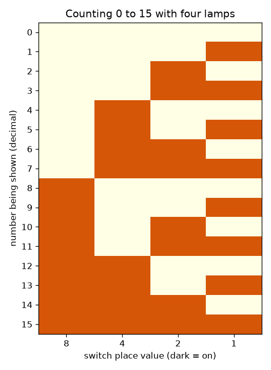
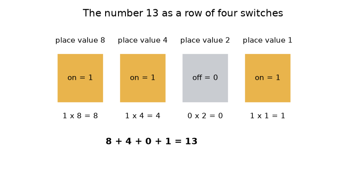

# அமர்வு 1: சுவிட்சுகள், விளக்குகள் மற்றும் பைனரியில் எண்ணுதல்

[Session 1 — हिन्दी](README.hi.md)

*நிலை 1 (கருத்தியல் ஊடாடும் மாதிரி) · சுமார் 60 நிமிடங்கள் · openbinary*

> இது எளிமைப்படுத்தப்பட்ட ஒரு கல்வி மாதிரி (educational model). இது சரிபார்க்கப்பட்ட வடிவமைப்புக் கருவி அல்ல; உண்மையான கட்டமைப்புகள், மின் நிறுவல்கள், வாகனங்கள், தொழில்துறை செயல்முறைகள் அல்லது மருத்துவ முடிவுகளுக்கு இதைப் பயன்படுத்தக் கூடாது.

**முன்தேவைகள் (Prerequisites)**

- முழு எண்களும் தசம முறையில் இட மதிப்பும் (place value) (ஒன்றுகள், பத்துகள், நூறுகள்).
- நீங்கள் PRIMER.md படித்து `python start.py 1` ஒருமுறை இயக்கியிருக்கிறீர்கள்.

**கற்றல் நோக்கங்கள் (Learning objectives).** இந்த அமர்வுக்குப் பிறகு உங்களால் முடியும்:

- ஆன்/ஆஃப் சுவிட்சுகளின் ஒரு வரிசை ஒரு எண்ணை எப்படிச் சேமிக்கும் என்பதை விளக்க.
- இட மதிப்புகளைப் பயன்படுத்தி சுவிட்சுகளின் ஒரு அமைப்பை (pattern) தசம எண்ணாகவும், மீண்டும் திருப்பியும் மாற்ற.
- நான்கு சுவிட்சுகளில் 0 முதல் 15 வரை எண்ணி, அதன் அமைப்பை விவரிக்க.
- n சுவிட்சுகள் எத்தனை எண்களை வைத்திருக்க முடியும், எண்ணிக்கை மிகப்பெரிய எண்ணைத் தாண்டினால் என்ன நடக்கும் என்று சொல்ல.

## A. நிஜ உலகப் பிரச்சினை
ஒரு விளக்கு சுவிட்ச் ஆன் அல்லது ஆஃப்; இடையில் எதுவும் இல்லை. ஒரு கணினி இத்தகைய மிகப்பெரிய எண்ணிக்கையிலான சுவிட்சுகளால் கட்டப்பட்டுள்ளது, இருந்தும் அது புகைப்படங்கள், பாடல்கள், வங்கி இருப்புகளைச் சேமிக்கிறது. 'ஆன்', 'ஆஃப்' மட்டுமே தெரிந்த ஒன்று 13 போன்ற ஒரு எண்ணை எப்படி வைத்திருக்க முடியும்? நான்கு விளக்குகள், நான்கு சுவிட்சுகள் கொண்டு இந்த அமர்வு அதற்குப் பதில் சொல்கிறது. முழு எண்கள் எப்படிச் சேமிக்கப்படுகின்றன என்பதன் எளிமைப்படுத்தப்பட்ட கல்வி மாதிரி இது; உண்மையான கணினிகள் இதே யோசனையை இன்னும் பல பிட்டுகளுடன் பயன்படுத்துகின்றன.

## B. கருத்தும் கோட்பாடும்
தசம எண் 345-இல் ஒவ்வொரு இலக்கமும் அதன் வலதுபுற இலக்கத்தைவிடப் பத்து மடங்கு மதிப்புடையது: 3 நூறுகள், 4 பத்துகள், 5 ஒன்றுகள். பைனரி (binary) இதையே 2 என்ற எண்ணைக் கொண்டு செய்கிறது. ஒரு *பிட் (bit)* என்பது 0 (சுவிட்ச் ஆஃப்) அல்லது 1 (சுவிட்ச் ஆன்) ஆக இருக்கும் ஒரு இலக்கம். நான்கு பிட்டுகளில் இடமிருந்து வலமாக இடங்களின் மதிப்பு 8, 4, 2, 1. ஆன் ஆக உள்ள சுவிட்சுகளின் இட மதிப்புகளின் கூட்டுத்தொகையே அந்த எண். எனவே 1101 என்றால் 8 + 4 + 0 + 1 = 13. நீங்கள் சேர்க்கும் ஒவ்வொரு சுவிட்சும் அமைப்புகளின் எண்ணிக்கையை இருமடங்காக்குகிறது, ஏனெனில் ஒவ்வொரு பழைய அமைப்பும் இப்போது புதிய சுவிட்ச் ஆஃப் அல்லது ஆன் உடன் வரலாம். நான்கு சுவிட்சுகள் 16 அமைப்புகளைத் தருகின்றன, அவை 0 (அனைத்தும் ஆஃப்) முதல் 15 (அனைத்தும் ஆன்) வரை எண்ணுகின்றன. 15-உடன் ஒன்றைக் கூட்ட ஐந்தாவது சுவிட்ச் தேவை; நான்கு மட்டுமே இருந்தால், எண்ணிக்கை சுற்றி (wrap around) 0-க்குத் திரும்புகிறது.

| குறியீடு | பொருள் | அலகு |
|---|---|---|
| b_k | k-ஆம் எண் சுவிட்சின் நிலை: 0 (ஆஃப்) அல்லது 1 (ஆன்) | அலகு இல்லை (ஒரு பிட்) |
| 2^k | சுவிட்ச் k-இன் இட மதிப்பு | அலகு இல்லை |
| n | சுவிட்சுகளின் (பிட்டுகளின்) எண்ணிக்கை | எண்ணிக்கை |
| N | சுவிட்சுகள் காட்டும் முழு எண் | அலகு இல்லை |

**அனுமானங்கள் (Assumptions)**

- சுவிட்சுகள் இலட்சியமானவை (ideal): எப்போதும் முழுமையாக ஆன் அல்லது முழுமையாக ஆஃப்.
- 0 முதல் மேல்நோக்கிய முழு எண்களை மட்டுமே நாம் சேமிக்கிறோம் (எதிர்ம எண்கள் அமர்வு 3-இல் வரும்).
- இடதுகோடி சுவிட்சுக்கே மிகப்பெரிய இட மதிப்பு.

$$ N=\sum_{k=0}^{n-1} b_k\,2^{k} $$

$$ \text{number of patterns}=2^{n},\qquad \text{largest number}=2^{n}-1 $$

$$ 1101_2 = 1\cdot 8+1\cdot 4+0\cdot 2+1\cdot 1=13 $$

## C. காட்சி விளக்கம்
முதல் படம் 13 என்ற எண்ணை 8, 4, 2, 1 இட மதிப்புகள் கொண்ட நான்கு சுவிட்சுகளாகக் காட்டுகிறது: முதல், இரண்டாவது, நான்காவது சுவிட்சுகளுக்கு மேலுள்ள விளக்குகள் ஆன், கீழே 8 + 4 + 0 + 1 = 13 என்ற கூட்டுத்தொகை எழுதப்பட்டுள்ளது. இரண்டாவது படம் 0 முதல் 15 வரையிலான முழு எண்ணும் அட்டவணை, ஒவ்வொரு எண்ணுக்கும் ஒரு வரிசை, ஒவ்வொரு சுவிட்சுக்கும் ஒரு நெடுவரிசை. வலதுபுற நெடுவரிசையைக் கீழ்நோக்கிப் பாருங்கள்: அது ஒவ்வொரு வரிசையிலும் மாறுகிறது. அடுத்த நெடுவரிசை இரண்டு வரிசைகளுக்கு ஒருமுறை மாறுகிறது, பிறகு நான்கு, பிறகு எட்டு — 0, 1 இலக்கங்கள் மட்டுமே உள்ள ஓடோமீட்டரின் (odometer) சக்கரங்களைப் போல.

*0 முதல் 15 வரை எண்ணுதல்: ஒவ்வொரு எண்ணுக்கும் ஒரு வரிசை, கருப்புச் சதுரங்கள் ஆன் ஆன விளக்குகள்.*

*8, 4, 2, 1 இட மதிப்புகள் கொண்ட நான்கு சுவிட்சுகளாக 13 என்ற எண்.*

## D. ஊடாடும் உருவகப்படுத்தல் (Interactive simulation)
பாடத்தை இயக்குங்கள் (`python start.py 1`), பிறகு நேரடிச் செயலியைத் திறக்கவும்: [அமர்வு 1: நான்கு சுவிட்சுகள், நான்கு விளக்குகள்](https://krunalpanchal1995.github.io/pan-iit-oss/openbinary/session-01/) (அல்லது இந்தக் கோப்புறையில் உள்ள `app.html`). நான்கு சுவிட்ச் ஸ்லைடர்களை மாற்றி விளக்குகளையும் கூட்டுத்தொகையையும் கவனியுங்கள். பிறகு வரைபடக் காட்சியைத் திறந்து 0 முதல் 15 வரையிலான ஒவ்வொரு எண்ணுக்கும் எத்தனை விளக்குகள் ஆன் என்று பாருங்கள்.

**சவால்.** விளக்குகளில் 13 என்ற எண்ணைக் காட்டுங்கள் (அமைப்பு 1101).

## E. தீர்க்கப்பட்ட எடுத்துக்காட்டும் சோதனையும்
**கணக்கு.** 1101 என்ற சுவிட்சுகள் எந்த எண்ணைக் காட்டுகின்றன? பிறகு 12 என்ற எண்ணைச் சுவிட்சுகளாகக் காட்டுங்கள்.

1. சுவிட்சுகளுக்கு மேல் இட மதிப்புகளை எழுதுங்கள்: 8, 4, 2, 1.
2. ஆன் ஆன சுவிட்சுகள் முதல், இரண்டாவது, நான்காவது; எனவே 8 + 4 + 1 கூட்டி, மூன்றாவதற்கு 0 சேர்க்கவும்: 8 + 4 + 0 + 1 = 13.
3. 12-க்குப் பொருந்தும் மிகப்பெரிய இட மதிப்பை எடுங்கள்: 8 பொருந்துகிறது (12 - 8 = 4), 4 பொருந்துகிறது (4 - 4 = 0), 2-உம் 1-உம் இல்லை.
4. எனவே 12 என்பது 8 + 4 = 1100 (முதல், இரண்டாவது சுவிட்ச் ஆன்).
5. சரிபார்ப்பு: 8 + 4 + 0 + 0 = 12.

**விடை.** 1101 காட்டுவது 13, 12 என்பது 1100 என எழுதப்படுகிறது.

**சோதனை.** நான்கு சிறிய பொருட்களை எடுங்கள் (உதாரணமாக நான்கு நாணயங்கள்), தலை (heads) என்றால் ஆன் என்று முடிவு செய்யுங்கள். 1101 என வைத்து ஒரு நண்பரிடம் எண்ணைப் படிக்கச் சொல்லுங்கள்; பிறகு 9-ஐக் காட்டச் சொல்லுங்கள். உண்மையான சுவிட்சுகள் சரியானவை அல்ல: ஒரு இயந்திர சுவிட்ச் நிலைபெறுவதற்கு முன் மினுமினுக்கலாம் (இது பவுன்ஸ் (bounce) எனப்படும்), உண்மையான விளக்கு எரிய நேரம் எடுக்கும். ஒவ்வொரு சுவிட்சும் உடனடியாகவும் தெளிவாகவும் 0 அல்லது 1 என்று மாதிரி அனுமானிக்கிறது.

## F. மதிப்பீடும் வடிவமைப்புச் சவாலும்
**கேள்வி வகை A: கருத்தியல்.** இன்னொரு சுவிட்சைச் சேர்ப்பது வெவ்வேறு அமைப்புகளின் எண்ணிக்கையைச் சரியாக இருமடங்காக்குவது ஏன்?

குறிப்பு

உங்களிடம் ஏற்கனவே இருந்த ஒவ்வொரு அமைப்பையும் எடுத்து, புதிய சுவிட்சை எத்தனை விதமாக வைக்கலாம் என்று கேளுங்கள்.

படிப்படியான தீர்வு

ஒவ்வொரு பழைய அமைப்பையும் புதிய சுவிட்ச் ஆஃப் அல்லது ஆன் உடன் இணைக்கலாம், இது ஒவ்வொரு பழையதற்கும் இரண்டு புதிய அமைப்புகளைத் தருகிறது. நான்கு சுவிட்சுகள் 16 அமைப்புகள், ஐந்து 32. எனவே n சுவிட்சுகள் 2^n அமைப்புகளைத் தருகின்றன, எண்ணுதல் 0-இல் தொடங்குவதால் மிகப்பெரிய எண் 2^n - 1.

**கேள்வி வகை B: எண்ணியல்.** 1011 என்ற சுவிட்சுகளைத் தசம எண்ணாகப் படியுங்கள், 12-ஐச் சுவிட்சுகளாக எழுதுங்கள். ஒவ்வொரு முடிவும் பொருத்தமானதா எனச் சரிபாருங்கள் (sanity check).

குறிப்பு

8, 4, 2, 1 இட மதிப்புகளைப் பயன்படுத்துங்கள்.

படிப்படியான தீர்வு

1011 = 8 + 0 + 2 + 1 = 11. 12-க்கு: 8 + 4 = 12, எனவே அமைப்பு 1100. சரிபார்ப்பு: 11 என்பது 15-க்குக் கீழே (4 சுவிட்சுகளில் மிகப்பெரியது), 1100-இன் கூட்டுத்தொகை மீண்டும் 12.

**கேள்வி வகை C: வரைபடம் மற்றும் உருவகப்படுத்தல் விளக்கம்.** ஆன் ஆன விளக்குகள் எதிர் எண் என்ற வரைபடத்தில், 0 முதல் 15 வரையிலான எத்தனை எண்களுக்குச் சரியாக இரண்டு விளக்குகள் ஆன்? வரைபடத்தின் உச்சப் புள்ளி எது, அது எங்கே நிகழ்கிறது?

குறிப்பு

உயரம் 2-இல் உள்ள புள்ளிகளை எண்ணுங்கள், எல்லா சுவிட்சுகளும் ஆன் ஆன எண்ணைத் தேடுங்கள்.

படிப்படியான தீர்வு

ஆறு எண்களுக்குச் சரியாக இரண்டு விளக்குகள் ஆன்: 3, 5, 6, 9, 10, 12. வரைபடம் 15-இல் மிக உயர்ந்தது (4 விளக்குகள்), அங்கு எல்லா சுவிட்சுகளும் ஆன்; 0-இல் மிகத் தாழ்ந்தது (0 விளக்குகள்). உயரம் 0 முதல் 4 வரையிலான எண்ணிக்கைகள் 1, 4, 6, 4, 1.

**கேள்வி வகை D: வடிவமைப்பு மற்றும் உகப்பாக்கம் (optimisation) சவால்.** வடிவமைப்பு: ஒரு அரங்கில் 0 முதல் 99 வரை எண்ணிடப்பட்ட 100 இருக்கைகள் உள்ளன. ஒரு பலகை இருக்கை எண்ணை விளக்குகளில் காட்ட வேண்டும். குறைந்தபட்ச விளக்குகளின் எண்ணிக்கை என்ன? அதைவிட அதிக விளக்குகளைப் பயன்படுத்துவதன் ஒரு பரிமாற்றத்தை (trade-off) குறிப்பிடுங்கள்.

குறிப்பு

2^n குறைந்தது 100 ஆகும் மிகச்சிறிய n-ஐக் கண்டறியுங்கள்.

படிப்படியான தீர்வு

6 விளக்குகள் 64 அமைப்புகளை மட்டுமே தருகின்றன, அது போதாது. 7 விளக்குகள் 128 அமைப்புகளைத் தருகின்றன, அது 0 முதல் 99 வரை உள்ளடக்குகிறது; எனவே 7 விளக்குகள் போதும், 7 தான் மிகச்சிறிய எண். 8 அல்லது அதற்கு மேற்பட்ட விளக்குகள் அதிக பாகங்களுக்கும் வயரிங்குக்கும் செலவாகும், அமைப்புகளை மட்டுமே வீணாக்கும்; குறைவாகப் பயன்படுத்துவது சாத்தியமில்லை. அனுமானம்: ஒரு பிட்டுக்கு ஒரு விளக்கு, அதிகபட்ச இருக்கை எண் நிலையானது, தெரிந்தது.

[RUBRIC.md](../../RUBRIC.md) கொண்டு உங்களை மதிப்பிடுங்கள். தாளில் செய்ய [செயல்பாட்டுத் தாள்](activity_sheet.md)-ஐ அச்சிடுங்கள்.

## பொதுவான தவறான கருத்துகள்
| பொதுவான தவறான கருத்து | உண்மையில் சரியானது |
|---|---|
| பைனரி என்பது வேறு வகையான எண். | இது வேறு விதமாக எழுதப்பட்ட அதே எண். பைனரியில் 1101-உம் தசமத்தில் 13-உம் ஒரே அளவு. |
| பைனரியில் 2 என்ற இலக்கம் உள்ளது. | பைனரி இலக்கங்கள் 0, 1 மட்டுமே; ஒரு இடம் 2-ஐ அடையும்போது அடுத்த இடத்திற்கு எடுத்துச் செல்கிறீர்கள் (carry), தசமத்தில் 9 + 1 எடுத்துச் செல்வதைப் போல. |
| இடதுகோடி சுவிட்சின் மதிப்பு 1. | இடதுகோடியே மிகப்பெரிய இடம் (நான்கு சுவிட்சுகளில் 8); வலதுகோடியின் மதிப்பு 1. |
| மிகப்பெரிய எண்ணைத் தாண்டி எண்ணினால் இன்னும் பெரிய எண் கிடைக்கும். | நான்கு சுவிட்சுகளால் 16-ஐக் காட்ட முடியாது; எண்ணிக்கை 0000-க்குச் சுற்றுகிறது, காரின் ஓடோமீட்டர் சுழன்று திரும்புவதைப் போலவே. |

## சொற்களஞ்சியம் (Glossary)
- **பிட் (bit)**: ஒரு பைனரி இலக்கம்: 0 (ஆஃப்) அல்லது 1 (ஆன்)
- **பைனரி (binary)**: 0, 1 என்ற இரண்டு இலக்கங்களும் 1, 2, 4, 8, ... என்ற இட மதிப்புகளும் மட்டுமே கொண்ட எண் முறை
- **இட மதிப்பு (place value)**: ஒரு இலக்கம் அமர்ந்திருக்கும் இடத்தின் காரணமாக அதற்குள்ள மதிப்பு
- **அமைப்பு (pattern)**: எல்லா சுவிட்சுகளின் ஒரு குறிப்பிட்ட நிலை
- **சுற்றி வருதல் (wrap around)**: மிகப்பெரிய எண்ணைத் தாண்டி மீண்டும் 0-க்கு வருதல்

## முடிவு
1. [exercises.md](exercises.md)-இல் உள்ள மூன்று நிரலாக்கப் பணிகளைச் செய்யுங்கள்.
2. உங்கள் மாற்றங்களுக்குப் பிறகு `python start.py 1` மீண்டும் இயக்குங்கள். அது சோதனைச் சாவடியுடன் (checkpoint) முடிகிறது; அது `PASS` என்று அச்சிடும்போது நீங்கள் முடித்துவிட்டீர்கள். (சோதனைச் சாவடி மட்டும்: `python start.py check 1`.)

அடுத்து: [அமர்வு 2](../session-02/README.md)
